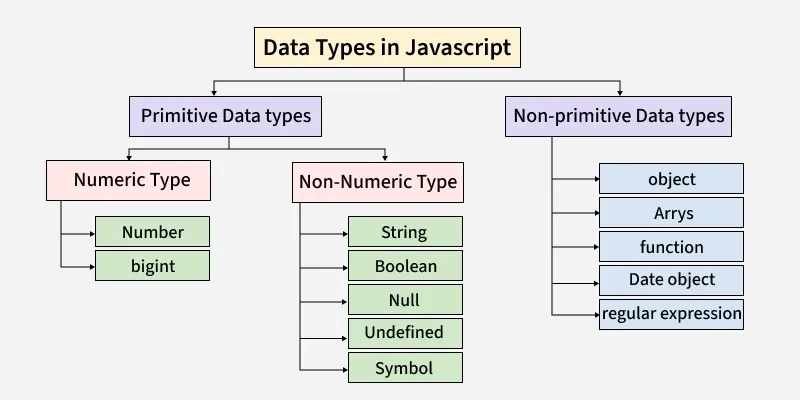

*Q1. What are the data types in JavaScript?*

JavaScript data types define what kind of values a variable can hold and how those values behave in a program. They determine how data is stored in memory and how operations like comparison, calculation, and conversion work.

- Each data type has its own methods and operations that control how it can be used.
- Understanding data types helps prevent errors and makes code more efficient and reliable.

JavaScript Data Type Categories
JavaScript data types are categorized into Primitive and Non-Primitive types



Primitive Data Type
Primitive data types in JavaScript represent simple, immutable values stored directly in memory, ensuring efficiency in both memory usage and performance.

1. Number
The Number data type in JavaScript includes both integers and floating-point numbers. Special values like Infinity, -Infinity, and NaN represent infinite values and computational errors, respectively.

2. String
A String in JavaScript is a series of characters that are surrounded by quotes.

3. Boolean
The boolean type has only two values i.e. true and false.

4. Null
The special null value does not belong to any of the default data types. It forms a separate type of its own which contains only the null value.

5. Undefined
A variable that has been declared but not initialized with a value is automatically assigned the undefined value. It means the variable exists, but it has no value assigned to it.

6. Symbol (Introduced in ES6)
Symbols, introduced in ES6, are unique and immutable primitive values used as identifiers for object properties. They help create unique keys in objects, preventing conflicts with other properties.

7. BigInt (Introduced in ES2020)
BigInt is a built-in object that provides a way to represent whole numbers greater than 253. The largest number that JavaScript can reliably represent with the Number primitive is 253, which is represented by the MAX_SAFE_INTEGER constant.

Non-Primitive Data Types
The data types that are derived from primitive data types are known as non-primitive data types. It is also known as derived data types or reference data types.

1. Object
JavaScript objects are key-value pairs used to store data, created with {} or the new keyword. They are fundamental as nearly everything in JavaScript is an object.

2. Arrays
An Array is a special kind of object used to store an ordered collection of values, which can be of any data type.

3. Function
A function in JavaScript is a block of reusable code designed to perform a specific task when called.

4. Date Object
The Date object in JavaScript is used to work with dates and times, allowing for date creation, manipulation, and formatting.

5. Regular Expression
A RegExp (Regular Expression) in JavaScript is an object used to define search patterns for matching text in strings

Interesting Facts about Data Types

1. Dynamically Typed : JavaScript Variables are not bound to a specific data type. Mainly data type is stored with value (not with variable name) and is decided & checked at run time.

2. Everything is an Object (Sort of): In JavaScript, Functions are objects, arrays are objects, and even primitive values can behave like objects temporarily when you try to access properties on them.

3.  NaN is not equal to itself: NaN Stands for “Not-a-Number”, It is used to represent a computational error. NaN is technically of type number.

4. A Symbol is Never Equal to Another One : Symbol is a unique and immutable data type often used for creating private properties and methods. Symbols are never equal to any other Symbol.

5. Undefined and Null: undefined represents a variable that has been declared but not assigned, while null is an explicit assignment representing “no value”.

6. Integers are Floating are Numbers only. There is only one type number that covers both integers and floating point numbers.

7. A character is also a string. There is no separate type for characters. A single character is also a string.

*Q2. What is the difference between var, let, and const?*

1. Var

Before the advent of ES6, var declarations ruled. There are issues associated with variables declared with var, though. That is why it was necessary for new ways to declare variables to emerge. First, let's get to understand var more before we discuss those issues.

# Scope of var

Scope essentially means where these variables are available for use. var declarations are globally scoped or function/locally scoped. The scope is global when a var variable is declared outside a function. This means that any variable that is declared with var outside a function block is available for use in the whole window. var is function scoped when it is declared within a function. This means that it is available and can be accessed only within that function.

To understand further, look at the example below.

var greeter = "hey hi";

function newFunction() {
   var hello = "hello";
}

Here, greeter is globally scoped because it exists outside a function while hello is function scoped. So we cannot access the variable hello outside of a function.

# Hoisting of var

Hoisting is a JavaScript mechanism where variables and function declarations are moved to the top of their scope before code execution. So var variables are hoisted to the top of their scope and initialized with a value of undefined.

This means that if we do this:

console.log (greeter);
var greeter = "say hello"

it is interpreted as this:

var greeter;
console.log(greeter); // greeter is undefined
greeter = "say hello"

2. Let

let is now preferred for variable declaration. It's no surprise as it comes as an improvement to var declarations.

# let is block scoped

- A block is a chunk of code bounded by {}. A block lives in curly braces. Anything within curly braces is a block. So a variable declared in a block with let is only available for use within that block.

# let can be updated but not re-declared.

Just like var, a variable declared with let can be updated within its scope. Unlike var, a let variable cannot be re-declared within its scope. So while this will work:

let greeting = "say Hi";
greeting = "say Hello instead";

this will return an error:

let greeting = "say Hi";
let greeting = "say Hello instead"; // error: Identifier 'greeting' has already been declared

However, if the same variable is defined in different scopes, there will be no error:

let greeting = "say Hi";
if (true) {
    let greeting = "say Hello instead";
    console.log(greeting); // "say Hello instead"
}
console.log(greeting); // "say Hi"

Why is there no error? This is because both instances are treated as different variables since they have different scopes. This fact makes let a better choice than var. When using let, you don't have to bother if you have used a name for a variable before as a variable exists only within its scope. Also, since a variable cannot be declared more than once within a scope, then the problem discussed earlier that occurs with var does not happen.

# Hoisting of let

Just like var, let declarations are hoisted to the top. Unlike var which is initialized as undefined, the let keyword is not initialized. So if you try to use a let variable before declaration, you'll get a Reference Error.

3. Const

Variables declared with the const maintain constant values. const declarations share some similarities with let declarations.

# const declarations are block scoped

Like let declarations, const declarations can only be accessed within the block they were declared.

# const cannot be updated or re-declared

This means that the value of a variable declared with const remains the same within its scope. It cannot be updated or re-declared. So if we declare a variable with const, we can neither do this:

const greeting = "say Hi";
greeting = "say Hello instead"; // error: Assignment to constant variable.

nor this:

const greeting = "say Hi";
const greeting = "say Hello instead";// error: Identifier 'greeting' has already been declared

Every const declaration, therefore, must be initialized at the time of declaration. This behavior is somehow different when it comes to objects declared with const. While a const object cannot be updated, the properties of this objects can be updated. Therefore, if we declare a const object as this: 

const greeting = {
     message: "say Hi",
     times: 4
}

while we cannot do this:

greeting = {
    words: "Hello",
    number: "five"
} // error:  Assignment to constant variable.

we can do this:   greeting.message = "say Hello instead";

This will update the value of greeting.message without returning errors.

# Hoisting of const
Just like let, const declarations are hoisted to the top but are not initialized.

*Q3. What is the Execution Context?*

When the JavaScript engine scans a script file, it makes an environment called the Execution Context that handles the entire transformation and execution of the code.

During the context runtime, the parser parses the source code and allocates memory for the variables and functions. The source code is generated and gets executed.

There are two types of execution contexts: global and function. The global execution context is created when a JavaScript script first starts to run, and it represents the global scope in JavaScript. A function execution context is created whenever a function is called, representing the function's local scope.

Phases of the JavaScript Execution Context
There are two phases of JavaScript execution context:

1. Creation phase: In this phase, the JavaScript engine creates the execution context and sets up the script's environment. It determines the values of variables and functions and sets up the scope chain for the execution context.

2. Execution phase: In this phase, the JavaScript engine executes the code in the execution context. It processes any statements or expressions in the script and evaluates any function calls.

Everything in JS happens inside this execution context. It is divided into two components. One is memory and the other is code. It is
important to remember that these phases and components are applicable to both global and functional execution contexts.

*Q4. What is the Call Stack?*

To keep the track of all the contexts, including global and functional, the JavaScript engine uses a call stack. A call stack is also known as an 'Execution Context Stack', 'Runtime Stack', or 'Machine Stack'.

It uses the LIFO principle (Last-In-First-Out). When the engine first starts executing the script, it creates a global context and pushes it on the stack. Whenever a function is invoked, similarly, the JS engine creates a function stack context for the function and pushes it to the top of the call stack and starts executing it.

When execution of the current function is complete, then the JavaScript engine will automatically remove the context from the call stack and it goes back to its parent.

Let's see the following example:

function funcA(m,n) {
    return m * n;
}

function funcB(m,n) {
    return funcA(m,n);
}

function getResult(num1, num2) {
    return funcB(num1, num2)
}

var res = getResult(5,6);

console.log(res); // 30

In this example, the JS engine creates a global execution context that enters the creation phase.

First it allocates memory for funcA, funcB, the getResult function, and the res variable. Then it invokes getResult(), which will be pushed on the call stack.

Then getResult() will call funcB(). At this point, funcB's context will be stored on the top of the stack. Then it will start executing and call another function funcA(). Similarly, funcA's context will be pushed.

Once execution of each function is done, it will be removed from the call stack.

Call Stack

The call stack has its own fixed size depending on the system or browser. If the number of contexts exceeds the limit, then a stack overflow error will occur. This happens with a recursive function that has no base condition.

*Q5. What is the event loop in JavaScript runtimes?*

The event loop lets a JavaScript agent coordinate asynchronous operations without blocking its currently executing stack. Each agent runs one JavaScript job at a time; workers use separate agents and event loops.

Parts of the event loop
To understand it better, we need to understand all the parts of the system. These components are part of the event loop:

Call stack
The call stack keeps track of the functions being executed in a program. When a function is called, it is added to the top of the call stack. When the function completes, it is removed from the call stack. This allows the program to keep track of where it is in the execution of a function and return to the correct location when the function completes. As the name suggests, it is a stack data structure which follows last-in-first-out.

Web APIs/Node.js APIs
Hosts such as browsers and Node.js manage timers, networking, and file I/O outside the currently executing JavaScript stack. The implementation varies: an operation may use operating-system facilities, an evented subsystem, or a worker pool rather than one new thread per operation. When work becomes ready, the host schedules the relevant task or microtask.

Task queue / Macrotask queue / Callback queue
Task queues hold tasks that are ready to run. Browsers may maintain multiple task queues and choose among eligible queues according to the HTML event loop rules; "macrotask queue" is convenient informal terminology, not the specification's single queue.

Microtasks queue
The microtask queue holds promise reactions, queueMicrotask() callbacks, and other microtasks. At a microtask checkpoint, it drains until empty, including newly added microtasks; an unbounded stream can starve later tasks.

Event loop order

1. The host selects and runs one task. Synchronous function calls made by that task are pushed onto and popped from the call stack.

2. Host facilities handle timers, networking, and I/O outside the active JavaScript stack. When their results become ready, they arrange for tasks or promise reactions to be queued.

3. When the task finishes, the runtime performs a microtask checkpoint and drains the microtask queue, including microtasks queued by other microtasks.
4. In a browser, the host may then update rendering. It selects another eligible task according to host-defined scheduling rules and repeats the cycle.

This model is deliberately simplified: browsers can have multiple task queues, and Node.js divides work into event-loop phases. The key ordering rule is that each completed task is followed by a microtask checkpoint before another task runs.

Example

The example below mixes synchronous logs with two timer callbacks and two promise callbacks. The first timer's callback enqueues a microtask, and the first promise callback enqueues another timer — small additions that exercise every ordering rule the event loop applies, while keeping each line individually trivial to read.

console.log('Start');

setTimeout(() => {
  console.log('Timeout 1');
  Promise.resolve().then(() => console.log('Promise 2'));
}, 0);

Promise.resolve().then(() => {
  console.log('Promise 1');
  setTimeout(() => console.log('Timeout 3'), 0);
});

setTimeout(() => console.log('Timeout 2'), 0);

console.log('End');

// Console output:
// Start
// End
// Promise 1
// Timeout 1
// Promise 2
// Timeout 2
// Timeout 3

Three rules the trace makes explicit:

- Microtasks drain before any macrotask. Step 6 runs Promise 1 before either timer, even though both timers were scheduled before the promise callback ran.

- A macrotask that schedules a microtask interleaves. Step 7 runs Timeout 1 and enqueues Promise 2; step 8 runs Promise 2 before the next macrotask, not after. The event loop re-checks the microtask queue between every macrotask, which is why a single drain at the end of synchronous code is not enough to model behavior correctly.

- A microtask that schedules a macrotask appends to the queue. Step 6 runs Promise 1 and schedules Timeout 3; Timeout 3 then runs last, after both timers that were already in the macrotask queue. Microtasks cannot promote a macrotask to the front of the line.

*Q6. Explain event delegation in JavaScript?*

Event delegation is a design pattern in JavaScript used to efficiently manage and handle events on multiple child elements by attaching a single event listener to a common ancestor element. This pattern is particularly valuable in scenarios where you have a large number of similar elements, such as list items, and want to optimize event handling.

How event delegation works

1. Attach a listener to a common ancestor: Instead of attaching individual event listeners to each child element, you attach a single event listener to a common ancestor element higher in the DOM hierarchy.

2. Event bubbling: When an event occurs on a child element, it bubbles up through the DOM tree to the common ancestor element. During this propagation, the event listener on the common ancestor can intercept and handle the event.

3. Determine the target: Within the event listener, you can inspect the event object to identify the actual target of the event (the child element that triggered the event). Use event.target to find which specific child element was interacted with. (event.currentTarget refers to the ancestor the listener is attached to, not the child that triggered the event.)

4. Perform action based on target: Based on the target element, you can perform the desired action or execute code specific to that element. This allows you to handle events for multiple child elements with a single event listener.

Benefits of event delegation

- Fewer listeners: Event delegation reduces listener bookkeeping and can reduce memory use when dealing with a very large number of elements.
- Dynamic elements: It works with dynamically added or removed child elements, as the common ancestor continues to listen for events on them.

Example

// HTML:
// <ul id="item-list">
//   <li>Item 1</li>
//   <li>Item 2</li>
//   <li>Item 3</li>
// </ul>

const itemList = document.getElementById('item-list');

itemList.addEventListener('click', (event) => {
  if (event.target.tagName === 'LI') {
    console.log(`Clicked on ${event.target.textContent}`);
  }
});

In this example, a single click event listener is attached to the <ul> element. When a click event occurs on an <li> element, the event bubbles up to the <ul> element, where the event listener checks the target's tag name to identify whether a list item was clicked. It's crucial to check the identity of the event.target as there can be other kinds of elements in the DOM tree.

*Q7. Explain how `this` works in JavaScript?*

There's no simple explanation for this; it is one of the most confusing concepts in JavaScript because its behavior differs from many other programming languages. The one-liner explanation of the this keyword is that it is a dynamic reference to the context in which a function is executed.

A longer explanation is that this follows these rules:

1. If the new keyword is used when calling the function, meaning the function was used as a function constructor, the this inside the function is the newly-created object instance.

2. If this is used in a class constructor, the this inside the constructor is the newly-created object instance.

3. If apply(), call(), or bind() is used to call/create a function, this inside the function is the object that is passed in as the argument.

4. If a function is called as a method (e.g. obj.method()) — this is the object that the function is a property of.

5. If a function is invoked as a free function invocation, meaning it was invoked without any of the conditions present above, this is the global object. In the browser, the global object is the window object. If in strict mode ('use strict';), this will be undefined instead of the global object.

6. If multiple of the above rules apply, the rule that is higher wins and will set the this value.

7. If the function is an ES2015 arrow function, it ignores all the rules above and receives the this value of its surrounding scope at the time it is created.

*Q8. Describe the difference between a cookie, `sessionStorage` and `localStorage` in browsers*

Cookies, localStorage, and sessionStorage are browser storage mechanisms. Client storage is useful for state such as themes, personalized layouts, draft form data, and identifiers needed by a server session. Sensitive authentication credentials require a threat-model-specific design; they should not be placed in Web Storage by default.

These client-side storage mechanisms have the following common properties:

- Client-side JavaScript can read and modify the values, except for HttpOnly cookies.
- Key-value based storage.
- They are only able to store values as strings. Non-strings will have to be serialized into a string (e.g. JSON.stringify()) in order to be stored.

Use cases for each storage mechanism

Since cookies have a relatively low maximum size, it is not advisable to store all your client-side data within cookies. The distinguishing properties about cookies are that cookies are sent to the server on every HTTP request so the low maximum size is a feature that prevents your HTTP requests from being too large due to cookies. Automatic expiry of cookies is a useful feature as well.

With that in mind, cookies suit small values that the server needs, such as opaque session identifiers, analytics identifiers, consent choices, or language preferences used during server rendering. Sensitive cookies can benefit from HttpOnly, Secure, and SameSite; Expires or Max-Age controls persistence. The server must still validate and authorize every request.

localStorage and sessionStorage both implement the Web Storage API interface. Their quota is browser-dependent and can be exceeded, so applications should handle QuotaExceededError. Values stored in Web Storage are not automatically sent with HTTP requests.

While you can manually include values from Web Storage when making AJAX/fetch() requests, the browser does not include them in the initial request / first load of the page. Hence Web Storage should not be used to store data that is relied on by the server for the initial rendering of the page if server-side rendering is being used (typically authentication/authorization-related information). localStorage is most suitable for user preferences data that do not expire, like themes and layouts (if it is not important for the server to render the final layout). sessionStorage is most suitable for temporary data that only needs to be accessible within the current browsing session, such as form data (useful to preserve data during accidental reloads).

Cookies

Cookies are used to store small pieces of data on the client side that can be sent back to the server with every HTTP request.

- Storage capacity: Limited to around 4 KB per cookie. Browsers also limit how many cookies can be stored per domain.

- Lifespan: Cookies can have a specific expiration date set using the Expires or Max-Age attributes. Without one, they are session cookies, although browsers may restore session cookies as part of session restore.

- Access: Cookies are domain-specific and can be shared across different pages and subdomains within the same domain.

- Security: Cookies can be marked as HttpOnly to prevent access from JavaScript, reducing the risk of XSS attacks. They can also be secured with the Secure flag to ensure they are sent only when HTTPS is used.

localStorage

localStorage is used for storing data that persists even after the browser is closed and reopened. It is designed for long-term storage of data.

- Storage capacity: Typically around 5MB per origin (varies by browser).

- Lifespan: Data in localStorage persists until explicitly deleted by the user or the application.

- Access: Data is accessible within all tabs and windows of the same origin.

- Security: All JavaScript on the page has access to values within localStorage.

sessionStorage

sessionStorage is used to store data for the duration of the page session. It is designed for temporary storage of data.

- Storage capacity: Typically around 5MB per origin (varies by browser).

- Lifespan: Data in sessionStorage is cleared when the page session ends (i.e., when the browser or tab is closed). Reloading the page does not destroy data within sessionStorage.

- Access: Data is accessible only within the current tab (or browsing context). Different tabs share different sessionStorage objects even if they belong to the same browser window. In this context, window refers to a browser window that can contain multiple tabs.

- Security: All JavaScript on the same page has access to values within sessionStorage for that page.

Beyond these three: IndexedDB and Cache Storage

Modern apps frequently need more than what these three APIs offer. Two more are worth knowing:

- IndexedDB: an in-browser, asynchronous, transactional database. Use it for large structured data (offline app state, large user-generated content, search indexes), MBs to GBs of storage, and queryable data. Wrappers like Dexie.js and idb make the API more pleasant.

- Cache Storage (caches): paired with Service Workers, this stores HTTP request/response pairs for offline-capable apps and PWAs. It is not a general-purpose key-value store; it is specifically for caching network responses.

- localStorage is for simple key-value config only. If you find yourself JSON-stringifying complex nested data into localStorage, IndexedDB is usually a better fit.

*Q9. What's the difference between a JavaScript variable that is: `null`, `undefined` or undeclared?*

# Undeclared

An undeclared identifier has no binding in the visible scope chain. Reading it directly throws ReferenceError. In sloppy-mode scripts, assigning to an unresolvable identifier can create a property on the global object; strict mode throws instead. Avoid relying on either behavior. typeof identifier is the one operation that returns 'undefined' for an undeclared identifier, though that same result cannot distinguish it from a declared value containing undefined.

function foo() {
  x = 1; // Throws a ReferenceError in strict mode
}

foo();
console.log(x); // 1 (if not in strict mode)

Using the typeof operator on undeclared variables will give 'undefined'.

console.log(typeof y === 'undefined'); // true

# undefined

A variable that is undefined is a variable that has been declared, but not assigned a value. It is of type undefined. If a function does not return a value, and its result is assigned to a variable, that variable will also have the value undefined. To check for it, compare using the strict equality (===) operator or typeof which will give the 'undefined' string. Note that you should not be using the loose equality operator (==) to check, as it will also return true if the value is null.

let foo;
console.log(foo); // undefined
console.log(foo === undefined); // true
console.log(typeof foo === 'undefined'); // true

console.log(foo == null); // true. Wrong, don't use this to check if a value is undefined!

function bar() {} // Returns undefined if there is nothing returned.
let baz = bar();
console.log(baz); // undefined

# null

A variable that is null will have been explicitly assigned to the null value. It represents no value and is different from undefined in the sense that it has been explicitly assigned. To check for null, simply compare using the strict equality operator. Note that like the above, you should not be using the loose equality operator (==) to check, as it will also return true if the value is undefined.

const foo = null;
console.log(foo === null); // true
console.log(typeof foo === 'object'); // true

console.log(foo == undefined); // true. Wrong, don't use this to check if a value is null!

*Q10. What's the difference between .call and .apply in JavaScript?*

Both .call and .apply are used to invoke functions, and the first parameter will be used as the value of this within the function. However, .call takes in comma-separated arguments as the next arguments, while .apply takes in an array of arguments as the next argument.

An easy way to remember this is C for call and comma-separated and A for apply and an array of arguments.

function add(a, b) {
  return a + b;
}

console.log(add.call(null, 1, 2)); // 3
console.log(add.apply(null, [1, 2])); // 3

With ES6 syntax, we can invoke call using an array along with the spread operator for the arguments.

function add(a, b) {
  return a + b;
}

console.log(add.call(null, ...[1, 2])); // 3

# Use cases

Context management

.call and .apply can set the this context explicitly when invoking methods on different objects.

const person = {
  name: 'John',
  greet() {
    console.log(`Hello, my name is ${this.name}`);
  },
};

const anotherPerson = { name: 'Alice' };

person.greet.call(anotherPerson); // Hello, my name is Alice
person.greet.apply(anotherPerson); // Hello, my name is Alice

Function borrowing

Both .call and .apply allow borrowing methods from one object and using them in the context of another. This is useful when passing functions as arguments (callbacks) and the original this context is lost. .call and .apply allow the function to be invoked with the intended this value.

function greet() {
  console.log(`Hello, my name is ${this.name}`);
}

const person1 = { name: 'John' };
const person2 = { name: 'Alice' };

greet.call(person1); // Hello, my name is John
greet.apply(person2); // Hello, my name is Alice

# Alternative syntax to call methods on objects

.apply can be used with object methods by passing the object as the first argument followed by the usual parameters.

const arr1 = [1, 2, 3];
const arr2 = [4, 5, 6];

Array.prototype.push.apply(arr1, arr2); // Same as arr1.push(4, 5, 6)

console.log(arr1); // [1, 2, 3, 4, 5, 6]

Deconstructing the above:

1. The first object, arr1 will be used as the this value.

2. .push() is called on arr1 using arr2 as an array of arguments because it's using .apply().

3. Array.prototype.push.apply(arr1, arr2) is equivalent to arr1.push(...arr2).

It may not be obvious, but Array.prototype.push.apply(arr1, arr2) mutates arr1. It's clearer to call methods using the OOP-centric way instead where possible.

*Q11. Event loop, microtasks and macrotasks. Predict the output order of a snippet mixing setTimeout, Promise.then, queueMicrotask, async/await and process.nextTick. Why do microtasks run before the next macrotask, and how can a microtask loop starve rendering?*

In JavaScript, the event loop coordinates synchronous code, asynchronous callbacks, and promise resolution. Understanding the execution order is important in React Native because blocking the JavaScript thread or continuously scheduling microtasks can delay user interactions and rendering.

**First, I understand the different queues.** Synchronous code executes first on the current call stack. After the stack finishes, JavaScript processes microtasks, such as `Promise.then()`, `queueMicrotask()`, and the continuation after `await` when its promise resolves. Timer callbacks, such as `setTimeout()`, are scheduled for later execution through the runtime's task or timer mechanism.

`process.nextTick()` is specific to Node.js. Its callbacks normally run before the regular promise microtask queue in Node.js, but it is not a standard browser or React Native API. Therefore, I distinguish Node.js event-loop behaviour from React Native's JavaScript runtime rather than assuming that every environment follows exactly the same rules.

**Second, consider this example in a Node.js environment:**

```javascript
console.log('1: Start');

setTimeout(() => {
  console.log('2: Timeout');
}, 0);

Promise.resolve().then(() => {
  console.log('3: Promise');
});

queueMicrotask(() => {
  console.log('4: QueueMicrotask');
});

process.nextTick(() => {
  console.log('5: NextTick');
});

async function run() {
  console.log('6: Async start');
  await Promise.resolve();
  console.log('7: Async end');
}

run();

console.log('8: End');
```

The expected output in a standard modern Node.js environment is:

```text
1: Start
6: Async start
8: End
5: NextTick
3: Promise
4: QueueMicrotask
7: Async end
2: Timeout
```

The reasoning is as follows:

- **Synchronous execution:** `Start`, `Async start`, and `End` execute immediately. Calling an async function runs its synchronous portion until it reaches `await`.
- **Next-tick queue:** After the current synchronous execution completes, Node.js processes `process.nextTick()` callbacks before draining the regular promise microtask queue in this example.
- **Promise microtasks:** The promise callback and `queueMicrotask()` callback run in their scheduling order. The resolved promise awaited by `run()` schedules its continuation as a microtask when execution reaches `await`.
- **Timer callback:** The `setTimeout()` callback runs later, after the synchronous execution and relevant microtasks have completed.

The exact ordering of `process.nextTick()` and promise callbacks depends on where they are scheduled and the runtime context. For example, callbacks scheduled inside an existing microtask can produce different relative ordering, so I would not apply this example as a universal rule to every Node.js scenario.

**Third, why do microtasks run before the next macrotask?** After a synchronous task completes, JavaScript normally drains the microtask queue before moving to another task, such as a timer callback. This ensures that promise continuations and other queued microtasks can complete their current chain of work before the runtime proceeds to later tasks.

In React Native, the precise scheduling details also depend on the JavaScript engine and native runtime integration, so I avoid treating browser, Node.js, and React Native scheduling as completely interchangeable.

**Fourth, how can a microtask loop starve rendering?** Consider this example:

```javascript
function repeatForever() {
  queueMicrotask(repeatForever);
}

repeatForever();
```

Each microtask schedules another microtask. Because the queue never becomes empty, the runtime may never reach a point where it can process other tasks normally. In a UI application, this can prevent the JavaScript thread from handling button presses, processing timers, or completing JavaScript-driven updates. Rendering may become delayed, and the application can appear frozen.

To avoid this, I do not schedule unbounded microtask chains. For large data-processing tasks, I divide work into smaller batches and yield to the runtime between batches, or move CPU-intensive work to an appropriate background execution mechanism. Simply replacing a loop with promises does not make the computation non-blocking.

**Finally, in a React Native interview, I connect this concept to practical performance.** If an API response contains thousands of records, parsing and processing the entire response synchronously can block JavaScript. Likewise, an endless promise chain can delay interaction handling even though the code appears asynchronous. I profile the operation, reduce unnecessary work, process data in manageable batches, and ensure the JavaScript thread has opportunities to handle user events.

Overall, the key distinction is that **asynchronous does not automatically mean non-blocking**. Microtasks generally run before the next regular task, and excessive microtask scheduling can starve other work, including UI-related JavaScript execution.

*Q12. Closures and scope in practice. Explain closures using a real bug: var in a loop with setTimeout. How does let fix it per iteration? Where do closures cause memory leaks (event handlers, caches), and how do you implement once, memoize and private state with them?*

A closure is created when a function remembers and retains access to variables from its lexical scope, even after the outer function has finished executing. In JavaScript, closures are useful for callbacks, event handlers, memoization, and encapsulating private state, but they can also introduce bugs when variable scope or object lifetimes are misunderstood.

**First, consider a common bug involving `var` and `setTimeout`.**

```javascript
for (var i = 0; i < 3; i++) {
  setTimeout(() => {
    console.log(i);
  }, 1000);
}
```

The output is:

```text
3
3
3
```

The reason is that `var` is function-scoped, not block-scoped. All three callbacks close over the same variable `i`. The loop finishes before the timer callbacks execute, so the shared variable has the value `3` when each callback reads it.

I can fix this by using `let`:

```javascript
for (let i = 0; i < 3; i++) {
  setTimeout(() => {
    console.log(i);
  }, 1000);
}
```

Now the output is:

```text
0
1
2
```

Unlike `var`, `let` is block-scoped, and a `let` declaration in a loop creates a separate binding for each iteration. Each callback therefore remembers its own iteration value.

**Second, closures can cause memory leaks.** For example, suppose a React Native screen registers an event listener that closes over a large object or component-related data. If the listener is never removed, the event emitter may continue referencing the callback, which in turn retains the captured data.

Similarly, an unbounded memoization cache can retain arguments and results indefinitely. The problem is not the closure itself; it is keeping references alive longer than necessary.

I prevent these issues by removing event listeners during `useEffect` cleanup, clearing timers, releasing subscriptions, and placing limits or eviction policies on caches when appropriate. I also avoid unnecessarily capturing large objects in long-lived callbacks.

**Third, I use closures to implement a `once` function.** The closure stores a private flag so that the wrapped function executes only once.

```javascript
function once(fn) {
  let called = false;
  let result;

  return function (...args) {
    if (!called) {
      called = true;
      result = fn.apply(this, args);
    }

    return result;
  };
}

const initialize = once(() => {
  console.log('Initialized');
  return true;
});

initialize(); // Logs "Initialized"
initialize(); // Does not execute again
```

Here, `called` and `result` remain accessible to the returned function even after `once()` finishes. This is useful for one-time initialization or preventing repeated execution of a particular operation. For asynchronous functions, I would also consider how rejected promises should be handled before marking the operation as permanently completed.

**Fourth, I use closures for memoization.** Memoization stores the results of previous function calls so that repeated calls with the same inputs can reuse the cached result.

```javascript
function memoize(fn) {
  const cache = new Map();

  return function (arg) {
    if (cache.has(arg)) {
      return cache.get(arg);
    }

    const result = fn.call(this, arg);
    cache.set(arg, result);

    return result;
  };
}

const square = memoize((n) => n * n);

console.log(square(5)); // 25
console.log(square(5)); // 25, returned from cache
```

The `cache` variable is private to the returned function. This example works for a single argument with suitable key semantics. For multiple arguments, I would use an appropriate composite-key strategy. In production, I would also consider cache size, eviction, and whether the function is pure, because memoization is only safe when reusing previous results preserves the intended behaviour.

**Fifth, closures provide private state without exposing internal variables.** For example:

```javascript
function createCounter() {
  let count = 0;

  return {
    increment() {
      count++;
      return count;
    },

    getValue() {
      return count;
    },
  };
}

const counter = createCounter();

console.log(counter.increment()); // 1
console.log(counter.increment()); // 2
console.log(counter.getValue());  // 2
```

The variable `count` cannot be accessed directly through the returned object. Only the exposed methods can read or modify it. Each call to `createCounter()` creates an independent counter with its own private state.

**Finally, I apply closures carefully in React Native.** Closures are common in event handlers and hooks, but they can capture outdated state if dependencies are incorrect. For example, a callback created inside `useEffect` with an empty dependency array may continue reading the initial value of a state variable. I address this using correct effect dependencies, functional state updates where appropriate, or refs when a callback needs access to the latest value without being recreated.

Overall, closures allow functions to retain access to their surrounding scope. Understanding lexical scope helps prevent `var`-related bugs, while careful lifecycle management, cache design, and hook dependencies help avoid memory leaks and stale-state problems.

*Q13. this binding. Walk through the four binding rules (default, implicit, explicit with call/apply/bind, new) plus arrow functions. What is this inside a callback passed to setTimeout or an array method, and why does a method extracted from an object lose its this?*

# `this` Binding in JavaScript

## One-line answer
`this` is not decided by where a function is **written**, but by **how it is called** (the call-site). The only exception is arrow functions, which take `this` from where they are **defined** (lexical).

---

## The 4 binding rules + arrow functions

### 1. Default binding (plain function call)
```js
function show() {
  console.log(this);
}
show();
```
- Non-strict mode: `this` is the global object (`window` in browsers, `globalThis` in Node).
- Strict mode: `this` is `undefined`.
- ES modules and class bodies are always strict, so you get `undefined` there.

### 2. Implicit binding (called as an object method)
```js
const user = {
  name: "Dev",
  greet() { console.log(this.name); }
};
user.greet(); // "Dev", because the object left of the dot is `this`
```
- Only the **immediate** object before the dot counts. In `a.b.c()`, `this` inside `c` is `b`, not `a`.

### 3. Explicit binding (`call`, `apply`, `bind`)
```js
function intro(city, country) {
  console.log(`${this.name} from ${city}, ${country}`);
}
const p = { name: "Dev" };

intro.call(p, "Delhi", "India");      // args passed one by one
intro.apply(p, ["Delhi", "India"]);   // args passed as an array
const bound = intro.bind(p, "Delhi"); // returns a NEW function, does not invoke
bound("India");
```
- `call` and `apply` invoke immediately. `bind` returns a new function.
- A bound function's `this` is permanent. Calling `.call()` on it again will not change it.
- `bind` also supports partial application (pre-filling arguments).

### 4. `new` binding (constructor call)
```js
function Person(name) {
  this.name = name;
}
const d = new Person("Dev");
```
`new` does four things:
1. Creates a fresh empty object.
2. Links its `[[Prototype]]` to `Person.prototype`.
3. Calls the function with `this` set to that new object.
4. Returns `this`, unless the constructor explicitly returns another **object**.

### Precedence (highest to lowest)
`new` > explicit (`call`/`apply`/`bind`) > implicit (`obj.method()`) > default

### 5. Arrow functions (not a "rule", they opt out of the rules)
```js
const obj = {
  name: "Dev",
  regular() {
    setTimeout(() => console.log(this.name), 100); // "Dev"
  }
};
```
- Arrows have **no own `this`**. They capture `this` from the enclosing scope when defined.
- `call`, `apply` and `bind` cannot change an arrow's `this`.
- They cannot be used with `new`, and they have no own `arguments`.
- Do not use an arrow as an object method if you need `this` to be the object. Its `this` will be the outer scope's, not the object.

---

## `this` inside a `setTimeout` callback
```js
const obj = {
  name: "Dev",
  start() {
    setTimeout(function () { console.log(this.name); }, 100);
  }
};
obj.start(); // undefined
```
- The callback is invoked later by the timer, not as `obj.something()`, so implicit binding does not apply. It falls to default binding.
- In browsers, `this` is the global `window`. In Node, `this` is the `Timeout` object. Either way, `this.name` is not what we wanted.
- Do not rely on what `this` is here. Fix it instead:
```js
setTimeout(() => console.log(this.name), 100);      // arrow, lexical this
setTimeout(function () { ... }.bind(this), 100);    // bind
const self = this; setTimeout(function () { self.name }, 100); // old-school closure
```

## `this` inside array method callbacks
```js
const team = {
  name: "Innov8",
  members: ["A", "B"],
  list() {
    this.members.forEach(function (m) {
      console.log(this.name, m); // `this` is NOT team
    });
  }
};
```
- `forEach`, `map`, `filter` and similar call the callback as a plain function, so default binding applies: `undefined` in strict mode, global in sloppy mode.
- Fixes:
```js
this.members.forEach(m => console.log(this.name, m));      // arrow (preferred)
this.members.forEach(function (m) { ... }, this);          // thisArg, 2nd parameter of forEach/map/filter
```
- `thisArg` exists on most array iteration methods but is rarely used today because arrows replaced it.

---

## Why does a method extracted from an object lose `this`?
```js
const user = {
  name: "Dev",
  greet() { console.log(this.name); }
};

const fn = user.greet; // just copies a reference to the function
fn();                  // undefined (or TypeError in strict mode)
```
**Reason:** a method is just a normal function that happens to be stored as a property. The function does not remember the object. `this` is resolved at call time from the call-site:
- `user.greet()` has an object before the dot, so implicit binding gives `this = user`.
- `fn()` is a bare call, so default binding gives global or `undefined`.

The same thing happens when you:
- pass a method as a callback: `setTimeout(user.greet, 100)` or `arr.map(user.greet)`
- destructure: `const { greet } = user`
- attach it as an event handler or pass it as a React prop (`onClick={this.handleClick}` in class components)

**Fixes:**
```js
const fn = user.greet.bind(user);          // 1. bind
setTimeout(() => user.greet(), 100);       // 2. wrapper arrow, keeps the call-site as user.greet()
class A {                                  // 3. class field arrow (common in React classes)
  handle = () => { console.log(this); };
}
```

---

## Common gotchas (interviewers like these)

1. Arrow as an object method: `{ name: "x", f: () => this.name }` gives `undefined`, because `this` is the outer/module scope.
2. Nested regular function inside a method loses `this`, since it is a plain call.
3. `bind` can only bind once. Re-binding a bound function is ignored.
4. `new` beats `bind`. `new boundFn()` still creates a new object and ignores the bound `this`.
5. In sloppy mode, `call(null)` or `call(undefined)` makes `this` the global object. In strict mode it stays `null`/`undefined`.
6. Event listeners: with `addEventListener("click", function () {})`, `this` is the element. With an arrow, it is the lexical `this`.

## 30-second spoken summary
"`this` depends on how a function is called, not where it is defined. There are four rules: default (global or `undefined` in strict mode), implicit (the object before the dot), explicit via `call`/`apply`/`bind`, and `new`, which creates a new object. Precedence is `new`, then explicit, then implicit, then default. Arrow functions don't have their own `this`; they use the one from the surrounding scope, which is why they work well for callbacks. A method pulled off an object loses `this` because the function doesn't remember its owner. Called bare, it goes through default binding. I fix that with `bind`, an arrow wrapper, or a class-field arrow."

*Q14. Prototypes and inheritance. How does the prototype chain resolve a property lookup? What does new do step by step? Compare Object.create, constructor functions and class (including super and private fields #x), and explain why class is not a different object model.*

# Prototypes and Inheritance in JavaScript

## One-line answer
Every object has an internal link `[[Prototype]]` to another object (or `null`). Property lookup walks that chain until it finds the property or reaches `null`. `class` is just cleaner syntax over this same mechanism, not a new object model.

---

## 1. How property lookup resolves

```js
const animal = { eats: true };
const dog = Object.create(animal);
dog.barks = true;

dog.barks;   // own property, found on dog
dog.eats;    // not on dog, found on animal via the chain
dog.fly;     // dog -> animal -> Object.prototype -> null, so undefined
```

**Read (get):**
1. Check the object's own properties.
2. If missing, go to `obj.[[Prototype]]` and repeat.
3. Stop at `null` and return `undefined`.

**Write (set):**
- `obj.x = 1` creates or updates an **own** property on `obj`. It does not modify the prototype.
- Exceptions: if a prototype has a setter for `x`, the setter is called. If `x` is a non-writable data property on the chain, the assignment fails silently (throws in strict mode).

**Other points:**
- `obj.hasOwnProperty("x")` or `Object.hasOwn(obj, "x")` checks only own properties. `"x" in obj` checks the whole chain.
- `for...in` iterates enumerable properties **including inherited** ones. `Object.keys` returns own only.
- `__proto__` is the accessor for `[[Prototype]]`. Prefer `Object.getPrototypeOf` and `Object.setPrototypeOf`.
- `Foo.prototype` is **not** the prototype of `Foo`. It is the object that becomes the `[[Prototype]]` of instances created with `new Foo()`.
- Changing a prototype after creation (`setPrototypeOf`) deoptimizes engines. Avoid it.

```js
function Foo() {}
const f = new Foo();
Object.getPrototypeOf(f) === Foo.prototype;       // true
Foo.prototype.constructor === Foo;                // true
Object.getPrototypeOf(Foo) === Function.prototype // true (Foo the function)
```

---

## 2. What `new` does, step by step

```js
function Person(name) { this.name = name; }
Person.prototype.hi = function () { return "hi " + this.name; };
const p = new Person("Dev");
```

1. Creates a new empty object `{}`.
2. Sets its `[[Prototype]]` to `Person.prototype`.
3. Calls `Person` with `this` bound to that new object.
4. If the function returns an **object**, that object is the result. Otherwise (no return, or a primitive) the new object is returned.

Hand-written equivalent (a classic interview ask):
```js
function myNew(Ctor, ...args) {
  const obj = Object.create(Ctor.prototype); // steps 1 and 2
  const result = Ctor.apply(obj, args);      // step 3
  return (result !== null && typeof result === "object") ||
         typeof result === "function"
    ? result : obj;                          // step 4
}
```
- Forgetting `new` on a constructor function runs it as a plain call, so `this` becomes global or `undefined` and you pollute globals or crash.
- `new.target` tells you inside a function whether it was called with `new`.

---

## 3. `Object.create` vs constructor functions vs `class`

### `Object.create(proto)`
```js
const base = { greet() { return "hi " + this.name; } };
const dev = Object.create(base, { name: { value: "Dev", enumerable: true } });
```
- Creates an object with the given prototype directly. No constructor runs.
- `Object.create(null)` gives a prototype-less object, useful as a pure dictionary with no inherited keys like `toString`.
- Simplest form of **delegation-based** inheritance.

### Constructor function + prototype (pre-ES6)
```js
function Animal(name) { this.name = name; }
Animal.prototype.speak = function () { return this.name + " makes a sound"; };

function Dog(name) { Animal.call(this, name); }          // inherit instance state
Dog.prototype = Object.create(Animal.prototype);         // inherit methods
Dog.prototype.constructor = Dog;                         // fix constructor
Dog.prototype.speak = function () {
  return Animal.prototype.speak.call(this) + " (woof)";  // manual "super"
};
```
- Lots of manual wiring: `call`, `Object.create`, resetting `constructor`.
- Methods on `prototype` are **shared** across instances (memory efficient). Methods defined inside the constructor via `this.fn = ...` are **per instance**.

### `class` (ES6)
```js
class Animal {
  #id = 1;                       // private field
  static count = 0;              // static field
  constructor(name) { this.name = name; Animal.count++; }
  speak() { return `${this.name} makes a sound`; }   // goes on Animal.prototype
  get id() { return this.#id; }
  #secret() { return "hidden"; } // private method
  static create(n) { return new this(n); }
}

class Dog extends Animal {
  constructor(name) {
    super(name);                 // MUST be called before using `this`
    this.type = "dog";
  }
  speak() { return super.speak() + " (woof)"; }
}
```

**`extends`** does two links:
- `Dog.prototype.__proto__ === Animal.prototype` (instance methods inherit)
- `Dog.__proto__ === Animal` (static members inherit)

**`super`:**
- `super(...)` calls the parent constructor. In a derived class, `this` does not exist until `super()` returns, otherwise you get a `ReferenceError`. (The parent constructs the object, and the child then initializes it.)
- `super.method()` looks up the method on the parent's prototype but calls it with the current `this`.
- Methods remember their home object via `[[HomeObject]]`, so `super` works lexically.

**Private fields `#x`:**
- Truly private, enforced by the language. Not accessible outside the class body, not via `obj["#x"]`, not via `Object.keys`, and not by subclasses.
- Accessing from outside is a **syntax error**, not just `undefined`.
- They are not properties and do not use the prototype chain. They are stored per instance and checked by "brand" (`#x in obj` tests if an object has it).
- Contrast with the `_x` convention, which is private by agreement only.
- Cost: no dynamic access, and Proxies cannot intercept them.

---

## 4. Why `class` is not a different object model

```js
class A { m() {} }
typeof A;                                         // "function"
Object.getPrototypeOf(A.prototype) === Object.prototype; // true
A.prototype.m === new A().m;                      // true, still shared via the chain
```

- A class **is** a function. It is a constructor function with better syntax.
- Methods are placed on `A.prototype`. Instances link to it via `[[Prototype]]`. Lookup uses the same chain walk.
- There is still no class-based copying of properties like in Java or C++. It is still **delegation** between objects.

**Differences (these are real, but they are guard rails, not a new model):**
| Aspect | Constructor function | `class` |
|---|---|---|
| Call without `new` | Works silently (bug) | Throws `TypeError` |
| Hoisting | Function declaration is hoisted | In TDZ like `let`, not usable before definition |
| Strict mode | Opt-in | Always strict inside class body |
| Methods enumerable | Yes (plain assignment) | No (non-enumerable) |
| Inheritance setup | Manual | `extends` / `super` |
| Private state | Closures only | `#fields` |
| Subclassing built-ins (`Array`, `Error`) | Awkward / broken | Works correctly |

---

## Common gotchas (interviewers like these)
1. `Foo.prototype` vs `Object.getPrototypeOf(foo)`: not the same thing as `Foo`'s own prototype.
2. Putting **mutable objects/arrays** on a prototype: all instances share and mutate the same one.
```js
Foo.prototype.items = [];   // shared across every instance, a classic bug
```
3. Arrow functions as class fields (`handle = () => {}`) are created **per instance**, not on the prototype. They fix `this` but cost memory and cannot be overridden via `super.handle()`.
4. Shadowing: setting `dog.speak = ...` hides the prototype's method for that instance only.
5. Using `this` before `super()` in a derived constructor throws `ReferenceError`.
6. `instanceof` checks whether `Ctor.prototype` appears anywhere in the object's chain. It is not about "who created it".
7. Composition over inheritance: deep chains are fragile. In modern code, mixins or composition are often preferred.

## 30-second spoken summary
"Every object has a hidden `[[Prototype]]` link. A property lookup checks the object itself, then walks up the chain until it finds the property or hits `null`. Writes always go on the object itself. `new` creates an empty object, links it to `Constructor.prototype`, runs the constructor with `this` set to that object, and returns it unless the constructor returns another object. `Object.create` sets the prototype directly with no constructor. Constructor functions need manual wiring for inheritance. `class` gives clean syntax with `extends`, `super` and truly private `#fields`, but under the hood a class is still a function, methods still live on `prototype`, and lookup is still the same prototype chain. The extra behaviours like required `new`, strict mode, non-enumerable methods and TDZ are safety features, not a new object model."

*Q15. Promises in depth. Implement your own Promise.all, allSettled, race and any semantics. What happens to an unhandled rejection? How do you run async tasks with a concurrency limit, and what is the difference between await in a loop and Promise.all?*

# Promises in Depth

## One-line answer
A promise is a one-time, immutable container for a future result. It is `pending`, then settles once to `fulfilled` or `rejected`, and `.then` callbacks always run asynchronously as microtasks. The combinators (`all`, `allSettled`, `race`, `any`) differ only in **when they settle** and **what they settle with**.

---

## Quick refresher (interviewers expect this first)
- States: `pending`, `fulfilled`, `rejected`. Once settled, it never changes.
- `.then(onFul, onRej)` returns a **new** promise, which is what makes chaining work.
- Returning a value from a handler fulfills the next promise. Returning a promise makes the next one **adopt** its state. Throwing rejects it.
- Handlers go on the **microtask queue**, which runs before the next macrotask (`setTimeout`, I/O).
- `Promise.resolve(x)` wraps non-promises and thenables, so `Promise.resolve(item)` is the standard way to normalise inputs.

---

## 1. Implementing the combinators

### `Promise.all` (all fulfil, or fail fast on first rejection)
```js
function myAll(iterable) {
  return new Promise((resolve, reject) => {
    const items = Array.from(iterable);
    const results = new Array(items.length);
    let remaining = items.length;

    if (remaining === 0) return resolve(results); // empty -> resolves with []

    items.forEach((item, i) => {
      Promise.resolve(item).then(value => {
        results[i] = value;                 // keep ORDER by index, not by finish time
        if (--remaining === 0) resolve(results);
      }, reject);                           // first rejection wins; later calls are no-ops
    });
  });
}
```
- Results keep **input order**, not completion order. Use the index, never `push`.
- A counter is used because `results.length` is wrong when slots fill out of order.
- Calling `reject` or `resolve` again after settling is silently ignored.

### `Promise.allSettled` (never rejects, waits for everything)
```js
function myAllSettled(iterable) {
  return new Promise(resolve => {
    const items = Array.from(iterable);
    const results = new Array(items.length);
    let remaining = items.length;

    if (remaining === 0) return resolve(results);

    const done = () => { if (--remaining === 0) resolve(results); };

    items.forEach((item, i) => {
      Promise.resolve(item).then(
        value  => { results[i] = { status: "fulfilled", value };  done(); },
        reason => { results[i] = { status: "rejected",  reason }; done(); }
      );
    });
  });
}
```

### `Promise.race` (first to settle, either way, wins)
```js
function myRace(iterable) {
  return new Promise((resolve, reject) => {
    for (const item of iterable) {
      Promise.resolve(item).then(resolve, reject);
    }
  });
}
```
- Empty iterable gives a promise that stays **pending forever**.
- Classic use: timeout pattern.
```js
const withTimeout = (p, ms) =>
  Promise.race([p, new Promise((_, rej) => setTimeout(() => rej(new Error("timeout")), ms))]);
```
- `race` does **not** cancel the losers. They keep running. Use `AbortController` for real cancellation.

### `Promise.any` (first **fulfilment** wins, rejects only if all reject)
```js
function myAny(iterable) {
  return new Promise((resolve, reject) => {
    const items = Array.from(iterable);
    const errors = new Array(items.length);
    let remaining = items.length;

    if (remaining === 0) {
      return reject(new AggregateError([], "All promises were rejected"));
    }

    items.forEach((item, i) => {
      Promise.resolve(item).then(resolve, err => {
        errors[i] = err;
        if (--remaining === 0) {
          reject(new AggregateError(errors, "All promises were rejected"));
        }
      });
    });
  });
}
```
- `any` is the mirror image of `all`: `all` needs every success, `any` needs one success.
- Failure value is an `AggregateError` with the individual reasons in `.errors`.

### Summary table
| Method | Resolves when | Rejects when | Empty input |
|---|---|---|---|
| `all` | all fulfil | first rejection | resolves `[]` |
| `allSettled` | all settle | never | resolves `[]` |
| `race` | first settle is a fulfilment | first settle is a rejection | pending forever |
| `any` | first fulfilment | all reject (`AggregateError`) | rejects `AggregateError` |

---

## 2. What happens to an unhandled rejection?

A rejected promise with no rejection handler attached by the time the engine checks (after the microtask queue drains) is an **unhandled rejection**.

```js
Promise.reject(new Error("boom")); // nobody handles it
```

**Browser**
- Fires `unhandledrejection` on `window`. The console logs "Uncaught (in promise)".
- If a handler is attached later, `rejectionhandled` fires.
```js
window.addEventListener("unhandledrejection", e => {
  console.error(e.reason);
  e.preventDefault(); // suppress default console error
});
```

**Node.js**
- Since **Node 15**, the default mode is `throw`: an unhandled rejection becomes an uncaught exception and **crashes the process** (exit code 1).
- Hook: `process.on("unhandledRejection", (reason, promise) => { ... })`. Use it for logging, not for swallowing errors.
- Attaching a handler late triggers `PromiseRejectionHandledWarning`.

**Common ways it sneaks in**
1. An `async` function called without `await` or `.catch`.
2. A `.then()` chain with no final `.catch()`.
3. `array.forEach(async ...)`: nobody awaits those promises, so errors are lost.
4. Creating promises early and awaiting them later:
```js
const a = fetchA();
const b = fetchB();      // may reject while we are still waiting on `a`
await a;                 // if b rejects now, it is "unhandled" until we reach `await b`
await b;
```
Fix: `await Promise.all([a, b])`, or attach handlers immediately.

**Good practice**
- End every chain with `.catch`, or use `try/catch` around `await`.
- In `Promise.all`, the extra rejections after the first are **not** reported as unhandled, because `all` already attached handlers to every input.
- Keep a global handler as a safety net that logs to a monitoring tool, but do not rely on it for control flow.

---

## 3. Running async tasks with a concurrency limit

Problem: 1000 API calls. `Promise.all(urls.map(fetch))` fires all at once, which causes rate limits, socket exhaustion and memory spikes.

**Worker-pool pattern** (most common interview answer):
```js
async function runWithLimit(tasks, limit) {
  // tasks: array of FUNCTIONS returning promises (not promises, which would already be running)
  const results = new Array(tasks.length);
  let next = 0;

  async function worker() {
    while (true) {
      const i = next++;                // safe: JS is single-threaded, no race here
      if (i >= tasks.length) return;
      results[i] = await tasks[i]();   // each worker handles one task at a time
    }
  }

  const workers = Array.from({ length: Math.min(limit, tasks.length) }, worker);
  await Promise.all(workers);
  return results;                      // order preserved by index
}

// usage
const tasks = urls.map(url => () => fetch(url).then(r => r.json()));
const data = await runWithLimit(tasks, 5);
```

**How it works**
- `limit` workers start. Each one pulls the next unclaimed index, awaits it, then pulls another.
- At most `limit` tasks are in flight at any moment. A slow task does not block the other workers.
- Tasks must be **thunks** (`() => promise`). If you pass already-created promises, they have already started.

**Design points to mention**
- **Error policy:** as written, the first failure rejects the whole run (fail-fast), but the other workers keep going. For "collect everything", wrap each task in `try/catch` and store `{ status, value | reason }`, or use `allSettled` semantics.
- **Cancellation:** pass an `AbortSignal` into tasks and stop workers when it aborts.
- **Retries and backoff** can be added inside the task function.
- **Alternatives:** batching with chunks (`for` loop of `Promise.all(slice)`) is simpler but wasteful, because each chunk waits for its slowest task. Libraries: `p-limit`, `p-queue`, `async.queue`.

---

## 4. `await` in a loop vs `Promise.all`

```js
// Sequential: each await blocks the next iteration
for (const id of ids) {
  results.push(await fetchUser(id));
}
// total time = t1 + t2 + t3 + ...

// Concurrent: all start immediately, then wait for all
const results = await Promise.all(ids.map(id => fetchUser(id)));
// total time = max(t1, t2, t3, ...)
```

| | `await` in loop | `Promise.all` |
|---|---|---|
| Execution | one at a time | all at once |
| Time | sum | max |
| Order of side effects | guaranteed | not guaranteed |
| Failure | stops at first failure, later tasks never start | rejects on first failure, others keep running (no cancel) |
| Resource use | low | can overload (use a limit) |

**Use sequential when:**
- Each step depends on the previous result.
- Order of side effects matters (DB migrations, writes to the same record).
- You must respect strict rate limits.

**Use `Promise.all` when** the tasks are independent. It is the right default for independent reads.

**Gotchas**
1. `forEach(async ...)` does **not** wait. Use `for...of` with `await`, or `Promise.all(arr.map(async ...))`.
2. `arr.map(async x => ...)` returns an array of promises. You still need `Promise.all` to unwrap it.
3. `Promise.all` is fail-fast but **not cancelling**. The other requests still complete in the background.
4. Awaiting inside `Promise.all` args is a mistake: `Promise.all([await a(), await b()])` is sequential again.
5. `await` of a non-promise still costs a microtask tick.
6. For "I need all results even if some fail", use `allSettled`, not `all`.

---

## 30-second spoken summary

"A promise settles once, and its handlers run as microtasks. `all` resolves with results in input order when everything fulfils and rejects on the first failure. `allSettled` always waits and reports status per item. `race` takes the first settlement, success or failure. `any` takes the first success and rejects with an `AggregateError` only if everything fails. I implement them by wrapping inputs in `Promise.resolve`, using an index to keep order and a counter to know when we're done. An unhandled rejection fires the `unhandledrejection` event in browsers and crashes the process in Node 15 and above, so I always end chains with `catch` and watch for `forEach(async)` and promises created early but awaited late. For concurrency limits I use a worker pool: N workers each pull the next task thunk, so at most N run at once and order is preserved by index. And `await` in a loop is sequential, so the total time is the sum, while `Promise.all` is concurrent, so the total time is the slowest task. I use the loop only when steps depend on each other, order matters, or I need to respect rate limits."

*Q16. Async error handling. Why does try/catch not catch an error thrown inside a setTimeout or a non-awaited promise? How do you propagate errors through promise chains, add retry with backoff, and cancel in-flight work with AbortController?*

# Async Error Handling in JavaScript

## One-line answer
`try/catch` only catches errors thrown **synchronously while its block is on the call stack**. Async work runs later on a fresh stack, after the `try` block has already exited, so the error has nowhere to go. In promise chains, errors travel as **rejections** through `.then` links until a `.catch` (or `try/catch` around an `await`) handles them.

---

## 1. Why `try/catch` misses errors in `setTimeout` and non-awaited promises

### `setTimeout`
```js
try {
  setTimeout(() => {
    throw new Error("boom");
  }, 0);
} catch (e) {
  console.log("caught"); // never runs
}
```
- `setTimeout` only **schedules** the callback and returns immediately.
- The `try` block finishes, and the call stack unwinds.
- Later, the event loop runs the callback on a **brand new stack**. The `try/catch` is no longer on it.
- Result: uncaught exception. Browser fires `window.onerror`. Node crashes the process (`uncaughtException`).

**Fix:** put the `try/catch` **inside** the callback.
```js
setTimeout(() => {
  try { riskyWork(); } catch (e) { handle(e); }
}, 0);
```

### Non-awaited promise
```js
try {
  Promise.reject(new Error("boom")); // or an async function call without await
} catch (e) {
  console.log("caught"); // never runs
}
```
- A promise does not **throw**. It **rejects**. A rejection is a state change, not a stack unwind.
- Without `await`, the `try` block exits before the rejection matters, so it is never rethrown into that block.
- Result: unhandled rejection (browser event, Node crash since v15).

```js
async function load() { throw new Error("boom"); }

try {
  load();          // returns a rejected promise, nothing thrown here
} catch {}         // never fires

try {
  await load();    // await unwraps the rejection and rethrows it at this point
} catch (e) {      // caught
  handle(e);
}
```
- `await` is what converts a rejection back into a thrown exception **inside the current async function**, so `try/catch` works.
- `return load()` inside a `try` also escapes `catch`. Use `return await load()` if you want the `catch` to handle it.
```js
async function a() {
  try { return load(); }        // rejection escapes try/catch
  catch (e) { /* not reached */ }
}
async function b() {
  try { return await load(); }  // caught here
  catch (e) { /* reached */ }
}
```

### Other related traps
- `new Promise(executor)`: a **synchronous** throw inside the executor is auto-converted to a rejection. A throw inside an async callback **within** the executor (for example inside `setTimeout`) is **not**.
```js
new Promise(() => { throw new Error("a"); });                 // becomes a rejection
new Promise(() => { setTimeout(() => { throw new Error("b"); }); }); // uncaught, not a rejection
```
- Event emitters and callbacks (Node style): errors arrive via the `error` argument or `'error'` event, not by throwing.
- `array.forEach(async fn)`: errors become unhandled rejections because nothing awaits them.

---

## 2. Propagating errors through promise chains

```js
fetchUser()
  .then(user => fetchOrders(user.id))   // throws or rejects -> skip to next catch
  .then(orders => process(orders))      // skipped
  .catch(err => { log(err); throw err; }) // handle, then rethrow to keep propagating
  .then(() => console.log("ok"))        // skipped because catch rethrew
  .catch(err => fallback())             // second catch handles it
  .finally(() => cleanup());            // always runs
```

**Rules**
1. A rejection or a throw inside any `.then` skips the following `.then` fulfilment handlers and goes to the nearest `.catch`.
2. `.catch(fn)` is sugar for `.then(undefined, fn)`.
3. If a `.catch` **returns a value**, the error is considered **recovered**, and the chain continues as fulfilled. If it **throws** (or returns a rejected promise), the error keeps propagating.
4. `.finally(fn)` runs on both outcomes, receives no arguments and does not change the result, unless it throws or rejects.
5. **Always `return` the inner promise** in a `.then`, otherwise the chain does not wait for it and its errors are not propagated.
```js
.then(user => { fetchOrders(user.id); })        // bug: forgot return, error lost
.then(user => fetchOrders(user.id))             // correct
```

**Async/await equivalent**
```js
async function run() {
  try {
    const user = await fetchUser();
    const orders = await fetchOrders(user.id);
    return process(orders);
  } catch (err) {
    log(err);
    throw err;            // rethrow so the caller can decide
  } finally {
    cleanup();
  }
}
```

**Good practices**
- Handle errors where you can do something useful (retry, fallback, show UI). Otherwise let them bubble.
- Do not swallow errors with an empty `catch`.
- Throw `Error` objects (stack trace, `name`), not strings.
- Preserve context with `new Error("msg", { cause: err })` (ES2022).
- Distinguish error types (`instanceof`, custom error classes, `err.name`, status codes) so you only retry the retryable ones.

---

## 3. Retry with backoff

```js
const sleep = (ms, signal) =>
  new Promise((resolve, reject) => {
    if (signal?.aborted) return reject(signal.reason);
    const id = setTimeout(resolve, ms);
    signal?.addEventListener("abort", () => {
      clearTimeout(id);
      reject(signal.reason);
    }, { once: true });
  });

async function retry(fn, {
  retries = 3,
  baseDelay = 200,
  maxDelay = 5000,
  shouldRetry = () => true,
  signal,
} = {}) {
  let attempt = 0;
  while (true) {
    try {
      return await fn(attempt, signal);
    } catch (err) {
      if (signal?.aborted) throw err;                       // do not retry after cancel
      if (attempt >= retries || !shouldRetry(err)) throw err;

      const exp = Math.min(maxDelay, baseDelay * 2 ** attempt); // exponential
      const delay = Math.random() * exp;                        // full jitter
      await sleep(delay, signal);
      attempt++;
    }
  }
}

// usage
const data = await retry(
  (_, signal) => fetch("/api/data", { signal }).then(r => {
    if (!r.ok) throw Object.assign(new Error("HTTP " + r.status), { status: r.status });
    return r.json();
  }),
  { retries: 4, shouldRetry: e => e.status >= 500 || e.name === "TypeError" }
);
```

**Points to mention**
- **Exponential backoff:** delay doubles each attempt (200, 400, 800, ...), so you do not hammer a struggling server.
- **Jitter:** randomise the delay so many clients do not retry at the same instant (thundering herd).
- **Cap** the delay (`maxDelay`) and the attempts.
- **Only retry transient errors:** network failures, `5xx`, `429` (respect `Retry-After`). Do not retry `4xx` validation or auth errors.
- **Idempotency:** only retry safe operations (GET, or POST with an idempotency key), otherwise you may double-charge or double-create.
- The backoff sleep must be abortable, otherwise cancelling still waits for the timer.
- `fetch` does **not** reject on HTTP error statuses. It only rejects on network failure. Check `response.ok`.

---

## 4. Cancelling in-flight work with `AbortController`

```js
const controller = new AbortController();
const { signal } = controller;

fetch("/api/slow", { signal })
  .then(r => r.json())
  .catch(err => {
    if (err.name === "AbortError") return;   // cancelled, not a real failure
    throw err;
  });

controller.abort();                    // fetch rejects with AbortError
// controller.abort(new Error("user left")) -> custom reason in signal.reason
```

**How it works**
- `AbortController` has a `signal` (an `AbortSignal`) and an `abort()` method.
- Calling `abort()` flips `signal.aborted` to `true`, sets `signal.reason`, and fires an `abort` event.
- APIs that accept a signal (`fetch`, Node streams, `fs.promises`, `timers/promises`, `addEventListener`) stop and reject with `AbortError` (a `DOMException`).
- A signal is **one-shot**. Once aborted, it stays aborted. Create a new controller for new work.

**Helpers**
```js
AbortSignal.timeout(5000)                       // auto-aborts after 5s (TimeoutError)
AbortSignal.any([userSignal, timeoutSignal])    // aborts when ANY of them aborts
signal.throwIfAborted()                         // throws signal.reason if already aborted
```

**Making your own async code cancellable**
```js
async function job(signal) {
  for (const item of items) {
    signal.throwIfAborted();           // checkpoint between steps
    await doStep(item, { signal });    // pass it down to anything cancellable
  }
}

// custom promise
function cancellable(signal) {
  return new Promise((resolve, reject) => {
    if (signal.aborted) return reject(signal.reason);
    const id = setTimeout(resolve, 1000);
    signal.addEventListener("abort", () => {
      clearTimeout(id);                // clean up the resource
      reject(signal.reason);
    }, { once: true });
  });
}
```

**React pattern (very common follow-up)**
```js
useEffect(() => {
  const controller = new AbortController();
  fetch(url, { signal: controller.signal })
    .then(r => r.json())
    .then(setData)
    .catch(e => { if (e.name !== "AbortError") setError(e); });
  return () => controller.abort();   // cleanup on unmount or when url changes
}, [url]);
```
- Prevents race conditions (an old slow response overwriting a newer one) and state updates after unmount.

**Gotchas**
1. **Promises themselves cannot be cancelled.** `AbortController` is cooperative: the code must listen to the signal. Otherwise the work keeps running.
2. `Promise.race` with a timeout rejects early but does **not** stop the underlying work. Pass a signal into the task as well.
3. Always treat `AbortError` as a normal outcome, not a bug. Do not log it as an error or retry it.
4. Remove or `{ once: true }` your abort listeners to avoid leaks.
5. Aborting after the response headers arrive can still cancel the body read (`response.json()` rejects).

---

## 30-second spoken summary

"`try/catch` only works for errors thrown while its block is still on the call stack. A `setTimeout` callback runs later on a new stack, so the `try` is gone. A rejected promise is a state, not a throw, so without `await` the `catch` never sees it. `await` turns the rejection back into a throw, and `return await` is needed if I want the local `catch` to handle it. In a promise chain, a rejection skips the fulfilment handlers until the nearest `catch`. If the `catch` returns, the error is recovered, and if it throws, it keeps propagating. I always return inner promises so the chain waits on them. For retries I use exponential backoff with jitter, a cap, retrying only transient errors like network failures or 5xx, and only on idempotent operations, and I make the sleep abortable. For cancellation, `AbortController` gives a signal that I pass to `fetch` or my own code. It's cooperative, so promises are not truly cancellable, and I treat `AbortError` as expected, such as in a React effect cleanup to avoid race conditions."

*Q17. Equality, coercion and types. Explain == vs === using the abstract equality algorithm. Why is [] + {} different from {} + [], and what is typeof null? When do NaN, -0 and Object.is matter, and how does Symbol.toPrimitive affect coercion?*

# Equality, Coercion and Types in JavaScript

## One-line answer
`===` compares without converting types. `==` converts types first using the abstract equality algorithm, and most of the strange results come from objects being converted to primitives via `ToPrimitive`. Know the algorithm, the `ToPrimitive` hooks, and the few special values (`NaN`, `-0`, `null`) and you can predict almost any "wat" example.

---

## 1. `==` vs `===`

**`===` (strict equality)**
- Different types: `false`. No conversion.
- Same type: compare values. Objects compare by **reference**.
- Special cases: `NaN === NaN` is `false`, and `+0 === -0` is `true`.

**`==` (abstract equality), simplified algorithm** for `x == y`:
1. Same type: behaves exactly like `===`.
2. `null == undefined` is `true`. Neither equals anything else with `==` (`null == 0` is `false`, `null == ""` is `false`).
3. Number vs String: convert the string to a number.
4. BigInt vs String: convert the string to a BigInt (`NaN` result means `false`).
5. Boolean vs anything: convert the boolean to a number (`true` becomes `1`, `false` becomes `0`), then compare again.
6. Object vs String / Number / BigInt / Symbol: convert the object with `ToPrimitive`, then compare again.
7. Otherwise: `false`.

```js
"5" == 5          // true  (string -> number)
true == 1         // true  (boolean -> number)
true == "1"       // true  (true -> 1, then "1" -> 1)
true == "true"    // false (true -> 1, "true" -> NaN)
null == undefined // true
null == 0         // false (null only equals undefined)
[] == false       // true  ([] -> "" -> 0, false -> 0)
[] == ![]         // true  (![] is false, then same as above)
"b" + "a" + +"a" + "a" // "baNaNa"
```

Walkthrough of the famous `[] == ![]`:
1. `![]` is `false` (arrays are truthy).
2. `[] == false` becomes `[] == 0` (boolean to number).
3. Object vs Number: `[]` becomes `""` via `ToPrimitive`, so `"" == 0`.
4. String vs Number: `"" ` becomes `0`, so `0 == 0` is `true`.

**Practical advice**
- Use `===` by default.
- The one accepted use of `==` is `x == null`, which checks both `null` and `undefined`.
- Truthiness (`if (x)`) is **not** the same as `==`. `[] == false` is `true`, but `if ([])` runs, because `[]` is truthy.
- Falsy values: `false`, `0`, `-0`, `0n`, `""`, `null`, `undefined`, `NaN`. Everything else is truthy, including `"0"`, `"false"`, `[]` and `{}`.

---

## 2. `[] + {}` vs `{} + []`

**The `+` operator algorithm:**
1. Convert both operands with `ToPrimitive` (default hint).
2. If either result is a **string**, concatenate as strings.
3. Otherwise, convert both to numbers and add.

```js
[] + {}   // "[object Object]"
```
- `[]` becomes `""` (`[].toString()` is `""`).
- `{}` becomes `"[object Object]"`.
- One side is a string, so the result is `"" + "[object Object]"`.

```js
{} + []   // depends on where it is written
```
- **As a statement** (console or start of a line): `{}` is parsed as an **empty block**, not an object. What remains is `+[]`, which is unary plus on `[]`: `[]` becomes `""`, which becomes `0`. Result: `0`.
- **As an expression** (`const x = {} + [];` or `console.log({} + [])`): `{}` is an object literal, so the result is `"[object Object]"`, same as the first one.

So the difference is a **parsing ambiguity** (block vs object literal), not different `+` rules. Bonus:
```js
[] + []      // ""
{} + {}      // "[object Object][object Object]" as expression; NaN as statement in old consoles
[1,2] + [3]  // "1,23"
[] * 2       // 0   ([] -> "" -> 0)
[5] * 2      // 10  ([5] -> "5" -> 5)
```

**`ToPrimitive` order (no custom method):**
- Hint `"string"` (template literals, `String(x)`, property keys): call `toString()` first, then `valueOf()`.
- Hint `"number"` (`Number(x)`, unary `+`, `-`, `*`, `<`): call `valueOf()` first, then `toString()`.
- Hint `"default"` (`+`, `==`): treated like `"number"`, except `Date` which treats it as `"string"`.
- Plain objects: `valueOf()` returns the object itself (not primitive), so it falls through to `toString()`, giving `"[object Object]"`.
- Arrays: `toString()` is `join(",")`, so `[1,[2,3]]` becomes `"1,2,3"`.

---

## 3. `typeof null`

```js
typeof null        // "object"  (a historical bug)
typeof undefined   // "undefined"
typeof function(){} // "function"
typeof []          // "object"
typeof 10n         // "bigint"
typeof Symbol()    // "symbol"
typeof NaN         // "number"
typeof undeclaredVar // "undefined" (no ReferenceError)
```
- In the first JavaScript engine, values had a type tag in the low bits, and objects had tag `0`. `null` was the null pointer (all zeros), so it was read as an object. It was never fixed because it would break existing code.
- `null` is a primitive, not an object.
- Reliable checks:
```js
x === null
Array.isArray(x)
Object.prototype.toString.call(x) // "[object Null]", "[object Array]", "[object Date]"
typeof x === "object" && x !== null // is a non-null object
```
- `typeof` on a variable in the temporal dead zone (`let`/`const` before declaration) **does** throw a `ReferenceError`.

---

## 4. `NaN`, `-0` and `Object.is`

### `NaN`
- `NaN` is the only value not equal to itself: `NaN === NaN` is `false`, and `NaN == NaN` is `false`.
- `typeof NaN` is `"number"`.
- Checks:
```js
Number.isNaN(x)     // true only for the actual NaN value (preferred)
isNaN("abc")        // true (global version coerces first, misleading)
Number.isNaN("abc") // false
Object.is(x, NaN)   // true
[NaN].includes(NaN) // true  (uses SameValueZero)
[NaN].indexOf(NaN)  // -1    (uses ===)
```
- Produced by: `0/0`, `parseInt("x")`, `Number(undefined)`, `Math.sqrt(-1)`, `undefined + 1`.
- `NaN` is contagious: any arithmetic with `NaN` gives `NaN`.

### `-0`
- IEEE 754 has both `+0` and `-0`. `-0 === 0` is `true`, `String(-0)` is `"0"`, and `JSON.stringify(-0)` is `"0"`.
- But they behave differently in some cases:
```js
1 / 0    // Infinity
1 / -0   // -Infinity
Math.sign(-0)   // -0
Object.is(0, -0) // false
```
- It matters when the sign carries meaning: direction of movement or animation, `Math.atan2`, graph or physics calculations, rounding results like `Math.round(-0.4)` which gives `-0`, and `0 * -5` which gives `-0`.

### `Object.is(a, b)` (SameValue)
- Like `===` except: `Object.is(NaN, NaN)` is `true`, and `Object.is(0, -0)` is `false`.

| Algorithm | `NaN` vs `NaN` | `+0` vs `-0` | Used by |
|---|---|---|---|
| `===` (Strict) | false | true | most code |
| `Object.is` (SameValue) | true | false | `Map` keys (mostly), React `useState` / deps comparison |
| SameValueZero | true | true | `includes`, `Map`, `Set` |

- React uses `Object.is` to compare state and dependency arrays, which is why `NaN` does not cause an infinite re-render loop.
- `Map` and `Set` use SameValueZero, so `-0` is normalised to `+0` as a key.

---

## 5. `Symbol.toPrimitive` and coercion

Define how an object converts to a primitive. It takes priority over `valueOf` and `toString`.

```js
const money = {
  amount: 50,
  [Symbol.toPrimitive](hint) {        // hint: "number" | "string" | "default"
    if (hint === "number")  return this.amount;
    if (hint === "string")  return `$${this.amount}`;
    return this.amount;               // "default"
  }
};

+money           // 50     (hint "number")
`${money}`       // "$50"  (hint "string")
money + 1        // 51     (hint "default")
money * 2        // 100    (hint "number")
money == 50      // true   (hint "default")
String(money)    // "$50"
```

**Rules**
- The method must return a **primitive**, otherwise it throws `TypeError`.
- When present, it fully replaces the `valueOf` / `toString` lookup.
- Without it, the legacy path applies:
```js
const o = {
  valueOf()  { return 42; },
  toString() { return "hello"; }
};
o + 1     // 43       ("default" hint tries valueOf first)
`${o}`    // "hello"  ("string" hint tries toString first)
```
- `Date` has a built-in `Symbol.toPrimitive` where `"default"` acts as `"string"`:
```js
new Date() + 1  // string concatenation, e.g. "Tue Oct 13 2026 ...1"
new Date() - 1  // number subtraction
```
- Symbols cannot be implicitly converted: `Symbol() + ""` throws `TypeError`. Use `String(sym)` or `sym.toString()`.
- BigInt and Number cannot be mixed in arithmetic: `1n + 1` throws `TypeError`. `1n == 1` is `true`, and `1n === 1` is `false`.

---

## Common gotchas (interviewers like these)
1. `"" == 0`, `"0" == 0`, but `"" != "0"`. `==` is **not transitive**.
2. `null >= 0` is `true` while `null == 0` is `false`. Relational operators convert `null` to `0`, but `==` has the special `null`/`undefined` rule.
3. `undefined == 0` is `false`, and `undefined + 1` is `NaN`.
4. `[10, 9, 1].sort()` gives `[1, 10, 9]`, because the default sort compares **strings**.
5. `0.1 + 0.2 !== 0.3`. This is floating point, not coercion. Use an epsilon (`Math.abs(a - b) < Number.EPSILON`) or integer cents.
6. `parseInt("08abc")` is `8`, but `Number("08abc")` is `NaN`. `parseInt` is lenient, `Number` is strict.
7. `Number(null)` is `0`, but `Number(undefined)` is `NaN`.
8. `[] + null + 1` gives `"null1"`.
9. `"3" - 1` is `2`, but `"3" + 1` is `"31"`. `-` always converts to numbers, `+` prefers strings.
10. `typeof` returns a string, so `typeof typeof 1` is `"string"`.

## 30-second spoken summary

"`===` compares without conversion, and `==` runs the abstract equality algorithm: same type behaves like `===`, `null` and `undefined` only equal each other, strings and booleans are converted to numbers, and objects go through `ToPrimitive`. That's why `[] == ![]` is `true`. I use `===` everywhere except `x == null`. For `[] + {}`, `+` converts both sides to primitives, and if either is a string it concatenates, giving `"[object Object]"`. `{} + []` only differs when `{}` is parsed as an empty block at the start of a statement, which leaves `+[]` and gives `0`. As an expression, it's the same as the first. `typeof null` is `"object"` because of a historical tag bug, so I check `x === null` explicitly. `NaN` is the only value not equal to itself, so I use `Number.isNaN`. `-0` equals `0` under `===` but `1 / -0` is `-Infinity`, and `Object.is` distinguishes them and treats `NaN` as equal to itself, which is why React uses it. Finally, `Symbol.toPrimitive` lets an object control its own conversion based on a hint of number, string or default, and it overrides `valueOf` and `toString`."

*Q18. Copying and immutability. Shallow vs deep copy: what do spread, Object.assign, JSON.parse(JSON.stringify()) and structuredClone each lose or break (functions, Dates, Maps, cycles)? How do Object.freeze and const differ, and how do structural sharing libraries make immutable updates cheap?*

# Copying and Immutability in JavaScript

## One-line answer
Spread and `Object.assign` make **shallow** copies: only the top level is new, nested objects are still shared by reference. `JSON` round-tripping and `structuredClone` make **deep** copies, but each has limits on what types survive. `const` freezes the **binding**, `Object.freeze` freezes the **object** (shallowly). Structural sharing makes immutable updates cheap by copying only the path that changed and reusing everything else.

---

## 1. Shallow vs deep copy

```js
const a = { name: "Dev", address: { city: "Delhi" } };

const b = { ...a };          // shallow
b.name = "X";                // a.name unchanged (top level is independent)
b.address.city = "Pune";     // a.address.city is now "Pune" too (shared reference)
```
- **Shallow copy:** new top-level container, but nested objects and arrays are the **same references**.
- **Deep copy:** every nested level is duplicated, so the copy shares nothing with the original.
- Primitives are always copied by value. The sharing problem only applies to objects, arrays, Maps, Sets, Dates, and so on.

---

## 2. What each technique does and loses

### Spread (`{ ...obj }`, `[...arr]`) and `Object.assign({}, obj)`
```js
const copy1 = { ...src };
const copy2 = Object.assign({}, src);
const arrCopy = [...arr];  // also arr.slice(), Array.from(arr)
```
- **Shallow only.** Nested objects are shared.
- Copies **own enumerable** properties only (string and symbol keys). Skips non-enumerable properties and the prototype chain.
- **Loses the prototype:** a class instance becomes a plain object, so its methods are gone.
```js
class User { greet() {} }
({ ...new User() }) instanceof User; // false
```
- **Getters are invoked** and their **values** are copied, not the getter itself. Property descriptors (`writable`, `configurable`) are reset to defaults.
- **Difference between them:** `Object.assign` calls **setters** on the target, while spread defines new properties directly (`[[DefineOwnProperty]]`). Spread also does not mutate anything, while `Object.assign(target, ...)` mutates `target`.
- Sparse array holes become `undefined` with spread.
- Both work on any array-like or iterable (spread needs an iterable).

### `JSON.parse(JSON.stringify(obj))`
```js
const deep = JSON.parse(JSON.stringify(src));
```
Deep, but it round-trips through a **text format**, so it loses or breaks a lot:

| Value | Result |
|---|---|
| Functions | dropped (property omitted; in arrays becomes `null`) |
| `undefined` | dropped (in arrays becomes `null`) |
| `Symbol` keys / values | dropped |
| `Date` | becomes an ISO **string**, not a `Date` |
| `Map`, `Set` | become `{}` (data lost) |
| `RegExp`, `Error` | become `{}` |
| `NaN`, `Infinity`, `-Infinity` | become `null` |
| `-0` | becomes `0` |
| `BigInt` | **throws** `TypeError` |
| Circular reference | **throws** `TypeError` |
| Class instances | plain objects (prototype lost) |
| Typed arrays | become plain objects with numeric keys |
| Sparse arrays | holes become `null` |
| Non-enumerable properties | dropped |

- Fine for plain JSON-shaped data (strings, numbers, booleans, arrays, plain objects). Dangerous for anything else, and slower than `structuredClone` on large data.
- Honors `toJSON()` if present, which is how `Date` becomes a string.

### `structuredClone(obj)` (modern standard, browsers and Node 17+)
```js
const deep = structuredClone(src);
```
**Works correctly:**
- Primitives, plain objects, arrays
- `Date`, `RegExp`, `Map`, `Set`
- `ArrayBuffer`, typed arrays, `Blob`, `File`, `ImageData`
- `BigInt`, `NaN`, `Infinity`, `-0`
- **Circular references** (handled, the copy preserves the cycle)
- Shared references are preserved: if the same object appears twice, the clone also has one shared copy.
- `Error` objects (name, message, and so on, in modern engines)

**Still fails or loses:**
- **Functions** throw `DataCloneError`.
- **DOM nodes** and **Symbols as values** throw `DataCloneError`.
- **Class instances** become **plain objects** (prototype and methods lost).
- **Property descriptors, getters and setters:** getters are read and the value is copied, descriptors are not kept.
- **Non-enumerable and symbol-keyed properties** are not copied.
- `WeakMap`, `WeakSet`, `Promise` are not cloneable.
- Also supports a `transfer` option to **move** `ArrayBuffer`s instead of copying them.

```js
structuredClone({ fn() {} });        // DataCloneError
const o = { self: null }; o.self = o;
structuredClone(o);                   // works, cycle preserved
structuredClone(new Map([[1, new Date()]])); // Map and Date preserved
```

### Other options
- **Hand-written recursive clone** handling types you care about (use a `WeakMap` to track visited objects for cycles).
- **`lodash.cloneDeep`:** handles many types, cycles, and keeps prototypes for class instances in many cases. Heavier on bundle size.
- **Immer** (below) when the goal is immutable **updates**, not copying everything.

### Comparison

| | Depth | Functions | Date | Map/Set | Cycles | Prototype |
|---|---|---|---|---|---|---|
| Spread / `assign` | shallow | kept (by ref) | by ref | by ref | fine | lost |
| JSON round trip | deep | dropped | string | `{}` | throws | lost |
| `structuredClone` | deep | throws | kept | kept | kept | lost |
| `cloneDeep` | deep | by ref | kept | kept | kept | mostly kept |

---

## 3. `Object.freeze` vs `const`

```js
const obj = { a: 1 };
obj.a = 2;            // allowed, the object is still mutable
obj = {};             // TypeError: assignment to constant variable
```
- **`const`** makes the **binding** (variable name to value) non-reassignable. It says nothing about the value's contents.

```js
const frozen = Object.freeze({ a: 1, nested: { b: 2 } });
frozen.a = 99;            // silently ignored (TypeError in strict mode)
frozen.c = 3;             // ignored, cannot add
delete frozen.a;          // ignored, cannot delete
frozen.nested.b = 99;     // works, freeze is SHALLOW
```
- **`Object.freeze`** makes the **object itself** non-extensible, and marks all own properties non-writable and non-configurable.
- **Shallow:** nested objects stay mutable unless you freeze them recursively.
```js
function deepFreeze(o) {
  Object.values(o).forEach(v => {
    if (typeof v === "object" && v !== null && !Object.isFrozen(v)) deepFreeze(v);
  });
  return Object.freeze(o);
}
```
- Related methods: `Object.seal` (can change values, cannot add or delete), `Object.preventExtensions` (cannot add only). Check with `isFrozen`, `isSealed`, `isExtensible`.
- Freezing an **array** blocks `push`, `pop`, index assignment (mutating methods throw `TypeError`). Non-mutating ones like `map`, `slice`, `concat`, `toSorted`, `with` still work.
- **Frozen `Map` / `Set` still mutate:** `Object.freeze(new Map()).set(k, v)` works, because their data is in internal slots, not properties.
- Freeze is a **runtime guard**, mostly for catching bugs (and in dev builds). In TypeScript, `readonly`, `as const` and `Readonly<T>` give **compile-time** only protection with no runtime cost.
- Freezing has minimal use as a performance tool. It is for **safety**.

| | `const` | `Object.freeze` |
|---|---|---|
| Protects | the variable binding | the object's own properties |
| Reassign variable | blocked | not affected |
| Mutate properties | allowed | blocked (shallow) |
| Nested objects | not affected | not frozen unless done recursively |

---

## 4. Structural sharing: how immutable updates stay cheap

**The problem:** "immutable" does not mean "copy everything". Deep-copying a big state tree on every change is O(n) and wasteful.

**The idea:** create a new version by copying only the **nodes on the path from the root to the changed value**, and **reuse (share) every untouched subtree by reference**.

```js
const state = {
  user: { name: "Dev", prefs: { theme: "dark" } },
  todos: [/* 10,000 items */],
};

const next = {
  ...state,
  user: { ...state.user, name: "New" },   // new: root, user
};

next.todos === state.todos;                // true, shared, not copied
next.user.prefs === state.user.prefs;      // true, shared
next === state;                            // false
```
- Only the changed path (`root` and `user`) is new. Everything else is the same reference.
- **Cost:** O(depth) instead of O(size).
- **Safety:** shared parts are never mutated, so sharing is safe. Old and new versions stay valid (good for undo and history).
- **Change detection becomes O(1):** if `next.todos === prev.todos`, nothing inside changed, with no deep comparison. This is why React, Redux (`useSelector`, memoization), `React.memo` and `useMemo` rely on **reference equality**.

### Libraries

**Immer**
- You write "mutating" code on a **draft**, and Immer produces a new immutable state using structural sharing.
```js
import { produce } from "immer";
const next = produce(state, draft => {
  draft.user.name = "New";       // looks like mutation, but state is untouched
  draft.todos[5].done = true;
});
```
- Uses **Proxies** to record changes, then copies only the modified path (copy-on-write). Unchanged parts keep the same references.
- If nothing changed, it returns the **same** reference.
- Auto-freezes the result in development. Used by Redux Toolkit.
- Trade-offs: Proxy overhead, works best with plain objects, arrays, Maps, Sets. Class instances need `immerable`.

**Immutable.js (and similar)**
- Persistent data structures (`List`, `Map`, `Set`): backed by a **hash array mapped trie (HAMT)** or **vector trie** with a branching factor of about 32.
- An update copies only O(log32 n) nodes, so near-constant time even for huge collections.
- Trade-off: its own API and types (`.get`, `.set`, `.toJS()`), conversion cost at the boundaries, larger bundle.

**Other:** Mutative (faster Immer-like), `immer` patches for undo or sync, ClojureScript style persistent collections.

**Native helpers (ES2023):** `toSorted`, `toReversed`, `toSpliced`, `with` return **new arrays** without mutating (shallow copy of the array, though).

**Gotchas**
- Structural sharing only works if you **never mutate** shared nodes. One accidental mutation corrupts every version that shares it.
- Spread on a big array (`[...bigArr, item]`) is still O(n). Persistent structures or batching help.
- Deeply nested spread is error-prone, which is exactly why Immer exists.

---

## Common gotchas (interviewers like these)
1. `{ ...obj }` and `Object.assign` are shallow, the classic cause of "I changed the copy and the original changed".
2. `JSON.parse(JSON.stringify())` silently turns `Date` into a string and drops `undefined` and functions. It throws on cycles and BigInt.
3. `structuredClone` throws on functions and loses class prototypes, but handles `Date`, `Map`, `Set` and cycles.
4. `const` does not make an object immutable.
5. `Object.freeze` is shallow, and frozen `Map` / `Set` still accept `.set` / `.add`.
6. Frozen objects silently ignore writes in sloppy mode, so use strict mode to see errors.
7. `Array.prototype.sort`, `reverse`, `splice` mutate in place. Copy first, or use `toSorted`, `toReversed`, `toSpliced`.
8. Equality checks on copies: a new reference every render breaks `React.memo` / `useEffect` dependencies, so avoid creating new objects when nothing changed (Immer handles this).

## 30-second spoken summary

"Spread and `Object.assign` are shallow: nested objects are shared, and the prototype is lost. `JSON.parse(JSON.stringify())` is deep but lossy: functions and `undefined` are dropped, `Date` becomes a string, `Map` and `Set` become empty objects, and cycles and BigInt throw. `structuredClone` is the modern deep copy: it handles `Date`, `Map`, `Set`, typed arrays and circular references, but throws on functions and loses class prototypes. `const` only stops reassigning the variable, while `Object.freeze` stops changing the object's properties, but it is shallow, so nested objects and the internals of `Map` and `Set` are still mutable. Immutable updates stay cheap through structural sharing: copy only the path from the root to the changed node and reuse every other subtree by reference, so the cost is O(depth) and change detection is a simple `===` check, which is what React and Redux depend on. Immer does this with Proxies, so you write mutation-style code on a draft, and Immutable.js does it with persistent tries."

*Q19. Iterators, generators and modern collections. How do the iterator protocol, Symbol.iterator and generators work, and how can generators model async flows or lazy sequences? When do you choose Map, Set, WeakMap or WeakRef over plain objects, and what does “weak” mean for garbage collection?*

# Iterators, Generators and Modern Collections

## One-line answer
An **iterable** is an object with a `[Symbol.iterator]()` method that returns an **iterator**, an object with `next()` returning `{ value, done }`. A **generator** is a function that can pause at `yield`, so it gives you an iterator for free, plus lazy and two-way communication. `Map` and `Set` are for dynamic keys and unique values, and the "weak" variants hold their keys without stopping garbage collection.

---

## 1. Iterator protocol and `Symbol.iterator`

**Two protocols**
- **Iterator protocol:** an object with `next()` that returns `{ value, done }`. When `done` is `true`, iteration is finished.
- **Iterable protocol:** an object with a `[Symbol.iterator]()` method that returns an iterator.

```js
class Range {
  constructor(start, end) { this.start = start; this.end = end; }

  [Symbol.iterator]() {
    let current = this.start;
    const end = this.end;
    return {
      next: () =>
        current <= end
          ? { value: current++, done: false }
          : { value: undefined, done: true },
      return() {                       // optional: called on early exit (break/throw)
        console.log("cleanup");
        return { done: true };
      },
    };
  }
}

for (const n of new Range(1, 3)) console.log(n);   // 1 2 3
[...new Range(1, 3)];                              // [1, 2, 3]
const [first] = new Range(1, 3);                   // destructuring uses it too (calls return())
```

**What consumes iterables**
- `for...of`, spread (`[...x]`, `f(...x)`), array destructuring, `Array.from`, `new Map(iterable)`, `new Set(iterable)`, `Promise.all(iterable)`, `yield*`.

**Built-in iterables:** `Array`, `String` (by code point, so emoji work), `Map`, `Set`, typed arrays, `arguments`, `NodeList`, generator objects.
**Not iterable:** plain objects. Use `Object.keys`, `Object.values`, `Object.entries` instead.

**Details worth knowing**
- `iterator.return()` is called when the loop exits early (`break`, `return`, `throw`, or partial destructuring). That is how resources get cleaned up.
- Built-in iterators are also iterable themselves (their `[Symbol.iterator]()` returns `this`), so `for (const x of arr.values())` works.
- Iterators are usually **single-use**. An iterable can create a fresh iterator on every `[Symbol.iterator]()` call, so you can loop it many times.
- `for...in` loops over enumerable **keys** (including inherited). `for...of` loops over **values** from the iterator. Do not use `for...in` on arrays.
- Array helpers: `arr.entries()`, `arr.keys()`, `arr.values()`.
- **Iterator helpers** (ES2025) add lazy methods on iterators: `.map`, `.filter`, `.take`, `.drop`, `.flatMap`, `.reduce`, `.toArray`, `.forEach`, `.some`, `.every`, `.find`. Check your runtime support before relying on them.
```js
naturals().filter(n => n % 2).map(n => n * n).take(5).toArray();
```

---

## 2. Generators

```js
function* idGen() {
  let id = 1;
  while (true) yield id++;     // pauses here, resumes on next()
}

const g = idGen();
g.next();   // { value: 1, done: false }
g.next();   // { value: 2, done: false }
```

**How it works**
- Calling a generator function does **not** run the body. It returns a **generator object**, which is both an iterator and an iterable.
- Each `next()` runs until the next `yield`, then pauses and keeps its local state (the stack frame is preserved).
- `return value` ends it with `{ value, done: true }`. Spread and `for...of` ignore that final return value.

**Two-way communication**
```js
function* conversation() {
  const name = yield "What's your name?";   // value passed into next() lands here
  const age  = yield `Hi ${name}, age?`;
  return `${name}, ${age}`;
}

const c = conversation();
c.next();            // { value: "What's your name?", done: false }  (first next() argument is ignored)
c.next("Dev");       // { value: "Hi Dev, age?", done: false }
c.next(24);          // { value: "Dev, 24", done: true }
```
- `gen.return(v)` finishes the generator early (runs `finally` blocks).
- `gen.throw(err)` throws the error **inside** the generator at the paused `yield`, so it can `try/catch` it.
- `yield*` delegates to another iterable or generator and returns its return value.
```js
function* flatten(tree) {
  for (const node of tree) {
    if (Array.isArray(node)) yield* flatten(node);
    else yield node;
  }
}
```

### Lazy sequences
Values are computed **on demand**, so infinite sequences and large data are fine:
```js
function* fib() {
  let [a, b] = [0, 1];
  while (true) { yield a; [a, b] = [b, a + b]; }
}

function* take(n, it) {
  let i = 0;
  for (const x of it) {
    if (i++ >= n) return;
    yield x;
  }
}

[...take(8, fib())];   // [0, 1, 1, 2, 3, 5, 8, 13]
```
- Benefits: constant memory, work is done only for what you consume, and you can compose pipelines (`map` -> `filter` -> `take`) without building intermediate arrays.
- Contrast: `arr.map().filter()` is **eager** and creates a full array at each step.
- Other uses: ID generators, tree and graph traversal, pagination, state machines, custom `[Symbol.iterator]() { yield* ... }`.

```js
class Tree {
  *[Symbol.iterator]() {      // generator as the iterator method, much shorter than manual next()
    yield* this.left ?? [];
    yield this.value;
    yield* this.right ?? [];
  }
}
```

---

## 3. Generators and async flows

### History: generators + promises = `async/await`
`async/await` is essentially a generator whose `yield`ed promises are resumed by a runner:
```js
function run(genFn) {
  const gen = genFn();
  return new Promise((resolve, reject) => {
    function step(method, arg) {
      let res;
      try { res = gen[method](arg); } catch (e) { return reject(e); }
      if (res.done) return resolve(res.value);
      Promise.resolve(res.value).then(
        v => step("next", v),
        e => step("throw", e)       // error thrown INTO the generator, so try/catch works
      );
    }
    step("next");
  });
}

run(function* () {
  const user = yield fetch("/user").then(r => r.json());   // like: await
  return user;
});
```
- This is how `co` worked before ES2017. `redux-saga` still uses generators because they are **testable and cancellable** (you can step through them manually or stop them).

### Async generators and `for await...of`
```js
async function* fetchPages(url, { signal } = {}) {
  let next = url;
  while (next) {
    const res = await fetch(next, { signal });
    const body = await res.json();
    yield* body.items;             // yield each item
    next = body.nextPage;          // fetch the next page only when the consumer asks for more
  }
}

for await (const item of fetchPages("/api/items")) {
  if (item.id === target) break;   // stops fetching, because return() is called on the generator
}
```
- `async function*` returns an **async iterator**, whose `next()` returns a **promise** of `{ value, done }`. The protocol symbol is `Symbol.asyncIterator`.
- `for await...of` consumes async iterables (and also sync iterables of promises).
- **Pull-based = natural backpressure:** the producer only runs when the consumer asks for the next value.
- Real-world uses: paginated APIs, `ReadableStream` (async iterable in modern runtimes), Node streams (`for await (const chunk of stream)`), `readline` lines, server-sent events, WebSocket message loops, polling.

**Gotchas**
1. Generators are **single-use**: once `done: true`, they cannot be restarted. Call the function again.
2. The first `next(value)` argument is discarded.
3. Using `return` early or `break` triggers `finally` inside the generator, which is good for cleanup.
4. Arrow functions cannot be generators. Use `function*` or the `*method()` shorthand.
5. `await` inside a loop in an async generator is sequential. Do not expect parallelism.
6. Sync spread on an async iterable fails (`[...asyncGen()]` throws). Use `for await` or `Array.fromAsync()`.

---

## 4. `Map`, `Set`, `WeakMap`, `WeakSet`, `WeakRef` vs plain objects

### `Map` vs plain object

| | `Object` | `Map` |
|---|---|---|
| Key types | strings and symbols only (others coerced to string) | **any** value (objects, functions, `NaN`, ...) |
| Order | integer-like keys first (ascending), then insertion order | strict **insertion order** |
| Size | `Object.keys(o).length` (O(n)) | `map.size` (O(1)) |
| Iteration | needs `Object.keys/entries` | directly iterable |
| Inherited keys | prototype keys (`toString`, `__proto__`) can collide | none |
| Frequent add/delete | not optimised for it | designed for it |
| JSON | works natively | needs conversion (`[...map]`) |
| Syntax | literals, dot access, destructuring | `.get`, `.set`, `.has`, `.delete` |

```js
const m = new Map([[1, "a"]]);
m.set({ id: 1 }, "object key").set(NaN, "nan works");
m.get(NaN);                       // "nan works" (SameValueZero equality)
```
- **Choose `Map`** when keys are dynamic or unknown at write time, keys are not strings (objects, numbers, IDs), you add and delete often, you need ordering and size, or the data is user-controlled (avoids prototype-pollution keys like `__proto__`).
- **Choose plain object** for fixed-shape records with known string keys, config, JSON payloads, and when you want destructuring or serialization.
- Related: `Object.create(null)` gives a prototype-less dictionary, and `Map.groupBy` / `Object.groupBy` (ES2024) group items.

### `Set`
```js
const unique = [...new Set([1, 2, 2, 3])];   // dedupe, [1, 2, 3]
const s = new Set(arr);
s.has(x);                                    // O(1) average, better than arr.includes (O(n))
```
- Stores unique values with SameValueZero equality, in insertion order. Objects are unique by **reference**, so `new Set([{a:1},{a:1}])` has size 2.
- Use for deduplication, fast membership checks, tracking visited nodes, tags and permissions.
- Modern set methods (ES2025): `union`, `intersection`, `difference`, `symmetricDifference`, `isSubsetOf`, `isSupersetOf`, `isDisjointFrom`.

### `WeakMap` and `WeakSet`
```js
const meta = new WeakMap();

function track(el) {
  meta.set(el, { clicks: 0 });        // data attached to the object, not stored ON it
}
// when `el` is removed and nothing else references it, the entry is eligible for GC
```
- **Keys must be objects** (or non-registered symbols). No primitives.
- **Not iterable, no `size`, no `clear()`.** You can only `get`, `set`, `has`, `delete` by a key you already hold.
- Use cases:
  - Private data per instance (the pre-`#private` pattern)
  - Caching or memoizing results **per object** (computed data that should die with the object)
  - Attaching metadata to DOM nodes or third-party objects without mutating them
  - `WeakSet`: marking objects as "seen" or "branded" (cycle detection while walking an object graph)
- A normal `Map` keyed by objects **leaks memory**, because the Map keeps every key alive until you delete it.

### What "weak" means for garbage collection
- GC frees objects that are **unreachable** from roots (globals, the call stack, closures).
- A **strong reference** keeps its target reachable. A **weak reference** does **not** count when GC decides reachability.
- In a `WeakMap`, only the **key** is held weakly. If nothing else references the key object, GC may remove the key **and** its entry. The **value** is then collectible too, unless something else references it.
- If the value references the key, it still does not keep the key alive (this is the ephemeron behaviour).
- **Why no iteration or `size`:** GC timing is non-deterministic, so the contents could change at any moment. Exposing them would make program behaviour depend on GC.

### `WeakRef` and `FinalizationRegistry`
```js
let big = { data: new Array(1e6) };
const ref = new WeakRef(big);

const obj = ref.deref();       // the object, or undefined if collected
if (obj) use(obj);
```
- A `WeakRef` points to an object without keeping it alive. `deref()` returns it or `undefined`.
- During one synchronous run of code, `deref()` returning an object keeps it alive until that turn ends, so you can use it safely.
- `FinalizationRegistry` runs a callback **after** an object is collected. Timing is **not guaranteed** (it may never run, for example when the page closes).
- Use cases: caches of expensive-to-recreate objects, observer lists that should not keep subscribers alive, cleanup of external resources.
- **Use sparingly.** Never put correctness-critical logic on GC timing. Prefer explicit cleanup (`dispose`, `AbortController`, removing listeners), and prefer a `WeakMap` over `WeakRef` when you just need "data tied to an object's lifetime".

### Choosing quickly

| Need | Pick |
|---|---|
| Fixed record with known string keys | plain object |
| Dynamic keys, non-string keys, frequent add/remove | `Map` |
| Unique values, fast `has` | `Set` |
| Metadata or cache tied to an object's lifetime | `WeakMap` |
| Tag or track objects without keeping them alive | `WeakSet` |
| Optional cached reference that may be freed | `WeakRef` (rare) |

---

## Common gotchas (interviewers like these)
1. Plain objects are not iterable. `for...of` on one throws `TypeError: x is not iterable`.
2. Spread and `Array.from` consume the iterator. A generator is empty after that.
3. `map.get(key)` with a different-but-equal object returns `undefined`, since object keys compare by reference.
4. `JSON.stringify(new Map())` gives `"{}"`. Convert with `Object.fromEntries(map)` or `[...map]`.
5. `Map` and `Set` iterate in insertion order. Re-setting an existing key does not change its position.
6. Mutating a `Map` or `Set` while iterating it is allowed, but added items may be visited and deleted ones are skipped. Be careful.
7. `WeakMap` is not a cache with eviction you control. Entries disappear only when GC decides.
8. `Object.keys` order for integer-like keys surprises people: `{ b: 1, 2: 1, a: 1, 1: 1 }` gives `["1", "2", "b", "a"]`.
9. A generator that never finishes in `[...infinite()]` hangs forever. Always bound infinite sequences with `take` or a `break`.
10. Forgetting `await` or `for await` on an async generator gives you a generator object instead of values.

## 30-second spoken summary

"An iterable has a `[Symbol.iterator]` method that returns an iterator, an object whose `next()` gives `{ value, done }`. That's what `for...of`, spread and destructuring consume, and an optional `return()` handles cleanup on early exit. A generator is a function that pauses at `yield` and keeps its state, so it's an easy way to write iterators. It's lazy, so it handles infinite or huge sequences, and `next(value)` lets data flow back in. `async/await` is basically generators plus a promise runner, and async generators with `for await...of` are great for paginated APIs and streams because they are pull-based, which gives natural backpressure. I choose `Map` over an object when keys are dynamic or non-strings, or when I add and delete often. I use `Set` for uniqueness and O(1) lookups. `WeakMap` and `WeakSet` take object keys without keeping them alive, so entries disappear when the object becomes unreachable, which is perfect for per-object metadata and caches. They can't be iterated because GC timing is non-deterministic. `WeakRef` is a weak pointer you `deref()` that may return `undefined`, and I use it rarely, never for critical logic."

*Q20. Modules, bundling and runtime behaviour. Compare CommonJS and ES modules (live bindings vs value copies, circular imports, static vs dynamic import()). How does tree shaking depend on ES module syntax, and why do side effects in a module block it?*

# Modules, Bundling and Runtime Behaviour

## One-line answer
CommonJS (CJS) is a **runtime, synchronous, value-copying** system: `require()` is just a function call that returns `module.exports`. ES modules (ESM) are a **static, asynchronous, live-binding** system: `import` / `export` are declarations the engine analyses **before** any code runs. That static structure is exactly what lets bundlers do tree shaking, and side effects are what stop them from safely deleting unused code.

---

## 1. CommonJS vs ES Modules

### Syntax and loading
```js
// CommonJS
const fs = require("fs");
const { add } = require("./math");
module.exports = { add };
exports.sub = (a, b) => a - b;     // shorthand for module.exports.sub

// ESM
import fs from "node:fs";
import { add } from "./math.js";
export const sub = (a, b) => a - b;
export default function main() {}
```

| | CommonJS | ES Modules |
|---|---|---|
| Loading | **Synchronous**, `require` blocks | **Asynchronous** (parse, fetch, link, evaluate) |
| Analysis | Dynamic, resolved at runtime | **Static**, imports and exports known at parse time |
| `require` / `import` position | anywhere, inside `if`, loops, functions | top level only (static form) |
| Specifier | can be computed: `require(path + "x")` | must be a string literal (static form) |
| Exports | a plain object (`module.exports`) | named bindings in a module namespace |
| Bindings | **copies of values** | **live read-only views** |
| Strict mode | opt-in | always strict |
| Top-level `this` | `module.exports` | `undefined` |
| `__dirname`, `__filename`, `require` | available | not available (use `import.meta.url`, `import.meta.dirname` in newer Node) |
| Top-level `await` | no | yes |
| File extension in Node | `.js` (default), `.cjs` | `.mjs`, or `.js` with `"type": "module"` |
| Browser | needs a bundler | native (`<script type="module">`) |
| Tree shaking | very limited | designed for it |

**ESM loading phases**
1. **Construction:** find, fetch and parse all modules, building the module graph. Imports and exports are discovered here without executing code.
2. **Instantiation:** allocate memory for exports and wire imports to those same memory slots (this creates the live bindings). No values yet, only linking.
3. **Evaluation:** run the module code, depth-first, each module once, filling the slots with values.

Each module is evaluated **once** and cached, in both systems.

### Live bindings vs value copies
```js
// counter.js (CJS)
let count = 0;
function inc() { count++; }
module.exports = { count, inc };      // copies the number 0 at this moment

// main.js
const c = require("./counter");
c.inc();
console.log(c.count);                 // 0, stale copy
```

```js
// counter.mjs (ESM)
export let count = 0;
export function inc() { count++; }

// main.mjs
import { count, inc } from "./counter.mjs";
inc();
console.log(count);                   // 1, live binding
```
- ESM imports are **read-only views onto the exporter's variable**. When the exporter changes it, importers see the change.
- Importers **cannot assign** to an import: `count = 5` throws `TypeError`. Only the owning module can change it.
- CJS exports a **snapshot** at assignment time. For objects, the **reference** is copied, so mutating the object is visible, but reassigning the variable is not.
- Default exports are different: `export default count` exports the **value** at that time, not a live binding to `count`. `export { count as default }` keeps the live binding.
- Namespace import `import * as ns` gives a frozen module namespace object that also reflects live values.

### Circular imports
```js
// a.js (CJS)
exports.loaded = false;
const b = require("./b");
exports.loaded = true;
```
```js
// b.js (CJS)
const a = require("./a");            // gets a's PARTIAL exports so far
console.log(a.loaded);               // false
```
**CJS:** when a cycle is hit, `require` returns the **partially filled** `module.exports` of the module still executing. You get whatever had been exported **up to that point**. If you replaced `module.exports = {...}` later, the early reference is stale and points to the old empty object.

**ESM:** bindings are linked **before** evaluation, so the cycle itself does not break. But accessing a binding before its module has run hits the **temporal dead zone**:
```js
// a.mjs
import { b } from "./b.mjs";
export const a = "A";
// b.mjs
import { a } from "./a.mjs";
export const b = "B" + a;            // ReferenceError: Cannot access 'a' before initialization
```
- `export function` declarations are hoisted and usable early. `export const` / `let` / `class` are not.
- Using the import only **inside functions** called later is safe, because by then all modules have evaluated.

**How to fix cycles**
- Best: restructure by extracting the shared piece into a third module, or inject dependencies.
- Otherwise use lazy access (inside functions), dynamic `import()`, or in CJS `require` inside the function.
- Tools: `madge`, `eslint-plugin-import` (`no-cycle`) to detect them.

### Static `import` vs dynamic `import()`
```js
import { x } from "./x.js";               // static: hoisted, top-level, string literal only

const mod = await import("./heavy.js");   // dynamic: runtime, returns a Promise
const { default: Chart } = await import(`./charts/${type}.js`); // computed path allowed
```
- **Static:** known at parse time, enables the graph, tree shaking, early errors and linking. Always hoisted and evaluated before the importing module's body.
- **Dynamic `import()`:** a function-like expression returning a **Promise of the module namespace**. Works in both ESM **and CJS** (the main way for CJS to load ESM).
- Use cases: **code splitting** and lazy loading (routes, modals, heavy libs), conditional loading (polyfills, feature detection), runtime-computed paths, loading ESM from CJS.
- Bundlers turn each dynamic `import()` into a **separate chunk** loaded on demand (`React.lazy(() => import("./Page"))`).
- `import("./x")` gives a namespace: default export is on `.default`, and a CJS module imported from ESM gives `module.exports` as `default`.
- Trade-off: dynamic imports with fully dynamic strings are hard to analyse, so bundlers either include a whole folder (webpack contexts) or cannot split them. Use magic comments or limited patterns.

### CJS / ESM interop in Node (common interview follow-up)
- ESM can `import` CJS (`module.exports` becomes the default export, named exports are only detected statically sometimes).
- CJS cannot `require()` an ES module in older Node (it is async). Use `await import()`. Recent Node versions are relaxing this for modules without top-level await, so check the target version.
- `package.json` fields: `"type": "module" | "commonjs"`, `"exports"` (conditional exports with `import` / `require` keys), `"main"`, `"module"` (bundler hint pointing to the ESM build).
- Dual packages (publishing both formats) risk the "dual package hazard", where two copies of the module state load.
- In ESM, relative imports need the **file extension** (`./x.js`), and no directory index resolution. Bundlers and TS often relax this.

---

## 2. Tree shaking depends on ES module syntax

**What it is:** dead-code elimination at the **export** level. The bundler builds the module graph, marks which exports are actually used, and **drops the unused ones** from the output.

```js
// utils.js
export function used() {}
export function unused() {}      // never imported anywhere

// app.js
import { used } from "./utils.js";
used();
// production bundle contains `used` and omits `unused`
```

**Why ESM makes this possible**
- `import` / `export` are **static**: bundlers can determine the dependency graph and which names are used **without running code**.
- Bindings are named and explicit, so "who uses what" is a graph lookup.
- Exports cannot be added, removed or computed at runtime.

**Why CJS defeats it**
```js
const lib = require("./lib");
lib[someVariable]();               // which export is used? Unknowable statically
module.exports = cond ? a : b;     // shape depends on runtime
if (x) require("./y");             // conditional dependency
```
- `module.exports` is a regular mutable object, and `require` can be called with computed values, so the bundler must **keep everything**.
- This is why libraries ship an ESM build (`"module"` / `"exports"` with `import`), and why `lodash` (CJS) bloats bundles while `lodash-es` shrinks.

**Pipeline in practice (webpack / Rollup / esbuild / Vite)**
1. Keep ESM syntax through the build. A Babel config that transforms `import` into `require` **before** bundling kills tree shaking (`modules: false` in `@babel/preset-env`).
2. **Mark** unused exports (webpack `usedExports`) and **drop** them with the minifier (Terser / esbuild) in production mode. In Rollup and esbuild, shaking is built into the bundling pass.
3. **Scope hoisting / module concatenation** merges modules into one scope, making removal and minification easier.

**Best practices for shakeable code**
- Use **named exports** instead of a big default-exported object (`export default { a, b, c }` cannot be partially shaken).
- Avoid barrel files that re-export everything with side effects, or at least declare `sideEffects: false`.
- Import only what you need: `import { debounce } from "lodash-es"`, not `import _ from "lodash"`.
- Avoid classes with many static methods or objects of functions that cannot be split. Plain exported functions shake better.

---

## 3. Why side effects block tree shaking

A **side effect** is code that does something just by being **evaluated**, beyond defining exports: mutating globals, patching prototypes, registering things, modifying the DOM, logging, network calls, and so on.

```js
// analytics.js
window.tracker = init();                  // runs on import, side effect
console.log("loaded");                    // side effect
Array.prototype.last = function () {};    // patches a global
export function track() {}
```
```js
import "./analytics.js";                  // no bindings used, but the file must still run
```

**The problem:** the bundler cannot remove a module (or statement) if removing it would change program behaviour. Even if **no export** of a module is used, the bundler must still **keep and run** its top-level code unless it can **prove** that the code is pure.

Typical blockers:
1. **Top-level calls that might have effects**, because the bundler cannot know that a function is pure:
```js
export const config = createConfig();     // is createConfig pure? Unknown, so it is kept
export const x = new Foo();               // constructor might have effects
```
2. **Module-level mutation or registration** (polyfills, global CSS imports, `customElements.define`, prototype patches).
3. **Barrel files** (`index.js` with `export * from ...`): importing one name forces the bundler to consider evaluating every re-exported module, and any with side effects must remain.
4. **Transpiled class code** and decorators produce top-level calls (`_defineProperty(...)`, `__decorate(...)`) that look impure.
5. **CSS imports** (`import "./x.css"`) are pure side effects by nature.

**How to tell the bundler it is safe**
- **`"sideEffects": false`** in `package.json`: promises that the package's modules have no side effects on import, so unused modules can be dropped entirely.
```json
{ "sideEffects": false }
```
- Or list the files that do have effects:
```json
{ "sideEffects": ["./src/polyfills.js", "*.css"] }
```
- **`/*#__PURE__*/` annotation** (or `/* @__PURE__ */`): marks a specific call as pure, so the minifier can remove it if the result is unused.
```js
export const widget = /*#__PURE__*/ createWidget();
```
- Keep module top-levels **declarative**: only definitions, no executing logic. Move setup into an exported `init()` function that the app calls explicitly.

**Danger of lying:** setting `sideEffects: false` on a package that does have effects (like global CSS or a polyfill) makes the bundler **delete** code that is actually needed, so features silently break in production. Classic case: CSS imports vanishing from a library marked side-effect-free.

**Related ideas**
- **Tree shaking vs code splitting:** shaking removes unused code, while splitting defers used code to separate chunks.
- Shaking works at **export** granularity and, with a good minifier, at the statement level. It does not remove unused **methods** on a class or object property reads.
- Check results with a bundle analyzer (`webpack-bundle-analyzer`, `rollup-plugin-visualizer`, `source-map-explorer`).

---

## Common gotchas (interviewers like these)
1. CJS exports are copies, ESM exports are live read-only bindings. The `count` and `inc` example is the classic proof.
2. `export default expression` does not create a live binding to a variable.
3. A cycle in CJS gives you a partial `exports` object. A cycle in ESM gives you a TDZ error, if you touch a binding too early.
4. `import` is hoisted, so it runs before the rest of the file's code, regardless of where it is written.
5. `import()` returns a Promise, so you need `await` or `.then`, and the result is the namespace (default export under `.default`).
6. Babel or TypeScript compiling to CJS before the bundler removes tree shaking (`"module": "esnext"` in `tsconfig`, `modules: false` in Babel).
7. `export default { ... }` objects and `import * as x` with dynamic access `x[name]` defeat shaking.
8. `sideEffects: false` is a promise, not an optimisation switch. Wrong claims break CSS and polyfills.
9. Barrel files hurt both build and dev performance, as well as shaking, so prefer direct imports for big libraries.
10. Each module is a singleton per resolved path, so two versions or two paths to the same package give two separate instances.

## 30-second spoken summary

"CommonJS is a runtime system: `require` is a synchronous function that returns `module.exports`, so you get a copy of the values at that moment, and a circular dependency gives you a partially filled exports object. ES modules are static: imports and exports are known at parse time, the engine links them before running, and imports are live read-only bindings to the exporter's variables, so they see updates. Cycles in ESM link fine but throw a TDZ error if you read a binding before its module has evaluated. Static `import` is hoisted and top-level only, while dynamic `import()` returns a promise, works anywhere, and is what bundlers use for code splitting. Tree shaking depends on that static structure: the bundler can build the graph and see which exports are used without running code, then drop the rest. CommonJS is too dynamic to analyse, so it can't be shaken, and transpiling ESM to CJS before bundling kills it. Side effects block shaking because a module with top-level code that mutates globals or calls unknown functions can't be removed without possibly changing behaviour. I fix this by keeping module top-levels declarative, using `/*#__PURE__*/` annotations, and setting `sideEffects` in `package.json`, carefully, because marking something side-effect-free when it isn't will make the bundler delete needed code such as CSS or polyfills."

*Q21. Hoisting, TDZ and execution context. How do the creation and execution phases handle var, let, const, function declarations and function expressions? What is the temporal dead zone, and why does typeof throw on a let variable in the TDZ but not on an undeclared variable?*

# Hoisting, TDZ and Execution Context

## One-line answer
Before any code in a scope runs, the engine does a **creation phase** where it finds every declaration and registers the names in that scope. "Hoisting" is just the visible result of this: declarations are known before execution, but what you can do with them early depends on the kind. `var` is registered and initialised to `undefined`, function declarations are registered **with their body**, and `let` / `const` / `class` are registered but left **uninitialised** (the temporal dead zone) until execution reaches their line.

---

## 1. Execution context: creation and execution phases

An **execution context** is the environment in which code runs. Types: global, function (one per call), and eval. Contexts are stacked on the **call stack**.

**Creation phase** (happens when the context is created, before running a single line):
1. Create the **environment records**:
   - **Variable environment:** holds `var` and function declarations.
   - **Lexical environment:** holds `let`, `const`, `class` (and block scopes).
2. Set up the **outer reference** (scope chain link to the parent environment).
3. Determine `this` binding.
4. **Scan the code for declarations** and register them:

| Declaration | What happens in creation phase |
|---|---|
| `var x` | binding created, initialised to **`undefined`** |
| `function f() {}` (declaration) | binding created, initialised to the **complete function object** |
| `let` / `const` / `class` | binding created but **uninitialised** (in the TDZ) |
| function parameters | bound to the passed arguments (or `undefined`) |
| function expression `var g = function(){}` | only the `var g` is hoisted as `undefined`; the function is assigned later |

**Execution phase:** code runs line by line. Assignments happen, and `let` / `const` get **initialised when their declaration line is executed**.

> Note on terminology: the spec describes this as environment records and bindings being instantiated. The "creation vs execution phase" model is the standard mental model, and nothing is literally moved up in the source text.

---

## 2. Behaviour per declaration type

```js
console.log(a);   // undefined (var: hoisted and initialised)
var a = 5;

console.log(b);   // ReferenceError: Cannot access 'b' before initialization (TDZ)
let b = 5;

console.log(c);   // ReferenceError (TDZ), same for const
const c = 5;

greet();          // "hi" (function declaration: hoisted with body)
function greet() { console.log("hi"); }

sayHi();          // TypeError: sayHi is not a function
var sayHi = function () {};   // only `var sayHi` was hoisted, as undefined

arrow();          // TypeError for var, ReferenceError for let/const
var arrow = () => {};

new Foo();        // ReferenceError (TDZ): class declarations are NOT usable early
class Foo {}
```

**Details**
- **`var`:** function-scoped (or global), ignores blocks, can be redeclared, and becomes a property of `window` at global level.
- **`let` / `const`:** **block-scoped**, cannot be redeclared in the same scope, and not added to `window`. They **are** hoisted (the engine knows the name for the whole block), but not initialised.
- **Proof that `let` is hoisted:** it shadows an outer variable for the entire block, even before the declaration.
```js
let x = "outer";
{
  console.log(x);   // ReferenceError, NOT "outer", because inner x is hoisted into TDZ
  let x = "inner";
}
```
- **`const`** must be initialised at declaration, and cannot be reassigned.
- **Function declaration vs expression:** declarations are fully hoisted (so you can call before defining). Expressions (including arrow functions) follow the rules of the variable that holds them.
- **Precedence on name clash:** a function declaration wins over a `var` of the same name during creation, but a later assignment overwrites it.
```js
console.log(typeof foo);  // "function"
var foo = 1;
function foo() {}
console.log(typeof foo);  // "number" (assignment ran after hoisting)
```
- **Function declarations inside blocks** (`if`, loops) have inconsistent legacy behaviour in sloppy mode (Annex B). In strict mode they are block-scoped. Avoid them, use expressions.
- **`var` in loops with closures** (classic):
```js
for (var i = 0; i < 3; i++) setTimeout(() => console.log(i));  // 3 3 3 (one shared i)
for (let i = 0; i < 3; i++) setTimeout(() => console.log(i));  // 0 1 2 (new binding per iteration)
```
- **Parameters and default values** have their own scope and TDZ: `function f(a = b, b = 1) {}` throws, because `b` is not initialised when `a`'s default is evaluated.
- **Imports** are hoisted too (ES modules link before evaluation).

---

## 3. Temporal Dead Zone (TDZ)

**Definition:** the period from the **start of the scope** (where the binding was created) until the **line where the declaration is executed**. During it, the binding exists but cannot be read or written. Any access throws `ReferenceError`.

```js
{
  // ---- TDZ for `x` starts here ----
  console.log(x);        // ReferenceError
  const fn = () => x;    // creating the closure is fine, reading x inside is not (yet)
  let x = 10;            // ---- TDZ ends here, x initialised ----
  fn();                  // 10, fine, because x is initialised by now
}
```
- "Temporal" because it is about **time** (execution order), not position in source. A function defined above the declaration is fine if it is **called** after initialisation.
- `let x;` initialises `x` to `undefined` when that line runs. The TDZ ends there.
- It applies to `let`, `const`, `class`, default-parameter expressions, and the `static`/field initialisers of classes.
- **Why it exists:**
  - Catches use-before-define bugs instead of silently giving `undefined`.
  - Makes `const` semantically sound: a `const` can never be observed as `undefined` before getting its value.
  - Keeps block-scoping consistent and enables future optimisations and guarantees.

---

## 4. Why `typeof` throws in the TDZ but not for undeclared variables

```js
typeof undeclared;        // "undefined" (no error)

typeof tdzVar;            // ReferenceError: Cannot access 'tdzVar' before initialization
let tdzVar = 1;
```

**Reason:**
- For an **undeclared** identifier, name resolution finds **no binding** anywhere in the scope chain. The spec gives `typeof` a special case: an **unresolvable reference** returns `"undefined"` instead of throwing. (Other operations on it, like reading `undeclared`, throw `ReferenceError: undeclared is not defined`.)
- For a **TDZ variable**, the binding **does exist** (it was created in the creation phase) and resolves fine, but its value is **uninitialised**. Reading an uninitialised binding always throws, and `typeof` has no exemption for that. It only exempts unresolvable references.

So the two errors are different situations:
- "**is not defined**": no binding at all. `typeof` is lenient.
- "**Cannot access before initialization**": binding exists but is uninitialised. `typeof` is not lenient.

**Why this matters**
- The old safe-feature-detection idiom `typeof window !== "undefined"` or `typeof SomeGlobal === "undefined"` works because those are unresolvable references.
- The TDZ behaviour is intentional: it deliberately breaks the "`typeof` is always safe" guarantee, to flag real bugs in `let` / `const` / `class` code.
- Another consequence: `typeof` is no longer 100% safe in modern code if the name might be a `let` / `const` in a TDZ in the same scope.

---

## Common gotchas (interviewers like these)
1. "`let` and `const` are not hoisted" is a **myth**. They are hoisted, but not initialised (TDZ). The shadowing example is the proof.
2. `var` hoists the **declaration**, not the **assignment**.
3. Function expressions and arrows are **not** hoisted as functions, so calling early gives `TypeError: x is not a function` (for `var`) or a TDZ error (for `let` / `const`).
4. `class` declarations are in the TDZ, so you cannot instantiate before the definition.
5. `typeof` on an undeclared name gives `"undefined"`, but on a TDZ name it throws.
6. Function declaration beats `var` in the creation phase, but later assignment overwrites it.
7. Each function **call** creates a new execution context, so every call has fresh local bindings (that is why closures capture per-call variables).
8. Closures keep the **lexical environment** alive after the function returns. That is how a closure remembers variables.
9. Blocks create a new lexical environment only for `let` / `const` / `class` / function-in-block (strict). `var` ignores blocks.
10. Calling `foo()` before a `function foo(){}` works, but a `const foo = () => {}` below it does not. Do not mix the two styles carelessly.
11. In the global scope, top-level `var` and function declarations become `window` properties, while `let` / `const` do not.
12. Strict mode changes `this` for plain calls (`undefined`), and disallows undeclared assignment (no accidental globals).

## 30-second spoken summary

"Every time a scope is entered, the engine runs a creation phase before executing any code: it sets up the environment, the scope chain and `this`, and registers all declarations. `var` is registered and initialised to `undefined`. Function declarations are registered with their full body, so they can be called early. `let`, `const` and `class` are also registered, which is why they shadow outer variables for the whole block, but they stay uninitialised until execution reaches their line. That gap is the temporal dead zone, and touching the variable in it throws a `ReferenceError`. Function expressions and arrows only hoist the variable that holds them, so calling early gives a `TypeError` for `var`. The TDZ exists to catch use-before-define bugs and to make `const` sound. `typeof` throws for a TDZ variable but not for an undeclared one because they are different cases: an undeclared name is an unresolvable reference, which the spec special-cases to return `"undefined"`, while a TDZ name resolves to an existing but uninitialised binding, and reading that always throws."

*Q22. Higher-order functions and functional patterns. Implement curry, compose/pipe, debounce (with leading/trailing options) and throttle from scratch. How do you decide between debounce and throttle for search input, scroll and resize handlers?*

# Higher-Order Functions and Functional Patterns

## One-line answer
A higher-order function takes functions as arguments, returns a function, or both. `curry`, `compose` / `pipe`, `debounce` and `throttle` are all built on **closures**: the returned function remembers state (collected arguments, a timer id, a last-run timestamp) between calls. Debounce waits until activity **stops**. Throttle limits how **often** the function runs during activity.

---

## 1. `curry`

Currying turns `f(a, b, c)` into `f(a)(b)(c)`. This version also allows partial calls like `f(a, b)(c)`.

```js
function curry(fn) {
  return function curried(...args) {
    if (args.length >= fn.length) {
      return fn.apply(this, args);                     // enough arguments, run it
    }
    return function (...next) {
      return curried.apply(this, [...args, ...next]);  // not enough, collect more
    };
  };
}

const add = (a, b, c) => a + b + c;
const cadd = curry(add);

cadd(1)(2)(3);    // 6
cadd(1, 2)(3);    // 6
cadd(1)(2, 3);    // 6
cadd(1, 2, 3);    // 6
```

**Points to mention**
- It relies on `fn.length`, the number of declared parameters. This **breaks** for functions with default parameters (`(a, b = 1) => {}` has length 1), rest parameters (`(...args) => {}` has length 0) and already-bound functions. For those, accept an explicit arity: `curry(fn, arity = fn.length)`.
- **Currying vs partial application:** currying always converts to a chain of unary-ish calls, while partial application pre-fills some arguments of one call. `fn.bind(null, a)` is partial application.
- **Why it is useful:** reuse and specialisation (`const add10 = cadd(10)`), building pipelines where each step takes one input, and point-free style.
- **Placeholder variant** (lodash-style `_`) lets you skip arguments. Mention it if asked for extensions.
- **Infinite curry** (`sum(1)(2)(3)()`) is a variation where termination is signalled by an empty call.
```js
const sum = a => b => b === undefined ? a : sum(a + b);
sum(1)(2)(3)(); // 6
```

---

## 2. `compose` and `pipe`

```js
// compose: right to left, compose(f, g, h)(x) === f(g(h(x)))
const compose = (...fns) => x => fns.reduceRight((acc, fn) => fn(acc), x);

// pipe: left to right, pipe(f, g, h)(x) === h(g(f(x)))
const pipe = (...fns) => x => fns.reduce((acc, fn) => fn(acc), x);

const trim  = s => s.trim();
const lower = s => s.toLowerCase();
const slug  = s => s.replace(/\s+/g, "-");

pipe(trim, lower, slug)("  Hello World  ");     // "hello-world"
compose(slug, lower, trim)("  Hello World  ");   // "hello-world"
```

**Async pipe** (very common follow-up):
```js
const pipeAsync = (...fns) => x =>
  fns.reduce((p, fn) => p.then(fn), Promise.resolve(x));
// or: fns.reduce(async (acc, fn) => fn(await acc), x)
```

**Allow the first function to take multiple arguments:**
```js
const pipe = (first, ...rest) => (...args) =>
  rest.reduce((acc, fn) => fn(acc), first(...args));
```

**Points to mention**
- Each function should take **one input** and return **one output**. That is why currying and composition go together: `curry` adapts multi-argument functions so they fit in a pipeline (`map = curry((fn, arr) => arr.map(fn))`).
- `pipe` reads in execution order, so it is usually easier to read. `compose` matches mathematical notation.
- Functions should be **pure** (same input gives same output, no side effects), so pipelines are predictable and testable.
- Debugging tip: insert a `tap` function: `const tap = fn => x => (fn(x), x);`
- Edge case: with zero functions, both return the input unchanged (identity).
- The upcoming pipeline operator (`|>`) is a syntax version of the same idea.

---

## 3. `debounce` (with leading and trailing options)

**Idea:** delay running `fn` until `wait` ms have passed **without a new call**. Every new call resets the timer.

```js
function debounce(fn, wait = 300, { leading = false, trailing = true } = {}) {
  let timer = null;
  let lastArgs, lastThis;

  function invoke() {
    fn.apply(lastThis, lastArgs);
    lastArgs = lastThis = undefined;
  }

  function debounced(...args) {
    lastArgs = args;
    lastThis = this;

    const callNow = leading && timer === null;   // first call of a burst

    clearTimeout(timer);
    timer = setTimeout(() => {
      timer = null;
      if (trailing && lastArgs) invoke();        // run with the LAST arguments
      lastArgs = lastThis = undefined;
    }, wait);

    if (callNow) invoke();                       // fire immediately on the leading edge
  }

  debounced.cancel = () => {
    clearTimeout(timer);
    timer = null;
    lastArgs = lastThis = undefined;
  };

  debounced.flush = () => {
    if (timer !== null) {
      clearTimeout(timer);
      timer = null;
      if (lastArgs) invoke();
    }
  };

  return debounced;
}
```

**Behaviour of the options**

| `leading` | `trailing` | Runs |
|---|---|---|
| `false` | `true` (default) | once, `wait` ms **after the last call** |
| `true` | `false` | once, **immediately** on the first call, then ignores the rest of the burst |
| `true` | `true` | immediately, and again at the end **only if** there were further calls during the wait |

- In the leading + trailing case, the leading call consumes its arguments (`invoke` clears `lastArgs`), so the trailing call only runs if another call happened after it. That prevents a double fire for a single call.
- Use `cancel()` on component unmount or navigation, and `flush()` to run the pending call right away (for example before submitting a form).
- **Preserve `this` and arguments:** use `function`, not an arrow, for the returned function, and `fn.apply`.
- Optional extra: `maxWait` (guarantees a run at least every `maxWait` ms even if calls keep coming). That is effectively debounce + throttle, and lodash supports it.

---

## 4. `throttle`

**Idea:** run `fn` **at most once per `wait` ms**, no matter how often it is called.

**Simple timestamp version (leading only):**
```js
function throttleSimple(fn, wait) {
  let last = 0;
  return function (...args) {
    const now = Date.now();
    if (now - last >= wait) {
      last = now;
      return fn.apply(this, args);
    }
  };
}
```
Problem: calls arriving inside the window are **dropped**, so the final state (for example the last scroll position) can be missed.

**Full version with leading and trailing:**
```js
function throttle(fn, wait = 100, { leading = true, trailing = true } = {}) {
  let timer = null;
  let lastCall = 0;
  let lastArgs, lastThis;

  function invoke() {
    lastCall = leading ? Date.now() : (lastCall || Date.now());
    timer = null;
    fn.apply(lastThis, lastArgs);
    lastArgs = lastThis = undefined;
  }

  function throttled(...args) {
    const now = Date.now();
    if (!lastCall && !leading) lastCall = now;       // suppress the very first immediate call

    const remaining = wait - (now - lastCall);
    lastArgs = args;
    lastThis = this;

    if (remaining <= 0 || remaining > wait) {        // window elapsed (or clock went backwards)
      if (timer) { clearTimeout(timer); timer = null; }
      lastCall = now;
      invoke();
    } else if (!timer && trailing) {
      timer = setTimeout(invoke, remaining);         // schedule one trailing call
    }
  }

  throttled.cancel = () => {
    clearTimeout(timer);
    timer = null;
    lastCall = 0;
    lastArgs = lastThis = undefined;
  };

  return throttled;
}
```

**Points to mention**
- Leading edge runs immediately, trailing edge guarantees the **final** call is not lost. Default is both.
- Two common implementations: **timestamp** (check elapsed time, no timer) and **timer** (`setTimeout` flag). The combined version above handles both.
- `performance.now()` is better than `Date.now()` because it is monotonic (not affected by system clock changes).
- For visual work, `requestAnimationFrame` throttling is often better than a fixed millisecond value:
```js
function rafThrottle(fn) {
  let scheduled = false;
  return (...args) => {
    if (scheduled) return;
    scheduled = true;
    requestAnimationFrame(() => { scheduled = false; fn(...args); });
  };
}
```
- Debounce and throttle in React: do **not** create them inside the render body, because each render gives a new function with fresh state, and the timer is lost. Memoise with `useMemo` / `useRef` / `useCallback`, and cancel in the cleanup of `useEffect`.
```js
const debouncedSearch = useMemo(() => debounce(search, 300), [search]);
useEffect(() => () => debouncedSearch.cancel(), [debouncedSearch]);
```

---

## 5. Debounce vs throttle: how to choose

| | Debounce | Throttle |
|---|---|---|
| Guarantee | runs after activity **stops** | runs **at a steady rate** during activity |
| During a continuous burst | nothing runs until it ends | runs every `wait` ms |
| Output frequency | 1 per burst | N per burst (duration / wait) |
| Best when | only the **final value** matters | **intermediate updates** matter |
| Risk | can starve if events never pause (fixed with `maxWait`) | may feel less precise at the end (fixed with trailing) |

**Search input -> debounce (trailing)**
- You only care about the final query after the user pauses typing (250-400 ms). Firing a request per keystroke wastes network calls and causes out-of-order responses.
- Combine with `AbortController` to cancel stale requests, so a slow old response cannot overwrite a newer one.
- Do not debounce the **input value update** itself (the field must feel instant), only the side effect (the API call or filtering).
- Leading edge is usually wrong here, because it would search on the first character.

**Scroll -> throttle (or `requestAnimationFrame`)**
- You need updates **during** the scroll: infinite scroll loading, sticky header, scroll-spy, progress bar, parallax. Debounce would only react after scrolling stops, which feels broken.
- Use throttle at roughly 100-200 ms for logic (load more when near the bottom), and `requestAnimationFrame` for visual updates.
- Better still: use `IntersectionObserver` for visibility and lazy loading, and add `{ passive: true }` to scroll listeners so scrolling is not blocked.
- Debounce can be valid for "scroll **ended**" logic, such as saving the scroll position.

**Resize -> depends on what you do**
- **Expensive layout recalculation or a re-render only needed for the final size:** **debounce** (about 150-250 ms). The in-between sizes are useless.
- **Live responsive updates** (for example canvas or chart resizing that must follow the window): **throttle** or `requestAnimationFrame`.
- Better: use CSS (media queries, container queries) where possible, or `ResizeObserver` for per-element sizing, which also batches notifications.

**Other quick cases**
- Button clicks that trigger a submit or payment: **debounce with leading edge** (or just disable the button), so the first click fires immediately and repeated clicks are ignored.
- Mouse move, drag, game input: **throttle**.
- Autosave while typing: **debounce** with `maxWait`, so it saves after a pause and also at least every few seconds.
- Window `blur`, form validation on type: **debounce**.

**Decision rule:** "Do I need the **final** state only?" use debounce. "Do I need **continuous feedback** at a controlled rate?" use throttle. "Do I need the first immediately plus the last guaranteed?" use leading + trailing options.

---

## Common gotchas (interviewers like these)
1. Using an arrow function for the returned wrapper loses `this`, and forgetting to pass `...args` loses arguments.
2. Debounce must keep the **latest** arguments, not the first.
3. Creating debounced functions inside a React render or inside the event handler itself: every call makes a new timer, so nothing is debounced.
4. Forgetting `cancel` on unmount, which leads to updates on unmounted components and memory leaks.
5. `curry` and `fn.length` with default or rest parameters.
6. Debouncing the controlled input's `onChange` state update makes typing lag. Debounce only the side effect.
7. Throttle without a trailing call drops the last event.
8. Debounce on a stream that never pauses never fires. Add `maxWait`.
9. `compose` vs `pipe` order confusion: `reduceRight` vs `reduce`.
10. Testing: use fake timers (`jest.useFakeTimers()`, `jest.advanceTimersByTime`) to verify timing behaviour.

## 30-second spoken summary

"These are all closures. `curry` collects arguments until it has `fn.length` of them, then calls the function, so `f(1)(2)(3)` and `f(1, 2)(3)` both work, with the caveat that `fn.length` ignores default and rest parameters. `pipe` is a `reduce` over functions left to right, and `compose` is `reduceRight`. Each function takes one input and returns one output, which is why currying helps. `debounce` keeps a timer and resets it on every call, so the function runs only after `wait` ms of silence, with the latest arguments. With `leading` it fires on the first call of a burst, and with `trailing` it fires at the end, and I add `cancel` and `flush`. `throttle` limits execution to once per interval, tracking the last run time and scheduling one trailing call so the final event isn't lost. For search input I debounce, because only the final query matters, and I cancel stale requests with `AbortController`. For scroll I throttle or use `requestAnimationFrame`, because I need updates while scrolling. For resize I debounce if only the final size matters, and throttle if the UI must follow live. The rule: debounce when only the end state matters, throttle when you need steady updates during activity."

*Q23. Polyfilling array methods. Write polyfills for map, filter, reduce (including the no-initial-value case and sparse arrays) and flat. Why does reduce on an empty array without an initial value throw, and how do forEach, for...of and for...in differ on arrays?*

## Polyfilling Array Methods: `map`, `filter`, `reduce`, and `flat`

A polyfill is a custom implementation of a JavaScript feature that provides similar functionality when the native implementation is unavailable. When writing polyfills for array methods, we need to consider callback arguments, sparse arrays, edge cases, and the original method's behavior.

### 1. Polyfill for `map()`

The `map()` method transforms each existing element of an array and returns a new array of the same length. It does not modify the original array, and it skips empty slots in sparse arrays.

```javascript
Array.prototype.myMap = function (callback, thisArg) {
    if (this == null) {
        throw new TypeError("Array is null or undefined");
    }

    if (typeof callback !== "function") {
        throw new TypeError("Callback must be a function");
    }

    const arr = Object(this);
    const result = new Array(arr.length);

    for (let i = 0; i < arr.length; i++) {
        if (i in arr) {
            result[i] = callback.call(
                thisArg,
                arr[i],
                i,
                arr
            );
        }
    }

    return result;
};

// Example
const numbers = [1, 2, 3];

const doubled = numbers.myMap(num => num * 2);

console.log(doubled); // [2, 4, 6]
console.log(numbers); // [1, 2, 3]
```

**Explanation:** I use `Object(this)` to support array-like objects, and `new Array(arr.length)` to preserve the original length. The `i in arr` check ensures that empty slots are skipped rather than treated as `undefined`. The callback receives the current element, index, and original array.

### 2. Polyfill for `filter()`

The `filter()` method creates a new array containing only the elements for which the callback returns a truthy value. Unlike `map()`, the resulting array can have fewer elements than the original.

```javascript
Array.prototype.myFilter = function (callback, thisArg) {
    if (this == null) {
        throw new TypeError("Array is null or undefined");
    }

    if (typeof callback !== "function") {
        throw new TypeError("Callback must be a function");
    }

    const arr = Object(this);
    const result = [];

    for (let i = 0; i < arr.length; i++) {
        if (i in arr) {
            if (callback.call(thisArg, arr[i], i, arr)) {
                result.push(arr[i]);
            }
        }
    }

    return result;
};

// Example
const numbers = [1, 2, 3, 4, 5];

const evenNumbers = numbers.myFilter(num => num % 2 === 0);

console.log(evenNumbers); // [2, 4]
```

**Explanation:** I iterate through the array, skip missing indices, and push an element into the result only when the callback returns a truthy value. The original array remains unchanged.

### 3. Polyfill for `reduce()`

The `reduce()` method processes an array and combines its elements into a single accumulated result. The important edge case is handling the optional initial value correctly.

```javascript
Array.prototype.myReduce = function (callback, initialValue) {
    if (this == null) {
        throw new TypeError("Array is null or undefined");
    }

    if (typeof callback !== "function") {
        throw new TypeError("Callback must be a function");
    }

    const arr = Object(this);
    const length = arr.length;

    let accumulator;
    let i = 0;

    if (arguments.length >= 2) {
        accumulator = initialValue;
    } else {
        while (i < length && !(i in arr)) {
            i++;
        }

        if (i >= length) {
            throw new TypeError(
                "Reduce of empty array with no initial value"
            );
        }

        accumulator = arr[i];
        i++;
    }

    for (; i < length; i++) {
        if (i in arr) {
            accumulator = callback(
                accumulator,
                arr[i],
                i,
                arr
            );
        }
    }

    return accumulator;
};

// Example 1: With initial value
console.log([1, 2, 3, 4].myReduce(
    (sum, num) => sum + num,
    0
)); // 10

// Example 2: Without initial value
console.log([1, 2, 3, 4].myReduce(
    (sum, num) => sum + num
)); // 10

// Example 3: Empty array
console.log([].myReduce((sum, num) => sum + num, 0)); // 0
```

**Explanation:** First, I check whether an initial value was actually supplied by using `arguments.length >= 2`. This is important because `undefined` can itself be a valid initial value.

If no initial value is supplied, I search for the first existing element and use it as the accumulator. I then start iteration from the next index. The `i in arr` check ensures that sparse-array holes are skipped.

**Why does `reduce()` throw on an empty array without an initial value?**

Because there is no first element to use as the accumulator, and there is no initial value to provide one. JavaScript cannot determine a valid starting accumulator, so it throws a `TypeError`.

The same error occurs when the array contains only empty slots and no initial value is provided. However, an initial value such as `0` allows reduction to proceed even when the array is empty.

### 4. Polyfill for `flat()`

The `flat()` method creates a new array by flattening nested arrays up to a specified depth. Its default depth is `1`.

```javascript
Array.prototype.myFlat = function (depth = 1) {
    if (this == null) {
        throw new TypeError("Array is null or undefined");
    }

    const result = [];

    function flatten(arr, currentDepth) {
        for (let i = 0; i < arr.length; i++) {
            // Skip holes in sparse arrays
            if (!(i in arr)) {
                continue;
            }

            const value = arr[i];

            if (Array.isArray(value) && currentDepth > 0) {
                flatten(value, currentDepth - 1);
            } else {
                result.push(value);
            }
        }
    }

    flatten(Object(this), Math.max(0, Math.floor(depth)));

    return result;
};

// Example 1
console.log([1, [2, [3, 4]]].myFlat());
// [1, 2, [3, 4]]

// Example 2
console.log([1, [2, [3, 4]]].myFlat(2));
// [1, 2, 3, 4]

// Example 3: Flatten completely
console.log([1, [2, [3, 4]]].myFlat(Infinity));
// Note: this basic implementation needs an adjustment
// to support Infinity safely.
```

**Explanation:** I use recursion to flatten nested arrays. Each time I enter a nested array, I decrease the remaining depth. When the depth reaches zero, I preserve the nested array instead of flattening it further. I also skip sparse-array holes.

This is a simplified interview implementation. A fully specification-compatible `flat()` polyfill must handle `Infinity` without reducing it, as well as array-like inputs and additional edge cases.

### 5. Difference between `forEach()`, `for...of`, and `for...in`

These three iteration approaches behave differently, especially when dealing with sparse arrays.

**`forEach()`**

- Executes a callback for each existing array element.
- Skips empty slots in sparse arrays.
- Provides the value, index, and original array to the callback.
- Does not support `break` or `continue` directly.
- Does not return a new transformed array; its return value is `undefined`.

```javascript
const arr = [10, 20, 30];

arr.forEach((value, index) => {
    console.log(index, value);
});
```

**`for...of`**

- Iterates over the values produced by the array's iterator.
- Supports `break` and `continue`.
- On a sparse array, an empty slot is normally yielded as `undefined`.
- Does not directly provide the index; use `entries()` when the index is needed.

```javascript
const arr = [10, 20, 30];

for (const value of arr) {
    console.log(value);
}

for (const [index, value] of arr.entries()) {
    console.log(index, value);
}
```

**`for...in`**

- Iterates over enumerable property keys, which are strings.
- Can include custom properties and inherited enumerable properties.
- Does not guarantee the array's intended numeric iteration order in the same way array iteration methods do.
- Is generally not recommended for iterating over array values.

```javascript
const arr = [10, 20, 30];
arr.extra = "test";

for (const key in arr) {
    console.log(key, arr[key]);
}

// May include:
// "0" 10
// "1" 20
// "2" 30
// "extra" "test"
```

For a sparse array such as `const arr = [10, , 30]`, `forEach()` skips the hole, `for...of` yields `undefined` for it, and `for...in` normally skips it because the missing index is not an enumerable property.

### Interview conclusion

My key considerations when implementing array-method polyfills are preserving native behavior, handling sparse arrays correctly, validating callbacks, and accounting for edge cases such as `reduce()` without an initial value. In production, I would generally use native array methods rather than custom polyfills unless compatibility requirements or a specific runtime limitation justified implementing them.

*Q24. Event propagation and delegation. Explain capturing, target and bubbling phases. How does event delegation work, and what are its trade-offs? What do stopPropagation, stopImmediatePropagation and preventDefault each do, and which events don’t bubble (focus, blur)?*

Event propagation is the process by which an event travels through the DOM when a user interacts with an element. In JavaScript, event propagation has three phases: **capturing, target, and bubbling**.

### 1. Capturing, Target, and Bubbling Phases

Suppose we have a button inside a div, which is inside the body. When the user clicks the button, the event travels through these phases:

1. **Capturing phase:** The event travels from the document or outer ancestors down toward the target element. We enable this phase by passing `true` or `{ capture: true }` to `addEventListener()`.
2. **Target phase:** The event reaches the actual element that triggered it, such as the button.
3. **Bubbling phase:** After reaching the target, the event propagates back up through its ancestors, provided the event supports bubbling.

```javascript
const parent = document.querySelector("#parent");
const child = document.querySelector("#child");

parent.addEventListener(
    "click",
    () => console.log("Parent - Capturing"),
    true
);

child.addEventListener(
    "click",
    () => console.log("Child - Target")
);

parent.addEventListener(
    "click",
    () => console.log("Parent - Bubbling")
);
```

If I click the child button, the output is:

```text
Parent - Capturing
Child - Target
Parent - Bubbling
```

The important point is that capturing listeners run while the event travels downward, whereas bubbling listeners run while it travels upward. By default, `addEventListener()` registers a bubbling-phase listener because `capture` defaults to `false`.

### 2. What Is Event Delegation?

Event delegation is a technique where I attach a single event listener to a parent element instead of attaching separate listeners to every child. It works primarily through event bubbling.

For example, imagine a list containing hundreds of dynamically generated items. Instead of adding a click listener to every item, I can attach one listener to the parent list and identify which item was clicked.

```html
<ul id="userList">
    <li data-id="101">User One</li>
    <li data-id="102">User Two</li>
    <li data-id="103">User Three</li>
</ul>
```

```javascript
const userList = document.querySelector("#userList");

userList.addEventListener("click", (event) => {
    const item = event.target.closest("li[data-id]");

    if (!item || !userList.contains(item)) {
        return;
    }

    console.log("Selected user:", item.dataset.id);
});
```

**How it works:**

When I click a list item, the click event bubbles up to the `ul`. The handler uses `event.target` to identify the original clicked element and `closest()` to find the relevant list item. This also works if the user clicks a nested element inside the list item.

Event delegation is especially useful for dynamic lists because newly added items automatically work with the existing listener. I do not need to attach another listener every time an item is created.

### 3. Advantages and Trade-offs of Event Delegation

**Advantages:**

- **Fewer event listeners:** Reduces the number of individual listeners for large collections of elements.
- **Dynamic elements:** Handles newly added children without requiring additional listener registration.
- **Centralized logic:** Keeps related event handling in one place.
- **Simpler lifecycle management:** Can reduce the need to attach and remove listeners as individual elements are created and destroyed.

**Trade-offs:**

- **Event target handling:** I must identify the correct child using `event.target`, `closest()`, or another appropriate selector.
- **Bubbling dependency:** Delegation using bubbling does not work directly for events that do not bubble.
- **Unrelated events:** Events originating from nested or unrelated elements may reach the parent, so the handler needs appropriate checks.
- **Performance considerations:** Delegation is not automatically faster in every situation. A parent handler may execute for many unrelated events, and complex selector checks can add overhead.
- **Propagation interference:** If another handler calls `stopPropagation()` before the event reaches the delegated ancestor, the delegated handler may not execute.

In practice, I use event delegation for large or dynamic lists, tables, menus, and similar components. For a small number of independent controls, direct listeners are often simpler and easier to maintain.

### 4. `stopPropagation()` vs. `stopImmediatePropagation()` vs. `preventDefault()`

These methods serve different purposes, and an important interview distinction is that **stopping propagation is not the same as preventing the browser's default action**.

**`stopPropagation()`**

Stops the event from continuing to propagate to other nodes in the propagation path. For example, it can prevent a click from bubbling from a child to its parent.

```javascript
child.addEventListener("click", (event) => {
    event.stopPropagation();
    console.log("Child clicked");
});
```

The child handler executes, but the click does not continue to the parent through the normal propagation path. However, other listeners on the same element can still execute.

**`stopImmediatePropagation()`**

Stops further propagation and also prevents other listeners for the same event on the same element from executing, including listeners registered later.

```javascript
child.addEventListener("click", (event) => {
    event.stopImmediatePropagation();
    console.log("First handler");
});

child.addEventListener("click", () => {
    console.log("Second handler");
});
```

Under these conditions, only `First handler` is logged. This method is stronger than `stopPropagation()` because it stops subsequent listeners on the current target as well as propagation to other nodes.

**`preventDefault()`**

Prevents the browser's default action associated with an event, provided the event is cancelable and the listener is not passive. It does not stop propagation.

For example, I can prevent a form from submitting normally and handle the submission with JavaScript:

```javascript
const form = document.querySelector("#loginForm");

form.addEventListener("submit", (event) => {
    event.preventDefault();

    console.log("Handle login with JavaScript");
});
```

The browser's normal form submission is prevented, but the event can still propagate to ancestor elements.

Here is the distinction:

| Method | Stops propagation | Stops other listeners on the same target | Prevents default browser action |
|---|---|---|---|
| `stopPropagation()` | Yes | No | No |
| `stopImmediatePropagation()` | Yes | Yes, subsequent listeners | No |
| `preventDefault()` | No | No | Yes, when cancelable |

### 5. Which Events Do Not Bubble? What About `focus` and `blur`?

Some DOM events do not bubble. Two important examples are `focus` and `blur`.

- **`focus`:** Fires when an element receives focus, but does not bubble.
- **`blur`:** Fires when an element loses focus, but does not bubble.
- **`focusin`:** Similar to `focus`, but bubbles.
- **`focusout`:** Similar to `blur`, but bubbles.

This distinction matters when implementing event delegation for form fields.

For example, if I attach a `focus` listener to a parent form, it will not receive bubbling `focus` events from its child inputs. Instead, I can use `focusin`:

```javascript
const form = document.querySelector("#loginForm");

form.addEventListener("focusin", (event) => {
    if (event.target.matches("input")) {
        console.log("Input focused:", event.target.name);
    }
});

form.addEventListener("focusout", (event) => {
    if (event.target.matches("input")) {
        console.log("Input blurred:", event.target.name);
    }
});
```

This allows the parent form to handle focus changes for multiple inputs, including dynamically added inputs.

Another option is to register `focus` or `blur` listeners on an ancestor using the capturing phase:

```javascript
form.addEventListener(
    "focus",
    (event) => {
        console.log("Focused element:", event.target);
    },
    true
);
```

Although `focus` does not bubble, the capturing phase can still allow an ancestor's capture listener to observe the event.

Other commonly discussed non-bubbling events include `mouseenter`, `mouseleave`, `load`, and `unload`, although exact propagation behavior depends on the specific event and target.

### Interview Conclusion

Event propagation describes how events travel through the DOM's capturing, target, and bubbling phases. Event delegation uses propagation to handle events from multiple child elements through a shared ancestor, making it particularly useful for dynamic UI components. I also distinguish propagation control from default-action cancellation: `stopPropagation()` stops movement through the DOM, `stopImmediatePropagation()` additionally blocks subsequent listeners on the same target, and `preventDefault()` cancels a browser action without stopping propagation.

*Q25. Property descriptors, getters/setters and Proxy. What do writable, enumerable and configurable control? How do Object.defineProperty and Proxy/Reflect differ for building reactive state, validation or logging, and what are the performance and invariants caveats of Proxy?*

In JavaScript, property descriptors control how object properties behave. Getters and setters allow us to define custom logic when a property is accessed or modified, while `Proxy` allows us to intercept operations on an object, such as reading, writing, deleting, or checking properties.

As a developer, I use these concepts when implementing validation, encapsulation, reactive state, logging, or controlled access to object properties.

### 1. What are `writable`, `enumerable`, and `configurable`?

JavaScript properties have descriptors that define their behavior. For a data property, the three important flags are:

- **`writable`:** Determines whether the property's value can be changed through normal assignment.
- **`enumerable`:** Determines whether the property appears in operations such as `Object.keys()` and `for...in`.
- **`configurable`:** Determines whether the property can be deleted or reconfigured, including changing its descriptor or converting between data and accessor properties.

```javascript
const user = {};

Object.defineProperty(user, "name", {
    value: "Dev",
    writable: false,
    enumerable: true,
    configurable: false
});

user.name = "Rahul";

console.log(user.name);         // "Dev"
console.log(Object.keys(user)); // ["name"]

delete user.name;

console.log(user.name);         // "Dev"
```

Here, `name` cannot be changed through normal assignment, is included in enumerable property listings, and cannot be deleted or reconfigured.

In non-strict mode, assigning to a non-writable property generally fails silently. In strict mode, it throws a `TypeError`.

One important detail is that when I create a property using `Object.defineProperty()`, the omitted flags default to `false`. This differs from ordinary assignment, which normally creates writable, enumerable, and configurable properties.

### 2. What is `Object.defineProperty()`?

`Object.defineProperty()` lets me define or modify a specific property with a descriptor. It is useful when I need precise control over property access, mutability, or validation.

For example, I can validate a user's age before accepting a value:

```javascript
const user = {};

Object.defineProperty(user, "age", {
    enumerable: true,
    configurable: true,

    get() {
        return this._age;
    },

    set(value) {
        if (!Number.isInteger(value) || value < 0) {
            throw new TypeError("Age must be a non-negative integer");
        }

        this._age = value;
    }
});

user.age = 25;

console.log(user.age); // 25

user.age = -5; // TypeError
```

Here, `get()` executes when I read `user.age`, while `set()` executes when I assign a value to it. The setter validates the input before updating the internal `_age` property.

This is called an **accessor property**. Unlike a data property, it uses getter and setter functions rather than a `value` and `writable` flag.

I would also be careful about exposing `_age` directly because the underscore is only a naming convention, not actual privacy. For stronger encapsulation, I could use a private class field such as `#age` or a closure.

### 3. What is a `Proxy`?

A `Proxy` creates a wrapper around an existing object and intercepts operations performed on that object through a set of handler methods called traps.

Common traps include:

- `get`: Intercepts property reads.
- `set`: Intercepts property assignments.
- `deleteProperty`: Intercepts property deletion.
- `has`: Intercepts the `in` operator.
- `ownKeys`: Intercepts operations that retrieve property keys.
- `defineProperty`: Intercepts property definition.

For example, I can validate property assignments without defining a separate setter for every property:

```javascript
const user = {
    name: "Dev",
    age: 24
};

const userProxy = new Proxy(user, {
    set(target, property, value, receiver) {
        if (property === "age") {
            if (!Number.isInteger(value) || value < 0) {
                throw new TypeError("Invalid age");
            }
        }

        return Reflect.set(
            target,
            property,
            value,
            receiver
        );
    }
});

userProxy.age = 25;

console.log(userProxy.age); // 25

userProxy.age = -5; // TypeError
```

The `set` trap intercepts the assignment, validates the value, and delegates the actual operation to `Reflect.set()`. If validation fails, the assignment is rejected.

An important detail is that the original `user` object is not automatically protected from direct access. If someone executes `user.age = -5`, they bypass the proxy. Therefore, all relevant access must go through the proxy for this validation strategy to be effective.

### 4. How do `Proxy` and `Reflect` work together?

`Proxy` intercepts operations, whereas `Reflect` provides methods that perform the corresponding standard object operations.

For example, `Reflect.get()` reads a property, `Reflect.set()` writes a property, and `Reflect.deleteProperty()` deletes a property.

```javascript
const target = {
    name: "Dev"
};

const proxy = new Proxy(target, {
    get(target, property, receiver) {
        console.log(`Reading: ${String(property)}`);

        return Reflect.get(target, property, receiver);
    },

    set(target, property, value, receiver) {
        console.log(`Writing: ${String(property)}`);

        return Reflect.set(
            target,
            property,
            value,
            receiver
        );
    }
});

console.log(proxy.name);
// Reading: name
// Dev

proxy.name = "Anand";
// Writing: name
```

Using `Reflect` is generally preferable to directly accessing `target[property]` or assigning `target[property] = value` inside traps because it preserves standard operation semantics and provides consistent success or failure results.

For example, `Reflect.set()` returns a boolean indicating whether the assignment succeeded. It also accepts a receiver, which matters for inherited properties and accessor behavior.

### 5. How would I use `Proxy` to implement reactive state?

A basic reactive system can use a proxy to detect property changes and notify subscribers. Frameworks use more sophisticated versions of this idea to track dependencies and schedule updates.

```javascript
function reactive(target, onChange) {
    return new Proxy(target, {
        set(target, property, value, receiver) {
            const oldValue = Reflect.get(
                target,
                property,
                receiver
            );

            const success = Reflect.set(
                target,
                property,
                value,
                receiver
            );

            if (
                success &&
                !Object.is(oldValue, value)
            ) {
                onChange({
                    property,
                    oldValue,
                    newValue: value
                });
            }

            return success;
        }
    });
}

const state = reactive(
    { count: 0 },
    ({ property, oldValue, newValue }) => {
        console.log(
            `${String(property)} changed from ${oldValue} to ${newValue}`
        );
    }
);

state.count = 1;
// count changed from 0 to 1

state.count = 1;
// No notification because the value did not change
```

In this example, the proxy intercepts writes, compares the old and new values, and notifies the callback only when a successful assignment changes the value.

However, this is only a basic reactive implementation. It does not automatically track which components depend on which properties, and it does not observe mutations inside nested objects unless those objects are also made reactive. A production reactive system would also need dependency tracking, nested proxy handling, array behavior, deletion detection, and update scheduling.

### 6. `Object.defineProperty()` vs. `Proxy`

| Feature | `Object.defineProperty()` | `Proxy` |
|---|---|---|
| Interception | Individual property accessors or descriptor changes | Many operations on an object |
| Existing properties | Requires defining accessors or changing descriptors | Can intercept reads and writes without redefining each property |
| New properties | Does not automatically observe newly added properties | Can intercept additions through the `set` trap |
| Deletion tracking | No general deletion interceptor | Supports `deleteProperty` |
| Property validation | Implemented in setters | Implemented in traps |
| Reactive systems | Useful for individual properties | Useful for broader object-level reactivity |
| Object identity | Keeps the same object identity | Creates a distinct wrapper identity |

For example, `Object.defineProperty()` is appropriate when I want a controlled accessor for a particular property. `Proxy` is more flexible when I want to intercept multiple operations across an object, including properties that are added later.

Neither approach automatically provides complete validation or reactivity. The implementation must still account for nested objects, access paths, and bypasses.

### 7. What are the performance caveats of `Proxy`?

A proxy introduces an additional layer between the caller and the target object. Operations that trigger traps can incur overhead compared with direct property access, particularly when many property reads or writes happen in performance-critical loops.

The impact depends on the JavaScript engine, the operation, and the complexity of the traps. I would not assume every proxy is slow, but I would avoid creating unnecessary proxies or doing expensive work inside frequently executed traps.

My practical considerations are:

- Keep traps lightweight and avoid unnecessary allocations or logging in hot paths.
- Cache proxies for nested objects instead of creating a new proxy on every read.
- Avoid repeatedly wrapping the same object without a clear identity strategy.
- Profile the real workload before replacing a simpler implementation with a proxy-based one.
- Consider compatibility and debugging requirements when using proxies in older runtimes.

### 8. What are Proxy invariants, and why do they matter?

Proxy traps must obey JavaScript's object invariants. A proxy cannot report arbitrary behavior that contradicts certain non-configurable properties or the target object's extensibility rules.

For example, a `get` trap cannot return a different value for a non-configurable, non-writable own data property on the target.

```javascript
const target = {};

Object.defineProperty(target, "id", {
    value: 100,
    writable: false,
    configurable: false
});

const proxy = new Proxy(target, {
    get(target, property) {
        if (property === "id") {
            return 200;
        }

        return Reflect.get(target, property);
    }
});

console.log(proxy.id); // TypeError
```

The proxy attempts to return `200`, but the target has a non-configurable, non-writable `id` property whose actual value is `100`. JavaScript throws a `TypeError` because the trap violates the proxy invariant.

Other traps also have invariants. For example, `ownKeys` must respect non-configurable properties, and `set` cannot successfully claim that it changed a protected non-writable property to a different value.

This matters because a proxy is not an unrestricted way to redefine JavaScript's object semantics. Its traps must remain consistent with the target's fundamental constraints.

### Interview Conclusion

I would use `Object.defineProperty()` when I need precise control over individual properties through descriptors, getters, and setters. I would use `Proxy` when I need to intercept broader object operations for validation, logging, or reactive state management. `Reflect` helps delegate those operations while preserving standard JavaScript semantics.

For production code, I would also consider proxy overhead, nested object handling, object identity, direct access to the original target, and proxy invariants. The right choice depends on whether I need property-level control or object-level interception.

*Q26. Garbage collection and memory leaks. How does mark-and-sweep work, and why is reference counting insufficient? Name common leak sources (detached DOM nodes, forgotten intervals and listeners, accidental globals, unbounded caches) and how you’d find one with Chrome DevTools heap snapshots.*

Garbage collection is the process by which the JavaScript engine automatically identifies and releases memory that is no longer reachable by the application. JavaScript developers do not normally allocate and free memory manually, but we still need to manage references properly to avoid memory leaks.

### 1. How does Mark-and-Sweep garbage collection work?

JavaScript engines such as V8 use garbage collection techniques based primarily on reachability, including mark-and-sweep.

The process works in two main phases:

1. **Mark phase:** The garbage collector starts from a set of roots, such as global objects, active function call stacks, and other engine-managed references. It traverses reachable objects and marks them as live.
2. **Sweep phase:** The collector identifies objects that were not marked as reachable and reclaims their memory.

For example:

```javascript
let user = {
    name: "Dev",
    profile: {
        age: 24
    }
};

user = null;
```

Initially, the `user` variable references an object, which in turn references the `profile` object. When I assign `null` to `user`, these objects become eligible for garbage collection if no other reachable references point to them.

The important distinction is that **an object is eligible for collection when it is no longer reachable, not simply when I stop using it logically**. If another variable or a closure still references the object, the garbage collector must preserve it.

Also, garbage collection is automatic, so eligibility does not mean memory will be reclaimed immediately.

### 2. Why is reference counting insufficient?

Reference counting tracks how many references point to an object. When the count reaches zero, the object can potentially be reclaimed.

However, reference counting alone cannot correctly collect unreachable objects that reference each other.

```javascript
let first = {};
let second = {};

first.other = second;
second.other = first;

first = null;
second = null;
```

The two objects reference each other, so their reference counts remain nonzero even after the external references are removed.

Neither object can be reached from the application's roots, but a simple reference-counting collector may fail to reclaim them.

Mark-and-sweep handles this situation because it checks reachability from roots rather than relying only on reference counts.

Modern JavaScript engines use more sophisticated garbage collectors, including generational and incremental techniques, to balance memory usage and application responsiveness.

### 3. What are common sources of memory leaks?

A memory leak occurs when an application retains objects that are no longer needed, preventing the garbage collector from reclaiming their memory.

**A. Detached DOM nodes**

A DOM element may be removed from the document but remain in memory because JavaScript still references it.

```javascript
let savedElement = document.querySelector("#modal");

savedElement.remove();

// The element can remain in memory because
// savedElement still references it.
```

Removing an element from the DOM does not automatically release it if JavaScript still holds a reference. Once the reference is no longer needed, I should clear it.

```javascript
savedElement = null;
```

This helps only if no other reachable references retain the element.

**B. Forgotten intervals and timeouts**

A recurring interval can continue executing after a component or screen is no longer needed.

```javascript
const intervalId = setInterval(() => {
    console.log("Updating data");
}, 1000);

// When the task is no longer needed:
clearInterval(intervalId);
```

I would keep track of timer IDs and clear them during cleanup. An interval callback can also retain references to large objects through its closure.

**C. Forgotten event listeners**

Listeners can retain references to callbacks and objects captured by those callbacks.

```javascript
function handleResize() {
    console.log("Window resized");
}

window.addEventListener("resize", handleResize);

// During cleanup:
window.removeEventListener("resize", handleResize);
```

I need to remove the same listener function with compatible options. Alternatively, I can use an `AbortController` and abort its signal during cleanup.

This is particularly important in single-page applications, where components can mount and unmount repeatedly.

**D. Accidental global variables**

Creating unintended global references can keep objects alive for the lifetime of the page.

```javascript
function processData() {
    // In non-strict mode, this can create a global.
    accidentalData = new Array(1000000).fill("data");
}
```

In strict mode or ES modules, this undeclared assignment throws a `ReferenceError` instead of creating a global property.

I avoid this problem by declaring variables with `const` or `let`, using strict mode where applicable, and avoiding unnecessary global state.

**E. Unbounded caches and collections**

A cache that continuously stores objects without eviction can cause memory usage to grow indefinitely.

```javascript
const cache = new Map();

function cacheResult(key, value) {
    cache.set(key, value);
}
```

If new keys keep being added, the map retains those entries until they are explicitly removed or the map itself becomes unreachable.

For production systems, I would introduce an appropriate eviction strategy, such as a size-limited LRU cache, a time-to-live policy, or `WeakMap` when its object-key semantics fit the use case. A `WeakMap` is not a general replacement for every cache because its keys must be objects or non-registered symbols, and its entries are not enumerable.

### 4. How would I find a memory leak using Chrome DevTools?

I would use Chrome DevTools, particularly the Memory panel, to compare heap snapshots and identify objects that remain in memory unexpectedly.

My debugging process would be:

**Step 1: Reproduce the problem**

I would perform the same user actions repeatedly, such as opening and closing a modal or navigating between screens. I would then check whether memory usage keeps increasing instead of stabilizing.

**Step 2: Take a baseline heap snapshot**

I would open Chrome DevTools, navigate to the **Memory** panel, select **Heap snapshot**, and capture the initial snapshot.

This gives me a baseline for comparison.

**Step 3: Repeat the suspected operation**

I would repeatedly perform the action that may be leaking memory. For example, I might open and close a modal ten times or navigate away from and back to a page several times.

**Step 4: Force garbage collection and take another snapshot**

Where DevTools provides the option, I would trigger garbage collection before taking another snapshot. This helps distinguish objects that are temporarily awaiting collection from objects that remain reachable.

**Step 5: Compare the snapshots**

I would compare the snapshots and investigate objects whose counts or retained sizes continue to increase.

Useful views include:

- **Summary:** Groups objects by constructor and shows their counts and memory sizes.
- **Comparison:** Shows changes between two snapshots, helping identify objects added or retained after repeated operations.
- **Containment:** Helps inspect object relationships and understand what is retaining memory.
- **Retainers:** Shows the reference chain keeping a selected object alive.

For example, if detached DOM nodes increase every time I close a modal, I would inspect a retained node and follow its retainer chain. I might discover that a global array or event listener still holds a reference to the removed element.

**Step 6: Fix the retaining reference and verify**

I would remove unnecessary references, clean up listeners or timers, or introduce cache eviction. Then I would repeat the same test and capture another snapshot to verify that the retained objects no longer accumulate.

I would also inspect the **Performance** panel's memory-related recordings when I need to correlate memory growth with repeated interactions and garbage collection activity.

### 5. What is the difference between shallow size and retained size?

This is another useful heap-snapshot concept.

- **Shallow size:** The memory occupied directly by an object itself.
- **Retained size:** The memory that could potentially be reclaimed if that object and the objects retained exclusively through it became unreachable.

For example, a small global array might retain thousands of large objects. Its shallow size could be small, while its retained size could be substantial.

Therefore, I would not investigate memory leaks by looking only at the largest individual objects. I would also inspect their retainers and retained sizes to identify the reference preventing collection.

### Interview Conclusion

Mark-and-sweep collects objects based on reachability from garbage-collection roots, which allows it to reclaim unreachable circular references that simple reference counting cannot handle.

The most common JavaScript memory leaks I investigate involve detached DOM nodes, uncleared intervals, forgotten event listeners, accidental globals, and unbounded caches. In Chrome DevTools, I reproduce the issue, compare heap snapshots, inspect retained objects and their retainer chains, fix the reference or cleanup problem, and repeat the test to confirm that memory usage stabilizes.

*Q27. Modern syntax and its edge cases. How do optional chaining and nullish coalescing differ from && and || (the 0, '', false cases)? What are the pitfalls of default parameters, destructuring with defaults, rest/spread on objects, and tagged template literals?*

Modern JavaScript provides features such as optional chaining, nullish coalescing, default parameters, destructuring, rest/spread operators, and tagged template literals. These features make code cleaner, but in interviews, I would also explain their edge cases and how they affect runtime behavior.

### 1. Optional Chaining (`?.`) vs. Logical AND (`&&`)

Optional chaining safely accesses a property or calls a function when the value immediately before `?.` is `null` or `undefined`. It prevents a `TypeError` caused by accessing a property on a nullish value.

```javascript
const user = {
    profile: {
        name: "Dev"
    }
};

console.log(user.profile?.name); // "Dev"
console.log(user.address?.city); // undefined
```

Without optional chaining, accessing `user.address.city` would throw a `TypeError` because `user.address` is `undefined`.

The key difference is that `&&` checks whether the left-hand value is truthy, whereas `?.` checks specifically for `null` or `undefined`.

```javascript
console.log(0 && 0.toString()); // Not a valid example
```

A clearer comparison is:

```javascript
const values = {
    count: 0,
    name: "",
    active: false
};

console.log(values.count && values.count.toString());
// 0

console.log(values.count?.toString());
// "0"

console.log(values.name && values.name.length);
// ""

console.log(values.name?.length);
// 0

console.log(values.active && values.active.value);
// false

console.log(values.active?.value);
// undefined
```

**Interview point:** `&&` short-circuits on any falsy value, including `0`, `""`, and `false`. Optional chaining only short-circuits when its receiver is `null` or `undefined`.

Optional chaining also works with method calls:

```javascript
user.onSave?.();
```

This skips the call if `onSave` is nullish. However, if `onSave` exists but is not a function, it still throws a `TypeError`.

### 2. Nullish Coalescing (`??`) vs. Logical OR (`||`)

Both operators provide a fallback value, but their conditions differ.

- `||` returns the fallback when the left-hand value is falsy.
- `??` returns the fallback only when the left-hand value is `null` or `undefined`.

```javascript
console.log(0 || 10);          // 10
console.log(0 ?? 10);          // 0

console.log("" || "Default");  // "Default"
console.log("" ?? "Default");  // ""

console.log(false || true);    // true
console.log(false ?? true);    // false

console.log(null ?? "Default");      // "Default"
console.log(undefined ?? "Default"); // "Default"
```

A practical example is handling API or configuration values:

```javascript
const settings = {
    pageSize: 0,
    username: "",
    enabled: false
};

const pageSize = settings.pageSize ?? 20;
const username = settings.username ?? "Guest";
const enabled = settings.enabled ?? true;

console.log(pageSize); // 0
console.log(username); // ""
console.log(enabled);  // false
```

If I used `||` instead, these legitimate values would be replaced by the defaults.

**My rule:** I use `??` when only missing values should trigger a fallback. I use `||` when every falsy value should be treated as absent.

One syntax restriction is that `??` cannot be directly mixed with `&&` or `||` without parentheses:

```javascript
// SyntaxError
// const result = value || fallback ?? defaultValue;

// Valid
const result = (value || fallback) ?? defaultValue;
```

### 3. Pitfalls of Default Parameters

Default parameters provide a fallback when an argument is omitted or explicitly passed as `undefined`. They do not apply when the argument is `null`, `0`, `false`, or an empty string.

```javascript
function greet(name = "Guest") {
    return `Hello, ${name}`;
}

console.log(greet());          // "Hello, Guest"
console.log(greet(undefined)); // "Hello, Guest"
console.log(greet(null));      // "Hello, null"
console.log(greet(""));        // "Hello, "
```

A common mistake is assuming that default parameters handle all empty or missing values. They only handle omission and `undefined`.

Default parameters are evaluated when the function is called, not when the function is defined.

```javascript
function createUser(user = {}) {
    user.created = true;
    return user;
}

console.log(createUser()); // { created: true }
console.log(createUser()); // { created: true }
```

Each call gets a new object because the default expression is evaluated separately for each call.

This differs from reusing a shared object outside the function:

```javascript
const defaultUser = {};

function createUser(user = defaultUser) {
    user.created = true;
    return user;
}
```

Here, calls that omit the argument reuse the same object, which can cause shared mutable state.

Another edge case is that later parameters can use earlier parameters in their default expressions, but parameters do not behave like ordinary function-scoped variables during initialization.

```javascript
function calculate(a = 2, b = a * 3) {
    return a + b;
}

console.log(calculate()); // 8
```

Default parameter initializers also have their own scope. They cannot access variables declared in the function body before that body executes.

### 4. Destructuring with Defaults

Destructuring extracts values from arrays or objects into variables. Defaults apply when the extracted value is `undefined`, not when it is `null` or another falsy value.

```javascript
const {
    name = "Guest",
    age = 18,
    active = true
} = {
    name: "",
    age: 0,
    active: false
};

console.log(name);   // ""
console.log(age);    // 0
console.log(active); // false
```

All three original values are preserved because none is `undefined`.

However, a default does not protect against destructuring `null` or `undefined` themselves:

```javascript
const { name = "Guest" } = undefined;
// TypeError
```

If an API response might be missing entirely, I would first provide an object fallback:

```javascript
const response = undefined;

const {
    name = "Guest"
} = response ?? {};

console.log(name); // "Guest"
```

Nested destructuring requires additional care:

```javascript
const {
    profile: {
        city = "Delhi"
    } = {}
} = {};

console.log(city); // "Delhi"
```

The inner `= {}` handles a missing or `undefined` `profile`. Without it, destructuring `profile.city` would throw because `profile` is undefined.

### 5. Rest and Spread Operators on Objects

The same `...` syntax represents different operations depending on its position.

**Spread** copies enumerable own properties into a new object:

```javascript
const original = {
    name: "Dev",
    address: {
        city: "Delhi"
    }
};

const copy = { ...original };

copy.name = "Anand";

console.log(original.name); // "Dev"
console.log(copy.name);     // "Anand"

copy.address.city = "Mumbai";

console.log(original.address.city); // "Mumbai"
```

The important pitfall is that object spread creates a **shallow copy**, not a deep copy. Nested objects are still shared references.

Object spread also copies enumerable own properties, not inherited properties or non-enumerable properties.

**Rest** collects the remaining properties into a new object:

```javascript
const user = {
    id: 1,
    name: "Dev",
    password: "secret"
};

const { password, ...publicUser } = user;

console.log(publicUser);
// { id: 1, name: "Dev" }
```

This is useful when removing or separating properties, but it is not a security boundary by itself. If sensitive fields are nested, or additional sensitive fields are introduced later, they may still be included in the resulting object.

Property order also matters when using spread:

```javascript
const defaults = {
    theme: "light",
    pageSize: 20
};

const userSettings = {
    theme: "blue"
};

console.log({
    ...defaults,
    ...userSettings
});
// { theme: "blue", pageSize: 20 }
```

Later properties overwrite earlier properties with the same key. Reversing the spread order would make `"light"` win.

Object spread can also accept primitive values. For example, spreading a string creates enumerable character-index properties:

```javascript
console.log({ ..."cat" });
// { 0: "c", 1: "a", 2: "t" }
```

Finally, spreading an object does not preserve its prototype or property descriptors. It creates ordinary data properties on the new object, so getters on the source may be evaluated while copying their values.

### 6. Tagged Template Literals

A tagged template literal passes a template's string segments and interpolated values to a function. Unlike an ordinary template literal, the tag function controls how the values are processed.

```javascript
function highlight(strings, ...values) {
    return strings.reduce((result, string, index) => {
        return result + string +
            (index < values.length
                ? `[${values[index]}]`
                : "");
    }, "");
}

const name = "Dev";
const role = "Developer";

console.log(highlight`Name: ${name}, Role: ${role}`);
// Name: [Dev], Role: [Developer]
```

The tag receives an array of literal string segments followed by the interpolated values as separate arguments.

For this example:

- `strings` contains the static text around the expressions.
- `values` contains `"Dev"` and `"Developer"`.
- The function decides how to combine the strings and values.

Tagged templates are useful for SQL query builders, internationalization, formatting, and styling libraries.

One important pitfall is assuming tagged templates automatically escape unsafe input. They do not.

```javascript
const userInput = "<script>alert(1)</script>";

// An ordinary template literal does not escape HTML.
const html = `<div>${userInput}</div>`;
```

If that string is inserted into an HTML document using an unsafe sink such as `innerHTML`, it can create a cross-site scripting vulnerability. A secure tag must implement context-appropriate escaping or use a well-designed library. The tag's name alone does not make it safe.

Another detail is that tagged templates can receive invalid escape sequences in cases where ordinary untagged template literals would fail, with the corresponding cooked string entry set to `undefined`. The `strings.raw` property exposes the raw template segments, including escape characters as written in the source.

### Interview Conclusion

I choose optional chaining when I want to guard against nullish values, and nullish coalescing when I want to provide defaults without replacing valid falsy values such as `0`, `false`, or `""`. With default parameters and destructuring, I remember that defaults apply to `undefined`, not every missing-looking value.

For rest and spread, I account for shallow copying, property precedence, and enumerable own properties. For tagged templates, I understand how tags receive literal segments and interpolated values, and I never assume that template processing automatically makes untrusted data safe.

*Q28. Numbers, dates and precision. Why does 0.1 + 0.2 !== 0.3, and how do you handle currency safely (integer paise/cents, BigInt, Intl.NumberFormat)? What are the gotchas of Date (time zones, month indexing, parsing ISO strings), and what does Number.MAX_SAFE_INTEGER imply for IDs from APIs?*

In JavaScript, numbers, dates, and precision require special attention because the language uses IEEE 754 floating-point numbers for its standard `Number` type, handles dates with specific parsing and time-zone rules, and cannot safely represent every possible integer.

As a developer, I focus on avoiding floating-point errors in financial calculations, handling dates consistently across time zones, and preserving the accuracy of identifiers received from APIs.

### 1. Why does `0.1 + 0.2 !== 0.3`?

JavaScript's `Number` type uses the IEEE 754 double-precision floating-point format. Many decimal fractions, including `0.1` and `0.2`, cannot be represented exactly in binary.

```javascript
console.log(0.1 + 0.2);
// 0.30000000000000004

console.log(0.1 + 0.2 === 0.3);
// false
```

The values are stored as the nearest representable binary floating-point numbers. When they are added, the small representation errors result in a value slightly different from the literal `0.3`.

For approximate numerical calculations, I can use a tolerance instead of strict equality:

```javascript
const result = 0.1 + 0.2;
const expected = 0.3;

console.log(Math.abs(result - expected) < 1e-10);
// true
```

For calculations involving values of very different magnitudes, a fixed tolerance may not be sufficient; a relative tolerance may be more appropriate.

**Interview point:** I do not use strict floating-point equality for general approximate calculations. For financial calculations, however, I prefer integer minor units or a suitable decimal arithmetic library rather than relying on floating-point tolerances.

### 2. How do you handle currency safely?

For financial applications, such as payment processing, restaurant billing, tax calculations, or invoice generation, precision is important. I generally use integer minor units, such as paise or cents, whenever the currency and calculation rules permit it.

**Approach 1: Store amounts as integer paise or cents**

For example, ₹125.50 is represented as 12,550 paise.

```javascript
const priceInPaise = 12550;
const quantity = 3;

const totalInPaise = priceInPaise * quantity;

console.log(totalInPaise);        // 37650
console.log(totalInPaise / 100);  // 376.5
```

This avoids floating-point errors during ordinary addition and multiplication of integer minor units, provided the results remain within the safe integer range.

However, division, percentage calculations, tax rules, and currencies with different minor-unit conventions still require deliberate rounding rules.

For example, I would not blindly calculate tax using floating-point arithmetic and assume the result is exact:

```javascript
const amountInPaise = 10000;
const taxRatePercent = 18;

// 18% tax on ₹100.00
const taxInPaise = Math.round(
    amountInPaise * taxRatePercent / 100
);

console.log(taxInPaise); // 1800
```

Here, the calculation uses integer paise and an explicit rounding step. In a real billing system, the rounding policy must match the applicable tax and accounting rules.

**Approach 2: Use `BigInt` for very large integer amounts**

When integer amounts can exceed `Number.MAX_SAFE_INTEGER`, `BigInt` can represent much larger integers exactly.

```javascript
const amountInPaise = 9007199254740993n;
const taxNumerator = 18n;

const taxInPaise =
    amountInPaise * taxNumerator / 100n;

console.log(taxInPaise);
```

`BigInt` arithmetic is exact for integer operations, but division truncates toward zero. If a calculation requires rounding to the nearest minor unit, I must implement the appropriate rounding policy explicitly.

Also, `BigInt` cannot be mixed directly with `Number` arithmetic:

```javascript
// TypeError
// console.log(100n + 50);
```

I would use `BigInt` only when the range requirements justify it, because it adds conversion and serialization considerations. For example, `JSON.stringify()` throws when it encounters a `BigInt` unless a suitable serialization strategy is provided.

**Approach 3: Use `Intl.NumberFormat` for display**

`Intl.NumberFormat` formats a numeric value according to a locale and currency. It is a presentation tool, not an exact financial arithmetic library.

```javascript
const formatter = new Intl.NumberFormat("en-IN", {
    style: "currency",
    currency: "INR"
});

console.log(formatter.format(12550 / 100));
// ₹125.50 (typical en-IN output)
```

For Indian currency, `en-IN` can provide localized currency formatting, including the appropriate grouping conventions.

My practical approach is to store amounts in integer minor units, perform calculations using defined rounding rules, and use `Intl.NumberFormat` only for displaying the final amount. If calculations require arbitrary decimal precision, I would use a decimal arithmetic library rather than treating `Number` as an exact decimal type.

### 3. What are the common pitfalls of JavaScript `Date`?

JavaScript's `Date` represents an instant as milliseconds relative to the Unix epoch, with methods that interpret or format that instant using either UTC or the local time zone.

There are three important pitfalls: time zones, zero-based months, and inconsistent assumptions when parsing date strings.

**A. Time zones**

```javascript
const date = new Date("2026-10-14T10:00:00Z");

console.log(date.toISOString());
// "2026-10-14T10:00:00.000Z"

console.log(date.getHours());
// Depends on the environment's local time zone
```

The `Z` means UTC. The same instant can display as different local clock times in different time zones.

In India, for example, UTC is five hours and thirty minutes behind Indian Standard Time. An instant at `10:00 UTC` corresponds to `15:30 IST`.

I use UTC timestamps for exchanging instants between systems and explicitly handle the intended time zone when displaying dates or scheduling local events.

A subtle distinction is that a calendar date, such as a birthday or invoice date, is not necessarily an instant in time. For date-only business values, I avoid accidentally converting them through time zones when the domain requires preserving the calendar date itself.

**B. Months are zero-indexed**

The month argument in the multi-argument `Date` constructor ranges from `0` to `11`, where `0` means January and `11` means December.

```javascript
const date = new Date(2026, 9, 14);

console.log(date.getMonth()); // 9
```

This represents October 14, 2026, in the local time zone.

This can cause off-by-one errors when month values come from an API or user interface that uses months numbered from `1` to `12`.

Also, the constructor normalizes out-of-range components rather than always rejecting them, which can conceal invalid input.

**C. Parsing ISO date strings**

An ISO timestamp with an explicit time-zone offset identifies an unambiguous instant:

```javascript
const date = new Date("2026-10-14T10:00:00+05:30");

console.log(date.toISOString());
// "2026-10-14T04:30:00.000Z"
```

The input represents 10:00 in UTC+05:30, which is 04:30 UTC.

A particularly important distinction is:

```javascript
new Date("2026-10-14");
```

A date-only ISO string is interpreted as UTC, whereas a date-time string without an offset, such as `"2026-10-14T10:00:00"`, is interpreted as local time.

That difference can cause dates to shift when displayed in another time zone.

I therefore prefer explicit ISO timestamps with `Z` or an offset when exchanging instants between a frontend and backend. For local schedules, I make the intended time zone explicit instead of relying on the browser's default.

### 4. What does `Number.MAX_SAFE_INTEGER` mean for API IDs?

`Number.MAX_SAFE_INTEGER` is `9007199254740991`, or \(2^{53}-1\).

JavaScript can represent larger numeric values, but not every integer above this limit can be represented exactly. That means two distinct integer IDs from an API can become indistinguishable if they are parsed as JavaScript numbers.

```javascript
console.log(Number.MAX_SAFE_INTEGER);
// 9007199254740991

console.log(9007199254740992 === 9007199254740993);
// true
```

The comparison is `true` because the second literal is rounded to a representable floating-point value, so the distinct integer values are no longer preserved as intended.

This matters when working with database IDs, large transaction IDs, account identifiers, or values returned by APIs.

**My approach:** If an API identifier can exceed the safe integer range, I ask for it to be returned as a string rather than a JSON number.

```javascript
const response = {
    id: "9007199254740993"
};

console.log(response.id);
// "9007199254740993"
```

I preserve the string for comparisons, storage, and API requests rather than converting it to `Number`. If arithmetic on the identifier is genuinely required, I can explicitly convert the string to `BigInt`, provided the API contract supports that workflow.

For ordinary identifiers, strings are often the better choice anyway because IDs are labels, not quantities. They may also contain leading zeros or other formatting that numeric conversion would destroy.

### Interview Conclusion

JavaScript's `Number` uses binary floating-point, so decimal fractions are not always exact. For currency, I use integer minor units or decimal arithmetic with explicit rounding rules, and `Intl.NumberFormat` for display.

With `Date`, I pay attention to UTC versus local time, zero-based months, and the difference between date-only strings and timestamps with explicit offsets. Finally, I preserve large API identifiers as strings whenever they may exceed `Number.MAX_SAFE_INTEGER`, because losing identifier precision can cause serious correctness issues.

*Q29. Browser rendering and performance. What triggers reflow and repaint, and how does layout thrashing happen when reading and writing the DOM in a loop? How do requestAnimationFrame, requestIdleCallback, IntersectionObserver and passive event listeners help?*

When a browser renders a webpage, it converts HTML and CSS into pixels on the screen. Understanding this process is important because unnecessary DOM updates, layout calculations, and JavaScript execution can cause performance problems, especially on pages with large lists, animations, or frequent user interactions.

### 1. What are reflow and repaint?

The browser rendering process generally involves these stages:

1. **DOM and CSSOM:** The browser parses HTML into the DOM and CSS into the CSS Object Model.
2. **Style calculation:** It determines which CSS rules apply to each element.
3. **Layout (reflow):** It calculates the size and position of elements.
4. **Paint (repaint):** It draws visual properties such as backgrounds, borders, shadows, and text.
5. **Compositing:** It combines rendered layers to produce the final frame.

**Reflow, or layout:** Happens when the browser must recalculate element dimensions or positions because something affecting layout has changed.

Examples include:
- Changing an element's width or height.
- Adding or removing DOM elements.
- Changing font size or content in ways that affect layout.
- Resizing the browser window.
- Reading certain layout properties after DOM changes have invalidated layout information.

**Repaint:** Happens when the browser needs to redraw the visual appearance of elements without necessarily recalculating their layout.

For example, changing an element's background color typically requires repainting but not reflowing its layout.

```javascript
const box = document.querySelector(".box");

// Usually requires layout and paint.
box.style.width = "300px";

// Usually requires paint, but not layout.
box.style.backgroundColor = "red";
```

These are typical cases, not absolute guarantees; the browser's rendering pipeline and CSS effects determine the actual work required.

A useful optimization is to animate `transform` and `opacity` where appropriate, because they can often be handled by compositing without repeated layout or paint. However, compositor-layer promotion is not guaranteed, and excessive layers can also consume memory.

### 2. What is layout thrashing?

Layout thrashing occurs when JavaScript repeatedly alternates between DOM writes and layout-dependent reads, forcing the browser to synchronously recalculate layout multiple times.

Consider this example:

```javascript
const items = document.querySelectorAll(".item");

items.forEach((item) => {
    item.style.width = "200px";

    const height = item.offsetHeight;

    console.log(height);
});
```

Here, I change an element's width and immediately read `offsetHeight`. If the style change invalidates layout, the browser may have to recalculate layout before returning the height. Repeating this pattern across many elements can trigger repeated synchronous layout calculations.

A better approach is to **batch DOM reads first and DOM writes afterward**.

```javascript
const items = document.querySelectorAll(".item");

// Phase 1: Read layout information.
const heights = Array.from(items, (item) => item.offsetHeight);

// Phase 2: Write style changes.
items.forEach((item, index) => {
    item.style.height = `${heights[index] + 10}px`;
});
```

This reduces the risk of alternating between invalidating layout and forcing layout reads. The browser can often combine the changes into fewer rendering updates.

The general principle is:

- Read layout properties together.
- Calculate values in JavaScript.
- Apply DOM mutations together.
- Avoid layout-dependent reads immediately after writes when possible.

Not every DOM write forces immediate reflow. The performance problem arises when a read requires the browser to resolve pending style or layout changes synchronously.

### 3. How does `requestAnimationFrame()` help?

`requestAnimationFrame()` schedules a callback before the browser's next repaint. It is useful for animations and visual updates that should align with the display's rendering cycle.

```javascript
const box = document.querySelector(".box");

let position = 0;

function animate() {
    position += 2;

    box.style.transform = `translateX(${position}px)`;

    if (position < 300) {
        requestAnimationFrame(animate);
    }
}

requestAnimationFrame(animate);
```

The browser schedules the next animation callback when it is preparing to render another frame, allowing the animation to stay synchronized with rendering.

**Why is this better than `setInterval()` for animations?**

- It synchronizes visual updates with the browser's rendering cycle.
- It avoids unnecessary updates between frames when the browser cannot display them.
- Browsers generally pause or throttle animation callbacks in background tabs.
- It makes frame-by-frame animations easier to coordinate.

For best results, I avoid expensive calculations and repeated forced layouts inside the callback. `requestAnimationFrame()` does not automatically make inefficient DOM operations fast; it provides a better scheduling point for visual work.

### 4. How does `requestIdleCallback()` help?

`requestIdleCallback()` schedules low-priority work when the browser has an idle period available. It is useful for non-urgent tasks that do not need to happen immediately.

```javascript
function processBackgroundTasks(deadline) {
    while (
        deadline.timeRemaining() > 0 &&
        pendingTasks.length > 0
    ) {
        const task = pendingTasks.shift();
        task();
    }

    if (pendingTasks.length > 0) {
        requestIdleCallback(processBackgroundTasks);
    }
}

const pendingTasks = [
    () => console.log("Task 1"),
    () => console.log("Task 2"),
    () => console.log("Task 3")
];

requestIdleCallback(processBackgroundTasks);
```

In this example, the tasks are processed incrementally instead of all being executed in one long synchronous operation.

I would use this for non-critical background processing, deferred analytics, or optional work that can wait.

However, there are important limitations:

- Browser support is not universal, so a fallback may be needed.
- Idle callbacks may be delayed, especially when the browser remains busy.
- A timeout can be supplied when work should not be postponed indefinitely.
- It should not be used for user-visible updates that must happen immediately.

For a large computation, I would also consider breaking work into chunks or using a Web Worker if the task can run away from the main thread.

### 5. How does `IntersectionObserver` improve performance?

`IntersectionObserver` asynchronously observes whether an element intersects a viewport or another specified container. It is useful for lazy loading, infinite scrolling, and triggering work only when elements approach visibility.

For example, I can load an image only when it approaches the viewport:

```javascript
const observer = new IntersectionObserver(
    (entries, observer) => {
        entries.forEach((entry) => {
            if (entry.isIntersecting) {
                const image = entry.target;

                image.src = image.dataset.src;

                observer.unobserve(image);
            }
        });
    },
    {
        rootMargin: "200px"
    }
);

document.querySelectorAll("img[data-src]").forEach((image) => {
    observer.observe(image);
});
```

The `rootMargin` setting makes the observer trigger before the image actually enters the visible viewport, giving the browser time to load it.

Compared with repeatedly calling `getBoundingClientRect()` inside a scroll handler, `IntersectionObserver` avoids requiring application code to perform those visibility checks on every scroll event.

I would use it for:
- Lazy-loading images and other media.
- Loading more data near the bottom of a list.
- Starting animations when content becomes visible.
- Deferring expensive work until it is relevant to the user.

It does not eliminate all rendering costs, and its callbacks are asynchronous, so I would not use it when exact synchronous geometry is required.

### 6. What are passive event listeners?

A passive event listener tells the browser that the handler will not call `preventDefault()` to cancel the event's default action.

This is particularly useful for touch and wheel events, where the browser may otherwise need to consider whether JavaScript will cancel scrolling before proceeding.

```javascript
window.addEventListener(
    "touchmove",
    (event) => {
        console.log("Touch movement detected");
    },
    { passive: true }
);
```

Because the listener is passive, the browser knows that the handler will not cancel the default scrolling behavior, which can improve scroll responsiveness.

However, calling `event.preventDefault()` from a passive listener has no effect and typically produces a console warning.

```javascript
window.addEventListener(
    "touchmove",
    (event) => {
        event.preventDefault(); // Ineffective in a passive listener.
    },
    { passive: true }
);
```

If an interaction genuinely needs to prevent scrolling, I would not mark that listener as passive. I would instead carefully manage event cancellation and consider CSS properties such as `touch-action` where appropriate.

Passive listeners do not automatically make the callback itself faster; their primary benefit is allowing the browser to proceed with the default action without waiting for the handler to decide whether to cancel it.

### 7. How would I investigate rendering performance in Chrome DevTools?

I would use the **Performance** panel to record the interaction that feels slow and inspect the main-thread activity.

My process would be:

1. Record the page while reproducing the slow interaction.
2. Inspect the Main thread for long JavaScript tasks and repeated style recalculation or layout work.
3. Look for repeated Layout events that occur between DOM mutations and geometry reads.
4. Check whether paint or compositing work dominates the frame.
5. Optimize the relevant code by batching DOM reads and writes, reducing unnecessary updates, or deferring non-critical work.
6. Record the same interaction again to verify that rendering time and responsiveness improve.

I would also use the Rendering tools, including paint flashing and layout-shift visualization where available, to identify unnecessary repaints and visible layout instability.

For animations, I would aim to keep work within the available frame budget. At 60 Hz, a frame takes approximately 16.7 milliseconds, and JavaScript, style calculation, layout, paint, and compositing must all fit within the time available to maintain smooth rendering.

### Interview Conclusion

Reflow recalculates layout, while repaint redraws visual changes. Layout thrashing occurs when DOM writes and layout-dependent reads repeatedly force synchronous layout calculations, so I avoid it by batching reads and writes.

I use `requestAnimationFrame()` for visual updates, `requestIdleCallback()` for non-urgent background work, `IntersectionObserver` for visibility-based behavior, and passive event listeners to improve scrolling responsiveness when default scrolling must not be canceled. Finally, I validate optimizations using Chrome DevTools rather than assuming a change is faster without measuring it.

*Q30. Web security basics for a JS developer. Explain XSS (stored, reflected, DOM-based) and how escaping, CSP and textContent vs innerHTML prevent it. How do CSRF, CORS (including preflight) and HttpOnly/SameSite cookies work, and where should you store an auth token in a browser app?*

As a JavaScript developer, I focus on preventing common web vulnerabilities such as XSS and CSRF, understanding how CORS protects cross-origin communication, and securely managing authentication tokens. The important principle is that **security should be enforced at multiple layers: the frontend, the backend, and the browser's security mechanisms.**

## 1. Cross-Site Scripting (XSS)

XSS occurs when an attacker injects malicious JavaScript into a web page, causing it to execute in another user's browser under the trusted origin of that website. Depending on the application's permissions and available credentials, the script may read sensitive page data, modify the UI, or perform actions as the user.

There are three main types of XSS.

### A. Stored XSS

In stored XSS, the attacker submits malicious content that the application stores in a database and later displays to other users.

**Example:**

```javascript
// Attacker submits this as a comment:
const comment = '';

// The application saves the comment in its database.
// Later, an unsafe frontend renders it:
commentsContainer.innerHTML = comment;
```

When another user opens the page, the browser parses the injected HTML, and the event handler can execute.

**Prevention:**
- Render user-generated text using `textContent`.
- Apply context-appropriate output encoding when inserting data into HTML.
- Sanitize HTML with a reputable sanitizer if the application intentionally supports rich text.
- Validate input on the server, but do not rely on input validation alone to prevent XSS.

### B. Reflected XSS

In reflected XSS, malicious input comes from a request, such as a query parameter, and the server or frontend immediately includes it in the response without safe handling.

For example, an application might read a search term from the URL:

```javascript
const params = new URLSearchParams(window.location.search);
const search = params.get("search");

document.querySelector("#result").innerHTML =
  `You searched for: ${search}`;
```

An attacker could craft a URL whose `search` parameter contains HTML with executable event-handler code. If the application inserts that input unsafely, the code may execute when a victim opens the URL.

**Prevention:** Treat URL parameters as untrusted input. Render them as text or apply the correct output encoding for the destination context. The fact that the input came from a URL does not make it safe.

### C. DOM-Based XSS

DOM-based XSS happens when client-side JavaScript takes untrusted data and passes it into an unsafe DOM operation. The vulnerability may exist entirely in frontend code without requiring the server to reflect the payload.

```javascript
const userInput = window.location.hash.slice(1);

// Unsafe: parses the input as HTML.
document.querySelector("#profile").innerHTML = userInput;
```

**Prevention:** Avoid unsafe DOM sinks such as `innerHTML` when handling untrusted data. Prefer `textContent`, safe DOM APIs, and sanitization when HTML is genuinely required. Review sources such as `location`, URL parameters, and messages alongside dangerous sinks such as `innerHTML` and `document.write`.

### `textContent` vs `innerHTML`

```javascript
const input = '';

element.textContent = input; // Displays the string as text.
element.innerHTML = input;   // Parses it as HTML; potentially unsafe.
```

`textContent` does not interpret the assigned string as HTML, so it is generally the safer choice for displaying user-controlled text. `innerHTML` parses markup and can create an XSS vulnerability when supplied with untrusted content.

However, `innerHTML` is not inherently dangerous in every situation; the risk depends on the content being inserted. If rich HTML is required, sanitize it with a maintained HTML sanitizer such as DOMPurify, and use the sanitized result consistently.

### What is output escaping?

Escaping encodes special characters so that they are treated as data rather than executable syntax in a particular context.

For example, in HTML text, `<` can be encoded as `&lt;`, and `>` as `&gt;`. This prevents those characters from being interpreted as HTML tag delimiters in that context.

The key detail is that **escaping must match the output context**. HTML text, HTML attributes, JavaScript strings, CSS, and URLs have different parsing rules. HTML escaping alone is not a universal solution for every context.

### What is Content Security Policy (CSP)?

CSP is a browser-enforced security policy delivered through an HTTP response header. It restricts where scripts and other resources can load from and can block certain forms of inline script execution.

Example:

```http
Content-Security-Policy: default-src 'self'; script-src 'self' 'nonce-randomValue'; object-src 'none'; base-uri 'self'; frame-ancestors 'self'
```

Here:
- `default-src 'self'` sets a default same-origin resource policy.
- `script-src` restricts script execution to the allowed sources and scripts carrying the matching nonce.
- `object-src 'none'` blocks plugins such as embedded objects.
- `base-uri 'self'` restricts the URLs that can be used in a `<base>` element.
- `frame-ancestors 'self'` limits which origins can embed the page in a frame.

In production, the nonce should be unpredictable and generated per response. A nonce-based policy should generally avoid allowing arbitrary inline scripts through `'unsafe-inline'`.

CSP is a **defense-in-depth mechanism**, not a replacement for safe DOM operations, output encoding, or sanitization.

## 2. CSRF (Cross-Site Request Forgery)

CSRF occurs when an attacker tricks a user's browser into sending an unwanted request to a website where the user is already authenticated.

For example, suppose a user is logged into a banking application. The browser automatically attaches the application's session cookie to matching requests. If the application accepts a sensitive state-changing request without adequate CSRF protection, an attacker may induce the browser to submit that request from another site.

CSRF is especially relevant to cookie-based authentication because browsers can attach cookies automatically.

**Prevention techniques:**

1. **CSRF tokens:** Generate a token associated with the user's session and require the client to include it in state-changing requests. Validate it on the server.
2. **SameSite cookies:** Use `SameSite=Lax` or `SameSite=Strict` where appropriate to reduce cross-site cookie sending.
3. **Origin and Referer validation:** Validate request origins for sensitive operations when applicable.
4. **Avoid state changes through GET requests:** Use appropriate HTTP methods and server-side authorization checks.
5. **Require re-authentication or additional verification** for particularly sensitive operations when appropriate.

`SameSite` is useful protection, but it should not automatically be treated as a complete replacement for CSRF tokens in every application.

## 3. CORS (Cross-Origin Resource Sharing)

Browsers enforce the same-origin policy. An origin consists of the scheme, hostname, and port. Therefore, `https://app.example.com` and `https://api.example.com` are different origins even though they share a parent domain.

CORS is a browser mechanism that allows a server to specify which origins may read its cross-origin responses. It is **not an authentication mechanism**, and it does not generally prevent non-browser clients from making requests.

For example, the API might return:

```http
Access-Control-Allow-Origin: https://app.example.com
```

This tells the browser that JavaScript running at that origin may access the response, subject to the other applicable CORS rules.

### What is a CORS preflight request?

For certain cross-origin requests, the browser sends an `OPTIONS` request before sending the actual request. This is called a preflight request.

Preflight is typically required for requests using non-safelisted methods, non-safelisted request headers, or certain content types. For example, a cross-origin JSON `POST` with an `Authorization` header will generally trigger preflight.

The browser might send:

```http
OPTIONS /api/users HTTP/1.1
Origin: https://app.example.com
Access-Control-Request-Method: POST
Access-Control-Request-Headers: authorization, content-type
```

The server can respond:

```http
Access-Control-Allow-Origin: https://app.example.com
Access-Control-Allow-Methods: GET, POST, PUT, DELETE
Access-Control-Allow-Headers: Authorization, Content-Type
```

If the response satisfies the browser's preflight requirements, the browser can send the actual request. Otherwise, it blocks the request from proceeding as required by the CORS protocol.

Not every cross-origin request is preflighted. A simple cross-origin request may be sent, but the browser can still prevent JavaScript from reading the response if the CORS checks fail.

### CORS with cookies

For credentialed cross-origin requests, the client must opt in to sending credentials, and the server must explicitly allow the requesting origin and credentials.

```javascript
fetch("https://api.example.com/profile", {
  method: "GET",
  credentials: "include"
});
```

The server needs appropriate response headers:

```http
Access-Control-Allow-Origin: https://app.example.com
Access-Control-Allow-Credentials: true
```

The server cannot use `Access-Control-Allow-Origin: *` for a credentialed CORS response. Cookie `SameSite`, `Secure`, domain, and path rules also affect whether cookies are sent.

## 4. `HttpOnly`, `Secure`, and `SameSite` Cookies

These cookie attributes solve different problems.

```http
Set-Cookie: session=opaque-value; HttpOnly; Secure; SameSite=Lax; Path=/
```

- **`HttpOnly`:** Prevents JavaScript from reading the cookie through APIs such as `document.cookie`. The browser can still attach it to matching HTTP requests. This reduces direct cookie theft through XSS, but it does not stop injected JavaScript from performing authenticated actions.
- **`Secure`:** Restricts the cookie to secure HTTPS connections, with localhost-related browser exceptions in development.
- **`SameSite=Lax`:** Restricts cookie sending in many cross-site contexts while allowing certain top-level navigations. `Strict` is more restrictive, while `None` permits cross-site cookie use and requires `Secure` in modern browsers.
- **`Path` and `Domain`:** Control the requests for which a cookie is eligible. Avoid unnecessarily broad scope, and do not assume that setting a cookie's `Path` provides strong security isolation.

For session-based authentication, a server-managed session identifier in an `HttpOnly`, `Secure`, appropriately scoped cookie is often a strong default.

## 5. Where Should an Authentication Token Be Stored?

There is no universal answer for every architecture. The right choice depends on the application's threat model, whether authentication uses cookies or bearer tokens, and whether the frontend and API share an origin.

### Option A: `localStorage`

```javascript
localStorage.setItem("accessToken", token);
const token = localStorage.getItem("accessToken");
```

**Advantages:** Simple to use and persists across browser sessions.

**Disadvantages:** Any JavaScript executing in the origin can read it. A successful XSS attack may steal the token and reuse it outside the browser.

I generally avoid storing long-lived or high-privilege authentication tokens in `localStorage` when a safer architecture is practical.

### Option B: `sessionStorage`

```javascript
sessionStorage.setItem("accessToken", token);
```

It is scoped to the browser tab's session and usually disappears when that tab's session ends. However, it is still accessible to JavaScript, so it does not protect against XSS-based token theft.

### Option C: In-memory storage

Keep the access token in application memory, such as a JavaScript variable or state managed by the application.

**Advantages:** It is not automatically persisted across page reloads and avoids the persistent exposure of browser storage.

**Disadvantages:** A reload clears it unless the application has a refresh mechanism. XSS can still access or use a token while it is available to the running application.

### Option D: `HttpOnly` Cookie

For many traditional web applications, a secure, server-managed session cookie is a good default. For applications using short-lived access tokens and refresh tokens, a common design is to keep access tokens in memory and protect refresh credentials in appropriately configured `HttpOnly` cookies.

A frontend cannot read an `HttpOnly` cookie directly; the browser handles it automatically. Because the browser may attach cookies to requests, the backend must also account for CSRF.

### My practical recommendation

For a first-party web application, I would consider these patterns:

- **Traditional web application:** Server-side session with an `HttpOnly`, `Secure`, appropriately configured `SameSite` cookie.
- **SPA with a backend-for-frontend (BFF):** Keep OAuth tokens on the server and give the browser a secure session cookie. This avoids exposing OAuth tokens directly to frontend JavaScript.
- **SPA calling an API directly:** Use short-lived access tokens in memory when practical, and design refresh-token handling carefully. If refresh credentials use cookies, implement appropriate CSRF defenses and cookie settings.

Avoid treating any one storage location as a complete security solution. XSS can still perform actions through the user's active session, and cookie-based authentication introduces CSRF considerations.

## 6. How These Defenses Work Together

| Threat | Main defenses |
|---|---|
| Stored, reflected, and DOM-based XSS | Safe DOM APIs, context-aware output encoding, sanitization when HTML is needed, CSP |
| CSRF | CSRF tokens, `SameSite` cookies, Origin/Referer validation, correct HTTP method semantics |
| Unauthorized cross-origin response access | Correct CORS origin, methods, headers, and credential configuration |
| Direct JavaScript access to session cookies | `HttpOnly`, plus XSS prevention and least-privilege session design |
| Token theft through persistent browser storage | Minimize token exposure, short token lifetime, in-memory access tokens, or a BFF |

## Interview Conclusion

My approach is to treat all externally controlled input as untrusted, use `textContent` instead of `innerHTML` for plain text, sanitize HTML when rich content is required, and deploy CSP as an additional layer of protection. I distinguish CSRF from CORS: CSRF tricks a browser into sending an authenticated request, while CORS controls whether browser JavaScript can access a cross-origin response. Finally, I choose authentication storage based on the architecture and threat model rather than automatically putting tokens in `localStorage`. For many first-party applications, an `HttpOnly`, `Secure` session cookie or a backend-for-frontend architecture provides a better foundation.