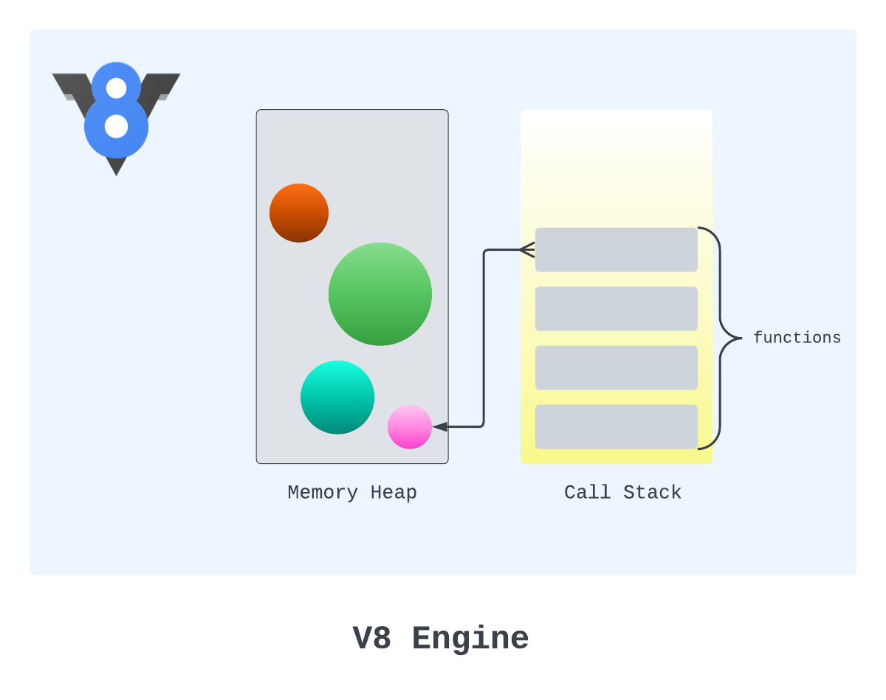
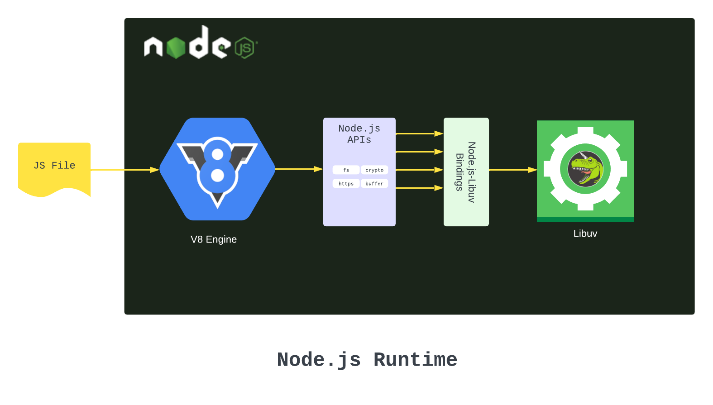
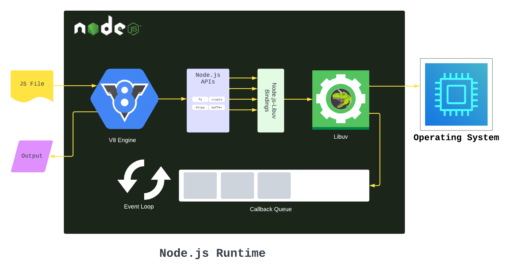
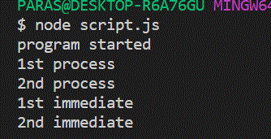
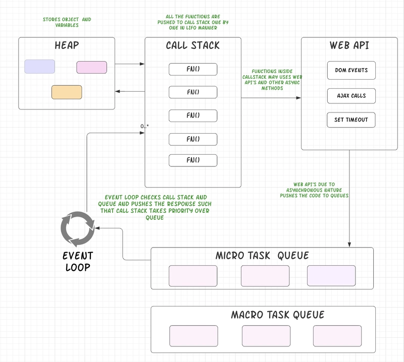
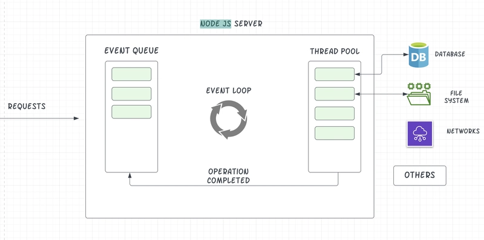
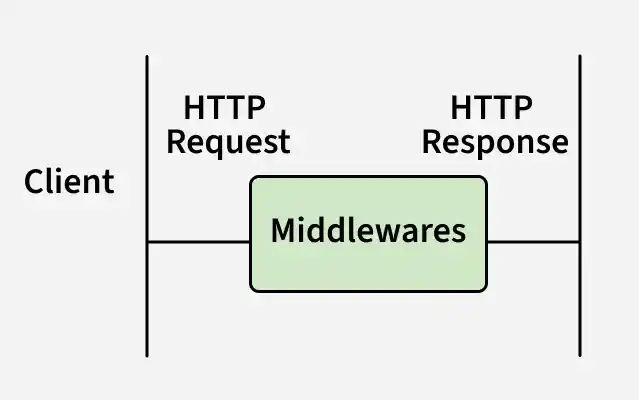
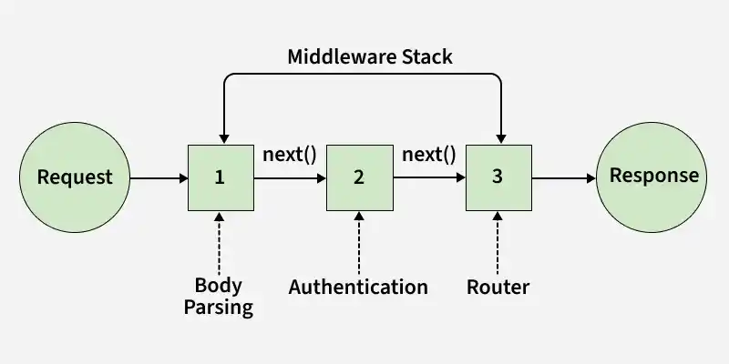

*Q1. What is Node.js and how does it work?*

Node.js is an open-source, cross-platform JavaScript Runtime Environment. Node.js is a software program that can execute JavaScript code. Put more properly, Node.js is a JavaScript runtime environment. It is an environment developed to make it possible to use JavaScript code for server-side scripting.

How Does Node.js Work

Node.js was written mostly with C/C++. As a program that is supposed to run web servers, Node.js needs to constantly interact with a device's operating system. Building Node.js with a low-level language like C made it easy for the software to access the operating system’s resources and use them to execute instructions. There are three main components we must understand to see how Node.js works. These components are:

1. V8 Engine: 

The V8 Engine is the JavaScript engine that interprets and runs JavaScript code in the Chrome browser. Some other browsers use a different engine, for example, Firefox uses SpiderMonkey, and Safari uses JavaScriptCore. Without the JavaScript engine, a computer can not understand JavaScript. The V8 engine contains a memory heap and call stack. They are the building blocks for the V8 engine. They help manage the execution of JavaScript code. The memory heap is the data store of the V8 engine. Whenever we create a variable that holds an object or function in JavaScript, the engine saves that value in the memory heap. To keep things simple, it is similar to a backpack that stores supplies for a hiker.
Whenever the engine is executing code and comes across any of those variables, it looks up the actual value from the memory heap – just like whenever a hiker is feeling cold and wants to start a fire, they can look into their backpack for a lighter.

The call stack is another building block in the V8 engine. It is a data structure that manages the order of functions to be executed. Whenever the program invokes a function, the function is placed on the call stack and can only leave the stack when the engine has handled that function. JavaScript is a single-threaded language, which means that it can only execute one instruction at a time. Since the call stack contains the order of instructions to be executed, it means that the JavaScript engine has just one order, one call stack.



2. Libuv:

Libuv is a C library used for performing Input/output (I/O) operations. I/O operations have to do with sending requests to the computer and receiving responses. These operations include reading and writing files, making network requests, and so on. This means that Libuv is cross-platform (can run on any operating system) and has a focus on Asynchronous I/O. The computer tends to take time to process I/O instructions, It can handle more than one I/O operation at once. This is what makes Node.js process I/O instructions efficiently despite being single-threaded. Whenever we pass a script to Node.js, the engine parses the code and starts processing it. The call stack holds the invoked functions and keeps track of the program. If the V8 engine comes across an I/O operation, it passes that operation over to Libuv. Libuv then executes the I/O operation. There are bindings that connect JavaScript functions to their actual implementation in Libuv. These bindings make it possible to use JavaScript code for I/O instructions. Node.js uses Libuv for the actual implementation but exposes Application Programming Interfaces (APIs). So, we can now use a Node.js API (which looks like a JavaScript function) to initiate an I/O operation. One interesting thing to note is that it is true that JavaScript is a single-threaded language, but Libuv—the low-level library Node.js uses— can make use of a thread pool (multiple threads) when executing instructions in the operating system. 



3. Event Loop:

The Event Loop in Node.js is a very important part of the process. From the name, we can see it is a loop. The loop starts running as Node.js begins executing a program. When we run our JavaScript program that contains some asynchronous code (like I/O instructions or timer-based actions), Node.js handles them using the Node.js APIs. Asynchronous functions usually have instructions to be executed after the function has finished processing. Those instructions are placed in a Callback Queue. The Callback Queue works with the First In First Out (FIFO) approach. That means the first instruction (callback) to enter the queue is the first to be invoked. As the event loop runs, it checks if the call stack is empty. If the call stack is not empty, it allows the ongoing process to continue. But if the call stack is empty, it sends the first instruction on the callback queue to the JavaScript engine. The engine then places that instruction (function) on the call stack and executes it. So, the event loop executes callbacks from asynchronous instructions using the JavaScript V8 engine in Node.js. And it is a loop, which means every time it runs, it checks the call stack to know if it will remove the foremost callback and send it to the JavaScript engine. Node.js is said to have an event-driven architecture. This means Node.js is built around listening to events and reacting to them promptly when they happen. These events can be timer events, network events, and so on. Node.js responds to those events by using an event loop to load event callbacks to the engine after something triggers an event. It is for this reason that Node.js is excellent for real-time data transfer in applications.



*Q2. Explain the Node.js event-driven architecture.*

NodeJS uses an event-driven architecture, which is a key part of how it handles many tasks at once without blocking. This approach relies on events, event emitters, and listeners to manage asynchronous operations efficiently. It is a design pattern where applications respond to events—changes in state, user input, or messages from other programs. Instead of a program's logic being tied to a specific sequence of steps, it reacts to events as they occur.This makes applications more flexible and responsive.

Event-Driven Architecture Working
NodeJS is inherently event-driven. The main focus is on a single-threaded event loop, which efficiently manages asynchronous operations. Here's how it works

- Events: Things that happen in your application, like a user clicking a button, a file being read, or a network request completing, are represented as "events."

- Event Loop: NodeJS has a central "event loop" that constantly monitors these events. It's like a traffic controller for your application.

- Callbacks: When an event occurs, NodeJS executes a corresponding "callback" function.This function contains the code that should run in response to that specific event.

- Non-Blocking: The event loop is non-blocking. This means that while waiting for an event (like a file to finish reading), NodeJS can handle other tasks.This is what makes NodeJS so efficient at handling many things at once.

- Asynchronous Operations: Many operations in NodeJS are asynchronous. For example, reading a file doesn't stop the rest of your program. Instead, NodeJS registers a callback function to be executed when the file is read.

*Q3. What is the difference between process.nextTick() and setImmediate()?*

process.nextTick() runs code immediately after the current operation, before I/O tasks. setImmediate() schedules code to run after the current event loop phase, following I/O tasks, impacting execution timing.

- process.nextTick() method

Whenever a new queue of operations is initialized we can think of it as a new tick. The process.nextTick() method adds the callback function to the start of the next event queue. It is to be noted that, at the start of the program process.nextTick() method is called for the first time before the event loop is processed.

Syntax: process.nextTick(callback);

- setImmediate() method

Whenever we call setImmediate() method, it's callback function is placed in the check phase of the next event queue. There is slight detail to be noted here that setImmediate() method is called in the poll phase and it's callback functions are invoked in the check phase.

Syntax: setImmediate(callback);

Example: This example illustrates that process.nextTick() callbacks execute before setImmediate() callbacks, even though both are scheduled in the same event loop iteration.

setImmediate(function A() {
	console.log("1st immediate");
});

setImmediate(function B() {
	console.log("2nd immediate");
});

process.nextTick(function C() {
	console.log("1st process");
});

process.nextTick(function D() {
	console.log("2nd process");
});

// First event queue ends here
console.log("program started");

Explanation:

For the above program, event queues are initialized in the following manner:

- In the first event queue only 'program started is printed'.

- Then second event queue is started and function C i.e. callback of process.nextTick() method is placed at the start of the event queue. C is executed and the queue ends.

- Then previous event queue ends and third event queue is initialized with callback D. Then callback function A of setImmdeiate() method is placed in the followed by B. Now, the third event queue looks like this - D A B - Now functions D, A, B are executed in the order they are present in the queue.



*Q3. How does the Node.js event loop differ from browser?*

Event Loop in Browser



1. Heap - It stores all the object reference and variables that we define in our function.

2. Call Stack - All the function that we use in our code is stacked here in LIFO manner such that the last function is at the top and first function is at the bottom.

3. Web API's - These API's are provided by browser which provides additional functionality over V8 engine. The functions which uses these API's are pushed to this container which on completion of the response of Web API is popped out of this container.

4. Queues - The queues are used to compute the asynchronous code response such that it doesn't block engine to execute further.

- Macro Task Queue - This queue executes async functions like DOM events, Ajax calls and setTimeout and has lower priority than Job queue.

- Micro Task Queue - This queue executes async functions which uses promises and has higher precedence over Message Queue.

The event loop checks the Call Stack, if the stack is empty it pushes the functions in the Queues to Call Stack and runs it. Functions already present are given higher priority and runs first in comparison to functions in message queue.

Event Loop in Node Js



1. Event Queue - On completion of the Thread Pool a callback function is issued and sent to the event queue. When call stack is empty the event goes through the event queue and sends callback to the call stack.

2. Thread Pool - The thread pool is composed of 4 threads which delegates operations that are too heavy for the event loop. I/O operations, Opening and closing connections, setTimeouts are the example of such operations.

3. Event loop in Node Js has different phases which has FIFO queue of callbacks to execute. When event loop enters a given phase it operates callbacks in that phase queue until the queue has been exhausted and maximum number of callbacks has executed and then moves to next phase.

The Event Loop is an endless loop which waits for the tasks, executes them and then sleeps until it receives more tasks. The event loop executes tasks from queue only when stack is empty. It processes the oldest task first and allows us to use callbacks and promises.

Difference between both the event loops

1. First difference is node uses a thread pool to manage disk I/O. It executes the I/O and other timer API's asynchronously.

2. Browser does not have setImmediate() function. This function execute once the I/O operation is done, if particular code is inside this it will be executed first. Whereas in setTimeout() callback function is executed after given minimum threshold value in milliseconds.

3. Node Js event loop has multiple phases and each phase handle specific type of tasks whereas browser has micro task and macro task queue within which all the tasks are processed in order they were placed into the queue.

*Q5. What are streams in Node.js?*

Streams are collections of data — just like arrays or strings. The difference is that streams might not be available all at once, and they don’t have to fit in memory. This makes streams really powerful when working with large amounts of data, or data that’s coming from an external source one chunk at a time.

However, streams are not only about working with big data. They also give us the power of composability in our code. Just like we can compose powerful linux commands by piping other smaller Linux commands, we can do exactly the same in Node with streams.

*Q6. Explain readable and writable streams.*

Readable

- To add data to a readable stream, you use the .push() function. When the stream is finished, you push(null).

- When ended, readable streams fire the 'end' event.

- You can read data from a readable stream by listening for the 'readable' event and then executing 'read()' until it returns null.

- Readable streams have a buffer, meaning that when you 'push()' to a buffer, if the buffer is full, then push() will return false. However, you can continue pushing to the buffer and filling it even though it's full. The 'highWaterMark' (or the buffer size) is really informational.

- Readable streams implement a _read() method to pull data from a non-stream source. You don't have to use this, however. You can just leave this method blank and use the push method described earlier. Whoever is using your stream could call read(), which would first read from the internal buffer, and then go call _read() when the buffer is empty.

Writable

- To add data to a writable stream, you use the .write() function. When the stream is finished, you use .end().

- When you call .end(), it does NOT end the stream immediately. It will use process.nextTick() to end the stream on the next tick! This has caused many race condition heartaches for me.

- Writable streams have a buffer. If the buffer is full (highWaterMark), then it will return false when you call .write(). However, you can keep writing to it and ignore this event if you want. Otherwise, I think there's something like a 'drain' event that notifies you that you can continue writing.

- Writable streams implement a _write() method to send the data to some back-end non-stream sink. If this method returns false, then the Writable stream will start buffering data and not call _write() again until 'drain'.

*Q7. What is middleware in Express?*

Middleware in Express.js are functions that run during the request–response lifecycle to process requests, modify responses, and control application flow.

- Executes custom logic for each request.
- Can read or modify req and res.
- May send a response and end the cycle.
- Uses next() to pass control to the next middleware.



Syntax

app.use((req, res, next) => {
    console.log('Middleware executed');
    next();
});

- (req, res, next) => {}: Middleware function to process the request and response before the final handler.
- next(): Passes control to the next middleware if the request–response cycle isn’t ended.

Working of Middleware in Express.js

In Express.js, middleware functions are executed sequentially in the order they are added to the application.

1. Request arrives at the server.
2. Middleware functions are applied to the request, one by one.
3. Each middleware either sends a response or passes control using next().
4. If no middleware ends the cycle, the route handler is reached, and a final response is sent.

Types of Middleware

1. Application-level Middleware

Application-level middleware runs across the entire Express application, handling common logic for all incoming requests.

- Registered using app.use() or app.METHOD().
- Executes for all routes and HTTP methods.
- Commonly used for logging, authentication, body parsing, and headers.

app.use(express.json()); // Parses JSON data for every incoming request
app.use((req, res, next) => {
  console.log('Request received:', req.method, req.url);
  next();
});

2. Router-level Middleware

Router-level middleware applies to a specific router instance, allowing middleware logic to be scoped to a defined group of routes.

- Registered using router.use() or router.METHOD().
- Executes only for routes within that router.
- Ideal for modular route grouping (e.g., auth or user routes).
- Improves code organization and maintainability by isolating middleware to related routes.

const router = express.Router();

// Apply middleware to only this router's routes
router.use((req, res, next) => {
  console.log('Router-specific middleware');
  next();
});

router.get('/dashboard', (req, res) => {
  res.send('Dashboard Page');
});

app.use('/user', router); // The middleware applies only to routes under "/user"

3. Built-in Middleware

Express offers built-in middleware functions to handle common server tasks efficiently.

- express.static() serves static files like images, CSS, and JS.
- express.json() parses incoming JSON request bodies.

app.use(express.static('public')); // Serves static files from the "public" folder
app.use(express.json()); // Parses JSON payloads in incoming requests

Middleware Chaining

Express allows middleware functions to be chained and executed sequentially, processing a request step by step before sending a response.

- Middleware runs in order as a chain.
- Each middleware can process or modify the request.
- The final handler sends the response to the client.
- next() passes control to the next middleware in the chain.



*Q7. Blocking the event loop. Which operations freeze all requests (sync fs, JSON.parse on huge payloads, heavy loops, catastrophic regex, bcrypt sync)? How do you detect event loop lag (perf_hooks.monitorEventLoopDelay, clinic.js), and how do you fix it with worker threads, child processes, chunking or moving work to a queue?*

Node.js uses an event-driven architecture in which JavaScript callbacks normally execute on a single main thread per process. This allows one process to handle many concurrent connections efficiently, but it also creates a critical constraint: **if one callback performs expensive synchronous work, other requests handled by that event loop must wait**.

My approach is to keep request handlers short, measure event loop delay, identify the blocking operation, and move CPU-intensive or long-running work to an appropriate execution mechanism.

## 1. Which operations block the event loop?

### A. Synchronous filesystem operations

```javascript
import fs from 'node:fs';

app.get('/report', (req, res) => {
  const data = fs.readFileSync('./large-report.json', 'utf8');
  res.json(JSON.parse(data));
});
```

`readFileSync()` blocks the JavaScript thread until the file read completes. Every request relying on that event loop waits during the operation.

**Fix:** use asynchronous filesystem APIs.

```javascript
import fs from 'node:fs/promises';

app.get('/report', async (req, res, next) => {
  try {
    const data = await fs.readFile('./large-report.json', 'utf8');
    res.json(JSON.parse(data));
  } catch (error) {
    next(error);
  }
});
```

The asynchronous read allows the event loop to handle other work while waiting for the file. However, `JSON.parse()` is still synchronous and can block if the document is huge.

### B. Large `JSON.parse()` and `JSON.stringify()` operations

```javascript
const parsed = JSON.parse(hugePayload);
```

Parsing a large JSON document consumes CPU and may allocate substantial memory. The event loop cannot process another callback until parsing finishes.

The same concern applies to serializing enormous objects with `JSON.stringify()`.

**Fixes:**
- Enforce request-body size limits.
- Paginate API responses instead of serializing huge collections.
- Avoid repeatedly parsing or serializing the same data.
- Use streaming parsers when the data format and processing requirements support streaming.
- Move genuinely expensive parsing or transformation to a worker thread or background job.

Changing the code to `await Promise.resolve()` before calling `JSON.parse()` does not make parsing asynchronous. The parsing operation still runs synchronously on the main thread.

### C. CPU-intensive loops and calculations

```javascript
app.get('/calculate', (req, res) => {
  let total = 0;

  for (let i = 0; i < 1_000_000_000; i++) {
    total += i;
  }

  res.json({ total });
});
```

The loop monopolizes the JavaScript thread until it finishes.

The issue is not simply the number of lines of code. It is the amount of computation performed before the event loop gets another opportunity to run.

**Fixes:** optimize the algorithm, bound the input, divide work into chunks, or move CPU-intensive calculations to worker threads.

### D. Catastrophic regular expressions (ReDoS)

Some regular expressions have pathological backtracking behavior on crafted inputs. Their execution time can grow exponentially or otherwise become disproportionately large.

For example, a vulnerable pattern with nested repetition may perform badly on a long string that almost matches.

**Fixes:**
- Avoid ambiguous nested quantifiers and other patterns with dangerous backtracking behavior.
- Validate and limit input lengths.
- Use simpler parsing logic or a regex engine with appropriate complexity guarantees.
- Consider a worker or isolated process for untrusted, potentially expensive matching, with a timeout and resource limits.

A timeout implemented using `setTimeout()` on the same blocked event loop cannot interrupt a running synchronous regex. The callback cannot run until the regex returns.

### E. Synchronous password hashing and cryptography

```javascript
import bcrypt from 'bcrypt';

const hash = bcrypt.hashSync(password, 12);
```

Synchronous bcrypt keeps the main JavaScript thread occupied while hashing. Doing this during login or registration can delay unrelated requests.

Use the asynchronous API instead:

```javascript
const hash = await bcrypt.hash(password, 12);
const valid = await bcrypt.compare(password, storedHash);
```

This avoids blocking the JavaScript event loop while the hashing operation runs. However, expensive cryptographic work still consumes system resources and may compete for a native worker pool, depending on the library implementation. I limit concurrency and monitor latency under realistic authentication load.

## 2. What about `async` and `await`?

`async` and `await` do not automatically make CPU-intensive operations non-blocking.

```javascript
app.get('/bad', async (req, res) => {
  const data = JSON.parse(hugePayload);
  res.json(data);
});
```

The `JSON.parse()` call still blocks.

Compare that with:

```javascript
const data = await fs.readFile('./data.json', 'utf8');
```

Here, the asynchronous filesystem operation allows other event-loop work to proceed while the file is being read. Once the read completes, the continuation runs on the JavaScript thread, and parsing remains synchronous if performed there.

A useful distinction is:

- **Asynchronous I/O:** waits without monopolizing the JavaScript thread.
- **CPU-intensive JavaScript:** runs on the executing thread unless explicitly moved elsewhere.
- **Native asynchronous operations:** may use operating-system facilities or libuv's worker pool, depending on the API.

Even asynchronous operations can overload the worker pool or exhaust memory if too many expensive jobs are submitted concurrently.

## 3. Detect event loop lag with `monitorEventLoopDelay()`

Node.js provides `monitorEventLoopDelay()` in the `node:perf_hooks` module. It measures delays in event-loop scheduling, with histogram values expressed in nanoseconds. <Cite refs={["turn691641search1","turn691641search4"]}/>

Example:

```javascript
import { monitorEventLoopDelay } from 'node:perf_hooks';

const histogram = monitorEventLoopDelay({
  resolution: 20
});

histogram.enable();

setInterval(() => {
  console.log({
    meanMs: histogram.mean / 1e6,
    p50Ms: histogram.percentile(50) / 1e6,
    p99Ms: histogram.percentile(99) / 1e6,
    maxMs: histogram.max / 1e6
  });

  histogram.reset();
}, 10_000).unref();
```

The histogram uses nanoseconds, so dividing by \(10^6\) converts the values to milliseconds.

I pay particular attention to **p99 event loop delay**, because averages can hide brief but severe stalls. I establish service-specific thresholds based on the application's latency objectives rather than treating one threshold as universally correct.

For example, repeated event loop delays of hundreds of milliseconds would be concerning for a latency-sensitive API.

I also monitor:
- Request latency percentiles, especially p95 and p99.
- Request throughput and error rates.
- Process CPU utilization and memory usage.
- Garbage-collection activity.
- Event Loop Utilization (ELU).
- Worker-pool contention where relevant.

Event loop delay is not the same as request latency: a slow database query can make a request slow without necessarily blocking the event loop.

### Event Loop Utilization

ELU helps quantify how much time the event loop spends active rather than idle.

```javascript
import { performance } from 'node:perf_hooks';

let previous = performance.eventLoopUtilization();

setInterval(() => {
  const current = performance.eventLoopUtilization(previous);
  previous = performance.eventLoopUtilization();

  console.log({
    utilization: current.utilization,
    activeMs: current.active,
    idleMs: current.idle
  });
}, 10_000).unref();
```

The utilization value is between `0` and `1`. High utilization combined with high event loop delay suggests that the loop is struggling to keep up, but I correlate these metrics with CPU and application traces before deciding on a fix.

## 4. Use Clinic.js and profiling tools

When metrics reveal a problem but not its cause, I profile the application under a representative workload.

Clinic.js provides profiling tools, including Clinic Flame, for examining where CPU time is spent. I can also use Node.js CPU profiles and flame graphs to identify expensive functions.

My workflow is:

1. Reproduce the slowdown with a controlled workload.
2. Capture CPU profiles while the problem occurs.
3. Identify hot functions such as JSON parsing, regex matching, serialization, or repeated calculations.
4. Inspect allocation and garbage-collection behavior if memory pressure is involved.
5. Fix the algorithm or execution model.
6. Repeat the same workload and compare latency, throughput, and event loop delay.

A CPU profile helps identify *where* time is spent. Event loop delay shows *when the event loop is not getting timely opportunities to run*. Together, they provide a much stronger diagnosis than looking at CPU utilization alone.

## 5. Choose the right fix

<box border radius="lg" padding={3} gap={3}>
  <row align="start" gap={3}>
    <box background="surface-secondary" radius="md" padding={2}>
      <icon name="file-check" size="xl" />
    </box>
    <box flex="1" gap={1}>
      **Asynchronous I/O**

      <text color="secondary" size="sm">Best for filesystem, network, and database operations that have asynchronous APIs.</text>

      Use `fs/promises`, asynchronous database clients, and non-blocking network operations.
    </box>
  </row>
  <divider color="subtle" />
  <row align="start" gap={3}>
    <box background="surface-secondary" radius="md" padding={2}>
      <icon name="cpu" size="xl" />
    </box>
    <box flex="1" gap={1}>
      **Worker threads**

      <text color="secondary" size="sm">Best for CPU-intensive JavaScript or suitable CPU-heavy native work.</text>

      Use a bounded worker pool for parsing, transformations, image processing, or calculations that justify the overhead.
    </box>
  </row>
  <divider color="subtle" />
  <row align="start" gap={3}>
    <box background="surface-secondary" radius="md" padding={2}>
      <icon name="terminal" size="xl" />
    </box>
    <box flex="1" gap={1}>
      **Child processes**

      <text color="secondary" size="sm">Best for process isolation or external executables.</text>

      Run converters, command-line tools, or untrusted computation in a separately managed process with resource limits.
    </box>
  </row>
  <divider color="subtle" />
  <row align="start" gap={3}>
    <box background="surface-secondary" radius="md" padding={2}>
      <icon name="layers" size="xl" />
    </box>
    <box flex="1" gap={1}>
      **Chunking and yielding**

      <text color="secondary" size="sm">Best when a task can be divided into small, independent steps.</text>

      Process bounded batches and yield to the event loop between batches.
    </box>
  </row>
  <divider color="subtle" />
  <row align="start" gap={3}>
    <box background="surface-secondary" radius="md" padding={2}>
      <icon name="list-ordered" size="xl" />
    </box>
    <box flex="1" gap={1}>
      **Background queue**

      <text color="secondary" size="sm">Best for long-running jobs that do not need to finish during the HTTP request.</text>

      Use a queue such as BullMQ with Redis, or a durable message broker, to process work asynchronously.
    </box>
  </row>
</box>

## 6. Worker threads: move CPU-intensive work off the main thread

Worker threads run JavaScript in separate threads and can execute CPU-intensive work without monopolizing the main event loop.

A simplified worker example:

**`worker.js`**

```javascript
import { parentPort, workerData } from 'node:worker_threads';

function calculate(limit) {
  let total = 0;

  for (let i = 0; i < limit; i++) {
    total += i;
  }

  return total;
}

parentPort.postMessage(calculate(workerData.limit));
```

**Main thread**

```javascript
import { Worker } from 'node:worker_threads';

function runCalculation(limit) {
  return new Promise((resolve, reject) => {
    const worker = new Worker(
      new URL('./worker.js', import.meta.url),
      { workerData: { limit } }
    );

    worker.once('message', resolve);
    worker.once('error', reject);

    worker.once('exit', (code) => {
      if (code !== 0) {
        reject(new Error(`Worker exited with code ${code}`));
      }
    });
  });
}
```

A request handler can await `runCalculation()`. While the worker calculates, the main event loop can continue handling other requests.

This example creates a worker per job for clarity, but in production I would usually use a **bounded worker pool** to avoid the overhead of creating many threads. I would also implement timeouts, worker replacement after failures, concurrency limits, and graceful shutdown.

Worker threads are not automatically faster for small tasks. Transferring large objects between threads can introduce copying, serialization, and memory overhead; transferable buffers or shared memory may help in suitable cases.

## 7. Chunking: split work into bounded batches

If work can be processed incrementally, chunking lets the event loop handle other callbacks between batches.

```javascript
import { setImmediate as yieldToEventLoop } from 'node:timers/promises';

async function processItems(items, batchSize = 500) {
  for (let i = 0; i < items.length; i += batchSize) {
    const batch = items.slice(i, i + batchSize);

    for (const item of batch) {
      processItem(item);
    }

    await yieldToEventLoop();
  }
}
```

Here, `processItem()` represents synchronous work that is individually cheap. The batch size should be chosen based on measured execution time, not just the number of items.

The `setImmediate` yield allows other event-loop callbacks to run between batches. It does not make any individual `processItem()` call asynchronous, and it does not help if a single item requires an enormous synchronous calculation.

For large workloads, chunking can also require progress tracking, cancellation, and careful handling of partial failures.

## 8. Move long-running work to a queue

Suppose a SaaS application needs to generate a large monthly report, import thousands of records, or process uploaded documents. I would not keep the HTTP request open while doing all that work.

Instead:

1. Validate the request and persist a job record.
2. Enqueue the job with a durable identifier.
3. Return `202 Accepted` with the job ID.
4. Let a background worker process the job.
5. Expose status and result endpoints.
6. Implement retries, idempotency, failure handling, and concurrency limits.

Example response:

```json
{
  "jobId": "job_12345",
  "status": "queued"
}
```

This improves request responsiveness and lets background capacity scale separately from API instances. It does not eliminate CPU work; it moves that work into a controlled execution environment.

For reliability, I avoid relying on an in-memory queue if jobs must survive process restarts. A durable queue and appropriate persistence strategy are preferable.

## 9. A practical production decision process

When an API's p99 latency suddenly increases, I would:

1. Check event loop delay and ELU alongside request latency and CPU metrics.
2. Inspect a CPU profile to identify expensive synchronous functions.
3. Determine whether the problem is CPU computation, synchronous I/O, memory pressure, or worker-pool saturation.
4. Bound inputs and fix inefficient algorithms before adding infrastructure.
5. Choose asynchronous I/O, worker threads, chunking, child processes, or a background queue based on the workload.
6. Apply backpressure and concurrency limits so that moving work off the event loop does not overload another resource.
7. Load-test the fix and verify that event loop delay and request latency improve under realistic concurrency.

**Interview summary:** Node.js handles many requests efficiently when each event-loop callback does a small amount of work. Synchronous I/O, CPU-heavy JavaScript, large JSON operations, pathological regexes, and synchronous cryptography can block all requests sharing that event loop. I detect the impact with event-loop delay metrics and profiling, then remove the bottleneck or isolate the workload in a worker, process, or background queue.

*Q8. Streams and backpressure. Explain the four stream types, pipe vs pipeline, and how backpressure works (write() returning false, the drain event, highWaterMark). How do you stream a large file or CSV upload to S3 without loading it into memory, and why is stream/promises pipeline the safer choice for error handling?*

## 1. What are streams in Node.js?

Streams allow us to process data **incrementally, in chunks, rather than loading the entire dataset into memory**. They are useful for large files, HTTP requests and responses, CSV processing, compression, and uploading data to cloud storage such as Amazon S3.

Node.js has four stream types:

| Stream type | Purpose | Example |
|---|---|---|
| **Readable** | Produces data that can be consumed | `fs.createReadStream()`, HTTP request |
| **Writable** | Accepts data to be written | `fs.createWriteStream()`, HTTP response |
| **Duplex** | Supports both reading and writing independently | TCP socket |
| **Transform** | A Duplex stream that transforms data as it passes through | `zlib.createGzip()`, encryption or CSV transformation |

Example:

```javascript
import fs from 'node:fs';
import zlib from 'node:zlib';
import { pipeline } from 'node:stream/promises';

await pipeline(
  fs.createReadStream('large.log'),
  zlib.createGzip(),
  fs.createWriteStream('large.log.gz')
);
```

Here, the file is read in chunks, compressed incrementally, and written to another file. The entire file does not need to reside in memory.

## 2. What is backpressure?

**Backpressure is the mechanism that prevents a fast data producer from overwhelming a slower consumer.**

For example, suppose a file is read at 100 MB/s, but the network can upload data at only 10 MB/s. Without backpressure, the application could accumulate data in memory until memory usage becomes excessive.

Node.js streams manage this through internal buffers and signals.

### How `write()`, `drain`, and `highWaterMark` work

Consider a Writable stream:

```javascript
import fs from 'node:fs';

const writable = fs.createWriteStream('output.txt');

writable.on('drain', () => {
  console.log('Writable buffer can accept more data');
});

writable.write('Some data');
```

The key behavior is:

- `write(chunk)` returns `true` when the stream can continue accepting data without requiring the producer to pause.
- It returns `false` when the internal buffer has reached its backpressure threshold. The producer should stop writing temporarily.
- The `drain` event indicates that the buffer has emptied sufficiently for writing to resume.
- `highWaterMark` is the buffer threshold, measured in bytes for ordinary byte streams or objects for object-mode streams.

For example:

```javascript
import fs from 'node:fs';

const writable = fs.createWriteStream('output.txt', {
  highWaterMark: 64 * 1024
});
```

This configures a 64 KiB threshold. It is **not a hard memory limit**: a chunk can exceed the threshold, and other stream buffers and application allocations also consume memory.

### Correct manual backpressure handling

```javascript
import fs from 'node:fs';

const writable = fs.createWriteStream('output.txt');

async function writeChunk(chunk) {
  if (!writable.write(chunk)) {
    await new Promise((resolve, reject) => {
      writable.once('drain', resolve);
      writable.once('error', reject);
    });
  }
}
```

This illustrates the concept, but production code must also handle stream closure, premature destruction, and errors without leaving listeners or promises hanging. Prefer `pipeline()` or async iteration whenever possible.

## 3. What is the difference between `pipe()` and `pipeline()`?

### `pipe()`

`pipe()` connects a readable stream to a writable stream and automatically manages normal backpressure.

```javascript
readable.pipe(writable);
```

It is convenient for simple stream connections, but **it does not provide the same comprehensive error propagation and cleanup guarantees as `pipeline()`**. An error in one stream does not necessarily clean up every connected stream automatically.

### `pipeline()`

`pipeline()` connects multiple streams, handles backpressure, propagates errors, and destroys participating streams when a pipeline fails.

```javascript
import fs from 'node:fs';
import zlib from 'node:zlib';
import { pipeline } from 'node:stream/promises';

try {
  await pipeline(
    fs.createReadStream('large.log'),
    zlib.createGzip(),
    fs.createWriteStream('large.log.gz')
  );

  console.log('Compression completed');
} catch (error) {
  console.error('Pipeline failed:', error);
}
```

The `stream/promises` version returns a Promise that resolves when the pipeline completes and rejects when an error occurs.

**Interview distinction:** `pipe()` handles backpressure for connected streams, while `pipeline()` additionally gives us centralized completion and error handling, making it the safer default for production pipelines.

## 4. How would you upload a large file to Amazon S3 without loading it into memory?

For a large local file, create a readable stream and pass it to the AWS SDK's multipart upload utility.

Using AWS SDK for JavaScript v3:

```javascript
import fs from 'node:fs';
import { S3Client } from '@aws-sdk/client-s3';
import { Upload } from '@aws-sdk/lib-storage';

const s3 = new S3Client({
  region: process.env.AWS_REGION
});

async function uploadLargeFile(filePath, bucket, key) {
  const fileStream = fs.createReadStream(filePath);

  const upload = new Upload({
    client: s3,
    params: {
      Bucket: bucket,
      Key: key,
      Body: fileStream,
      ContentType: 'application/octet-stream'
    },
    partSize: 8 * 1024 * 1024,
    queueSize: 2,
    leavePartsOnError: false
  });

  await upload.done();

  return { bucket, key };
}
```

The `Upload` utility from `@aws-sdk/lib-storage` supports multipart uploads, including large objects. The stream is consumed incrementally rather than first being converted into a complete in-memory buffer.

Important production considerations:

- **Memory:** `queueSize` controls concurrent multipart uploads, and `partSize` controls individual part sizes. Their combination affects memory usage.
- **Retries:** Configure appropriate retry behavior and handle failed uploads.
- **Cleanup:** `leavePartsOnError: false` requests cleanup of incomplete multipart uploads on failure. Also configure an S3 lifecycle rule to abort stale incomplete multipart uploads.
- **Security:** Use IAM roles or temporary credentials rather than hardcoded AWS keys.
- **Validation:** Enforce file-size limits, allowed file types, and authorization before accepting uploads.
- **Completion:** Do not report upload success until `upload.done()` resolves.

For a file already available on disk, `createReadStream()` is generally straightforward. For a large incoming HTTP upload, the design requires additional care.

## 5. How do you stream an incoming CSV upload to S3?

Suppose an Express endpoint accepts a CSV upload. A robust approach is to stream the incoming request through a CSV parser or validation Transform and into an S3 multipart upload stream.

Conceptually:

```text
HTTP request
    ↓
CSV parser / validation Transform
    ↓
S3 upload stream
    ↓
Amazon S3
```

This avoids buffering the entire upload in application memory.

However, the AWS SDK's `Upload` utility accepts a readable stream as its body; it is not itself a generic Writable stream that can simply be placed at the end of `pipeline()`. A practical approach is to connect the parser to a `PassThrough` stream and give that stream to `Upload`.

```javascript
import { PassThrough } from 'node:stream';
import { pipeline } from 'node:stream/promises';
import { Upload } from '@aws-sdk/lib-storage';

async function streamCsvToS3({
  request,
  s3,
  bucket,
  key,
  csvTransform
}) {
  const body = new PassThrough();

  const upload = new Upload({
    client: s3,
    params: {
      Bucket: bucket,
      Key: key,
      Body: body,
      ContentType: 'text/csv'
    },
    partSize: 8 * 1024 * 1024,
    queueSize: 2,
    leavePartsOnError: false
  });

  const pipelinePromise = pipeline(
    request,
    csvTransform,
    body
  );

  try {
    const [, result] = await Promise.all([
      pipelinePromise,
      upload.done()
    ]);

    return result;
  } catch (error) {
    body.destroy(error);

    // Wait for both operations to settle before returning.
    await Promise.allSettled([
      pipelinePromise,
      upload.done()
    ]);

    throw error;
  }
}
```

This example assumes `request` is the raw readable upload stream and `csvTransform` is a correctly configured Transform that parses or validates CSV data. The HTTP framework's upload handling, request limits, cancellation behavior, and multipart parser must be integrated appropriately.

The key design point is that **the pipeline and S3 upload are separate asynchronous operations**. Both must be monitored, and a failure in either must trigger cleanup of the other. A `PassThrough` is a bridge between the Writable side of the pipeline and the Readable side consumed by the S3 uploader.

For a production endpoint, also consider:

- Enforcing upload-size and request-time limits.
- Rejecting malformed CSV and invalid rows.
- Preventing unbounded row-level buffering in the parser.
- Aborting the S3 upload if the client disconnects.
- Ensuring incomplete multipart uploads are cleaned up.
- Avoiding duplicate uploads when clients retry requests.

If the goal is simply to store the original CSV unchanged, skip CSV parsing and stream the raw request directly to the S3 upload body. If validation is required, use a streaming Transform instead of collecting all rows into an array.

## 6. Why is `stream/promises` `pipeline()` safer?

It helps avoid common stream-handling failures:

1. **Centralized error propagation:** Errors from a source, Transform, or destination reject the pipeline Promise.
2. **Cleanup:** Pipeline failure destroys participating streams, reducing the risk of streams remaining open and resources leaking.
3. **Backpressure:** Data flow is coordinated between stages instead of requiring manual buffer management.
4. **Completion guarantees:** The Promise resolves only when the pipeline completes, so the caller can safely sequence dependent work.
5. **Simpler control flow:** `try/catch/finally` works naturally with asynchronous operations.

One important nuance: `pipeline()` cannot automatically clean up every external operation associated with a stream. If a destination represents an S3 upload managed by another API, you must explicitly coordinate cancellation, multipart cleanup, and error propagation for that upload.

## 7. What if you need to process the file row by row?

Use async iteration with a streaming parser rather than reading the entire CSV into memory:

```javascript
for await (const row of csvParser) {
  await processRow(row);
}
```

Awaiting `processRow()` applies application-level pacing, but it does not automatically guarantee that every upstream source is backpressured correctly. The parser and its input stream must support normal stream flow control.

Avoid patterns such as:

```javascript
const chunks = [];

for await (const chunk of readable) {
  chunks.push(chunk);
}

const completeFile = Buffer.concat(chunks);
```

That approach ultimately buffers the complete file in memory and defeats the purpose of streaming.

## Interview summary

Node.js streams process data incrementally. The four types are Readable, Writable, Duplex, and Transform. Backpressure prevents a producer from overwhelming a consumer: when `write()` returns `false`, a manual producer must pause until `drain`, while `highWaterMark` controls the buffer threshold. `pipe()` connects streams and handles ordinary backpressure; `pipeline()` is safer because it also centralizes error propagation, cleanup, and completion. For large S3 uploads, stream data into the AWS SDK's multipart uploader, avoid full-file buffering, and explicitly coordinate failures between the stream pipeline and the upload operation.

*Q9. Scaling a Node process: cluster, worker threads and child processes. What are the differences, and when do you use each (CPU-bound vs I/O-bound, isolation, shared memory with SharedArrayBuffer)? How does the cluster module distribute connections, why prefer PM2 or container orchestration with one process per container, and how do you share state across instances (Redis, not in-process memory)?*

## 1. Why do we need to scale a Node.js process?

Node.js runs JavaScript on a main thread using an event loop. It handles asynchronous I/O efficiently, but CPU-intensive JavaScript can block the event loop and delay incoming requests.

For example, a Node.js API can handle many concurrent database queries without creating a thread for each query. However, a large synchronous calculation, image transformation, or expensive data-processing task can block the main thread and increase API latency.

There are several ways to scale or isolate work:

- **Cluster:** Run multiple Node.js processes that can accept connections to the same server port.
- **Worker threads:** Run JavaScript in additional threads within one process, particularly for CPU-intensive work.
- **Child processes:** Launch separate operating-system processes for isolation or to run external programs.
- **PM2 or container orchestration:** Manage multiple application instances, restarts, deployment, and scaling.

## 2. Cluster vs. worker threads vs. child processes

| Feature | Cluster | Worker threads | Child processes |
|---|---|---|---|
| Execution model | Multiple processes running the same Node.js server | Multiple threads in one process | Separate operating-system processes |
| Best use case | Scale an HTTP server across CPU cores | CPU-intensive JavaScript calculations | External commands, separate services, or strong process isolation |
| Memory | Separate process memory | Separate JavaScript heaps by default | Separate process memory |
| Communication | IPC between processes | Message passing; optional shared memory | IPC, pipes, or other process communication |
| Crash isolation | Worker process can crash independently | A worker thread can fail without necessarily terminating the whole process, but shares process-level resources | Separate process can crash independently |
| Startup/resource cost | Relatively high | Usually lower than a process | Relatively high |
| Typical example | Multiple API server workers | Image processing, parsing, calculations | FFmpeg, Python scripts, shell commands |

### A. Cluster: Scale an HTTP server across CPU cores

The `cluster` module allows a primary process to create multiple worker processes. Each worker runs its own JavaScript event loop and can handle HTTP connections.

```javascript
import cluster from 'node:cluster';
import os from 'node:os';
import http from 'node:http';

if (cluster.isPrimary) {
  const cpuCount = os.availableParallelism();

  for (let i = 0; i < cpuCount; i++) {
    cluster.fork();
  }

  cluster.on('exit', (worker, code) => {
    console.log(`Worker ${worker.process.pid} exited: ${code}`);

    // Production code should use a deliberate restart policy
    // with backoff and shutdown handling.
  });
} else {
  const server = http.createServer((req, res) => {
    res.end(`Handled by process ${process.pid}`);
  });

  server.listen(3000);
}
```

The primary process manages workers, while each worker runs its own server and event loop.

**When to use it:** When an application needs to serve HTTP traffic using multiple Node.js processes on one machine.

Important considerations:

- Each process has its own heap, database connection pools, caches, and in-memory session data.
- Total database connections can increase significantly. For example, four workers with a pool of 20 connections each can create up to 80 connections.
- A worker restart policy should include backoff to avoid rapid restart loops.
- Graceful shutdown should stop accepting new work and allow in-flight requests to finish.
- More workers do not always mean better performance; measure CPU, memory, event-loop delay, and downstream capacity.

### B. Worker threads: Run CPU-intensive JavaScript in parallel

Worker threads are useful when computation is expensive enough to block the main event loop. Each worker has its own JavaScript execution context and event loop, while sharing the same operating-system process.

Example:

**`main.js`**

```javascript
import { Worker } from 'node:worker_threads';

function runCalculation(input) {
  return new Promise((resolve, reject) => {
    const worker = new Worker(
      new URL('./calculation-worker.js', import.meta.url),
      { workerData: input }
    );

    worker.once('message', resolve);
    worker.once('error', reject);

    worker.once('exit', (code) => {
      if (code !== 0) {
        reject(new Error(`Worker exited with code ${code}`));
      }
    });
  });
}

const result = await runCalculation(100_000_000);
console.log(result);
```

**`calculation-worker.js`**

```javascript
import { parentPort, workerData } from 'node:worker_threads';

let total = 0;

for (let i = 0; i < workerData; i++) {
  total += i;
}

parentPort.postMessage(total);
```

The main thread remains available while the worker performs the calculation.

For production systems, use a **bounded worker pool** rather than creating a new thread for every request. Libraries such as Piscina can manage worker reuse, task queues, and concurrency limits.

Worker threads are most useful for:

- CPU-heavy calculations.
- Parsing or transforming large datasets.
- Computationally expensive image processing implemented in JavaScript.
- Other tasks where parallel computation outweighs messaging and scheduling overhead.

They generally do not improve ordinary asynchronous database or network I/O, because Node.js already handles such I/O efficiently.

### C. Child processes: Isolate work or execute external programs

Child processes are separate operating-system processes with their own memory and runtime. They are appropriate when running a different executable or when process-level isolation is desirable.

```javascript
import { spawn } from 'node:child_process';

const child = spawn('ffmpeg', [
  '-i', 'input.mp4',
  '-vf', 'scale=1280:-1',
  'output.mp4'
], {
  stdio: 'inherit'
});

child.on('error', (error) => {
  console.error('Failed to start FFmpeg:', error);
});

child.on('close', (code) => {
  console.log(`FFmpeg exited with code ${code}`);
});
```

Use `spawn()` for streaming output from long-running commands. Avoid using `exec()` for unbounded output because it buffers output in memory and has a configurable maximum buffer size. Never construct shell commands directly from untrusted input.

Child processes are useful for:

- Running tools such as FFmpeg.
- Executing separate programs written in Python, Go, or another language.
- Running isolated background tasks.
- Separating workloads that require different dependencies or failure boundaries.

A child process can still overload the machine if too many are created, so concurrency and resource limits remain necessary.

## 3. CPU-bound vs. I/O-bound: Which approach should you choose?

The key distinction is whether the application spends its time waiting for external operations or performing computation.

| Workload | Preferred approach | Reason |
|---|---|---|
| Database queries and HTTP requests | Async I/O on the main event loop | Waiting does not require a dedicated JavaScript worker |
| CPU-heavy JavaScript calculations | Worker threads or a worker pool | Computation can run concurrently on additional CPU cores |
| HTTP server handling more traffic | Cluster, multiple managed processes, or multiple containers | Multiple event loops can use multiple cores |
| Video transcoding using FFmpeg | Child process | FFmpeg is an external executable |
| Scheduled report generation | Background worker or job queue | Keeps expensive work away from request handling |
| Multiple independent API replicas | PM2 or container orchestration | Provides process management, deployment, and scaling |

For example, if an API spends most of its time waiting for MySQL, adding worker threads may not help. Better improvements might include connection pooling, query optimization, caching, and efficient concurrency limits.

If a synchronous JavaScript calculation consumes 100% of one core and blocks requests, move that calculation to a worker pool or a separate background service.

## 4. How does `cluster` distribute connections?

The primary process creates workers that can listen on the same port. The operating system and Node.js cluster implementation coordinate how incoming connections reach those workers.

There are two important models:

1. **Primary-process distribution:** The primary process accepts connections and distributes them to workers. On supported platforms, Node.js commonly uses a round-robin strategy for this model.
2. **Operating-system distribution:** Workers accept connections from a shared listening socket, and the operating system determines which worker receives each connection.

The exact scheduling behavior depends on the platform and cluster configuration.

A crucial distinction is that **cluster distributes connections, not necessarily individual HTTP requests**. An HTTP keep-alive connection can carry multiple requests to the same worker. Uneven connection lifetimes and workload sizes can therefore create imbalanced request distribution even when connections are distributed reasonably evenly.

Cluster also does not automatically share application state between workers. Sticky sessions may be required by some applications, but a better approach for scalable HTTP APIs is often to keep the application stateless and store shared session data externally.

## 5. What is `SharedArrayBuffer`, and how does it work?

Worker threads can communicate using messages or shared memory.

With ordinary structured-clone messaging, data is copied or transferred according to the messaging API. With `SharedArrayBuffer`, multiple threads can access the same underlying memory.

```javascript
import { Worker } from 'node:worker_threads';

const sharedBuffer = new SharedArrayBuffer(
  Int32Array.BYTES_PER_ELEMENT
);

const sharedCounter = new Int32Array(sharedBuffer);

const worker = new Worker(
  new URL('./shared-worker.js', import.meta.url),
  { workerData: sharedBuffer }
);

worker.on('message', (message) => {
  console.log(message);
});
```

**`shared-worker.js`**

```javascript
import {
  workerData,
  parentPort
} from 'node:worker_threads';

const counter = new Int32Array(workerData);

Atomics.add(counter, 0, 1);

parentPort.postMessage(Atomics.load(counter, 0));
```

Both threads can access the same memory region. `Atomics` provides synchronization primitives for supported shared typed-array operations, helping prevent data races for those operations.

Use shared memory when profiling shows that copying data or message-passing overhead is a bottleneck. It is more complex than message passing because concurrent access requires careful synchronization.

`SharedArrayBuffer` is not a replacement for Redis or a database: it shares memory between threads in one process, not between independent Node.js processes or separate containers.

## 6. Why use PM2 or container orchestration instead of managing `cluster` manually?

The `cluster` module provides primitives for creating workers, but production process management involves much more than forking processes.

### PM2

PM2 is a process manager that can run Node.js applications in cluster mode and provide:

- Automatic restart after crashes.
- Process monitoring and logs.
- Multiple application instances.
- Reload workflows intended to reduce downtime.
- Startup integration and environment configuration.

It can be a practical choice for deploying a Node.js application directly on a VPS.

### Containers and orchestration

With Docker and an orchestrator such as Kubernetes, a common architecture is **one main application process per container**, with multiple replicas managed by the orchestrator.

```text
                 Load balancer
                       |
          +------------+------------+
          |            |            |
       API replica  API replica  API replica
       Container 1  Container 2  Container 3
          |            |            |
          +------------+------------+
                       |
               Shared dependencies
             MySQL / Redis / S3
```

Benefits include:

- Horizontal scaling by changing replica count.
- Health checks and replacement of unhealthy instances.
- Resource limits and scheduling.
- Rolling deployments and rollback strategies.
- Clear separation between application lifecycle management and application code.

“One process per container” is a useful operational default, not an absolute rule. If a container needs to use multiple CPU cores efficiently, scale through replicas or deliberately use multiple processes within that container. The right choice depends on resource utilization, deployment architecture, and operational complexity.

PM2 and an orchestrator solve overlapping but different operational problems. PM2 is useful for managing processes on a server; Kubernetes or another orchestrator manages containers and their lifecycle across a cluster of machines.

## 7. How do you share state across multiple Node.js instances?

**Do not rely on in-process memory for state that must be consistent across multiple instances.**

Suppose an API stores login sessions in a JavaScript `Map`:

```javascript
const sessions = new Map();
```

This works only inside that process. If a load balancer sends a subsequent request to another instance, that instance cannot see the original map.

The same problem applies to in-memory caches, rate-limit counters, job state, and WebSocket connection metadata.

Use a shared external system based on the type of state:

| State | Typical solution |
|---|---|
| Login sessions | Redis or a shared database |
| Rate-limit counters | Redis with atomic operations |
| Distributed locks | Redis or a database with appropriate coordination guarantees |
| Durable business data | MySQL or PostgreSQL |
| Cache shared by instances | Redis |
| Background jobs | Redis-backed queue, RabbitMQ, Kafka, or another suitable broker |
| Uploaded files | S3 or another object store |
| Real-time event distribution | Redis Pub/Sub, a message broker, or another shared event system |

### Example: Redis-backed shared state

```javascript
import { createClient } from 'redis';

const redis = createClient({
  url: process.env.REDIS_URL
});

redis.on('error', (error) => {
  console.error('Redis error:', error);
});

await redis.connect();

await redis.set('session:123', JSON.stringify({
  userId: 42,
  role: 'admin'
}), {
  EX: 3600
});

const session = await redis.get('session:123');
```

All application instances connected to the same Redis deployment can access this key, subject to the configured Redis topology and availability.

For session storage, use a proper session middleware and a production-ready Redis store rather than manually implementing session management with ad hoc keys.

For rate limiting or counters, use atomic Redis operations or Lua scripts where needed. A separate `GET` followed by `SET` is not an atomic increment and can lose updates under concurrency.

For durable business data, keep the authoritative record in the database rather than relying on Redis alone.

## 8. Common scaling mistakes

- **Using worker threads for every asynchronous task:** They add overhead when ordinary asynchronous I/O is sufficient.
- **Forking unlimited processes:** Each process consumes memory and may create its own database connection pool.
- **Assuming cluster shares memory:** Each worker has its own process-level application state.
- **Treating `SharedArrayBuffer` as distributed memory:** It is shared between threads, not across separate processes or machines.
- **Using sticky sessions to compensate for all state problems:** Externalizing session state usually makes horizontal scaling easier.
- **Running CPU-heavy code on the request event loop:** This increases latency for unrelated requests.
- **Scaling application replicas without checking downstream limits:** More instances can overwhelm MySQL, Redis, third-party APIs, or connection quotas.
- **Ignoring graceful shutdown:** Requests and background jobs can be interrupted during deployments or restarts.

## Interview summary

Cluster runs multiple Node.js processes to serve HTTP traffic across CPU cores. Worker threads are best for CPU-intensive JavaScript and can share memory through `SharedArrayBuffer` with proper synchronization. Child processes provide process isolation and are suitable for external executables or separate workloads. PM2 manages processes on a server, while container orchestration commonly scales applications through replicas. Finally, state that must be consistent across instances should live in shared systems such as Redis or a database—not in process-local variables.

*Q10. Error handling and process safety. What is the difference between operational and programmer errors? What happens on an uncaughtException or unhandledRejection (and Node 15+ behaviour), and why should you log and exit rather than continue? How do you implement graceful shutdown on SIGTERM (stop accepting connections, drain in-flight requests, close DB pools)?*

## 1. What is the difference between operational errors and programmer errors?

In Node.js, errors can be classified by their cause and whether the application can reasonably recover from them.

### Operational errors

Operational errors are expected failures that can occur during normal application operation. They do not necessarily indicate a bug in the code.

Examples:
- A database connection times out.
- A remote API returns HTTP 503.
- A user requests a resource that does not exist.
- A file cannot be found.
- A network connection is reset.
- A request fails validation.

**How to handle them:** Handle them at the appropriate boundary, return a meaningful response, retry when appropriate, or use a fallback.

For example:

```javascript
try {
  const user = await userService.findById(userId);

  if (!user) {
    return res.status(404).json({
      error: 'USER_NOT_FOUND'
    });
  }

  return res.json(user);
} catch (error) {
  next(error);
}
```

The missing user is an expected business outcome, while an unexpected database failure is passed to centralized error handling.

### Programmer errors

Programmer errors result from defects or incorrect assumptions in the code.

Examples:
- Accessing a property on `undefined`.
- Calling a function with an invalid internal state.
- Violating an invariant.
- Using a variable incorrectly.
- Making an incorrect assumption about an object's structure.

**How to handle them:** Fix the underlying bug, add tests, and prevent the faulty code from running again. If the error escapes into an uncaught exception, treat the process as potentially unsafe.

For example:

```javascript
function calculateTotal(order) {
  return order.items.reduce(
    (sum, item) => sum + item.price,
    0
  );
}
```

If `order` is unexpectedly `undefined`, the code may throw a `TypeError`. The correct fix is to validate inputs at the appropriate boundary and maintain internal invariants—not to catch every `TypeError` and silently continue.

The distinction is useful, but not absolute. A database error can reveal a programming defect, and an invalid user input should usually be rejected before it reaches business logic.

## 2. What happens when an `uncaughtException` occurs?

An `uncaughtException` occurs when a synchronous exception escapes the JavaScript execution context without being handled.

```javascript
throw new Error('Unexpected failure');
```

If nothing catches this error, Node.js normally prints the error and stack trace to standard error and exits with a nonzero exit code.

You can register a handler:

```javascript
process.on('uncaughtException', (error) => {
  console.error('Uncaught exception:', error);
});
```

However, this changes the default behavior. Registering the handler can prevent Node.js from terminating automatically.

That creates a serious risk: the application may be left in an inconsistent state. An exception could have interrupted a multi-step operation, corrupted application invariants, or left locks and resources in an unexpected state.

Therefore, **an `uncaughtException` handler should be used for last-resort diagnostics and controlled termination—not to resume normal service**.

A minimal emergency handler might look like this:

```javascript
process.on('uncaughtException', (error) => {
  console.error('Fatal uncaught exception:', error);

  // Stop accepting work and terminate.
  // A process manager should restart the process.
  process.exit(1);
});
```

In a production application, synchronous logging to standard error is a useful last-resort measure, but logging infrastructure itself can fail. Avoid complex asynchronous cleanup in this handler; it is not a reliable recovery point.

If the application requires orderly draining, implement normal shutdown handling separately and use it for signals and controlled termination paths.

## 3. What happens on an `unhandledRejection`?

An `unhandledRejection` occurs when a Promise is rejected and no rejection handler is attached within the relevant event-loop turn.

```javascript
async function loadData() {
  throw new Error('Database unavailable');
}

loadData(); // Rejected Promise is not handled.
```

Node.js behavior depends on the runtime version and configuration.

**Since Node.js 15, the default `--unhandled-rejections` mode is `throw`.** Under this mode, an unhandled rejection is raised as an uncaught exception if no `unhandledRejection` hook handles it. This normally causes the process to terminate.

A process-level listener can alter that behavior, so do not add one merely to log errors and continue.

Handle expected Promise failures explicitly:

```javascript
try {
  const data = await loadData();
  console.log(data);
} catch (error) {
  console.error('Failed to load data:', error);
}
```

Or attach a rejection handler when the operation is intentionally launched without awaiting it:

```javascript
loadData().catch((error) => {
  logger.error({ error }, 'Background operation failed');
});
```

For background tasks, logging alone may not be enough. The application may also need retry logic, a failed-job queue, or an alert.

An important distinction: `process.on('unhandledRejection')` is useful for diagnostics and monitoring, but it should not become a blanket substitute for handling Promise failures where they originate.

## 4. Why log and exit instead of continuing?

After a fatal, uncaught error, the process may no longer be in a trustworthy state. Continuing can lead to:

- Incorrect business operations or partially committed workflows.
- Inconsistent in-memory state.
- Requests hanging because resources were not released.
- Further errors that obscure the original cause.
- Corrupted caches or invalid application invariants.

A safer recovery strategy is:

1. Capture the error and stack trace.
2. Emit diagnostic information through the logging system or standard error.
3. Stop accepting new requests where practical.
4. Terminate the process.
5. Let a process manager or orchestrator restart it.
6. Use health checks and monitoring to detect repeated crashes.

A process manager should not restart a process indefinitely without safeguards. Repeated crashes may indicate a persistent defect, a bad deployment, or a failing dependency.

**Do not confuse process recovery with request recovery.** Operational errors can often be handled at request level. An uncaught exception is a process-level safety problem.

## 5. How do you implement graceful shutdown on `SIGTERM`?

A graceful shutdown allows the application to stop receiving new work while giving existing requests and operations time to finish.

`SIGTERM` is commonly sent by container orchestrators and process managers during deployment, scaling, or termination.

A typical shutdown sequence is:

1. Mark the instance as not ready so the load balancer stops routing new traffic to it.
2. Stop accepting new connections.
3. Allow in-flight requests to finish within a defined timeout.
4. Close database pools, Redis connections, message consumers, and other resources.
5. Force termination if the deadline expires.

### Example: Express server with a database pool

```javascript
import http from 'node:http';
import express from 'express';
import mysql from 'mysql2/promise';

const app = express();

const pool = mysql.createPool({
  host: process.env.DB_HOST,
  user: process.env.DB_USER,
  password: process.env.DB_PASSWORD,
  database: process.env.DB_NAME,
  connectionLimit: 10
});

app.get('/health/live', (req, res) => {
  res.status(200).json({ status: 'ok' });
});

app.get('/health/ready', (req, res) => {
  if (shuttingDown) {
    return res.status(503).json({
      status: 'shutting_down'
    });
  }

  return res.status(200).json({
    status: 'ready'
  });
});

const server = http.createServer(app);
let shuttingDown = false;
let shutdownPromise;

server.listen(process.env.PORT || 3000);

function closeServer() {
  return new Promise((resolve, reject) => {
    server.close((error) => {
      if (error) reject(error);
      else resolve();
    });
  });
}

function shutdown(signal) {
  if (shutdownPromise) {
    return shutdownPromise;
  }

  shuttingDown = true;
  console.log(`Received ${signal}; starting graceful shutdown`);

  shutdownPromise = (async () => {
    const forceExitTimer = setTimeout(() => {
      console.error('Graceful shutdown timed out');
      process.exit(1);
    }, 25_000);

    // Do not keep the event loop alive solely for this timer.
    forceExitTimer.unref();

    try {
      // Stop accepting new connections and wait for existing
      // HTTP connections to close.
      await closeServer();

      // Close the pool after requests have drained.
      await pool.end();

      console.log('Graceful shutdown completed');
      clearTimeout(forceExitTimer);
      process.exitCode = 0;
    } catch (error) {
      console.error('Graceful shutdown failed:', error);
      clearTimeout(forceExitTimer);
      process.exitCode = 1;
    }
  })();

  return shutdownPromise;
}

process.once('SIGTERM', () => {
  void shutdown('SIGTERM');
});

process.once('SIGINT', () => {
  void shutdown('SIGINT');
});
```

This illustrates the shutdown lifecycle, but a production implementation needs to account for several important details:

- `shuttingDown` must be declared before the readiness handler can execute.
- The server must stop accepting new connections before the database pool is closed.
- Long-running requests need a defined deadline and cancellation strategy.
- Active WebSocket connections, background jobs, and message consumers need their own shutdown logic.
- If the process receives another termination signal, the application may choose to escalate to forced termination.
- Avoid calling `process.exit()` immediately after logging normal shutdown completion, because doing so can truncate pending output or cleanup. Prefer setting `process.exitCode` and allowing the event loop to finish naturally.

The timer above is an emergency deadline. In a production implementation, make sure that the deadline covers the entire shutdown procedure, including any resource cleanup that could otherwise hang.

## 6. Does `server.close()` drain all in-flight requests?

`server.close()` stops the server from accepting new connections and waits for existing connections to close. Exact handling of idle keep-alive connections depends on the Node.js version and connection state.

For current Node.js versions, `server.close()` also closes idle connections. However, it does not guarantee that every application-level operation will finish successfully before an external termination deadline.

For long-running HTTP requests, you should:

- Track active requests or operations if explicit drain visibility is needed.
- Stop accepting new work.
- Allow active requests to complete within a bounded grace period.
- Cancel or terminate work that exceeds the deadline.
- Ensure the database pool remains available until dependent requests finish.

For HTTP servers, `server.closeAllConnections()` can be used as a forceful fallback, but it should not be called before the graceful-drain period if the goal is to preserve active requests. WebSocket and upgraded connections may require separate tracking and closure.

Also, a readiness check alone does not instantly remove an instance from every load balancer. The deployment platform's routing and termination behavior must be configured to allow sufficient propagation time.

## 7. What is the difference between liveness and readiness?

These health checks serve different purposes.

- **Liveness:** Is the process functioning, or should it be restarted?
- **Readiness:** Should this instance receive new traffic?

During graceful shutdown, the instance should generally become unready immediately while remaining alive long enough to drain requests.

Do not make liveness depend blindly on every downstream dependency. If MySQL is temporarily unavailable, restarting every API process may amplify the incident. Readiness can incorporate dependency status when appropriate, while liveness should focus on whether restarting the process is likely to help.

## 8. What about database pools, Redis, and background workers?

Shutdown must follow dependency order.

For example:

1. Stop accepting new HTTP requests.
2. Stop polling for new background jobs.
3. Wait for active requests and jobs to complete, subject to a deadline.
4. Close database and Redis clients.
5. Close telemetry exporters and other resources.

If the application uses a queue, acknowledge a job only after its work has completed successfully. If shutdown interrupts a job, allow the queue's retry or visibility-timeout mechanism to recover it safely.

For operations that may be retried, design idempotency into the workflow. A process can fail after performing an external side effect but before recording success, so a retry must not blindly duplicate a payment or other irreversible action.

## 9. Common interview mistakes

- Catching all errors and returning HTTP 200.
- Logging `uncaughtException` and continuing to serve traffic.
- Assuming all unhandled Promise rejections are harmless.
- Closing the database pool before active requests have drained.
- Calling `process.exit(0)` immediately after receiving `SIGTERM`.
- Using an unbounded shutdown wait that can exceed the container's termination grace period.
- Assuming readiness checks instantly stop all incoming requests.
- Retrying every operational error without limits, backoff, or idempotency.

## Interview summary

Operational errors are expected failures that should be handled at the appropriate application boundary. Programmer errors indicate defects and may violate internal invariants. Uncaught exceptions and unhandled rejections can leave a process in an unsafe state; log them for diagnosis and terminate rather than blindly continuing. For graceful shutdown, mark the instance unready, stop accepting new connections, drain in-flight work within a deadline, close database and other resource pools, and let the process manager or orchestrator handle restart and replacement.

*Q11. Memory management and leak hunting. How does V8’s generational garbage collector work, and what do --max-old-space-size, heap snapshots and --inspect with Chrome DevTools reveal? What are common leak sources (unbounded caches, listeners never removed, closures in long-lived scopes, global arrays), and how do you spot growth in production?*

## 1. How does memory management work in Node.js?

Node.js uses the V8 JavaScript engine, which automatically manages JavaScript memory through garbage collection (GC).

When an application creates objects, arrays, functions, and closures, V8 allocates memory for them. Garbage collection reclaims memory occupied by objects that are no longer reachable from the application's live references.

For example:

```javascript
function processRequest() {
  let data = { name: 'Dev' };
  data = null;
}

processRequest();
```

Once the function finishes and no references to the object remain, the object becomes eligible for garbage collection. However, **eligible for collection does not mean immediately collected**; V8 decides when to run the collector.

A memory leak occurs when an application retains references to objects that it no longer needs. The garbage collector cannot reclaim those objects because they are still reachable.

## 2. How does V8's generational garbage collector work?

V8 uses a generational approach based on the observation that many objects have short lifetimes.

At a high level, the heap is divided into areas with different collection strategies.

### A. Young generation

New objects are generally allocated in the young generation.

The young generation is collected relatively frequently because many temporary objects become unreachable quickly, such as request payloads, intermediate arrays, and short-lived response objects.

V8 uses the **Scavenger** collector for young-generation garbage collection. In its traditional copying approach, live objects are copied or moved between young-generation spaces, while unreachable objects are discarded.

Objects that survive enough collections may be promoted to the old generation.

### B. Old generation

Objects that survive longer may be promoted to the old generation. Examples include long-lived application configuration, caches, and persistent in-memory data structures.

Old-generation collection is generally more expensive because it may involve examining and reclaiming a larger set of objects.

V8 uses collectors including:

- **Major mark-compact collection:** Identifies live objects, reclaims unreachable objects, and can compact memory to reduce fragmentation.
- **Concurrent and incremental techniques:** Some marking and other GC work can occur concurrently with application execution or in smaller steps to reduce long pauses.
- **Other specialized collectors:** V8's implementation and collection strategies evolve between versions.

The exact algorithms are implementation-dependent, but the central idea is that V8 tries to collect short-lived objects cheaply while managing long-lived objects more selectively.

### C. What is the impact on application performance?

Garbage collection consumes CPU time. Collection activity can also cause pauses or increased latency, although modern V8 uses techniques to reduce their impact.

For example, an API that creates millions of temporary objects may experience frequent young-generation collections. If objects are unintentionally retained, old-generation usage may continue increasing, leading to expensive collections, higher latency, and eventually an out-of-memory failure.

**Important:** Garbage collection does not guarantee that memory usage always decreases immediately after an object becomes unreachable. V8 may defer collection, and the operating system's reported resident memory (RSS) can remain high even after the JavaScript heap has reclaimed objects.

## 3. What does `--max-old-space-size` do?

The `--max-old-space-size` option configures the approximate maximum size of V8's old-generation heap, measured in MiB.

Example:

```bash
node --max-old-space-size=4096 server.js
```

This sets the old-generation heap limit to approximately 4 GiB.

It is useful when a legitimate workload needs more heap memory than the default limit permits.

However, it does not:

- Set the total memory limit for the Node.js process.
- Set a hard limit on RSS or native allocations.
- Fix a memory leak.
- Guarantee that the process can allocate the entire configured amount.

A Node.js process can use additional memory for young-generation objects, native allocations, Buffers, code, stacks, and other runtime structures. Container memory limits may also be lower than the configured heap limit.

For example, setting the old-generation limit to 4 GiB inside a container limited to 2 GiB may cause the container to be killed by the operating system before V8 reaches its configured heap limit.

**Production recommendation:** Set heap limits based on measured memory usage and the container's actual memory budget. Leave sufficient headroom for native memory, buffers, runtime overhead, and temporary allocation peaks.

## 4. How do you identify a memory leak using production metrics?

The first step is to establish whether memory usage is actually growing over time.

Node.js exposes memory metrics through `process.memoryUsage()`:

```javascript
import process from 'node:process';

setInterval(() => {
  const memory = process.memoryUsage();

  console.log({
    rssMB: Math.round(memory.rss / 1024 / 1024),
    heapUsedMB: Math.round(memory.heapUsed / 1024 / 1024),
    heapTotalMB: Math.round(memory.heapTotal / 1024 / 1024),
    externalMB: Math.round(memory.external / 1024 / 1024),
    arrayBuffersMB: Math.round(memory.arrayBuffers / 1024 / 1024)
  });
}, 30_000);
```

In production, send these metrics to a monitoring system rather than relying only on console logs.

### What do the metrics mean?

| Metric | Meaning | What growth may indicate |
|---|---|---|
| `rss` | Total resident memory for the process | Overall process memory growth |
| `heapUsed` | JavaScript heap currently used | Retained JS objects or allocation pressure |
| `heapTotal` | Memory currently allocated to the V8 heap | Heap expansion; not necessarily a leak |
| `external` | Memory associated with native objects bound to JavaScript | Native resources or externally allocated memory |
| `arrayBuffers` | Memory used by `ArrayBuffer` and related buffers, including Node.js Buffers | Large or retained buffers |

`arrayBuffers` is included in `external`, so do not add those two values together when estimating memory consumption.

### How do you interpret the trends?

**Case 1: `heapUsed` repeatedly rises and its post-GC baseline keeps increasing.**

This suggests that more JavaScript objects are being retained over time. An unbounded cache, retained request objects, or leaked listeners may be responsible.

**Case 2: `heapUsed` remains relatively stable, but RSS increases.**

Investigate native allocations, Buffer usage, native dependencies, memory fragmentation, and allocator behavior. A JavaScript heap snapshot alone may not explain the problem.

**Case 3: `external` and `arrayBuffers` rise sharply.**

Investigate large file uploads, retained Buffers, streaming pipelines that accumulate chunks, and native libraries that allocate external memory.

**Case 4: Memory rises during traffic spikes and later falls.**

This can be normal allocation pressure. Compare memory with traffic volume, garbage-collection activity, request latency, and the post-GC baseline before concluding there is a leak.

The most useful signal is often the **trend in memory retained after comparable workload periods**, not a single high memory reading.

## 5. How do heap snapshots help find memory leaks?

A heap snapshot captures the JavaScript heap at a particular point in time. Chrome DevTools can inspect objects, references, and their relationships.

A practical investigation usually follows these steps:

1. Capture a baseline snapshot after startup and warm-up.
2. Exercise the application with a representative workload.
3. Allow temporary work to finish and garbage collection to occur naturally.
4. Capture another snapshot.
5. Compare the snapshots.
6. Inspect objects whose retained size or count has increased.
7. Follow their retaining paths to determine which references keep them alive.

### What should you look for?

- Arrays or Maps whose sizes grow with each request.
- Large numbers of objects associated with completed requests.
- Event listeners retaining old request or connection state.
- Closures retaining large objects.
- Buffers retained by caches or queues.
- Unexpectedly large numbers of instances of the same class.

Two important concepts are:

- **Shallow size:** Memory directly occupied by an object.
- **Retained size:** Memory that could potentially be reclaimed if the object and the objects reachable only through it became unreachable.

Retained size is especially useful for finding the root of a leak. A small object may retain a large object graph through its references.

A heap snapshot is not simply a list of large objects. The retaining path often tells you why an object is still alive.

### Example: An unbounded cache

```javascript
const cache = new Map();

app.get('/users/:id', async (req, res) => {
  const user = await loadUser(req.params.id);

  cache.set(req.params.id, user);

  res.json(user);
});
```

If requests use an ever-growing set of user IDs, the Map can retain every loaded user indefinitely.

A heap snapshot may reveal a large Map and many user objects retained through it. The fix is to implement an explicit cache policy, such as a maximum size, expiration, or a dedicated caching system with bounded storage.

## 6. How do `--inspect` and Chrome DevTools help?

The `--inspect` flag enables the Node.js Inspector protocol, which allows compatible debugging tools to connect to the process.

Start Node.js with:

```bash
node --inspect server.js
```

By default, the inspector listens on port `9229`. You can open Chrome and navigate to `chrome://inspect` to discover and debug the Node.js process.

For a local development session where you want the process to wait for a debugger:

```bash
node --inspect-brk server.js
```

This pauses execution at startup until a debugger attaches.

In Chrome DevTools, you can:

- Capture and compare heap snapshots.
- Record allocation timelines.
- Inspect retaining paths.
- View object counts and retained sizes.
- Profile CPU usage.
- Set breakpoints and inspect variables.
- Identify code paths that repeatedly allocate expensive objects.

### How do you use this in production?

Do not expose the inspector publicly. A debugger attached to a production process can inspect sensitive data and execute code in the process.

For production incidents:

1. Prefer monitoring and heap profiling designed for controlled operational use.
2. Reproduce the workload in a staging environment where possible.
3. If a live snapshot is necessary, use a secured access path, restrict access, and assess the impact first.
4. Consider memory and latency overhead before capturing a snapshot.
5. Ensure snapshots containing credentials, personal data, or other secrets are stored and handled securely.

Heap snapshots can temporarily consume significant additional memory and may pause the application. On a memory-constrained container, snapshot generation can cause an outage. Use them deliberately rather than capturing them automatically every few seconds.

## 7. What are common memory leak sources in Node.js?

### A. Unbounded caches

```javascript
const cache = new Map();

function cacheResult(key, result) {
  cache.set(key, result);
}
```

If keys are never removed, the cache grows continuously.

**Fix:** Use a bounded cache with a maximum entry count or memory budget, expiration, and an appropriate eviction policy such as LRU. TTL alone may not be sufficient if expired entries are not removed promptly.

### B. Event listeners that are never removed

```javascript
function handleRequest(req, res) {
  process.on('dataUpdated', () => {
    console.log(req.url);
  });
}
```

Every request adds another global listener, and each listener closes over `req`. Even after the request finishes, the listener can retain the request and related objects.

**Fix:** Register listeners at the correct lifecycle boundary and remove them when the work finishes. Use `once()` for one-time events where appropriate, or an `AbortController` to coordinate listener cleanup.

```javascript
const controller = new AbortController();

process.on('dataUpdated', handleUpdate, {
  signal: controller.signal
});

// When the operation finishes:
controller.abort();
```

The `signal` option is supported by Node.js event listener APIs such as `EventTarget`; do not assume every emitter implementation accepts it. For Node.js `EventEmitter` APIs that do not support the option, use `removeListener()` or `off()`.

### C. Closures in long-lived scopes

```javascript
function createHandler() {
  const largeData = loadLargeData();

  return function handler(req, res) {
    res.json({ status: 'ok' });
  };
}
```

The returned function closes over its lexical environment. If it retains a reference to `largeData`, the data may remain reachable as long as the handler remains reachable, even if the handler never uses that value in its body.

**Fix:** Avoid unnecessarily capturing large objects in long-lived callbacks. Keep scopes small and release references when their lifetime ends.

### D. Global arrays that grow indefinitely

```javascript
const requestHistory = [];

app.use((req, res, next) => {
  requestHistory.push({
    url: req.url,
    timestamp: Date.now()
  });

  next();
});
```

This records every request forever.

**Fix:** Use bounded in-memory buffers, aggregate counters, sampled telemetry, or external logging and monitoring systems.

### E. Unconsumed streams and queues

If producers continue adding data while consumers are slow or stopped, queues and buffers can grow without bound.

**Fix:** Apply backpressure, cap queue sizes, limit concurrency, and define what happens when capacity is exhausted.

### F. Timers and subscriptions

Repeatedly creating intervals, polling loops, or subscriptions without clearing them can retain callbacks and the objects they capture.

**Fix:** Track timer and subscription lifetimes and clear them during cleanup.

### G. Native resources and Buffers

Large Buffers, native modules, database clients, and other external allocations can cause RSS to grow even when JavaScript heap usage is stable.

**Fix:** Inspect `external`, `arrayBuffers`, and RSS alongside heap snapshots. Verify that streams, database connections, native resources, and subscriptions are properly closed.

## 8. How do you spot memory growth in production?

A practical workflow is:

**Step 1 — Establish a baseline.**

Measure RSS, heap used, external memory, request rate, latency, and garbage-collection activity after startup and warm-up.

**Step 2 — Observe under representative load.**

Compare memory usage across similar request volumes and workload periods. A continuously rising post-GC baseline is more suspicious than temporary spikes.

**Step 3 — Check the failure pattern.**

- Heap growth suggests retained JavaScript objects or excessive allocation.
- External memory growth suggests Buffers or native allocations.
- RSS growth without corresponding heap growth suggests looking beyond ordinary JavaScript objects.

**Step 4 — Capture diagnostic evidence.**

Use a heap snapshot or allocation profile in a controlled environment. Identify growing object types and follow retaining paths to the code holding references.

**Step 5 — Fix the ownership or lifetime problem.**

Bound caches, remove listeners, dispose of subscriptions, drain queues, and release unnecessary references.

**Step 6 — Verify the fix.**

Repeat the same workload and compare memory baselines. Confirm that memory stabilizes and that latency and garbage-collection pressure improve.

For operational visibility, use a metrics platform to track memory trends, GC activity, event-loop delay, and out-of-memory events. Alerts should account for container limits and sustained growth rather than triggering on every temporary spike.

## 9. Interview summary

V8 uses generational garbage collection: short-lived objects are collected frequently in the young generation, while longer-lived objects may be promoted to the old generation. `--max-old-space-size` configures the old-generation heap limit, not the entire process memory limit. Heap snapshots and Chrome DevTools reveal retained objects and their retaining paths. Common leaks include unbounded caches, listeners, closures, global collections, timers, and unconsumed queues. In production, monitor RSS, `heapUsed`, `external`, and `arrayBuffers`; compare memory after comparable workloads; investigate growing post-GC baselines; and validate fixes under repeatable load.

*Q12. Module systems and project structure. Compare CommonJS (require, caching, circular dependencies) and ES modules in Node ("type": "module", top-level await, import(), __dirname workarounds). How do you structure a maintainable Express/Fastify app (routes, controllers, services, repositories, config, dependency injection)?*

## 1. CommonJS vs. ES Modules

Node.js supports two primary JavaScript module systems: CommonJS (CJS) and ECMAScript Modules (ESM).

**CommonJS** is the traditional Node.js module system, using `require()` and `module.exports`. **ES modules** are the standardized JavaScript module system, using `import` and `export`.

### Key differences

| Feature | CommonJS | ES modules |
|---|---|---|
| Import | `require('./service')` | `import { getUser } from './service.js'` |
| Export | `module.exports = ...` | `export` / `export default` |
| Loading model | `require()` loads modules synchronously | Static imports are resolved and linked before module evaluation |
| Caching | `require.cache` caches loaded modules | ESM modules are cached by resolved module identity |
| Circular dependencies | May expose partially initialized exports | Live bindings can expose initialization-order problems |
| Top-level `await` | Not supported directly | Supported |
| Dynamic loading | `require()` | `import()` returns a Promise |
| File extensions | Often omitted for relative imports | Relative file extensions are normally explicit |
| Module scope | Wrapped in a function | Own module scope |
| `__dirname` | Available in ordinary CommonJS modules | Not available directly |

### A. CommonJS example

**`userService.cjs`**

```javascript
function getUser(id) {
  return { id, name: 'Dev' };
}

module.exports = { getUser };
```

**`app.cjs`**

```javascript
const { getUser } = require('./userService.cjs');

console.log(getUser(1));
```

CommonJS modules execute within a function wrapper that provides variables such as `require`, `module`, `exports`, `__filename`, and `__dirname`.

### B. ES module example

Set the following in `package.json`:

```json
{
  "type": "module"
}
```

**`userService.js`**

```javascript
export function getUser(id) {
  return { id, name: 'Dev' };
}
```

**`app.js`**

```javascript
import { getUser } from './userService.js';

console.log(getUser(1));
```

In a package configured with `"type": "module"`, ordinary `.js` files are interpreted as ES modules. The `.mjs` extension also explicitly identifies an ES module, while `.cjs` identifies CommonJS.

For new Node.js projects, ESM is a good default when your dependencies and tooling support it. CommonJS remains valid, particularly in older applications and packages.

## 2. How does module caching work?

Both module systems cache evaluated modules so repeated imports generally reuse the same module instance instead of executing the module again.

In CommonJS:

```javascript
const first = require('./config.cjs');
const second = require('./config.cjs');

console.log(first === second); // Usually true
```

This means that mutable module-level state is shared by consumers of that module within the same process.

For example:

```javascript
// counter.cjs
let count = 0;

module.exports = {
  increment() {
    return ++count;
  }
};
```

Every consumer of this module in the same process normally shares the same counter.

However, module-level state is **not shared across separate Node.js processes or containers**.

Caching can also create testing problems if a module captures environment variables or initializes connections at import time. Tests may then observe stale configuration or share mutable state between test cases.

A better pattern is to expose a factory function and inject configuration or dependencies explicitly.

## 3. What happens with circular dependencies?

A circular dependency occurs when modules depend on one another.

For example:

```text
userService → emailService → userService
```

Circular dependencies are legal in both module systems, but they can cause initialization-order problems.

### CommonJS behavior

CommonJS can expose partially initialized exports while a module is still executing.

**`a.cjs`**

```javascript
exports.name = 'A';

const b = require('./b.cjs');

exports.getB = () => b.name;
```

**`b.cjs`**

```javascript
const a = require('./a.cjs');

exports.name = 'B';
console.log(a.name);
```

In this example, `a.cjs` assigns `name` before requiring `b.cjs`, so `b.cjs` can see it. If the required export had not yet been assigned, the other module could see an incomplete object.

### ES module behavior

ES modules use live bindings, but cyclic modules still have initialization-order constraints.

If a module accesses a binding before that binding has been initialized, it can throw a `ReferenceError` because the binding is in its temporal dead zone.

**Best practice:** Avoid circular dependencies where possible. Extract shared functionality into a third module, invert dependencies through interfaces or callbacks, or restructure the modules around clear ownership boundaries. Do not rely on partially initialized exports.

## 4. Top-level `await` and dynamic `import()`

### Top-level `await`

ES modules allow `await` outside an `async` function at the module's top level.

```javascript
// config.js
const response = await fetch(
  'https://config.example.com/settings'
);

export const settings = await response.json();
```

This is useful for asynchronous initialization, but it delays evaluation of modules that depend on this module.

In a server application, avoid scattering network calls or database connection attempts throughout imported modules. Prefer an explicit application startup sequence so failures are handled predictably.

### Dynamic `import()`

`import()` loads a module dynamically and returns a Promise.

```javascript
async function loadReportGenerator() {
  const { generateReport } = await import('./reports.js');

  return generateReport();
}
```

Use dynamic imports for optional functionality, lazy loading, or conditionally loaded modules.

Unlike static imports, the import decision can depend on runtime conditions:

```javascript
async function loadProvider(providerName) {
  if (providerName === 'stripe') {
    return import('./providers/stripe.js');
  }

  if (providerName === 'razorpay') {
    return import('./providers/razorpay.js');
  }

  throw new Error('Unsupported provider');
}
```

Validate provider names against an explicit allowlist rather than constructing arbitrary module paths from untrusted input.

## 5. How do you replace `__dirname` in ES modules?

ES modules do not provide `__dirname` and `__filename` directly. Use `import.meta.url` with Node.js utilities.

```javascript
import path from 'node:path';
import { fileURLToPath } from 'node:url';

const __filename = fileURLToPath(import.meta.url);
const __dirname = path.dirname(__filename);

console.log(__dirname);
```

For paths relative to the current module, `new URL()` is often simpler:

```javascript
import { readFile } from 'node:fs/promises';

const fileUrl = new URL('./templates/email.html', import.meta.url);

const template = await readFile(fileUrl, 'utf8');
```

This avoids manually constructing a filesystem path and is convenient for module-relative resources.

---

## 6. How should you structure a maintainable Express or Fastify application?

A maintainable backend separates responsibilities without introducing unnecessary abstraction.

A practical structure is:

```text
src/
├── app.js
├── server.js
├── config/
│   ├── env.js
│   └── database.js
├── modules/
│   └── users/
│       ├── user.routes.js
│       ├── user.controller.js
│       ├── user.service.js
│       ├── user.repository.js
│       ├── user.schema.js
│       └── user.test.js
├── middleware/
│   ├── authenticate.js
│   └── error-handler.js
├── infrastructure/
│   ├── logger.js
│   ├── redis.js
│   └── email-client.js
└── shared/
    ├── errors.js
    └── constants.js
```

This is a feature-oriented structure: code for the user domain stays together, while cross-cutting infrastructure and shared utilities remain separate.

For a small API, fewer files may be sufficient. Introduce additional layers when they create a useful boundary, not merely to follow a template.

### A. Routes

Routes define the HTTP endpoints, middleware, and validation.

They should not contain business logic or direct database queries.

```javascript
// modules/users/user.routes.js
import { Router } from 'express';
import { createUser, getUser } from './user.controller.js';

const router = Router();

router.get('/:id', getUser);
router.post('/', createUser);

export default router;
```

### B. Controllers

Controllers translate HTTP requests into application operations and translate results into HTTP responses.

```javascript
// modules/users/user.controller.js
import * as userService from './user.service.js';

export async function getUser(req, res, next) {
  try {
    const user = await userService.getUserById(req.params.id);

    if (!user) {
      return res.status(404).json({
        error: 'USER_NOT_FOUND'
      });
    }

    return res.json({ data: user });
  } catch (error) {
    next(error);
  }
}

export async function createUser(req, res, next) {
  try {
    const user = await userService.createUser(req.body);

    return res.status(201).json({ data: user });
  } catch (error) {
    next(error);
  }
}
```

The controller should remain thin. It should not implement complex pricing rules, business workflows, or database transaction logic.

This example illustrates the Express pattern; production code should validate route parameters and request bodies before calling the service.

### C. Services

Services contain business rules and orchestrate operations.

```javascript
// modules/users/user.service.js
import * as userRepository from './user.repository.js';

export async function getUserById(id) {
  return userRepository.findById(id);
}

export async function createUser(input) {
  const existingUser = await userRepository.findByEmail(input.email);

  if (existingUser) {
    const error = new Error('Email already exists');
    error.code = 'EMAIL_ALREADY_EXISTS';
    throw error;
  }

  return userRepository.create({
    name: input.name,
    email: input.email
  });
}
```

In a production application, define domain-specific errors rather than attaching arbitrary properties to generic errors. Map those errors to HTTP status codes in centralized error handling.

Services are also a natural place to coordinate repositories, transactions, and external integrations.

### D. Repositories

Repositories isolate data access from business logic.

```javascript
// modules/users/user.repository.js
import { pool } from '../../config/database.js';

export async function findById(id) {
  const [rows] = await pool.execute(
    'SELECT id, name, email FROM users WHERE id = ?',
    [id]
  );

  return rows[0] ?? null;
}

export async function findByEmail(email) {
  const [rows] = await pool.execute(
    'SELECT id FROM users WHERE email = ?',
    [email]
  );

  return rows[0] ?? null;
}

export async function create(user) {
  const [result] = await pool.execute(
    'INSERT INTO users (name, email) VALUES (?, ?)',
    [user.name, user.email]
  );

  return findById(result.insertId);
}
```

This example uses the MySQL2 Promise API and parameterized SQL. It assumes the relevant schema and pool are configured.

Repositories should encapsulate persistence details, not become a second service layer containing business rules.

Also, checking for an existing email before inserting is not sufficient to guarantee uniqueness under concurrent requests. Add a unique database constraint and handle duplicate-key errors.

### E. Configuration

Validate environment variables at startup and centralize configuration.

```javascript
// config/env.js
function required(name) {
  const value = process.env[name];

  if (!value) {
    throw new Error(`Missing required environment variable: ${name}`);
  }

  return value;
}

export const config = {
  port: Number(process.env.PORT ?? 3000),
  databaseUrl: required('DATABASE_URL'),
  nodeEnv: process.env.NODE_ENV ?? 'development'
};
```

A production configuration module should also validate numeric ranges, URLs, booleans, and other expected formats. Avoid reading and interpreting environment variables independently throughout the application.

Do not commit credentials or secrets to source control.

---

## 7. Where does dependency injection fit?

Dependency injection (DI) means a component receives its dependencies rather than constructing them internally.

Without DI, a service might directly import a global database pool and email client. This makes testing and replacing those dependencies harder.

With DI, create dependencies at the application composition root and pass them to the services that need them.

```javascript
// modules/users/user.service.js
export function createUserService({ userRepository }) {
  return {
    async getUserById(id) {
      return userRepository.findById(id);
    },

    async createUser(input) {
      const existing = await userRepository.findByEmail(input.email);

      if (existing) {
        throw new Error('Email already exists');
      }

      return userRepository.create(input);
    }
  };
}
```

Wire the dependencies in the application startup code:

```javascript
import { createUserService } from './modules/users/user.service.js';
import * as userRepository from './modules/users/user.repository.js';

const userService = createUserService({
  userRepository
});
```

The repository could also be injected with a database connection or transaction manager.

Benefits include:

- Unit tests can supply fake or in-memory dependencies.
- Business logic is less tightly coupled to infrastructure.
- External services can be replaced without rewriting core logic.
- Application initialization and resource ownership become explicit.

For a modest Express application, factory functions and manual DI are often sufficient. A full DI container is useful only when the application complexity justifies it.

## 8. How would you adapt this structure to Fastify?

Fastify encourages plugin-based composition. Routes, decorators, authentication, and shared infrastructure can be registered as plugins with explicit encapsulation boundaries.

```javascript
// modules/users/user.routes.js
export default async function userRoutes(fastify) {
  fastify.get('/:id', async (request, reply) => {
    const user = await fastify.userService.getUserById(
      request.params.id
    );

    if (!user) {
      return reply.code(404).send({
        error: 'USER_NOT_FOUND'
      });
    }

    return { data: user };
  });
}
```

Register the service as a Fastify decorator or supply it through a plugin, and use Fastify's schema validation and serialization facilities where appropriate.

Fastify can handle many errors through its request lifecycle and `setErrorHandler()`. Express commonly uses middleware and `next(error)` for centralized error handling. The architectural boundaries—routes, controllers or handlers, services, repositories, and infrastructure—can remain similar in either framework.

For Fastify, avoid assuming a decorator registered inside an encapsulated plugin is automatically visible to every sibling plugin. Register dependencies at the appropriate scope or use an appropriate plugin arrangement.

## 9. Practical design rules

1. **Keep HTTP concerns in routes and controllers.** Authentication, request validation, status codes, and response serialization belong at the transport boundary.
2. **Keep business rules in services or domain modules.** Avoid coupling core logic to Express request and response objects.
3. **Keep persistence in repositories.** Use parameterized queries and enforce integrity constraints in the database.
4. **Manage transactions deliberately.** Multi-step business operations should use an explicit transaction boundary, with the same transaction connection passed through the participating repositories.
5. **Validate at boundaries.** Validate incoming requests and configuration at startup; do not rely only on TypeScript types or client-side validation.
6. **Centralize error handling.** Use domain-specific errors and map them consistently to HTTP responses.
7. **Keep startup separate from app construction.** An `app.js` factory can create and configure the application, while `server.js` owns listening, dependency initialization, and graceful shutdown.
8. **Avoid premature abstraction.** Do not create interfaces, factories, and repositories for every trivial function unless they improve testability, reuse, or separation of concerns.
9. **Test the right boundaries.** Unit-test business logic, integration-test repositories against a real database when practical, and test important HTTP workflows end to end.

## Interview summary

CommonJS uses `require()` and `module.exports`, while ES modules use static `import` and `export`, support top-level `await`, and provide dynamic loading through `import()`. Both cache modules, but circular dependencies can expose incomplete exports or trigger initialization errors. In an Express or Fastify application, keep HTTP routing and response handling separate from business services and persistence. Centralize configuration, use dependency injection to make components testable, establish clear transaction boundaries, and avoid circular dependencies and unnecessary abstraction.

*Q13. Express/Fastify internals and middleware. How does the middleware chain work (next, error-handling middleware with four arguments, async errors in Express 4 vs 5)? How do you design validation (Zod/Joi), centralized error responses, request IDs, rate limiting, helmet, CORS and body size limits? What does Fastify’s schema-based serialization and hook lifecycle offer over Express?*

## 1. How does the Express middleware chain work?

Express processes an incoming request through an ordered sequence of middleware functions. Each middleware can inspect or modify the request and response, end the response, or pass control to the next middleware.

A middleware function typically has this signature:

```javascript
function middleware(req, res, next) {
  // Perform some operation.
  next();
}
```

There are three common ways to proceed:

- `next()` — pass control to the next middleware.
- `next(error)` — transfer control to error-handling middleware.
- `res.send()`, `res.json()`, or another response-ending method — finish the response without continuing the normal chain.

Example:

```javascript
app.use((req, res, next) => {
  console.log('Request received');
  next();
});

app.get('/users', (req, res) => {
  res.json({ users: [] });
});
```

Middleware execution follows registration order. If a middleware neither calls `next()` nor ends the response, the request can hang.

Middleware should also avoid calling `next()` more than once, because doing so can cause duplicate processing or errors.

### Example: Authentication middleware

```javascript
function authenticate(req, res, next) {
  const token = req.headers.authorization;

  if (!token) {
    return res.status(401).json({
      error: {
        code: 'UNAUTHORIZED',
        message: 'Authentication required'
      }
    });
  }

  try {
    req.user = verifyToken(token);
    return next();
  } catch {
    return res.status(401).json({
      error: {
        code: 'INVALID_TOKEN',
        message: 'Invalid or expired token'
      }
    });
  }
}
```

In production, token verification should distinguish expected authentication failures from unexpected internal errors. Invalid credentials should produce a 401 response, but a database outage or unexpected programming failure should not automatically be misclassified as an invalid token.

---

## 2. What is error-handling middleware?

Express identifies error-handling middleware by its four-argument signature:

```javascript
function errorHandler(err, req, res, next) {
  // Handle the error.
}
```

When middleware calls `next(error)`, Express skips the remaining normal middleware and routes and searches for an appropriate error handler.

Example:

```javascript
app.get('/users/:id', async (req, res, next) => {
  try {
    const user = await userService.getById(req.params.id);

    if (!user) {
      return res.status(404).json({
        error: { code: 'USER_NOT_FOUND' }
      });
    }

    return res.json({ data: user });
  } catch (error) {
    return next(error);
  }
});

app.use((err, req, res, next) => {
  if (res.headersSent) {
    return next(err);
  }

  console.error(err);

  return res.status(500).json({
    error: {
      code: 'INTERNAL_SERVER_ERROR',
      message: 'An unexpected error occurred'
    }
  });
});
```

Important rules:

- Register the centralized error handler after routes and ordinary middleware.
- Do not expose stack traces, SQL details, credentials, or internal exception messages in production responses.
- If headers have already been sent, delegate to Express's default error handler with `next(err)` rather than attempting to send a second response.
- Log unexpected failures with enough context to diagnose them, while redacting sensitive data.

A four-argument handler is recognized by its function signature. Omitting the fourth parameter can cause Express to treat it as ordinary middleware instead.

## 3. How do async errors differ between Express 4 and Express 5?

This is a frequently asked interview question.

### Express 4

Express 4 does not automatically forward rejected Promises from an `async` route handler to error-handling middleware.

```javascript
app.get('/users', async (req, res) => {
  const users = await userService.getUsers();
  res.json(users);
});
```

If `getUsers()` rejects, the rejection may remain unhandled unless the route catches it or forwards the error.

A common Express 4 pattern is:

```javascript
app.get('/users', async (req, res, next) => {
  try {
    const users = await userService.getUsers();
    return res.json(users);
  } catch (error) {
    return next(error);
  }
});
```

Alternatively, use a well-tested async-handler wrapper.

### Express 5

Express 5 automatically forwards a rejected Promise returned by a route handler or middleware to `next(error)`.

```javascript
app.get('/users', async (req, res) => {
  const users = await userService.getUsers();
  return res.json(users);
});
```

If the awaited operation rejects, Express forwards the error to the error-handling chain.

However, asynchronous work started but not returned or awaited by the handler is not automatically covered:

```javascript
app.get('/users', (req, res) => {
  someAsyncTask(); // Not awaited or returned.
  res.json({ ok: true });
});
```

Errors from detached background work must be handled separately.

**Interview takeaway:** Express 5 improves Promise-based error propagation, but it does not eliminate the need to handle background-task failures or design a centralized error policy.

---

## 4. How do you design request validation with Zod or Joi?

Validation should happen at the system boundary, before untrusted input reaches business logic.

Validate:

- Path parameters.
- Query parameters.
- Request bodies.
- Headers when relevant.
- Environment variables at application startup.

A schema library such as Zod or Joi lets the application define expected shapes, types, constraints, and transformations.

### Example using Zod

```javascript
import { z } from 'zod';

const createUserSchema = z.object({
  name: z.string().trim().min(1).max(100),
  email: z.string().trim().email().max(254),
  age: z.number().int().min(18).optional()
}).strict();

function validateBody(schema) {
  return (req, res, next) => {
    const result = schema.safeParse(req.body);

    if (!result.success) {
      return res.status(400).json({
        error: {
          code: 'VALIDATION_ERROR',
          message: 'Request validation failed',
          details: result.error.issues.map((issue) => ({
            path: issue.path.join('.'),
            message: issue.message
          }))
        }
      });
    }

    req.body = result.data;
    return next();
  };
}

app.post(
  '/users',
  validateBody(createUserSchema),
  createUser
);
```

The `.strict()` setting rejects unexpected object properties. That can help prevent accidental mass assignment, but it is a design choice: some APIs intentionally allow or strip unknown fields instead.

A few additional considerations:

- Express's default JSON parser produces numeric JSON values as numbers, but form submissions and query parameters are commonly strings.
- If coercion is needed, use an explicit schema transformation and understand its edge cases.
- Avoid returning all raw validation input in error messages, since it may contain sensitive data.
- Validation does not replace authorization. A valid `userId` still must be checked against the caller's permissions.
- Database constraints must enforce invariants that can be violated by concurrent requests, such as uniqueness.

### Where should validation live?

Request shape validation belongs near the HTTP boundary. Business invariants—such as whether an account can transition to a particular state—belong in the service or domain layer.

For Joi, the same design applies using `Joi.object()`, `schema.validate()`, and consistent conversion of validation failures into a 400 response.

---

## 5. How do you design centralized error responses?

A good API uses a consistent error structure rather than returning a different JSON shape from every endpoint.

For example:

```json
{
  "error": {
    "code": "VALIDATION_ERROR",
    "message": "Request validation failed",
    "requestId": "req-8f31"
  }
}
```

The exact response should match the API's contract. Field-level details can be included for validation errors.

A useful error-handling strategy distinguishes expected application errors from unexpected failures:

| Error | Typical HTTP status |
|---|---:|
| Invalid request data | 400 |
| Missing or invalid authentication | 401 |
| Authenticated but not authorized | 403 |
| Resource not found | 404 |
| Conflict or duplicate resource | 409 |
| Rate limit exceeded | 429 |
| Unexpected internal failure | 500 |
| Temporary service unavailability | 503 |

These are common mappings, not universal rules. For example, 422 is also widely used for semantically invalid request content.

Define application error classes:

```javascript
export class AppError extends Error {
  constructor(statusCode, code, message) {
    super(message);
    this.statusCode = statusCode;
    this.code = code;
  }
}
```

Then centralize the response policy:

```javascript
app.use((err, req, res, next) => {
  if (res.headersSent) {
    return next(err);
  }

  const isOperational = err instanceof AppError;
  const statusCode = isOperational ? err.statusCode : 500;
  const code = isOperational
    ? err.code
    : 'INTERNAL_SERVER_ERROR';

  if (!isOperational) {
    req.log?.error({ err }, 'Unhandled request error');
  }

  return res.status(statusCode).json({
    error: {
      code,
      message: isOperational
        ? err.message
        : 'An unexpected error occurred',
      requestId: req.id
    }
  });
});
```

This example assumes that `req.log` and `req.id` are installed by earlier middleware. A production handler should also normalize known parser, validation, authentication, and database errors into safe public error codes.

Do not classify an error as safe to expose merely because it is an instance of `Error`. Public messages should be deliberately defined.

---

## 6. How do you implement request IDs and structured logging?

Request IDs help correlate a request across logs, database operations, downstream services, and distributed traces.

A simple Express implementation:

```javascript
import { randomUUID } from 'node:crypto';

app.use((req, res, next) => {
  req.id = randomUUID();
  res.setHeader('X-Request-ID', req.id);
  next();
});
```

In production, a trusted reverse proxy or gateway may supply a request ID. Only trust a client-supplied ID when the architecture and validation rules make that safe; otherwise, generate your own.

Use structured logging with fields such as:

- Request ID.
- HTTP method and route.
- Status code.
- Request duration.
- Error code.
- Relevant service or trace identifiers.

Avoid logging authorization headers, passwords, full payment details, or sensitive request bodies.

For distributed tracing, use trace context and a tracing implementation rather than treating a request ID as a complete substitute for trace IDs and span IDs.

---

## 7. How do you implement rate limiting?

Rate limiting restricts how many requests a client can make within a defined interval. It helps reduce abuse, brute-force attempts, and accidental overload.

Common algorithms include:

- **Fixed window:** Simple counters per time window, but requests near window boundaries can create bursts.
- **Sliding window:** More accurate rate calculations over a moving interval.
- **Token bucket:** Allows controlled bursts while enforcing an average rate.
- **Leaky bucket:** Smooths the rate at which requests are processed.

For a single Express process, an in-memory limiter can be sufficient for development or a simple single-instance service.

For a horizontally scaled production API, use a shared store such as Redis or an appropriately designed gateway-level limiter. An in-memory counter is independent in each process and can be bypassed simply by reaching another instance.

A typical middleware configuration with `express-rate-limit` looks like this:

```javascript
import rateLimit from 'express-rate-limit';

const loginLimiter = rateLimit({
  windowMs: 15 * 60 * 1000,
  limit: 10,
  standardHeaders: 'draft-8',
  legacyHeaders: false,
  message: {
    error: {
      code: 'RATE_LIMIT_EXCEEDED',
      message: 'Too many attempts. Try again later.'
    }
  }
});

app.use('/auth/login', loginLimiter);
```

The exact option names depend on the installed library version. For distributed deployments, configure a compatible shared store.

Apply different limits to different endpoints. Login, password-reset, public search, and expensive report-generation routes generally need different policies.

Also configure Express's `trust proxy` carefully when operating behind a reverse proxy; otherwise, the client IP used by the limiter may be wrong or spoofable.

---

## 8. What do Helmet and CORS do?

### Helmet

Helmet sets HTTP response headers that help protect browsers against certain classes of attacks and reduce accidental exposure.

```javascript
import helmet from 'helmet';

app.use(helmet());
```

Helmet can configure headers related to content security policy, MIME-type sniffing, framing, and other browser security behaviors.

It does not replace authentication, authorization, input validation, SQL parameterization, or secure session management.

Content Security Policy often requires application-specific configuration, particularly when the application uses external scripts, inline scripts, or embedded resources.

### CORS

Cross-Origin Resource Sharing controls whether browsers allow frontend JavaScript from one origin to read responses from another origin.

```javascript
import cors from 'cors';

app.use(cors({
  origin: [
    'https://app.example.com',
    'https://admin.example.com'
  ],
  methods: ['GET', 'POST', 'PUT', 'PATCH', 'DELETE'],
  allowedHeaders: ['Content-Type', 'Authorization'],
  credentials: true
}));
```

With `credentials: true`, use explicit allowed origins rather than `*`.

Important distinction: **CORS is a browser-enforced cross-origin policy, not an authentication or authorization mechanism.** Non-browser clients can still call the API, so the server must independently enforce access control.

For cookie-based authentication, configure cookie attributes, CSRF protection where appropriate, and credentialed CORS consistently. A permissive CORS policy can expose browser-accessible API responses to unintended origins.

---

## 9. Why are body-size limits important?

An API should not accept arbitrarily large request bodies. Oversized payloads can consume memory, CPU, and bandwidth, causing denial of service or resource exhaustion.

Configure explicit limits:

```javascript
app.use(express.json({
  limit: '1mb'
}));

app.use(express.urlencoded({
  extended: true,
  limit: '100kb'
}));
```

Choose limits based on the endpoint's real requirements. A small JSON API might need only a few hundred kilobytes, while an upload endpoint should use a streaming upload design rather than increasing the JSON body limit to hundreds of megabytes.

For file uploads:

- Enforce file-size limits at the reverse proxy and application layers.
- Stream large files rather than buffering them fully in memory.
- Validate file content, not only filename extensions or client-provided MIME types.
- Apply upload timeouts and concurrency limits.
- Consider direct-to-object-storage uploads for large files.

Also remember that `express.json()` parses JSON bodies into memory. A small configured limit is a useful safety boundary, not a complete resource-management strategy.

---

## 10. What does Fastify offer over Express?

Both Express and Fastify can build production APIs. Fastify emphasizes schema-driven request validation, response serialization, plugin encapsulation, and a structured lifecycle.

### A. Schema-based validation and serialization

Fastify supports JSON Schema for validating requests and serializing responses.

```javascript
fastify.post('/users', {
  schema: {
    body: {
      type: 'object',
      required: ['name', 'email'],
      additionalProperties: false,
      properties: {
        name: { type: 'string', minLength: 1, maxLength: 100 },
        email: { type: 'string', format: 'email' }
      }
    },
    response: {
      201: {
        type: 'object',
        properties: {
          id: { type: 'integer' },
          name: { type: 'string' },
          email: { type: 'string' }
        },
        required: ['id', 'name', 'email']
      }
    }
  }
}, async (request, reply) => {
  const user = await userService.createUser(request.body);
  return reply.code(201).send(user);
});
```

Fastify can compile schemas for efficient validation and use its response serializer to produce output matching the declared response schema.

Response schemas can also help prevent accidental disclosure of internal fields by limiting what is serialized. They should not replace deliberate data-access controls or authorization.

Only use trusted schemas and validators; do not allow arbitrary untrusted schemas to be compiled dynamically.

### B. Hook lifecycle

Fastify exposes lifecycle hooks that let developers run logic at specific stages of request processing.

Common hooks include:

- `onRequest` — early request processing, before body parsing.
- `preParsing` — inspect or transform the incoming payload stream.
- `preValidation` — run logic before schema validation.
- `preHandler` — run after validation, before the route handler.
- `preSerialization` — modify a payload before serialization.
- `onSend` — inspect or modify the outgoing payload.
- `onResponse` — run after the response has been sent.
- `onError` — observe request errors.

These hooks make it easier to implement authentication, instrumentation, request enrichment, and response processing at the appropriate lifecycle stage.

The lifecycle also includes plugin registration and encapsulation, which lets routes and hooks be scoped to specific parts of the application.

### C. Plugin encapsulation

Fastify plugins provide explicit composition boundaries. Decorators and hooks registered within a plugin are generally scoped according to the plugin tree, unless registration choices alter that behavior.

This can help organize authentication policies, shared services, and route-specific functionality without applying every hook globally.

### D. Performance and trade-offs

Fastify is designed to minimize framework overhead and can perform well for high-throughput APIs. However, real application performance also depends on database queries, network latency, serialization costs, validation complexity, logging, and business logic.

Do not claim that Fastify will automatically make every API faster. Benchmark representative workloads and compare operational needs, ecosystem support, team familiarity, and maintainability.

---

## 11. Express vs. Fastify: Interview comparison

| Concern | Express | Fastify |
|---|---|---|
| Core request pipeline | Ordered middleware and routes | Route lifecycle with hooks |
| Async route errors | Express 4 requires explicit forwarding; Express 5 forwards rejected handler Promises | Async handlers and hooks integrate with Fastify's error lifecycle |
| Validation | Usually added through middleware or libraries | Built-in JSON Schema integration |
| Response serialization | Usually handled manually or through additional libraries | Schema-driven serialization support |
| Extension model | Middleware and routers | Plugins, decorators, hooks, encapsulation |
| Ecosystem | Large, mature ecosystem | Strong plugin ecosystem with a more structured framework model |
| Best choice | Simple APIs, existing Express applications, broad middleware compatibility | Schema-driven APIs, structured lifecycle, plugin encapsulation |

## Interview summary

Express middleware executes in registration order, and `next(error)` transfers control to four-argument error-handling middleware. Express 4 requires explicit handling of rejected route Promises, whereas Express 5 forwards them automatically. A robust API validates input at the boundary, returns consistent sanitized errors, correlates logs with request IDs, and applies rate limits, Helmet, CORS, and body-size limits according to its threat model. Fastify adds schema-driven validation and response serialization, lifecycle hooks, and plugin encapsulation, which can improve consistency and reduce framework overhead when used appropriately.

*Q14. Authentication, security and dependency risk. How do you implement JWT access plus refresh tokens or sessions securely in Node? What do you do about prototype pollution, ReDoS, SQL/NoSQL injection, SSRF and path traversal on file endpoints? How do you manage npm supply-chain risk (lockfiles, npm audit, pinning, --ignore-scripts)?*

## 1. How do you implement authentication securely in Node.js?

Authentication verifies **who the user is**; authorization determines **what the user is allowed to do**. I implement authentication using either server-side sessions or JWT access tokens with refresh tokens, depending on the application's architecture.

### A. JWT access tokens + refresh tokens

A JWT-based system typically uses two tokens:

- **Access token:** Short-lived, usually around 5–15 minutes, used to authorize API requests.
- **Refresh token:** Longer-lived, used to obtain a new access token without requiring the user to log in again.

**Authentication flow:**

1. The user submits credentials over HTTPS.
2. The server verifies the password using Argon2id or bcrypt.
3. The server issues a short-lived, signed access token and a refresh token.
4. The client sends the access token in the `Authorization: Bearer <token>` header.
5. When the access token expires, the client sends the refresh token to a dedicated refresh endpoint.
6. The server validates the refresh token, rotates it, and issues a new token pair.
7. On logout, the server revokes the refresh token or its token family.

Example using the `jose` library:

```javascript
import { SignJWT, jwtVerify } from "jose";
import { randomUUID } from "node:crypto";

const secret = new TextEncoder().encode(
  process.env.JWT_ACCESS_SECRET
);

export async function createAccessToken(user) {
  return new SignJWT({
    role: user.role,
  })
    .setProtectedHeader({ alg: "HS256" })
    .setSubject(String(user.id))
    .setIssuer("my-api")
    .setAudience("my-client")
    .setIssuedAt()
    .setJti(randomUUID())
    .setExpirationTime("10m")
    .sign(secret);
}

export async function verifyAccessToken(token) {
  const { payload } = await jwtVerify(token, secret, {
    algorithms: ["HS256"],
    issuer: "my-api",
    audience: "my-client",
  });

  return payload;
}
```

The important security controls are:

- Explicitly allow the expected signing algorithm; never trust an algorithm selected by an untrusted token.
- Validate the signature, expiration, issuer, audience, and relevant claims.
- Keep signing secrets in a secret manager or protected environment configuration, never in source control.
- Use HTTPS everywhere.
- Never put passwords, API keys, or sensitive personal data in JWT payloads. Signed JWTs are not necessarily encrypted.
- Perform authorization checks on every protected operation, not just at login.
- Keep access tokens short-lived and refresh tokens revocable.

**Refresh-token security:** Generate refresh tokens using a cryptographically secure random generator. Store a hash of each token server-side, associate it with a user, device or session, and expiry, and rotate it atomically after every successful use. If an already-used token is presented again, treat it as possible token theft and revoke the associated token family.

A JWT access token generally remains valid until expiry unless the server checks a revocation mechanism. Short expiry reduces this exposure; it does not provide immediate revocation by itself.

### B. Server-side sessions

For traditional web applications, server-side sessions can be simpler and easier to revoke.

The flow is:

1. Authenticate the user.
2. Create a session record in Redis or a database.
3. Send the browser an opaque session ID in a cookie.
4. On each request, look up the session and verify that it is valid.
5. On logout or session expiry, invalidate the server-side session.

Example with Express and `express-session`:

```javascript
import session from "express-session";
import RedisStore from "connect-redis";
import { createClient } from "redis";

const redis = createClient({
  url: process.env.REDIS_URL,
});

await redis.connect();

app.use(
  session({
    store: new RedisStore({ client: redis }),
    secret: process.env.SESSION_SECRET,
    resave: false,
    saveUninitialized: false,
    name: "__Host-session",
    cookie: {
      httpOnly: true,
      secure: true,
      sameSite: "lax",
      path: "/",
      maxAge: 30 * 60 * 1000,
    },
  })
);
```

This is a configuration example; production deployment also needs appropriate proxy configuration, session lifecycle handling, and a strong secret. Do not use Express's default in-memory session store in production.

After successful login, regenerate the session ID to prevent session fixation:

```javascript
req.session.regenerate((err) => {
  if (err) return next(err);

  req.session.userId = user.id;
  res.json({ message: "Login successful" });
});
```

**JWT vs. sessions:**

| Consideration | JWT access + refresh | Server-side sessions |
|---|---|---|
| Request validation | Verify signed token | Look up session |
| Immediate revocation | Requires server-side checks or short expiry | Invalidate session centrally |
| Shared infrastructure | Signing keys and possibly token storage | Shared session store |
| Browser storage | Prefer secure cookie or carefully managed memory | Secure, HTTP-only cookie |
| Best fit | Distributed APIs and service integrations | Traditional web apps and centralized login |

For browser-based applications, I avoid storing long-lived tokens in `localStorage` because JavaScript running through an XSS vulnerability can read them. HTTP-only cookies reduce token theft through JavaScript, but cookie-based authentication also requires CSRF protection appropriate to the application's design. `SameSite` is useful, but should not be treated as a universal substitute for CSRF defenses.

---

## 2. How do you prevent prototype pollution?

Prototype pollution occurs when an attacker manipulates special object properties such as `__proto__`, `constructor`, or `prototype`, potentially modifying inherited properties and changing application behavior.

A common source is unsafe merging of untrusted JSON into configuration objects.

**Vulnerable pattern:**

```javascript
const config = Object.assign(defaultConfig, req.body);
```

The risk depends on the merge operation, object shape, and downstream code. Recursive merge utilities and dynamic property assignment are especially common sources of prototype pollution.

**Prevention:**

1. Validate request bodies against an explicit schema.
2. Allow only known fields rather than copying arbitrary input into internal objects.
3. Avoid unsafe recursive merge utilities.
4. Reject dangerous property names when handling arbitrary nested objects.
5. Use `Map` or `Object.create(null)` for suitable dictionary-like data structures.
6. Keep dependencies patched and test untrusted nested input.

Example using Zod:

```javascript
import { z } from "zod";

const updateUserSchema = z.object({
  displayName: z.string().trim().min(1).max(80),
  email: z.string().email(),
}).strict();

const input = updateUserSchema.parse(req.body);

await userService.updateProfile(req.user.id, input);
```

The strict schema rejects unexpected properties rather than blindly merging them. For nested data, validate each nested structure as well.

Using `Object.create(null)` can remove the normal prototype from a dictionary, but it is not a replacement for input validation or safe object-handling logic.

---

## 3. How do you prevent ReDoS?

Regular Expression Denial of Service (ReDoS) occurs when a regular expression takes excessive time to process a carefully crafted input. Certain patterns have catastrophic backtracking and can block Node.js's event loop.

For example, a pattern such as:

```javascript
/^(a+)+$/
```

can take disproportionately long to reject some long strings consisting of repeated `a` characters followed by a different character.

**Prevention:**

- Avoid nested, ambiguous quantifiers and overlapping alternatives in regex patterns.
- Set strict input length limits before running expensive validation.
- Prefer simple, well-understood patterns for email, identifiers, and user input.
- Use vetted validation libraries and review their regex behavior.
- Consider a linear-time regex engine or a safe alternative for complex matching.
- Run potentially expensive work in a worker or separate process if isolation is needed.

A timeout around a synchronous regex does **not** solve the problem: while the regex blocks the event loop, the same event loop cannot execute the timeout callback.

For example:

```javascript
function validateIdentifier(value) {
  if (typeof value !== "string" || value.length > 100) {
    return false;
  }

  return /^[a-zA-Z0-9_-]+$/.test(value);
}
```

This example uses a bounded input and a straightforward character-class pattern. The general principle is to bound attacker-controlled work, not merely to catch errors after it becomes expensive.

---

## 4. How do you prevent SQL and NoSQL injection?

### SQL injection

SQL injection happens when untrusted input is concatenated into SQL text and changes the meaning of the query.

**Unsafe:**

```javascript
const sql =
  `SELECT * FROM users WHERE email = '${req.body.email}'`;
```

**Safe:**

```javascript
const [rows] = await pool.execute(
  "SELECT id, email FROM users WHERE email = ?",
  [req.body.email]
);
```

Parameterized queries separate query structure from data. I use them for values and avoid building SQL fragments from arbitrary user input.

Some SQL elements, such as table names and sort directions, cannot generally be supplied as ordinary value parameters. For those, use a strict allowlist:

```javascript
const allowedSortColumns = {
  name: "name",
  createdAt: "created_at",
};

const sortColumn =
  allowedSortColumns[req.query.sort] ?? "created_at";

const rows = await query(
  `SELECT id, name FROM users ORDER BY ${sortColumn}`
);
```

Only trusted, predefined column names are interpolated into the query.

### NoSQL injection

NoSQL injection can occur when user input is treated as a query operator rather than ordinary data. For example, an attacker might submit an object containing `$ne` where the application expects a username string.

**Unsafe:**

```javascript
const user = await User.findOne({
  username: req.body.username,
  password: req.body.password,
});
```

If those fields are accepted as arbitrary objects, query semantics may be manipulated. This example also incorrectly treats password comparison as a database lookup.

**Safer approach:**

```javascript
import { z } from "zod";

const loginSchema = z.object({
  username: z.string().min(1).max(100),
  password: z.string().min(1).max(200),
}).strict();

const { username, password } = loginSchema.parse(req.body);

const user = await User.findOne({ username });

if (!user || !(await verifyPassword(password, user.passwordHash))) {
  throw new UnauthorizedError("Invalid credentials");
}
```

Here, the input schema requires strings, the database lookup uses the validated username, and the password is checked against a stored password hash.

For MongoDB, I also avoid passing arbitrary client-supplied objects directly into filters or update operators, and I restrict which fields clients can update.

**Key distinction:** Parameterization protects SQL values; schema validation and controlled query construction prevent untrusted input from becoming database operators or query structure.

---

## 5. How do you prevent SSRF?

Server-Side Request Forgery (SSRF) occurs when an attacker tricks the backend into making requests to unintended destinations, such as cloud metadata endpoints, internal services, or localhost.

For example, an application that fetches an image from a user-provided URL may accidentally expose internal network resources.

**Prevention strategy:**

1. Prefer accepting a known resource ID rather than an arbitrary URL.
2. Allowlist approved domains or destinations whenever possible.
3. Permit only required protocols, usually HTTPS.
4. Reject loopback, private, link-local, and other prohibited IP ranges for both IPv4 and IPv6.
5. Resolve DNS and validate the resulting addresses before connecting.
6. Revalidate every redirect destination or disable redirects.
7. Apply outbound firewall rules so the application cannot reach sensitive internal networks.
8. Set connection and total request timeouts, response-size limits, and rate limits.

A URL's hostname must not be trusted simply because it looks legitimate. DNS rebinding and redirects can bypass naive hostname checks. A robust implementation validates the actual connection destination and prevents the HTTP client from independently resolving to a prohibited address after validation.

**Important:** Do not rely solely on a regex that rejects strings containing `localhost` or `127.0.0.1`. IP representations, IPv6, DNS resolution, redirects, and alternate hostnames make such checks insufficient.

For a URL-fetching feature, I would use a well-maintained HTTP client, explicit destination validation, restricted egress networking, and strict response limits. If arbitrary URLs are not a real requirement, I would remove that capability entirely.

---

## 6. How do you prevent path traversal in file endpoints?

Path traversal occurs when a user manipulates a file path, for example using `../../`, to access files outside the intended directory.

**Unsafe:**

```javascript
const filePath = path.join(
  uploadDirectory,
  req.params.filename
);

res.sendFile(filePath);
```

This is unsafe if the endpoint does not enforce containment and other file-access restrictions.

A safer approach is to resolve the candidate path and verify that it stays within the intended root:

```javascript
import path from "node:path";

function resolveUploadPath(rootDirectory, filename) {
  // Prefer rejecting separators and accepting only a defined
  // filename format, rather than accepting arbitrary paths.
  if (
    typeof filename !== "string" ||
    filename.length === 0 ||
    filename.includes("/") ||
    filename.includes("\\") ||
    filename === "." ||
    filename === ".."
  ) {
    throw new Error("Invalid filename");
  }

  const root = path.resolve(rootDirectory);
  const candidate = path.resolve(root, filename);
  const relative = path.relative(root, candidate);

  if (
    relative === "" ||
    relative.startsWith(`..${path.sep}`) ||
    relative === ".." ||
    path.isAbsolute(relative)
  ) {
    throw new Error("Invalid file path");
  }

  return candidate;
}
```

This illustrates lexical path containment; it is not a complete defense for every filesystem scenario.

For production file endpoints, I also:

- Prefer opaque file IDs mapped to server-controlled paths.
- Store uploads outside the web root.
- Generate server-side filenames instead of trusting client filenames.
- Enforce file size, extension, MIME type, and actual file-content checks.
- Prevent executable uploads and apply malware scanning when appropriate.
- Consider symbolic-link attacks and filesystem race conditions.
- Enforce authorization on every download or deletion.

A file belonging to another user must remain inaccessible even if the path itself is valid. Path validation and authorization solve different problems.

---

## 7. How do you manage npm supply-chain risk?

The npm supply chain includes direct dependencies, transitive dependencies, package maintainers, installation scripts, registries, and build tools. A compromised or vulnerable dependency can introduce malicious code or expose sensitive data.

### A. Commit and enforce the lockfile

I commit `package-lock.json` and use:

```bash
npm ci
```

`npm ci` installs the dependency tree defined by the lockfile and fails when `package.json` and the lockfile are inconsistent. It is preferable for reproducible CI builds.

I also:

- Review lockfile changes in pull requests.
- Use consistent Node.js and npm versions in CI.
- Avoid routinely deleting and regenerating the lockfile without a reason.
- Pin direct dependency versions where reproducibility or change control requires it.
- Update dependencies through reviewed, automated pull requests.

A lockfile improves reproducibility; it does **not** guarantee that packages are safe.

### B. Audit dependencies

```bash
npm audit
npm audit --omit=dev
npm outdated
```

- `npm audit` checks the dependency tree against known vulnerability advisories.
- `npm audit --omit=dev` focuses the audit request on the production dependency tree.
- `npm outdated` identifies packages with newer published versions.

I assess severity, exploitability, whether the vulnerable code path is used, and whether a safe fix is available. I update affected packages, run tests, and deploy through the normal release process.

I avoid blindly running:

```bash
npm audit fix --force
```

because it can introduce breaking major-version changes. An audit also cannot detect every malicious package or unknown vulnerability.

### C. Pinning and package selection

I prefer maintained packages with a clear ownership history, sensible release practices, and a reasonable dependency footprint. I review new dependencies before adoption and avoid unnecessary packages.

For higher-risk environments, I also consider:

- Automated vulnerability and license scanning.
- Dependency review in pull requests.
- SBOM generation and dependency provenance where supported.
- Private registry controls and trusted publishing mechanisms.
- Monitoring for compromised maintainers, typosquatting, and suspicious releases.

Version pinning reduces unexpected updates, but a pinned vulnerable or compromised version remains vulnerable. Pinning must be paired with a patching process.

### D. Control installation scripts

npm packages can execute lifecycle scripts such as `preinstall`, `install`, and `postinstall`. Malicious scripts may run during dependency installation in CI or developer environments.

For a controlled CI installation, I can use:

```bash
npm ci --ignore-scripts
```

This suppresses package lifecycle scripts during installation. It reduces one avenue of supply-chain execution, but it is **not a complete security boundary**. Some packages need installation scripts to compile native modules or download required binaries, so I verify compatibility and explicitly allow only necessary trusted build steps where appropriate.

I never assume that `--ignore-scripts` makes an untrusted package safe: its code can still execute later when the application or build tooling imports or runs it.

### E. Secure CI/CD credentials

- Use short-lived, least-privilege CI credentials.
- Avoid exposing publishing tokens to untrusted pull-request builds.
- Separate dependency installation, build, test, and release permissions where practical.
- Run builds with restricted network access and filesystem permissions.
- Keep secrets out of logs and avoid running arbitrary third-party code in privileged environments.

The objective is to limit the impact if a dependency or build step is compromised.

---

## 8. What is your overall security approach?

I use defense in depth:

1. **Identity:** Strong password hashing, secure token/session lifecycle, and MFA where appropriate.
2. **Authorization:** Deny by default and verify ownership and permissions on every protected resource.
3. **Input handling:** Validate schemas, restrict accepted fields, parameterize database queries, and bound input sizes.
4. **Resource protection:** Rate limits, timeouts, response-size limits, and protection against event-loop blocking.
5. **Network and filesystem isolation:** Restrict outbound access and confine file operations to authorized locations.
6. **Dependency security:** Lockfiles, audits, reviewed updates, controlled install scripts, and least-privilege CI.
7. **Monitoring:** Structured security logs, alerts for suspicious authentication activity, dependency vulnerability tracking, and incident-response procedures.

I would also test these controls with negative cases: expired or reused refresh tokens, privilege escalation attempts, malicious nested objects, pathological regex input, injection payloads, internal-address SSRF attempts, traversal filenames, and intentionally vulnerable dependencies.

**Interview summary:** I secure Node.js applications by enforcing explicit authentication and authorization, validating untrusted input, using parameterized queries, restricting filesystem and network access, and controlling the software supply chain. No single technique is sufficient: JWTs need revocation and lifecycle controls, validation does not replace authorization, and lockfiles or `npm audit` do not guarantee dependency integrity.

*Q15. Production readiness and observability. How do you configure logging (pino, structured JSON, correlation IDs), metrics (Prometheus, event loop lag, heap), tracing (OpenTelemetry), health/readiness endpoints, and connection pooling to MySQL or Postgres? What belongs in a Dockerfile for Node (non-root user, multi-stage build, NODE_ENV=production, signal handling with tini)?*

Production readiness means an application can be operated reliably under real traffic, diagnosed when something fails, and shut down or deployed without unnecessarily interrupting users. I focus on five areas: **structured logging, metrics, distributed tracing, health checks, and resource management**, followed by a secure and efficient Docker deployment.

## 1. Logging with Pino and structured JSON

I use a structured logger such as Pino instead of scattered `console.log()` statements. Structured JSON logs are machine-readable and can be searched, filtered, and correlated in systems such as Elasticsearch, Loki, or a cloud logging platform.

A useful log record includes:

- Timestamp and severity level.
- Service name, environment, and application version.
- Request or correlation ID.
- HTTP method, route, status code, and duration.
- Error type, message, and stack trace when appropriate.

Example:

```javascript
import pino from "pino";

export const logger = pino({
  level: process.env.LOG_LEVEL ?? "info",
  redact: {
    paths: [
      "req.headers.authorization",
      "req.headers.cookie",
      "password",
      "accessToken",
      "refreshToken",
    ],
    censor: "[REDACTED]",
  },
  base: {
    service: "orders-api",
    environment: process.env.NODE_ENV ?? "development",
  },
});
```

Usage:

```javascript
logger.info(
  { orderId: order.id, userId: user.id },
  "Order created"
);

logger.error(
  { err, requestId },
  "Order processing failed"
);
```

I use consistent field names and log levels: `debug`, `info`, `warn`, and `error`. I avoid logging passwords, tokens, database credentials, payment details, or unnecessary personal data.

### Correlation IDs

A correlation ID lets me follow a request through application logs and downstream services. I generate an ID at the API boundary or accept an incoming ID only after validating it according to a defined format and trust policy.

Example Express middleware:

```javascript
import { randomUUID } from "node:crypto";

app.use((req, res, next) => {
  const requestId = randomUUID();

  req.requestId = requestId;
  res.setHeader("X-Request-ID", requestId);

  req.log = logger.child({ requestId });
  next();
});
```

A production implementation should also ensure that downstream HTTP clients propagate the appropriate trace context and request metadata. If a trusted gateway supplies a correlation ID, the application can preserve it after validation rather than accepting arbitrary unbounded values from every caller.

**Important distinction:** A correlation ID is useful for log searches, but it is not automatically a distributed trace ID. OpenTelemetry provides standardized trace and span identifiers for tracking work across services.

---

## 2. Metrics with Prometheus

Logs explain individual events; metrics reveal trends and system-wide behavior.

I monitor four categories.

| Category | Examples |
|---|---|
| Traffic | Requests per second, requests by route |
| Errors | HTTP 5xx rate, failed jobs, database errors |
| Latency | p50, p95, p99 request duration |
| Saturation | CPU, memory, event-loop lag, DB pool usage |

I expose application metrics through a Prometheus-compatible endpoint, commonly `/metrics`, using a library such as `prom-client`.

Example:

```javascript
import client from "prom-client";

client.collectDefaultMetrics({
  register: client.register,
});

const httpDuration = new client.Histogram({
  name: "http_request_duration_seconds",
  help: "HTTP request duration in seconds",
  labelNames: ["method", "route", "status_code"],
  buckets: [0.005, 0.01, 0.025, 0.05, 0.1, 0.25, 0.5, 1, 2, 5],
});

app.use((req, res, next) => {
  const start = process.hrtime.bigint();

  res.once("finish", () => {
    const duration =
      Number(process.hrtime.bigint() - start) / 1e9;

    httpDuration.observe(
      {
        method: req.method,
        route: req.route?.path ?? "unmatched",
        status_code: String(res.statusCode),
      },
      duration
    );
  });

  next();
});

app.get("/metrics", async (req, res) => {
  res.set("Content-Type", client.register.contentType);
  res.end(await client.register.metrics());
});
```

This is a starting point. In a real application, I register instrumentation once, avoid recording raw URLs containing IDs or sensitive data, and ensure the route label has bounded cardinality. I also handle unmatched routes and metrics collection carefully.

### Why cardinality matters

A metric labeled by `userId`, full URL, or request ID can create millions of distinct time series. This increases Prometheus memory usage and makes queries expensive.

I use low-cardinality labels such as HTTP method, normalized route, and status class. High-cardinality identifiers belong in logs or traces instead.

### Event-loop lag

Node.js runs JavaScript callbacks on an event loop. Long synchronous operations can prevent it from processing incoming requests even when CPU or memory dashboards look acceptable.

I monitor event-loop delay with Node's `perf_hooks`:

```javascript
import { monitorEventLoopDelay } from "node:perf_hooks";

const histogram = monitorEventLoopDelay({
  resolution: 20,
});

histogram.enable();

setInterval(() => {
  const p99Ms = histogram.percentile(99) / 1e6;
  const meanMs = histogram.mean / 1e6;

  logger.info({
    eventLoopDelayP99Ms: p99Ms,
    eventLoopDelayMeanMs: meanMs,
  });

  histogram.reset();
}, 10_000).unref();
```

This example logs the values; production instrumentation should export them as gauges or histograms and handle the no-sample case. I correlate event-loop lag with CPU usage, garbage collection, latency, and throughput to identify whether synchronous computation or other blocking work is causing delays.

### Heap and memory monitoring

I track `process.memoryUsage()`:

```javascript
const memory = process.memoryUsage();

logger.info({
  rssBytes: memory.rss,
  heapUsedBytes: memory.heapUsed,
  heapTotalBytes: memory.heapTotal,
  externalBytes: memory.external,
  arrayBuffersBytes: memory.arrayBuffers,
}, "Process memory");
```

- `rss`: total resident memory used by the process, including more than the JavaScript heap.
- `heapUsed`: memory occupied by JavaScript objects in use.
- `heapTotal`: memory currently allocated for the V8 heap.
- `external`: native memory associated with JavaScript objects.
- `arrayBuffers`: memory used by `ArrayBuffer` and related buffers.

A steadily rising heap after garbage collection may indicate a memory leak. Rising RSS with a stable heap may point to native allocations, buffers, fragmentation, or other non-heap usage.

I also monitor container memory limits and restart counts. I do not automatically treat every increase in memory as a leak.

---

## 3. Distributed tracing with OpenTelemetry

Metrics show that a problem exists; logs provide event details; distributed traces help identify where latency or failure occurs across a request's path.

For example, an order request might call:

1. Node.js API.
2. Authentication service.
3. PostgreSQL.
4. Payment provider.
5. Message broker.

A distributed trace represents this work as a trace containing spans. Each span records an operation's timing, status, and relevant attributes.

I use OpenTelemetry for standardized instrumentation and export traces to a backend such as Jaeger, Grafana Tempo, or a compatible observability platform.

A simplified setup using the Node SDK:

```javascript
// instrumentation.mjs
import { NodeSDK } from "@opentelemetry/sdk-node";
import { getNodeAutoInstrumentations } from
  "@opentelemetry/auto-instrumentations-node";
import { OTLPTraceExporter } from
  "@opentelemetry/exporter-trace-otlp-http";

const sdk = new NodeSDK({
  traceExporter: new OTLPTraceExporter({
    url: process.env.OTEL_EXPORTER_OTLP_TRACES_ENDPOINT,
  }),
  instrumentations: [
    getNodeAutoInstrumentations(),
  ],
});

sdk.start();
```

Load the instrumentation before importing the application modules it needs to instrument:

```bash
node --import ./instrumentation.mjs server.mjs
```

The exact initialization and shutdown APIs depend on the installed OpenTelemetry SDK version and deployment setup.

I instrument important operations such as database queries, outbound HTTP requests, and queue processing. I propagate W3C Trace Context across service boundaries and add useful attributes without recording credentials or sensitive request bodies.

**Sampling:** Tracing every request may be expensive at high traffic volumes. I use an appropriate sampling strategy, potentially retaining errors and slow traces at higher rates, depending on the tracing backend and operational requirements.

I also shut down the tracing SDK during graceful application shutdown so buffered telemetry has an opportunity to be exported.

---

## 4. Health checks and readiness endpoints

I distinguish between **liveness** and **readiness** because they answer different questions.

### Liveness: Is the process alive?

A liveness endpoint indicates whether the process is functioning sufficiently to continue running. It should generally be lightweight and should not fail simply because an external dependency is temporarily unavailable.

```javascript
app.get("/health/live", (req, res) => {
  res.status(200).json({ status: "alive" });
});
```

If liveness fails, an orchestrator may restart the container. Incorrect liveness checks can create restart loops during database outages.

### Readiness: Can the instance serve traffic?

Readiness checks whether the application has completed startup and can handle requests, including whether critical dependencies are usable.

```javascript
app.get("/health/ready", async (req, res) => {
  try {
    await pool.query("SELECT 1");

    res.status(200).json({
      status: "ready",
    });
  } catch {
    res.status(503).json({
      status: "not_ready",
    });
  }
});
```

This is a PostgreSQL-style example; the query API differs between database drivers. The route assumes `pool` is already initialized.

For production, I also check startup completion and any other genuinely critical dependencies. Checks should have short timeouts, avoid expensive queries, and not expose credentials or internal infrastructure details.

A Redis or message-broker outage should make readiness fail only if that dependency is essential to serving the instance safely. Otherwise, the application may be able to continue operating in a degraded mode.

I keep the following distinction clear:

- **Liveness:** Should this process be restarted?
- **Readiness:** Should this instance receive traffic?
- **Startup probe:** Has the application completed initialization?

---

## 5. Database connection pooling: MySQL and PostgreSQL

Creating a database connection for every HTTP request adds connection overhead and can overwhelm the database under load. I use a connection pool to reuse established connections and limit concurrency.

### MySQL example

Using `mysql2/promise`:

```javascript
import mysql from "mysql2/promise";

export const pool = mysql.createPool({
  host: process.env.DB_HOST,
  user: process.env.DB_USER,
  password: process.env.DB_PASSWORD,
  database: process.env.DB_NAME,
  waitForConnections: true,
  connectionLimit: 10,
  queueLimit: 100,
});
```

Usage:

```javascript
const [rows] = await pool.execute(
  "SELECT id, email FROM users WHERE id = ?",
  [userId]
);
```

### PostgreSQL example

Using `pg`:

```javascript
import pg from "pg";

const pool = new pg.Pool({
  host: process.env.DB_HOST,
  user: process.env.DB_USER,
  password: process.env.DB_PASSWORD,
  database: process.env.DB_NAME,
  max: 10,
  connectionTimeoutMillis: 3000,
  idleTimeoutMillis: 30000,
});
```

Usage:

```javascript
const result = await pool.query(
  "SELECT id, email FROM users WHERE id = $1",
  [userId]
);
```

The placeholders differ: MySQL commonly uses `?`, while PostgreSQL uses `$1`, `$2`, and so on.

### How do you choose pool size?

Pool size is not simply the number of CPU cores. I consider:

- Expected concurrent database operations.
- Query duration and transaction duration.
- Database connection limits.
- Number of application instances and workers.
- Other consumers, such as background jobs and administration tools.

For example, if eight application instances each permit 20 connections, they can collectively consume up to 160 database connections, before counting other clients.

I size pools against the database's total connection budget, load-test under realistic concurrency, and monitor active, idle, waiting, and timed-out connections.

### Transactions and connection release

For a multi-statement transaction, I acquire one connection and release it in a `finally` block:

```javascript
const connection = await pool.getConnection();

try {
  await connection.beginTransaction();

  await connection.execute(
    "UPDATE accounts SET balance = balance - ? WHERE id = ?",
    [amount, sourceId]
  );

  await connection.execute(
    "UPDATE accounts SET balance = balance + ? WHERE id = ?",
    [amount, destinationId]
  );

  await connection.commit();
} catch (error) {
  await connection.rollback();
  throw error;
} finally {
  connection.release();
}
```

This is illustrative; a real transfer must validate balances, amounts, ownership, and concurrency conditions, and must handle rollback failures appropriately. A checked-out connection must always be released, including when an operation fails.

For PostgreSQL, I use `pool.connect()` and `client.release()` for explicit transactions. Calling `pool.query()` independently for each transaction statement is incorrect because those statements may run on different connections.

I also set query and transaction timeouts where appropriate, avoid holding connections while waiting for external APIs, and close pools gracefully during shutdown.

---

## 6. What belongs in a production Node.js Dockerfile?

A production Docker image should be reproducible, minimal, secure, and easy to operate. I typically use a multi-stage build when the project has a build step, run the process as a non-root user, install only production dependencies in the runtime stage, and ensure the process receives termination signals correctly.

Example for a JavaScript Node API that does not require a compilation step:

```dockerfile
# syntax=docker/dockerfile:1

FROM node:22-bookworm-slim AS dependencies
WORKDIR /app

COPY package.json package-lock.json ./
RUN npm ci

FROM dependencies AS production-dependencies
RUN npm prune --omit=dev

FROM node:22-bookworm-slim AS runtime
ENV NODE_ENV=production

WORKDIR /app

COPY --from=production-dependencies --chown=node:node \
  /app/node_modules ./node_modules

COPY --chown=node:node package.json ./
COPY --chown=node:node src ./src

USER node

EXPOSE 3000

CMD ["node", "src/server.js"]
```

This example uses separate dependency stages, but for TypeScript or another compiled application I would add a build stage and copy only the compiled output and production dependencies into the runtime stage. I would also verify that runtime assets and package files required by the application are included.

For a stronger production setup, I pin the base image to a reviewed version or digest, update it regularly, scan it for vulnerabilities, and use a `.dockerignore` file to exclude `.git`, local `node_modules`, `.env` files, tests or other unnecessary files as appropriate.

### A. Why multi-stage builds?

A multi-stage build separates build-time tools and development dependencies from the final runtime image.

Benefits include:

- Smaller images and reduced attack surface.
- No need to ship compilers or development tooling when they are not required at runtime.
- More predictable deployments.
- Better separation between building and running the application.

I use a `.dockerignore` file to avoid copying local dependencies, credentials, and unnecessary files into the build context.

### B. Why run as a non-root user?

If an attacker compromises the application process, a non-root user limits the privileges available inside the container.

The official Node image includes a `node` user. I use `USER node` and ensure the application only has write access to the directories it needs. I do not grant unnecessary Linux capabilities or mount sensitive host paths into the container.

A non-root user is one layer of defense, not a replacement for container isolation or host security.

### C. Why `NODE_ENV=production`?

```dockerfile
ENV NODE_ENV=production
```

This communicates that the application is running in production mode. Libraries and frameworks may use it to disable development behavior, enable production optimizations, or alter logging.

It does not itself secure the application or guarantee that development dependencies are excluded. I explicitly install the appropriate dependency set and verify the final image.

### D. Why use `tini`?

A container's main process should handle `SIGTERM` and `SIGINT` correctly. When Node.js runs as PID 1, signal handling and orphaned-child reaping can require extra care.

A small init process such as `tini` forwards signals and reaps orphaned child processes. This is useful when the application spawns subprocesses or when predictable process supervision is required.

For example, a runtime stage can install `tini` and use:

```dockerfile
ENTRYPOINT ["tini", "--"]
CMD ["node", "src/server.js"]
```

The package installation and verification depend on the chosen base image. Some container platforms can provide an init process themselves, so I avoid running duplicate init layers unnecessarily.

Use Docker's **exec form** for `CMD` and `ENTRYPOINT`; it avoids an unnecessary shell wrapper and helps signals reach the intended process.

### E. Graceful shutdown

When the container receives `SIGTERM`, the application should stop accepting new traffic, allow in-flight requests to finish within a deadline, and close database pools and telemetry exporters.

Example Express shutdown outline:

```javascript
let shuttingDown = false;

process.on("SIGTERM", () => {
  if (shuttingDown) return;
  shuttingDown = true;

  server.close(async (error) => {
    try {
      await pool.end();
      await telemetrySdk.shutdown();
    } catch (shutdownError) {
      logger.error(
        { err: shutdownError },
        "Shutdown failed"
      );
      process.exitCode = 1;
    }

    if (error) {
      logger.error({ err: error }, "HTTP server close failed");
      process.exitCode = 1;
    }
  });
});
```

Here, `server` is the HTTP server returned by `app.listen()`, and `pool` and `telemetrySdk` represent the configured resources. Exact shutdown APIs vary by library.

This outline needs a bounded shutdown deadline and coordination with background jobs, queue consumers, and readiness checks before it is production-complete. The container's termination grace period must be long enough for normal cleanup, but not unlimited.

---

## 7. How do you know the system is production-ready?

Before release, I verify the following:

- Logs are structured, searchable, and free of secrets.
- Request IDs and distributed traces connect relevant operations.
- Metrics include request rate, error rate, latency percentiles, event-loop delay, memory, and database pool pressure.
- Liveness, readiness, and startup checks have clear, different semantics.
- Database pools have explicit limits, timeouts, and graceful shutdown behavior.
- Docker runs as a non-root user and contains only necessary runtime artifacts.
- The service responds correctly to `SIGTERM` and does not lose in-flight work unnecessarily.
- Dashboards and alerts are based on user-impacting symptoms, not just raw CPU or memory thresholds.
- Load tests and failure tests cover database unavailability, slow downstream dependencies, traffic spikes, and container restarts.

**Interview summary:** I make Node.js production-ready by combining structured logs, low-cardinality Prometheus metrics, OpenTelemetry tracing, meaningful health checks, bounded database connection pools, and secure container practices. The key is not merely collecting telemetry; it is using it to detect degradation, identify the failing component, and recover without causing cascading failures.

*Q15. Buffers, encodings and binary data. What is a Buffer (a Uint8Array subclass allocated outside the V8 heap), and how do Buffer.alloc, allocUnsafe and the buffer pool differ? How do you handle UTF-8 multi-byte characters split across stream chunks (StringDecoder), base64/hex conversions, and binary protocols or file headers with readUInt32BE-style methods?*

## 1. What is a Buffer in Node.js?

A `Buffer` is a Node.js API for working with raw binary data. It is a subclass of `Uint8Array` and represents a sequence of bytes, where each byte has a value from `0` to `255`.

JavaScript strings represent text, while buffers represent the underlying bytes used by files, network packets, images, encryption, and binary protocols.

For example, the string `"Hi"` encoded as UTF-8 consists of two bytes:

```javascript
const buffer = Buffer.from("Hi", "utf8");

console.log(buffer);          // <Buffer 48 69>
console.log(buffer.length);   // 2
console.log(buffer[0]);       // 72
console.log(buffer.toString("utf8")); // Hi
```

The byte `0x48` represents `H`, and `0x69` represents `i`.

### Is Buffer memory outside the V8 heap?

Generally, yes. Buffer byte storage is allocated in memory managed outside the ordinary V8 JavaScript object heap, using Node.js's backing-store and allocator mechanisms. However, the `Buffer` object itself is a JavaScript object managed by V8.

This distinction matters because a process can consume substantial memory through buffers even when `heapUsed` is relatively low. I monitor `rss`, `external`, and `arrayBuffers` in addition to `heapUsed`.

---

## 2. `Buffer.alloc()` vs `Buffer.allocUnsafe()`

These methods differ primarily in how the allocated memory is initialized.

### `Buffer.alloc(size)`

Allocates a buffer and initializes every byte to zero.

```javascript
const buffer = Buffer.alloc(4);

console.log(buffer);
// <Buffer 00 00 00 00>
```

This is the safer default when the buffer will be filled with data incrementally or when any unwritten bytes could be exposed.

### `Buffer.allocUnsafe(size)`

Allocates a buffer without initializing every byte first.

```javascript
const buffer = Buffer.allocUnsafe(4);

buffer.writeUInt32BE(100, 0);

console.log(buffer.readUInt32BE(0)); // 100
```

Before every byte is overwritten, its contents are not safe to rely on. They may contain residual data from previously used memory.

**Never expose or transmit an `allocUnsafe()` buffer before completely initializing every byte that could be read.**

For example, this is dangerous:

```javascript
const buffer = Buffer.allocUnsafe(100);

buffer.write("Hello");
res.end(buffer); // Dangerous: most bytes may be uninitialized.
```

The safe version is:

```javascript
res.end(Buffer.from("Hello"));
```

Or initialize the entire buffer and then fill it.

### Comparison

| Feature | `Buffer.alloc()` | `Buffer.allocUnsafe()` |
|---|---|---|
| Initialization | All bytes set to zero | Bytes are not guaranteed to be initialized |
| Performance | May incur zero-filling overhead | Can be faster for carefully controlled use |
| Security | Safer default | Requires complete initialization |
| Typical use | General-purpose buffer creation | Performance-sensitive code that overwrites every byte |

I use `allocUnsafe()` only when profiling justifies it and I can prove every byte is initialized before use.

---

## 3. What is the Buffer pool?

Node.js uses an internal memory pool for certain small buffer allocations to reduce allocation overhead. In current Node.js implementations, `Buffer.poolSize` defaults to 8 KiB, and eligible small allocations can use slices of this shared backing allocation.

Common APIs that may use the pool include:

- `Buffer.allocUnsafe()`
- `Buffer.from(string)`
- `Buffer.from(array)`
- `Buffer.from(arrayBuffer, ...)` does not use the pool in the same way; it shares the supplied backing memory.

The exact pooling behavior depends on the API and allocation size. For example, `Buffer.alloc()` does not use the small-buffer pool in the same way as `Buffer.allocUnsafe()`.

### Why does pooling matter?

It can improve performance by avoiding a separate allocation for every small buffer. But it also affects memory retention: a small buffer slice can keep a larger backing allocation alive until that slice is no longer referenced.

When investigating memory usage, I distinguish between:

- The size of the individual buffer.
- The size of its backing `ArrayBuffer`.
- Whether multiple buffers share that backing allocation.

If a small buffer must outlive a large source buffer, copying it can sometimes reduce retained memory.

```javascript
const smallCopy = Buffer.from(source.subarray(0, 20));
```

This creates a separate copy of the selected bytes.

By contrast:

```javascript
const smallView = source.subarray(0, 20);
```

creates a view over the same underlying memory rather than copying the bytes.

---

## 4. How do you handle UTF-8 characters split across stream chunks?

A stream does not guarantee that each chunk ends at a character boundary.

UTF-8 characters can require one to four bytes. For example, a character such as `€` is encoded as three bytes. If a stream splits those bytes between chunks, independently converting each chunk to a string can corrupt the character.

**Problematic approach:**

```javascript
stream.on("data", (chunk) => {
  console.log(chunk.toString("utf8"));
});
```

If a multi-byte character is split between two chunks, each independent conversion may replace the incomplete sequence with the Unicode replacement character `�`.

### Solution: `StringDecoder`

Node.js provides `StringDecoder` in the `node:string_decoder` module. It retains incomplete trailing sequences and completes them when the next chunk arrives.

```javascript
import { StringDecoder } from "node:string_decoder";

const decoder = new StringDecoder("utf8");

stream.on("data", (chunk) => {
  const text = decoder.write(chunk);
  processText(text);
});

stream.on("end", () => {
  const remaining = decoder.end();

  if (remaining) {
    processText(remaining);
  }
});
```

The important methods are:

- `decoder.write(chunk)`: Decodes the bytes and retains incomplete multi-byte sequences.
- `decoder.end()`: Flushes the decoder's remaining state when the stream ends.

The decoder must be flushed at the end of the stream. Otherwise, any incomplete final sequence may not be handled as intended.

### Alternative: `Readable.setEncoding()`

When I want a readable stream to emit strings instead of buffers, I can use:

```javascript
stream.setEncoding("utf8");

stream.on("data", (text) => {
  processText(text);
});
```

Node.js handles UTF-8 character boundaries for the stream.

**Rule:** Use `StringDecoder` when managing chunk decoding manually, or `setEncoding()` when the entire readable stream should emit decoded text. Keep binary data as buffers rather than decoding it prematurely.

---

## 5. Base64 and hexadecimal conversions

Base64 and hexadecimal are textual representations of binary bytes. They are not encryption; they simply encode binary data into printable characters.

### UTF-8 text to Base64

```javascript
const text = "Hello";
const base64 = Buffer.from(text, "utf8").toString("base64");

console.log(base64); // SGVsbG8=
```

Decode it:

```javascript
const decoded = Buffer.from(base64, "base64").toString("utf8");

console.log(decoded); // Hello
```

### Binary data to hexadecimal

```javascript
const buffer = Buffer.from([0x48, 0x69]);

console.log(buffer.toString("hex")); // 4869
```

Convert hexadecimal back to bytes:

```javascript
const bytes = Buffer.from("4869", "hex");

console.log(bytes); // <Buffer 48 69>
```

### Important distinction

```javascript
Buffer.from("4869", "utf8"); // Bytes for the four text characters
Buffer.from("4869", "hex");  // Bytes 0x48 and 0x69
```

The first creates four bytes representing the characters `"4869"`. The second interprets the string as hexadecimal and produces two bytes.

### Practical considerations

- Base64 increases the encoded size by approximately one-third.
- Hexadecimal requires two characters per byte.
- Encoding and decoding large payloads can consume CPU and memory.
- Node's Base64 decoder accepts some non-canonical input; validate the format explicitly if strict canonical encoding is required by the protocol.
- Never assume Base64 provides confidentiality or integrity.

For large files or HTTP bodies, I prefer streaming instead of reading the entire file into a buffer and encoding it in one operation.

---

## 6. Reading and writing binary protocols

Binary protocols define fields at specific byte offsets. Those fields may represent integers, flags, lengths, timestamps, or payloads.

Node.js provides methods such as:

- `readUInt16BE()` and `readUInt32BE()`
- `readUInt16LE()` and `readUInt32LE()`
- `readInt32BE()` for signed integers
- `readBigUInt64BE()` for 64-bit unsigned integers
- `writeUInt32BE()` for writing an unsigned 32-bit integer

`BE` means big-endian: the most significant byte comes first. `LE` means little-endian: the least significant byte comes first.

### Example: Reading a binary header

Suppose a protocol defines a six-byte header:

| Offset | Length | Field |
|---|---:|---|
| 0 | 4 bytes | Payload length, unsigned big-endian |
| 4 | 2 bytes | Message type, unsigned big-endian |

We can parse it like this:

```javascript
function parseHeader(buffer) {
  if (buffer.length < 6) {
    throw new Error("Incomplete header");
  }

  const payloadLength = buffer.readUInt32BE(0);
  const messageType = buffer.readUInt16BE(4);

  return {
    payloadLength,
    messageType,
  };
}
```

For example:

```javascript
const header = Buffer.from([
  0x00, 0x00, 0x00, 0x05, // Payload length: 5
  0x00, 0x02,             // Message type: 2
]);

console.log(parseHeader(header));
// { payloadLength: 5, messageType: 2 }
```

### Writing the same header

```javascript
function createHeader(payloadLength, messageType) {
  if (
    !Number.isInteger(payloadLength) ||
    payloadLength < 0 ||
    payloadLength > 0xffffffff
  ) {
    throw new RangeError("Invalid payload length");
  }

  if (
    !Number.isInteger(messageType) ||
    messageType < 0 ||
    messageType > 0xffff
  ) {
    throw new RangeError("Invalid message type");
  }

  const header = Buffer.alloc(6);

  header.writeUInt32BE(payloadLength, 0);
  header.writeUInt16BE(messageType, 4);

  return header;
}
```

For binary protocol code, I validate both field ranges and buffer boundaries. An out-of-range read or write can throw a `RangeError`.

---

## 7. Handling binary data arriving in network chunks

One of the most important interview distinctions is that **a TCP stream does not preserve application message boundaries**.

If a protocol has a four-byte length prefix, a single network read may contain:

- Only part of the header.
- The complete header but only part of the payload.
- One complete message.
- Multiple complete messages.

Therefore, I cannot assume one `data` event corresponds to one complete protocol message.

A robust parser accumulates bytes until it has enough data to read the header and then the complete payload. It must also enforce a maximum permitted payload length.

Illustrative parsing logic:

```javascript
const HEADER_SIZE = 4;
const MAX_PAYLOAD_SIZE = 1024 * 1024;

let pending = Buffer.alloc(0);

function onChunk(chunk) {
  pending = Buffer.concat([pending, chunk]);

  while (pending.length >= HEADER_SIZE) {
    const payloadLength = pending.readUInt32BE(0);

    if (payloadLength > MAX_PAYLOAD_SIZE) {
      throw new Error("Payload exceeds permitted size");
    }

    const frameLength = HEADER_SIZE + payloadLength;

    if (pending.length < frameLength) {
      break; // Wait for more bytes.
    }

    const payload = pending.subarray(
      HEADER_SIZE,
      frameLength
    );

    processMessage(payload);

    pending = pending.subarray(frameLength);
  }
}
```

This illustrates the framing logic, but repeated `Buffer.concat()` calls can become expensive for large or highly fragmented inputs because they copy the accumulated data. A production parser should use a bounded buffer strategy, a queue of chunks, or another incremental parser to avoid unnecessary copying.

The parser must also handle connection closure with an incomplete frame, enforce deadlines, and prevent unbounded buffering when the sender advertises an excessive payload length.

---

## 8. Reading file headers and magic numbers

File formats often start with a fixed signature called a *magic number*. This helps identify a file format, but it is not sufficient to prove that the file is valid or safe.

For example, PNG files start with these eight bytes:

```javascript
const PNG_SIGNATURE = Buffer.from([
  0x89, 0x50, 0x4e, 0x47,
  0x0d, 0x0a, 0x1a, 0x0a,
]);

function hasPngSignature(buffer) {
  return (
    buffer.length >= PNG_SIGNATURE.length &&
    buffer.subarray(0, PNG_SIGNATURE.length)
      .equals(PNG_SIGNATURE)
  );
}
```

I can use a signature check as an initial format check, but I also validate the file structure with an appropriate parser and enforce size limits. An attacker can construct a file with a valid signature but malicious or malformed content.

When reading a file header, I verify the minimum buffer length before reading offsets. For untrusted formats, I also validate lengths and offsets before allocating memory or seeking to a position specified by the file.

---

## 9. Common Buffer mistakes to avoid

1. **Treating chunks as complete messages:** Network and file streams can split data at arbitrary byte boundaries.
2. **Decoding each UTF-8 chunk independently:** Multi-byte characters can be corrupted; use `StringDecoder` or `setEncoding()`.
3. **Exposing uninitialized memory:** Fully initialize every byte in an `allocUnsafe()` buffer before reading or transmitting it.
4. **Ignoring endianness:** `readUInt32BE()` and `readUInt32LE()` interpret the same bytes differently.
5. **Trusting untrusted length fields:** Enforce payload limits before buffering or allocating memory.
6. **Confusing a view with a copy:** `subarray()` shares memory; `Buffer.from(buffer)` creates a copy.
7. **Using Base64 as encryption:** It is only an encoding.
8. **Ignoring external memory:** Monitor `external`, `arrayBuffers`, and RSS, not just V8 heap usage.

**Interview summary:** A Node.js `Buffer` represents raw bytes and is backed by memory outside the ordinary V8 heap. `Buffer.alloc()` zero-initializes memory, while `allocUnsafe()` trades initialization work for performance and requires careful handling. I use `StringDecoder` for chunk-safe text decoding, explicit Base64 or hexadecimal encodings when required, and endian-aware read/write methods for binary protocols. For untrusted streams and file formats, I validate boundaries, enforce size limits, and never assume that one chunk equals one complete message.

*Q16. EventEmitter internals and pitfalls. How do on, once, off and emit work, and what happens when a listener throws or an 'error' event has no handler? What does the MaxListenersExceededWarning signal, how do listener leaks happen, and how do you build a typed, async-safe event bus (events.once, AbortSignal support)?*

