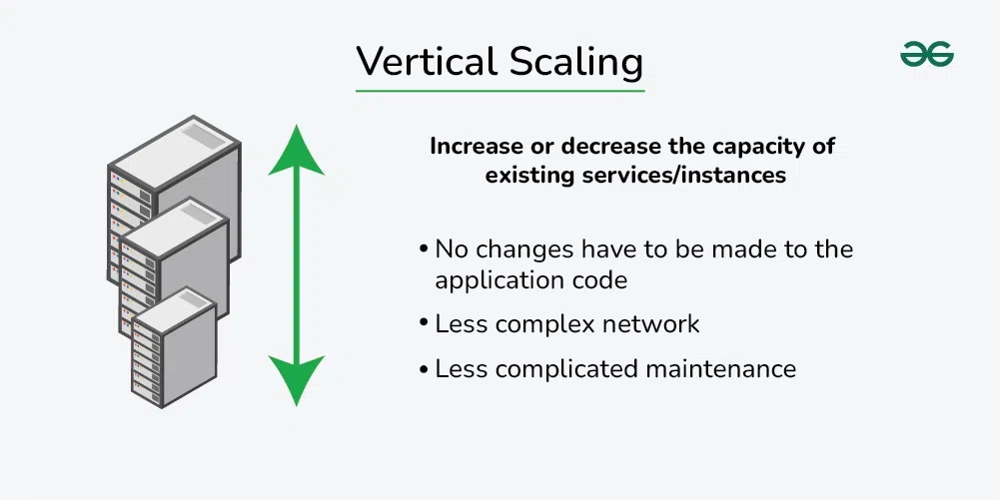
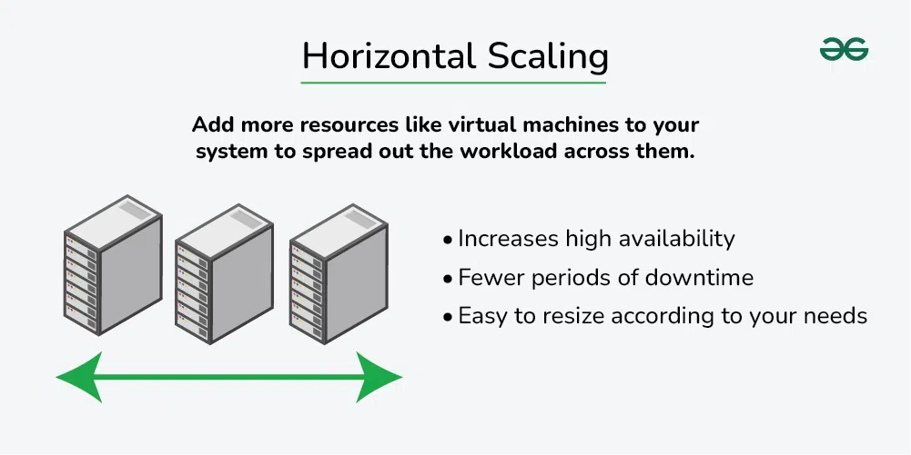
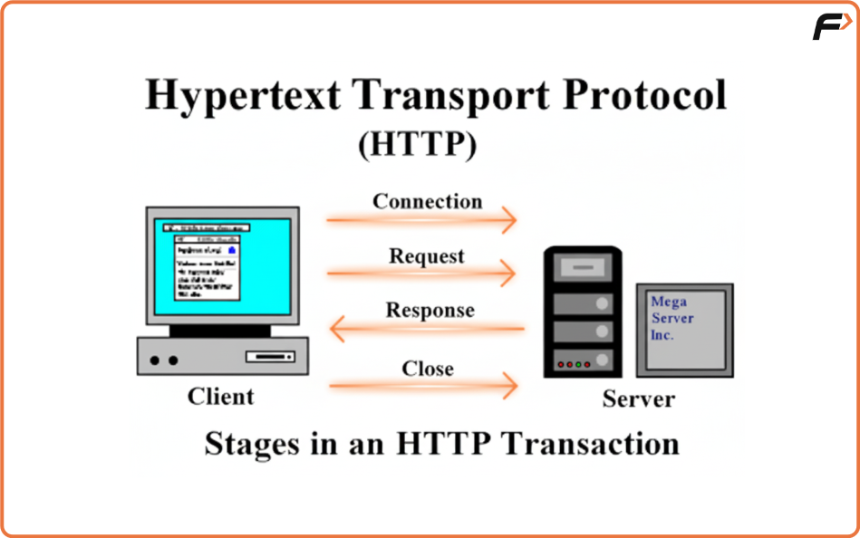
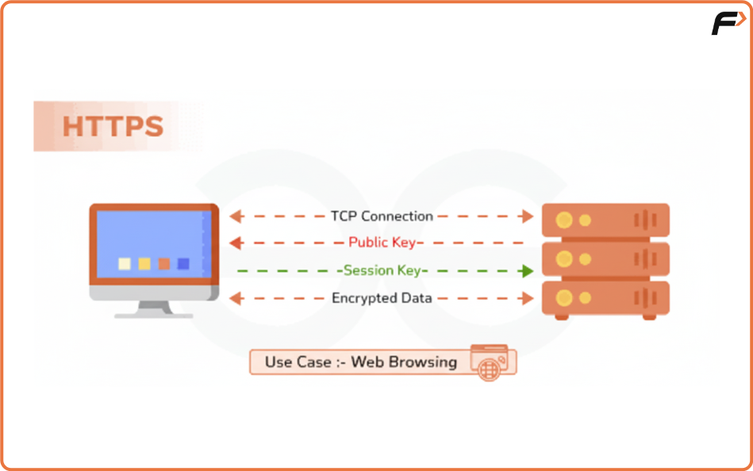
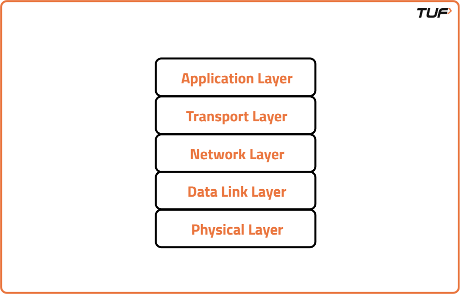
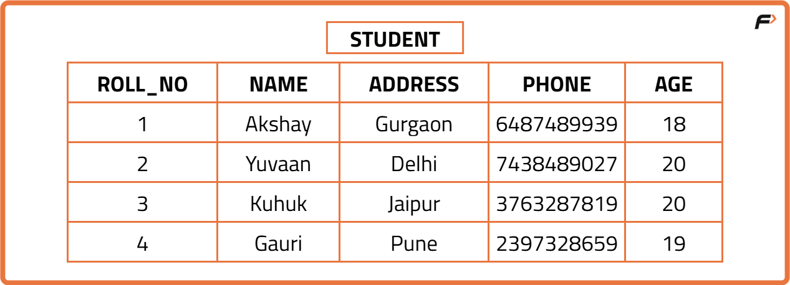
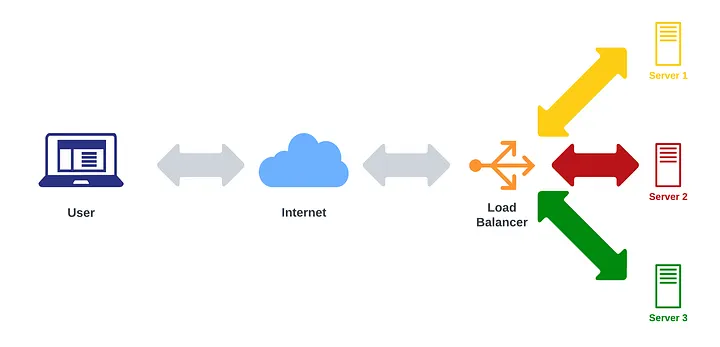
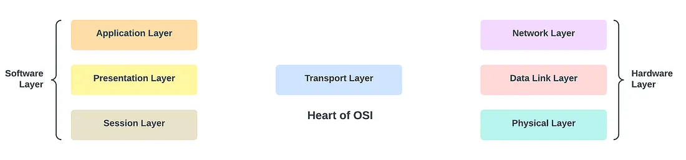
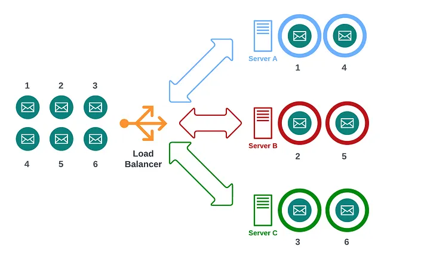

*Q1. What is system design?*

System design is the process of planning, structuring and defining the architecture of Software System.

- Involves translating user requirements into a detailed blueprint that guides the implementation phase.
- The goal is to create a well-organized and efficient structure that meets the intended purpose while considering factors like scalability, maintainability, and performance.

System Design in SDLC

- In System Design Life Cycle, without the designing phase, one cannot jump to the implementation or the testing part.
- System Design is a vital step and also provides the backbone to handle exceptional scenarios because it represents the business logic of the software.

System Design can be divided into two complementary parts


Real World Examples of HLD Decisions

- Netflix transitioned their entire backend from a monolith to microservices (starting with encoding and UI services), completing the migration by 2011 to scale rapidly during high-load events like holiday seasons.

- Uber adopted an event-driven architecture where ride requests, location updates, and fare changes emit events that trigger real-time systems like driver matching, billing, and dynamic pricing.

- Twitter deployed a load-balanced architecture with caching of trending topics and tweets to quickly serve millions of users and handle real-time data flows efficiently.

Steps for getting started with System Design

- Understand Requirements: Gather and analyze business needs by consulting stakeholders, users, and documentation.

- Define Architecture: Identify key system components and how they interact (e.g., services, APIs, databases).

- Choose Tech Stack: Select appropriate languages, databases, frameworks, and tools based on requirements.

- Design Modules: Break the system into modules, defining their responsibilities and data flow.

- Plan for Scalability: Design with growth in mind—anticipate load, optimize bottlenecks, and use scalable patterns.


*Q2. Horizontal vs. Vertical Scaling*

In system design, scaling is crucial for managing increased loads. Horizontal scaling and vertical scaling are two different approaches to scaling a system, both of which can be used to improve the performance and capacity of the system.


Why do we need Scaling!!

- Handle increased user load and traffic.
- Ensure high availability and reliability.
- Maintain performance and response time.
- Support growing data and storage needs.

Vertical Scaling

Vertical scaling, also known as scaling up, refers to the process of increasing the capacity or capabilities of an individual hardware or software component within a system.

- We upgrade the same system rather than adding more systems. Add more power to your machine by adding better processors, increasing RAM, or other power-increasing adjustments.
- Simple to implement and useful for monolithic and small scale applications.



Examples

- Upgrading a MySQL server from 16 GB RAM to 64 GB to handle more queries.
- Moving a website hosted on a 2-core VM to an 8-core, higher-RAM VM to improve performance.
- E-commerce platform running on a single large AWS EC2 instance with increased resources (CPU, RAM, disk).

Advantages

- Increased capacity: A server's performance and ability to manage incoming requests can both be enhanced by upgrading its hardware.
- Easier management: Upgrading a single node is usually the focus of vertical scaling, which might be simpler than maintaining several nodes.

Disadvantages

- Limited scalability: Vertical scaling is constrained by the hardware's physical limitations. Horizontal Scaling is not limited.
- One server still receives all incoming requests thus increasing the possibility of downtime in the event of a server failure.
- Scaling up often requires restarting or replacing the machine, causing downtime.

Horizontal Scaling

Horizontal scaling, also known as scaling out, refers to the process of increasing the capacity or performance of a system by adding more machines or servers to distribute the workload across a larger number of individual units.

- There is no need to change the capacity of the server or replace the server.
- There is no downtime while adding more servers to the network.



Examples

- A website like GeeksforGeeks adds more web servers behind a load balancer to handle traffic spikes.
- Netflix scales different microservices independently — e.g., multiple instances of the streaming service across regions.
- Amazon Auto Scaling spins up more EC2 instances during peak shopping hours (e.g., Black Friday).

Advantages

- Increased capacity: More nodes or instances can handle a larger number of incoming requests.
- Improved performance: By distributing the load over several nodes or instances, it is less likely that any one server will get overloaded.

Disadvantages

- Requires complex architecture (load balancers, distributed databases, etc.).
- Difficult to maintain strong consistency across distributed nodes. Requires synchronization, messaging, or replication between nodes.
- More machines = more networking, power, and maintenance.
- Needs orchestration tools (e.g., Kubernetes, Ansible) to manage many servers.
- Communication between nodes adds latency and complexity.

*Q3. What is Capacity Estimation?*

Capacity estimation in systems design is the process of predicting or determining the maximum load or demand that a system can handle within its operational parameters. This involves analyzing various aspects such as hardware capabilities, software performance, network bandwidth, and user behavior patterns.

- The goal is to ensure that the system can accommodate the expected workload without experiencing performance degradation, bottlenecks, or failures.
- Capacity estimation is crucial for designing and scaling systems effectively to meet current and future demands, whether it's a website, a network infrastructure, or any other complex system.

Factors that affect Capacity Estimation

- Hardware Resources: The capabilities of the hardware components such as processors, memory, storage devices, and network interfaces directly impact the system's capacity.

- Software Efficiency: The efficiency of the software algorithms, data structures, and overall design significantly affects how efficiently the system utilizes hardware resources.

- Workload Characteristics: Understanding the nature of the workload, including its intensity, variability, and peak periods, is essential for accurately estimating capacity requirements.

- User Behavior: User behavior patterns, such as browsing habits, transaction volumes, and concurrency levels, influence the system's capacity needs.

- Scalability: The system's ability to scale, both vertically (adding more resources to a single node) and horizontally (adding more nodes to a distributed system), impacts its overall capacity.

- Performance Metrics: Defining relevant performance metrics such as response time, throughput, and resource utilization helps in quantifying the system's capacity requirements.

- Failure Scenarios: Considering potential failure scenarios, such as hardware failures or network outages, is crucial for designing systems with adequate capacity for fault tolerance and resilience.

Tools and Resources for Capacity Estimation

- LoadRunner: LoadRunner is a performance testing tool used to simulate real-world user activity on your application. It creates virtual users to mimic actual users accessing your app. It measures how your system performs under different loads (light, normal, or heavy traffic) and identifies bottlenecks like slow responses, server crashes, or resource overuse.

- Grafana: Grafana is a data visualization and monitoring tool used to display real-time performance metrics of your system. Connects to data sources like databases, servers, or monitoring tools. Shows system metrics like CPU usage, memory usage, error rates, and traffic load on interactive dashboards and sends alerts when specific thresholds are crossed.

- Load Testing Tools: Tools like Apache JMeter, LoadRunner, and Gatling facilitate load testing to simulate real-world usage scenarios and measure system performance under various loads.

- Monitoring Platforms: Monitoring tools such as Prometheus, Nagios, and Datadog provide real-time insights into system performance metrics, resource utilization, and capacity trends.

*Q4. What is HTTP?*

When you browse the internet, every website you visit communicates with your device using a protocol. Two of the most common ones are HTTP (Hypertext Transfer Protocol) and HTTPS (Hypertext Transfer Protocol Secure). Think of HTTP as a regular postal service delivering letters without an envelope. Anyone along the way can read them. HTTPS, on the other hand, is like sending those same letters sealed inside a locked envelope. Only the sender and receiver can understand the contents. This difference makes HTTPS the modern standard, especially when dealing with sensitive information like passwords, online payments, and personal data.

HTTP

HTTP stands for HyperText Transfer Protocol. It is the standard protocol used by web browsers and servers to communicate and exchange data.Think of HTTP like sending a postcard. Anyone who handles the postcard during delivery (like routers, ISPs, or hackers on the network) can read what’s written on it because it’s all in plain text.

- HTTP operates on port 80 by default.
- It transfers data in plain text, meaning the content is not protected.
- Because it is unencrypted, attackers can intercept or modify the data easily.
- It is still used for non-sensitive websites where security is not a concern (like public blogs or info pages).



Advantages of HTTP

- Simplicity: Easy to implement and use since it does not require complex encryption mechanisms.
- Speed (without encryption): Faster in small setups because no encryption or decryption is performed.
- Compatibility: Supported by all browsers, servers, and applications without extra configuration.

Disadvantages of HTTP

- No Security: Data is sent in plain text and can be intercepted by attackers.
- No User Trust: Browsers often label HTTP websites as “Not Secure.”
- Not Suitable for Sensitive Data: Cannot be used for banking, login systems, or e-commerce where private information is exchanged.

What is HTTPS?

HTTPS stands for HyperText Transfer Protocol Secure. It is an extension of HTTP with added security through encryption. If HTTP is a postcard, HTTPS is like a locked envelope. Anyone can send it, but only the person with the right key (the website’s server) can open and read it. Even if attackers intercept it, they only see scrambled content.

- HTTPS operates on port 443 by default.
- It uses SSL (Secure Sockets Layer) or TLS (Transport Layer Security) to encrypt the data.
- Even if attackers capture the traffic, they cannot read the actual message.
- Browsers show a padlock symbol next to the URL to indicate that the site is secure.



Advantages of HTTPS

- Data Encryption: Protects information using SSL/TLS, making it unreadable to attackers.
- User Trust: Shows a padlock icon, increasing visitor confidence.
- SEO Benefits: Preferred by search engines and ranked higher compared to HTTP sites.
- Prevents Data Tampering: Stops man-in-the-middle attacks and ensures integrity of information.
- Supports Modern Protocols: HTTPS enables HTTP/2 and faster performance with multiplexing and compression.

Disadvantages of HTTPS

- Cost of Certificates: Requires SSL/TLS certificates (though many providers now offer them free via Let’s Encrypt).
- Performance Overhead: Encryption and decryption add slight computational overhead, though minimized in modern systems.
- Setup Complexity: Requires configuration of certificates, renewals, and proper server setup.

*Q5. What is the Internet TCP/IP stack?*

Explain TCP model

Transmission Control Protocol/Internet Protocol(TCP/IP) is a practical network model developed by the Department of Defense (DoD) in the 1960s to support communication between different network devices on the internet. 

TCP is a set of communication protocols that supports network communication.

The TCP model is subdivided into five layers, each containing specific protocols.



Layers of TCP model

1. Physical Layer

- The physical layer translates message bits into signals for transmission on a medium, i.e. the physical layer is the place where the real communication takes place.
- Signals are generated depending on the type of media used to connect two devices. For example, electrical signals are generated for copper cables, light signals are generated for optical fibers, and radio waves are generated for air or vacuum.
- Physical layer also specifies characteristics like topology(bus,star,hybrid,mesh,ring), line configuration(point-to-point, multipoint) and transmission mode(simplex, half-duplex, full-duplex).

2. Data Link Layer(DLL)

- The DLL is subdivided into 2 layers: MAC(Media Access Control), LLC(Logical Link Control)
- The MAC layer is responsible for data encapsulation(Framing) of IP packets from the network layer into frames. Framing means DLL adds a header(which contains the MAC address of source and destination) and a trailer(which contains error-checking data) at the beginning and end of IP packets.
- LLC deals with flow control and error control. Flow control: Limits how much data a sender can transfer without overwhelming the receiver. Error Control: Error in the data transmission can be detected by checking the error detection bits in the trailer of the frame.

3. Network Layer

The network layer adds IP address/logical address to the data segments to form IP packets and finds the best possible path for data delivery. IP addresses are addresses allocated to a device to uniquely identify it on a global scale. Common protocols used in the Network layer are

- IP(Internet Protocol): IP uses the receiver’s IP address to determine the best path for the proper delivery of packets to the destination. When a packet is too large to send over a network medium, the sender host's IP splits it up into smaller fragments. The fragments are reassembled into the original packet on the receiving host. IP is unreliable since it does not ensure delivery or check for errors.
- ARP(Address Resolution Protocol): ARP is used to find MAC/physical Addresses from the IP address.
- ICMP(Internet Control Message Protocol): ICMP is responsible for error reporting.

4. Transport Layer 

The transport layer is in charge of flow control (controlling the rate at which data is transferred), end-to-end connectivity, and error-free data transmission. Protocols used in the Transport layer:

- TCP(Transmission Control Protocol): 
- TCP is a connection-oriented protocol, which means it requires the formation and termination of connections between devices in order to transmit data.
- TCP segmentation means that at the sending node, TCP breaks the entire message into segments, assigns a sequence number to each segment, then reassembles the segments into the original message at the receiving end based on the sequence numbers.
- TCP is a reliable protocol because it identifies errors and retransmits the damaged frames, and ensures data delivery in the correct order.
- UDP(User Datagram Protocol):
- UDP is a connectionless protocol, which means it does not require the establishment and termination of connections between devices.
- UDP does not support segmentation and lacks error checking and correction which makes it less reliable but more cost-efficient.

5. Application Layer

This is the uppermost layer, which combines the OSI model's session, presentation, and application layers. Users can interact with the application and access network resources through this layer.

Protocols used in the Application layer:

- HTTP(Hypertext Transfer Protocol): Protocol used to access data on the World Wide Web.
- DNS(Domain Name System): This protocol translates domain names to IP addresses.
- SMTP(Simple Mail Transfer Protocol): This protocol is used to send Email messages.
- FTP(File Transfer Protocol): This protocol is used to transfer files between computers.
- TELNET(Telecommunication Network): It is a two-way communication protocol connecting a local machine to a remote machine.

*Q6. What happens when you enter Google.com?*

- So the first thing that happens is that your browser looks up in its cache to see if that website was visited before and the IP address is known.

- If it can't find the IP address for the URL requested then it asks your operating system to locate the website. The first place your operating system is going to check for the address of the URL you specified is in the host file. If the URL is not found inside this file, then the OS will make a DNS request to find the IP Address of the web page.

- The first step is to ask the Resolver (or Internet Service Provider) server to look up its cache to see if it knows the IP Address, if the Resolver does not know then it asks the root server to ask the .COM TLD (Top Level Domain) server - if your URL ends in .net then the TLD server would be .NET and so on - the TLD server will again check in its cache to see if the requested IP Address is there. 

- If not, then it will have at least one of the authoritative name servers associated with that URL, and after going to the Name Server, it will return the IP Address associated with your URL. All this was done in a matter of milliseconds WOW!

- After the OS has the IP Address and gives it to the browser, it then makes a GET (a type of HTTP Method) to said IP Address. When the request is made the browser again makes the request to the OS which then, in turn, packs the request in the TCP traffic protocol we discussed earlier, and it is sent to the IP Address. 

- On its way, it is checked by both the OS' and the server's firewall to make sure that there are no security violations. And upon receiving the request the server (usually a load balancer that directs traffic to all available servers for that website) sends a response with the IP Address of the chosen server along with the SSL (Secure Sockets Layer) certificate to initiate a secure session (HTTPS). 

- Finally, the chosen server then sends the HTML, CSS, and Javascript files (If any) back to the OS who in turn gives it to the browser to interpret it. And then you get your website as you know it.

*Q7. What are Relational Databases?*

The relational model in a Database Management System (DBMS) is a framework for managing and organizing data using tables, also known as relations. After designing the conceptual model of the Database using ER diagrams, we need to convert the conceptual model into a relational model that can be implemented using any RDBMS language like Oracle SQL, MySQL, etc.

It was introduced by Edgar F. Codd in 1970 and has become the foundation for most modern database systems. The relational model emphasizes the use of a structured, tabular format to store data and the relationships between those data points.

Key Terminologies

- Tables (Relations): Data is stored in tables, which consist of rows and columns. Each table represents a specific entity or concept.
- Rows (Tuples): Each row in a table represents a single record or instance of the entity described by the table.
- Columns (Attributes): Each column in a table represents a specific attribute or property of the entity. All values in a column are of the same data type.
- Degree: The number of attributes in the relation is known as the degree of the relation.
- Cardinality: The number of tuples in a relation is known as cardinality.

Let’s take an example of a student table for a class. We would call it the STUDENT relation. The relation STUDENT would have attributes ROLL_NO, NAME, ADDRESS, PHONE, and AGE, which would be represented as columns, and each student would be a record or tuple represented by each row of the table.



Integrity

Data integrity is an important aspect of relational models. Integrity should be maintained and checked for before performing any operation (insertion, deletion, and updation) in the database. If there is a violation of any of the constraints, the operation will fail.

Maintaining integrity constraints involves:

- Domain Integrity: Ensuring that all values in a column are of a specific data type.
- Entity Integrity: Each row must be unique, where keys come into the picture (candidate, super, primary, etc.).
- Referential Integrity: Ensuring that foreign keys correctly reference primary keys in other tables.

The values must be atomic, i.e., they can’t be divided further. For example, instead of having a NAME attribute, have separate attribute columns for FIRST_NAME, MIDDLE_NAME, and LAST_NAME.

*Q8. What are Database Indexes?*

In simple terminology, an index maps search keys to corresponding data on disk by using different in-memory & on-disk data structures. Index is used to quicken the search by reducing the number of records to search for.

Mostly an index is created on the columns specified in the WHERE clause of a query as the database retrieves & filters data from the tables based on those columns. If you don’t create an index, the database scans all the rows, filters out the matching rows & returns the result. With millions of records, this scan operation may take many seconds & this high response time makes APIs & applications slower & unusable.

Primary Key:
Take the following into consideration when creating a primary key:

- A primary key should be part of many vital queries in your application.
- Primary key is a constraint that uniquely identifies each row in a table. If multiple columns are part of the primary key, that combination should be unique for each row.
- Primary key should be Non-null. Never make null-able fields your primary key. By ANSI SQL standards, primary keys should be comparable to each other, and you should definitely be able to tell whether the primary key column value for a particular row is greater, smaller or equal to the same from other row. Since NULL means an undefined value in SQL standards, you can’t deterministically compare NULL with any other value, so logically NULL is not allowed.
- The ideal primary key type should be a number like INT or BIGINT because integer comparisons are faster, so traversing through the index will be very fast.

What is the difference between key & index

Although the terms key & index are used interchangeably, key means a constraint imposed on the behaviour of the column. In this case, the constraint is that primary key is non null-able field which uniquely identifies each row. On the other hand, index is a special data structure that facilitates data search across the table.

*Q9. What are NoSQL databases?*

NoSQL databases are built to manage large amounts of unstructured and semi-structured data with flexible schemas and high scalability.

- Do not rely on fixed tables or predefined schemas.
- Support flexible data models for diverse data types.
- Enable horizontal scaling for high performance.
- Well-suited for modern, data-intensive applications.

Features of NoSQL Databases

Here are the features of NoSQL databases that enable flexible, scalable, and high-performance data management for modern applications.

- Dynamic schema: Allows flexible data structures without requiring schema changes or migrations.

- Performance: Perfect for big data and real-time analytics and high volume applications.

- Flexibility: Supports dynamic schemas and multiple data types for adaptable data storage and retrieval.

- Distributed and high availability: Maintains data availability using automatic replication and fault tolerance across cluster nodes.

- Column-based: Data are organized into columns instead of rows (e.g., CASSANDRA).

- Key-value-based: Stores data as key–value pairs for simple and fast access (e.g., Redis).

- Document-based: Data are presented in flexible, semi-structured formats like JSON/BSON (e.g., MongoDB).

- Horizontal scalability: Supports larger datasets and higher traffic by adding nodes and distributing load across servers.

*Q10. What is a Cache?*

Caching, in the world of computer systems, is a technique to store a copy of data or computational results that can be retrieved quickly. The cache memory is like a tiny treasure box that keeps the most frequently accessed data ready for you.

Importance of Caching

Speed and efficiency are the name of the game. Caching reduces latency and lightens the load on the backend by serving pre-processed data. It also improves scalability and reduces operational costs, making it a lifesaver for businesses of all sizes.

Caching: Mechanisms, Tools, and Techniques

1. Browser Caching

Browser caching stores webpage resources on a local computer when a user visits a webpage. On the next visit, the browser loads the page from local resources, reducing server load and improving page load speed.

Here’s a code snippet showing how to enable caching via HTTP headers:

app.use((req, res, next) => {
  res.set({
    'Cache-Control': 'public, max-age=86400',  // Cache for 24 hours
  });
  next();
});

Browser caching is powerful but comes with limitations — it’s only effective for repeat visits and is entirely client-dependent.

2. CDN Caching (Content Delivery Network)

CDN caching replicates your data across various geographical locations, reducing the data travel time (latency) by serving it from the nearest server to the user. Big players like Cloudflare and AWS CloudFront provide CDN services.

CDN caching shines when you have a global user base. The more distributed the users, the more beneficial a CDN becomes.

3. Database Query Caching

Database query caching saves the result set of a query in the cache. When the same query is executed, the DBMS first checks the cache. If found, the results are returned from the cache, skipping the actual database hit.

Database-specific solutions exist, like MySQL Query Cache, or you can use an ORM that includes caching, like Hibernate for Java.

4. In-Memory Caching (e.g., Redis, Memcached)

In-memory caches store data in RAM, which is much faster than typical disk storage. They are often used for frequently read data, session information, and full-page caching.

const redis = require('redis');
const client = redis.createClient();
client.on('connect', function() {
  console.log('Redis client connected');
});
client.set('key', 'value', redis.print);
client.get('key', function(error, result) {
  if (error) {
    console.log(error);
    throw error;
  }
  console.log('GET result ->' + result);
});

5. Application Caching

Application caching allows an application to store instances or data that are expensive to create. This cache can be custom-built for your application or handled by a framework feature like Spring Cache for Java applications.

6. Distributed Caching

Distributed cache is a cache shared across multiple servers, commonly used in Microservices architectures. It improves performance and scalability by replicating cache data across all nodes in a system. Tools like Redis, Memcached, and Hazelcast are popular choices.

*Q11. What is Thrashing?*

Thrashing occurs when the operating system continually moves pages of data in and out of main memory because there is not enough RAM to support the working sets of all active processes. Each time a process references a page not in memory, a page fault occurs, forcing the OS to fetch that page from disk. When page faults occur too frequently, disk access dominates CPU time. Since accessing disk storage is thousands of times slower than accessing RAM, overall system performance drops dramatically.

Causes of Thrashing

Thrashing is typically caused by an imbalance between memory demand and available capacity. Common reasons include:

- Insufficient physical memory.
- Too many processes running simultaneously (high multiprogramming level).
- Inefficient page replacement policies.
- High memory fragmentation.

In essence, thrashing is a sign that the system’s resources are overcommitted.

The Working Set Model

To address thrashing, operating systems use the Working Set Model, introduced by Peter Denning. A working set is the collection of pages a process has referenced recently within a given time interval. The OS continuously monitors each process’s working set size. If the total of all working sets exceeds the available physical memory, the OS temporarily suspends or swaps out some processes. This reduces overall memory demand and allows active processes to run more efficiently. By maintaining only the active working sets in memory, the system can prevent the uncontrolled swapping that leads to thrashing.

*Q12. What are Threads & Processes?*

Processes:

To understand this properly let’s start from very simple. We all write code daily in a .py file or maybe in a .js file. Whenever we run that file we get our results back and we are done. But we never thought about what happened when I ran my program. If I say running a piece of program and getting results back in a process.

Whenever we run a program, it gets compiled into an executable format (binary form) because our computer understands only two words 0 and 1. So, this binary file then gets loaded onto the RAM of our system. But still, it’s just a piece of program, not a process. So, to make it a process we need OS, memory, Program counter, stack, threads, etc. When all necessary things get allocated along with the program file that becomes a process.

At every moment there are multiple processes available for the CPU to process but there is a process scheduler that decides which process took priority at which time. The scheduler assigns a place to us in the CPU to run our process.

Nowadays, as we have multiple core CPUs at a particular time multiple processes are executed in the CPU but all the processes are Isolated from each other like P1 doesn’t know anything about P2 and vice versa. So, what we can say is that multiprocessing is when we are using all the cores of our CPUs and running multiple processes simultaneously at a given point in time.

Threads:

It is a sub-part of a process. As we already know that process is just not program code there are multiple things inside a process. Threads are one of the most important things that present inside processes.

There can be multiple threads available in a process, so if we talk about a complex program there is not only a single action to perform in it. To perform heavy programs we need multiple threads inside a process to make things faster.

As we know in a process, there are multiple things like memory, heap, stack, etc. When it comes to threads we all are wondering how different threads gonna execute small pieces of a program with now single stack and if they are different then How memory is gonna get distributed? The answer to all questions is that all threads have their stack and all these threads work by sharing the memory. Whenever anything comes to a thread it gets in the stack and gets executed and since all have the same memory then it’s easy for us to get the final result from process because the all threads are gonna return results in the same place. The problem here is that threads are not isolated, unlike multiple processes. If anything wrong happens within one thread it might affect the result of other threads too.

There is a concept in threading called multithreading: You all know threading and multithreading are nothing different. As you know when we have a complex process to perform then we break the process into smaller pieces and instead of assigning whole pieces of the process to a single thread we can create multiple threads and make our process execute faster. All the threads in the process gonna share the same memory but all the threads consist of different stacks.

*Q13. What is Load Balancing?*



In the world of computers and the internet, load balancing works similarly. When a website or online service becomes super popular, it starts receiving a flood of requests from users all over the place. Instead of relying on a single server to handle all these requests (like the one chef scenario), load balancing spreads the workload across multiple servers.

By doing this, no single server gets overwhelmed with too much traffic, and every server gets to share the load. This prevents crashes, slowdowns, and annoying error messages, making sure that users like you and me have a smooth and enjoyable experience while browsing websites or using online applications.

Load balancing algorithms decide which server should handle each request, making sure they’re divvied up fairly. Think of it as a smart traffic cop redirecting cars during rush hour, ensuring that everyone gets where they need to be without a traffic jam.

Types of Load Balancers based on the OSI Model



Load balancers are categorized based on the layer of the OSI (Open Systems Interconnection) model at which they operate.

1. Network Load Balancer (Load Balancer 4):
Layer 4 Load Balancer operates at the transport layer (Layer 4) of the OSI model. It makes decisions based on information such as the source and destination IP addresses, as well as the port numbers of incoming requests. The main focus of Layer 4 load balancers is to distribute network traffic efficiently across multiple servers.

How it works:
When a user sends a request to access a website or application, the Layer 4 Load Balancer receives the request. It then looks at the transport layer data (IP addresses and ports) to determine which server should handle the request. The load balancer uses various algorithms (e.g., round-robin, least connections) to decide the best server to forward the request to. This ensures that traffic is evenly spread among the servers, improving performance and avoiding overloading any single server.

Advantages:
- High performance and low latency due to its network-level decisions.
- Suitable for distributing TCP and UDP traffic efficiently.
- Ideal for scenarios where content-based decisions are not necessary.

Disadvantages:
- Limited in making application-specific decisions.

2. Application Load Balancer (Load Balancer 7):
Layer 7 Load Balancer operates at the application layer (Layer 7) of the OSI model. It can make more intelligent decisions based on application-specific data, such as HTTP headers, cookies, and URLs. Layer 7 Load Balancers understand application protocols, enabling them to optimize traffic distribution for specific applications or services.

How it works:
When a user sends a request, the Layer 7 Load Balancer analyzes the content of the request to gain insights into the application being accessed. For example, it can identify the type of service (e.g., HTTP, HTTPS, FTP) or the specific URL being requested. Using this information, the load balancer can make intelligent decisions about which server is best suited to handle the request. This allows for more advanced load balancing strategies, such as sending certain requests to specialized servers that can handle specific application tasks.

Advantages:
- Application-aware and can optimize traffic based on specific application requirements.
- Allows for content-based routing and advanced load balancing algorithms.
- Suitable for complex applications that require different server responses based on the type of request.

Disadvantages:
- Higher processing overhead compared to Layer 4 Load Balancer due to content analysis.

Load Balancing Algorithms

1. Round Robin

The Round Robin load balancing algorithm is one of the simplest and most straightforward methods used to distribute incoming network traffic across multiple servers. It operates at the transport layer (Layer 4) of the OSI model and is commonly used in various load balancers.

 How it works:

 1. Server Pool: To begin, the load balancer maintains a pool of available servers that are ready to handle incoming requests. These servers could be physical machines, virtual instances, or containers.

 2. Request Distribution: When a new request comes in, the load balancer starts at the first server in the pool and forwards the request to that server. For the next request, it moves to the next server in line and forwards the request to that server, continuing this sequential pattern.

 3. Circular Pattern: The load balancer cycles through the list of servers in a circular fashion. Once it reaches the last server in the pool, it goes back to the first server and starts the cycle again. This ensures an even distribution of requests across all servers.

 The Round Robin algorithm is stateless, meaning it doesn’t consider the current load or responsiveness of servers when making the distribution decision. All servers are treated equally, regardless of their current workload.

 

 Advantages:

 - Simplicity: Round Robin is one of the simplest load balancing algorithms to implement. It doesn’t require complex calculations or in-depth server monitoring.

 - Equal Workload: The algorithm ensures an even distribution of incoming requests among all servers in the pool. Each server gets an equal share of the load, promoting fair resource utilization.

 - No Session Affinity: Round Robin is stateless, meaning it doesn’t rely on session information or maintain any state about previous requests. This makes it suitable for stateless applications or scenarios where session affinity is not required.

 Disadvantages:

 - Unequal Server Capacities: Round Robin treats all servers equally, regardless of their capacities or performance capabilities. This can lead to some servers being overburdened if they are less powerful than others in the pool.

 - No Health Monitoring: The algorithm lacks intelligence to monitor server health or responsiveness. If a server becomes unavailable or experiences performance issues, Round Robin continues to forward requests to that server.

 - Load Imbalance: In practice, the actual workload of requests can vary, even with Round Robin. Certain requests may be more resource-intensive, leading to imbalances in server loads.

 2. Weighted Round Robin

 The Weighted Round Robin load balancing algorithm is an extension of the basic Round Robin algorithm. It aims to address the issue of unequal server capacities by assigning different weights to each server in the pool. These weights represent the relative capacity or performance of each server. Servers with higher weights get a larger share of the incoming traffic, while servers with lower weights receive a smaller share.

 How it works:

 1. Assigning Weights: Each server in the pool is assigned a weight, which represents its capacity or processing power. Servers with higher capacities are given higher weights, and those with lower capacities receive lower weights.

 2. Weight-Based Distribution: When a new request comes in, the load balancer uses the weights to determine which server should handle the request. It cycles through the servers in a circular manner, as in the basic Round Robin algorithm, but with a slight modification. Instead of equal distribution, it takes into account the weights of the servers.

 3. Proportional Allocation: The load balancer forwards incoming requests to servers based on their weights. Servers with higher weights receive a larger proportion of the traffic, while servers with lower weights handle fewer requests.

 4. Equal Load per Weight: Within the subset of servers with the same weight, the load is distributed equally using basic Round Robin. This ensures that all servers with the same weight share the traffic evenly.

 Advantages:

 - Capacity-Based Distribution: Weighted Round Robin accounts for the different capacities of servers, ensuring that more powerful servers handle a higher proportion of the traffic.
 
 Disadvantages:

 - Static Configuration: Weighted Round Robin requires manual configuration of server weights. It may not adapt dynamically to changes in server performance or capacity.

 3. IP Hash

 The IP Hash load balancing algorithm is a method used to distribute incoming network traffic across multiple servers based on the source IP address of the client. This algorithm operates at the application layer (Layer 7) of the OSI model and is commonly used in environments where session persistence or sticky sessions are required.

 How it works:

 1. Client IP Address: When a client (usually a user’s device) sends a request to access a website or application, the load balancer extracts the source IP address from the incoming request.

 2. Hashing the IP Address: The IP address is then hashed, meaning it is converted into a unique numerical value using a hash function. The hash function ensures that the same IP address will always produce the same hash value.

 3. Determining the Server: The load balancer uses the hashed value to map the client’s IP address to a specific server in the pool. This mapping is typically done by dividing the hash value by the total number of servers and selecting the corresponding server.

Advantages:

- Session Persistence: IP Hash provides session affinity, ensuring that subsequent requests from the same client are always directed to the same server. This is crucial for applications that rely on maintaining user sessions or state.

Disadvantages: 

- Uneven Workload: If a few clients generate a disproportionately large amount of traffic, the corresponding servers may experience a higher workload, potentially causing imbalances.

4. Least Connection Algorithm

The Least Connection load balancing algorithm is designed to distribute incoming network traffic across multiple servers based on the number of active connections each server currently has. The main objective of this algorithm is to direct new requests to the server with the least number of connections, ensuring a more balanced distribution of the workload.

How it works:

1. Tracking Connections: The load balancer continuously monitors the number of active connections on each server in the pool. It keeps track of how many clients are currently connected to each server.

2. Choosing the Least Connection: When a new request comes in, the load balancer evaluates the current connection count for each server and selects the server with the fewest active connections.

3. Load Distribution: The new request is then forwarded to the chosen server, which has the least burden of active connections.

4. Equalizing Connections: By directing new requests to servers with fewer connections, the Least Connection algorithm attempts to balance the number of connections across all servers in the pool.

Advantages:

- Dynamic Load Distribution: The Least Connection algorithm adapts in real-time to the actual workload on each server, ensuring that new requests are directed to the least busy server at that moment.

Disadvantages:

- Connection Fluctuations: The Least Connection algorithm may cause frequent fluctuations in connections for some servers, especially when the workload is volatile.

*Q14. What is Consistent Hashing?*

Before diving deep into Consistent Hashing, let’s first understand what Hashing is? Hashing is a computationally efficient way of information retrieval and helpful in enhancing the performance of various programs. In hashing, a hash function is generally used to map the information to a storage pool by generating a hash value using a well-defined logic.

For example we can generate a random number that can map to storage by taking mod using the total number of servers. Hence, the hashing is used to map the requests to various servers and get the work done. However, this concept is valid only when the servers don’t change and memory locations are known. Distributed systems often involve changing the underlying servers to handle the requests over a network. Hence to deal with such shortcoming of distributed systems and handle the requests over a network, we need a more efficient manner of handling and organizing requests for a scalable application. This is compensated using Consistent Hashing.

Consistent hashing is an improvement over normal Hashing. Here, the user and servers are located virtually in a circular ring structure called the Hash ring. The ring is considered infinite and can accommodate any number of servers with/having no fixed allocation and assign them to random locations based on some hash function.

*Q15. What is Sharding?*

Database sharding is the process of storing a large database across multiple machines. A single machine, or database server, can store and process only a limited amount of data. Database sharding overcomes this limitation by splitting data into smaller chunks, called shards, and storing them across several database servers. All database servers usually have the same underlying technologies, and they work together to store and process large volumes of data. Database sharding is one of the methods to solve this problem because it enables parallel processing of smaller datasets across shards.

Benefits of database sharding

- Improve response time: Data retrieval takes longer on a single large database. The database management system needs to search through many rows to retrieve the correct data. By contrast, data shards have fewer rows than the entire database. Therefore, it takes less time to retrieve specific information, or run a query, from a sharded database.

- Avoid total service outage: If the computer hosting the database fails, the application that depends on the database fails too. Database sharding prevents this by distributing parts of the database into different computers. Failure of one of the computers does not shut down the application because it can operate with other functional shards. Sharding is also often done in combination with data replication across shards. So, if one shard becomes unavailable, the data can be accessed and restored from an alternate shard.

- Scale efficiently: A growing database consumes more computing resources and eventually reaches storage capacity. Organizations can use database sharding to add more computing resources to support database scaling. They can add new shards at runtime without shutting down the application for maintenance.

Shared-nothing architecture

Database sharding operates on a shared-nothing architecture. Each physical shard operates independently and is unaware of other shards. Only the physical shards that contain the data that you request will process the data in parallel for you. 

A software layer coordinates data storage and access from these multiple shards. For example, some types of database technology have automatic sharding features built in. Software developers can also write sharding code in their application to store or retrieve information from the correct shard or shards.

*Q16. What are Bloom Filters?*

In system design, Bloom Filters emerge as an elegant solution for efficient data querying and storage. This probabilistic data structure offers a compact representation, adept at determining set membership with minimal memory footprint. By leveraging hash functions and bit arrays, Bloom Filters excel in scenarios demanding rapid retrieval and space optimization.

Bloom Filters are probabilistic data structures used for membership testing in a set. They efficiently determine whether an element is possibly in the set or definitely not, with a small probability of false positives. These filters consist of a bit array and multiple hash functions.

How do Bloom Filters Work?

- Bloom Filters work by using a bit array, typically initialized with all bits set to 0, and a set of hash functions.
- When an element is added to the Bloom Filter, it undergoes hashing through each of the hash functions, which produce a set of indexes in the bit array. These indexes are then set to 1.
- To check if an element is present in the Bloom Filter, it undergoes the same hashing process.
- If all the corresponding bits in the array are set to 1, the filter indicates that the element may be present in the set.
- However, if any of the bits are 0, then the element is definitely not in the set.

Bloom Filters can give false positives, meaning they may incorrectly indicate that an element is present in the set when it is not. This can happen due to hash collisions, where multiple elements map to the same set of indexes in the bit array. The probability of false positives can be controlled by adjusting the size of the bit array and the number of hash functions used.

*Q17. What is Data Replication?*

Data Replication is the process of storing data in more than one site or node. It is simply copying data from a database from one server to another server.

Types of algorithms for implementing Database Replication?

1. Single Leader Replication (Active-Passive or Master-Slave Replication)

- So in leader based architecture, client (application server) requests are sent to leader DB first and after that leader sends the data changes to all of its followers as a part of the replication log.

- Whenever a client wants to read data from the database then it can query either leader or any of the follower (Yes there is generally more than just one follower to make the system highly available). However, writes to the database is only accepted on the leader by the client.

- Now whenever a follower dies our application will not get impacted as there is not just a single node of data. Our application can read from other followers as well and hence this makes our system highly Read Scalable

Used in: PostgreSQL, MySql, SQL Server, MongoDB, Kafka, etc.

*Q18. URL shortener (bit.ly). Estimate traffic and storage. How do you generate unique short codes (counter + base62, hash + collision handling, pre-generated key service)? How do you scale reads with caching and a CDN, handle expiry, custom aliases and analytics without slowing redirects, and choose between SQL and NoSQL?*

I would design a URL shortener around one primary requirement: **redirects must be extremely fast and reliable, while URL creation, expiry, and analytics can be handled asynchronously where appropriate.**

The core system accepts a long URL, generates a short code, stores the mapping, and redirects requests to the original URL. At scale, the hardest parts are estimating capacity, generating unique codes safely, optimizing read-heavy traffic, and collecting analytics without adding latency to redirects.

## 1. Requirements and assumptions

### Functional requirements

- Create a short URL from a valid long URL.
- Redirect a short code to its destination.
- Support custom aliases such as `/summer-sale`.
- Support expiration dates and optional link deactivation.
- Track clicks, referrers, timestamps, and coarse device or geographic information.
- Optionally support user accounts, link management, and analytics dashboards.

### Non-functional requirements

- Low-latency redirects, ideally within tens of milliseconds at the application layer.
- High availability for reads.
- Unique codes with no accidental overwrites.
- Abuse prevention against phishing, spam, and malicious destinations.
- Eventual consistency for analytics is acceptable; incorrect redirects are not.

For a concrete estimate, assume:

| Parameter | Assumption |
|---|---:|
| New short URLs | 10 million/day |
| Redirects | 100 million/day |
| Peak-to-average traffic factor | 5× |
| Average stored mapping size | 500 bytes |
| Average analytics event size | 200 bytes |

These are design assumptions, not measured Bitly statistics.

## 2. Traffic and storage estimation

### Write traffic

\[
\frac{10{,}000{,}000}{86{,}400}
\approx 116 \text{ writes/second}
\]

At a 5× peak factor:

\[
116 \times 5 \approx 580 \text{ writes/second}
\]

### Read traffic

\[
\frac{100{,}000{,}000}{86{,}400}
\approx 1{,}157 \text{ redirects/second}
\]

Peak redirects:

\[
1{,}157 \times 5 \approx 5{,}785 \text{ requests/second}
\]

That is manageable with a horizontally scaled application tier and a suitable database, but a real design must also account for traffic skew: a small number of viral URLs may receive a large fraction of requests.

### Mapping storage

At 10 million new mappings per day:

\[
10{,}000{,}000 \times 365
= 3.65 \text{ billion mappings/year}
\]

At 500 bytes per mapping:

\[
3.65 \times 10^9 \times 500
= 1.825 \text{ TB/year}
\]

That is approximately 1.83 TB/year in decimal units, **before indexes, replication, database overhead, backups, and storage-engine overhead**. A practical provisioned footprint could be several times larger.

### Analytics storage

At 100 million redirects per day and 200 bytes per event:

\[
100{,}000{,}000 \times 200
= 20 \text{ GB/day}
\]

That is roughly 7.3 TB/year of raw analytics events, before indexes, replication, and compression.

This is why I would not store every click as an additional row in the same transactional table that serves redirects. I would send events to a queue or streaming platform and process them separately.

## 3. High-level architecture

<text> </text>

```text
                    URL creation
                        |
                    API service
                        |
                Code generation
                        |
                  Mapping database
                        |
                    Short code

Browser -- GET /abc123 --> CDN / edge cache
                              |
                         Redirect service
                              |
                       Local / Redis cache
                              |
                        Mapping database
                              |
                         301 / 302
                              |
                    Async click event
                              |
                     Queue / stream
                              |
                  Analytics consumers
                              |
                  Analytics data store
```

The redirect service should be stateless so it can scale horizontally. The mapping database is the source of truth, caches accelerate reads, and analytics runs outside the redirect's critical path.

For a new link, I validate the destination, allocate a code, persist the mapping, and only then return the short URL. For a redirect, I resolve the code, check status and expiry, emit a redirect response, and enqueue analytics without waiting for the analytics pipeline to finish.

## 4. Generating unique short codes

A short code must be unique. It must also be reasonably compact, URL-safe, and difficult enough to enumerate if the links are intended to be private.

There are three common approaches.

### Approach A: counter or unique ID + Base62

Allocate a unique numeric ID, then encode it using 62 characters:

`0-9`, `a-z`, and `A-Z`.

Example:

```javascript
const ALPHABET =
  "0123456789abcdefghijklmnopqrstuvwxyzABCDEFGHIJKLMNOPQRSTUVWXYZ";

function encodeBase62(number) {
  if (!Number.isSafeInteger(number) || number < 0) {
    throw new Error("Expected a non-negative safe integer");
  }

  if (number === 0) return "0";

  let result = "";

  while (number > 0) {
    result = ALPHABET[number % 62] + result;
    number = Math.floor(number / 62);
  }

  return result;
}

console.log(encodeBase62(125)); // "21"
```

Here, `125` becomes `21` in Base62.

**How to allocate IDs:**
- A database sequence or auto-incrementing primary key.
- A distributed ID generator.
- A dedicated ID allocation service.
- Preallocated ranges of IDs assigned to different application instances.

**Advantages**
- Guaranteed uniqueness when ID allocation is correct.
- No hash collisions.
- Simple lookup and predictable code length for a given ID range.

**Disadvantages**
- Sequential IDs are guessable.
- A single central allocator can become a bottleneck.
- Distributed allocation requires careful coordination or range management.

For a large system, I might allocate ID ranges to application instances so they can generate codes locally without contacting a central service for every URL. I would ensure that ranges are never assigned twice.

Base62 encoding is not encryption. If codes need to be difficult to enumerate, use a random or cryptographically generated identifier, or apply an appropriate permutation to IDs while preserving uniqueness.

### Approach B: hash the long URL

Compute a hash of the normalized URL, then truncate or encode part of it.

```javascript
import { createHash } from "node:crypto";

function hashUrl(url) {
  return createHash("sha256")
    .update(url)
    .digest("base64url")
    .slice(0, 8);
}
```

This is illustrative, not a complete unique-code generator.

**The problem:** truncating a hash can produce collisions. Two different long URLs may generate the same short code.

Collision handling options:
1. Insert the mapping using a unique constraint on the code.
2. If the insert conflicts, generate another candidate or use more hash bits.
3. Retry a bounded number of times.
4. Return a controlled error if allocation still fails.

A deterministic hash can be useful when deduplication is a requirement, but it is not necessarily desirable for a general URL shortener. Different users may want separate links to the same destination, with different expiry policies, access controls, or analytics.

Also, normalize URLs carefully. Removing query parameters or changing path casing can change the meaning of a destination.

### Approach C: pre-generated key service

A dedicated service generates unique codes in advance and stores them in a pool. Application instances request batches of available codes and consume them locally.

For example:

```text
Key service
   |
   +--> Instance A: codes 1000–1999
   |
   +--> Instance B: codes 2000–2999
   |
   +--> Instance C: codes 3000–3999
```

The ranges are illustrative; a real key service may allocate random codes rather than sequential ranges.

**Advantages**
- Low latency during URL creation.
- Reduced contention on a central ID generator.
- Can use random codes to make enumeration more difficult.

**Challenges**
- Safe allocation and lease management.
- Wasted codes when instances crash.
- Pool replenishment and exhaustion.
- Avoiding reuse of codes that may still exist in caches or external references.

Unused codes are generally harmless. Reusing a code that once pointed to a different destination can be dangerous because old links may still be shared or cached.

### Which approach would I choose?

For a conventional, high-volume URL shortener, I would start with a unique ID generator plus Base62, using a distributed allocator or preallocated ID ranges if necessary. I would add a randomization strategy if enumeration is a concern.

For custom aliases, I would bypass automatic generation and enforce a unique database constraint on the alias.

**The database uniqueness constraint is the final authority**, regardless of the code-generation algorithm.

## 5. Read scaling: cache, Redis, and CDN

Redirects vastly outnumber URL creations, so the read path is the most important part of the design.

I would use a two-level cache:

1. **CDN or edge cache:** serves frequently requested redirects close to users.
2. **Redis or an in-process cache:** serves requests that reach the origin.
3. **Database:** source of truth on cache misses.

### Cache-aside example

```javascript
async function resolveShortCode(code) {
  const cached = await redis.get(`url:${code}`);

  if (cached !== null) {
    const mapping = JSON.parse(cached);

    if (mapping.expiresAt && Date.now() >= mapping.expiresAt) {
      return null;
    }

    return mapping;
  }

  const mapping = await db.findByCode(code);

  if (!mapping || !mapping.isActive) {
    return null;
  }

  if (mapping.expiresAt && Date.now() >= mapping.expiresAt) {
    return null;
  }

  const remainingTtl = mapping.expiresAt
    ? Math.floor((mapping.expiresAt - Date.now()) / 1000)
    : 3600;

  if (remainingTtl > 0) {
    await redis.set(
      `url:${code}`,
      JSON.stringify(mapping),
      { EX: remainingTtl }
    );
  }

  return mapping;
}
```

This is illustrative; production code should validate the code, handle cache/database failures, and distinguish expired, missing, and inactive mappings as needed.

### Cache design considerations

- Cache hot codes based on actual access patterns rather than assuming a fixed hit rate.
- Set cache TTLs so entries do not outlive their link expiry.
- Use negative caching for missing codes with a short TTL to reduce repeated database lookups for random invalid codes.
- Prevent cache stampedes when many requests miss the same key simultaneously.
- Invalidate or update cache entries when a link is deactivated or its destination changes.
- Use a bounded local cache only when its staleness and invalidation behavior are acceptable.

A Redis hit rate of 90% would reduce origin database reads by approximately 90% for requests reaching that cache, assuming the workload and cache behavior support that rate. A CDN may reduce origin traffic further.

### CDN caching and HTTP redirects

For a URL shortener, I would normally choose **HTTP 302** initially.

- `301 Moved Permanently` can be cached by browsers and intermediaries. That improves performance but can make destination changes, expiry enforcement, and click counting difficult.
- `302 Found` is a temporary redirect and is commonly used when redirects need to remain under application control. Explicit caching headers still matter.

A CDN can cache a 302 if its caching policy allows it, so the status code alone does not guarantee every click reaches the origin.

If the product needs exact per-visit analytics, avoid caching the redirect beyond the point where the click is recorded. If analytics are approximate and link destinations are immutable, edge caching can be more aggressive.

## 6. Expiration and deletion

Each mapping should include an expiry timestamp, typically `expires_at`, or no expiry if the link is permanent.

I use two mechanisms:

- **Lazy expiry check:** check the timestamp whenever a redirect resolves.
- **Background cleanup:** periodically deactivate or remove expired records and associated cache entries.

The lazy check is the correctness mechanism; the cleanup job reclaims storage and maintains indexes.

For example:

```sql
SELECT destination_url, expires_at, is_active
FROM url_mappings
WHERE short_code = ?;
```

After retrieving a record, the redirect service checks `is_active` and `expires_at` before returning a redirect.

Important details:

- A cache TTL should never extend beyond the link's expiry.
- Expiry workers should be idempotent and safe to run concurrently.
- If a link can be deactivated immediately, invalidate its Redis entry and purge relevant CDN caches.
- CDN purge propagation may not be instantaneous, so short-lived edge TTLs or versioned cache keys may be needed for links that require strict revocation.
- Do not reuse expired codes casually. A previously shared link could unexpectedly redirect to a different destination if its code is reassigned.

For systems where revocation must take effect immediately, aggressive edge caching is a trade-off that needs explicit handling.

## 7. Custom aliases

A user may request a readable alias such as `/black-friday`.

I would store generated codes and custom aliases in the same namespace, protected by a unique constraint.

```sql
CREATE TABLE url_mappings (
    short_code VARCHAR(32) PRIMARY KEY,
    destination_url TEXT NOT NULL,
    created_at TIMESTAMP NOT NULL,
    expires_at TIMESTAMP NULL,
    is_active BOOLEAN NOT NULL DEFAULT TRUE,
    user_id BIGINT NULL
);
```

When creating a custom alias:

1. Validate its allowed characters and length.
2. Reject reserved paths such as `/admin`, `/api`, and health-check routes.
3. Check authorization and rate limits.
4. Attempt the insert.
5. If the unique constraint fails, return `409 Conflict`.

A preliminary availability check is useful for the user interface, but it is not sufficient to guarantee uniqueness: two concurrent requests can both pass the check. The database constraint resolves that race.

I would also prevent users from creating aliases that impersonate reserved system routes or violate abuse policies.

## 8. Analytics without slowing redirects

The redirect path should not wait for a database insert into an analytics table, a dashboard aggregation, or a third-party analytics API.

Instead:

```text
Redirect request
      |
Resolve mapping and validate expiry
      |
Return 302 response
      |
Publish click event asynchronously
      |
Kafka / durable queue
      |
Analytics consumers
      |
Aggregate store / data warehouse
```

A click event might contain:

```json
{
  "eventId": "evt_123",
  "shortCode": "aB12xy",
  "timestamp": "2026-10-16T10:00:00Z",
  "referrer": "https://example.com",
  "userAgent": "browser information",
  "country": "IN"
}
```

This is an illustrative event schema. Avoid retaining raw IP addresses or detailed identifiers unless needed and permitted by the product's privacy policy.

### Delivery and failure handling

A critical distinction: placing an event on an in-memory queue does not guarantee delivery if the process crashes.

For more reliable analytics, publish to a durable message broker or use a local durable mechanism. The redirect handler should not block on analytics aggregation, but the system must define what happens when the broker is unavailable.

Possible policies include:

- Best-effort analytics for noncritical click counts.
- Bounded local buffering with explicit drop metrics.
- Durable event publication with a suitable latency budget.
- A transactional or durable outbox when events must correspond reliably to committed business operations.

Consumers should be idempotent because message brokers commonly provide at-least-once delivery in many configurations. Deduplicate events or use aggregation logic that handles retries.

### Why not increment a click counter directly?

Doing this for every redirect:

```sql
UPDATE url_mappings
SET click_count = click_count + 1
WHERE short_code = ?;
```

creates a write on the hottest part of the read path. Popular links can cause row contention, increased database writes, and higher redirect latency.

Instead, publish events and aggregate counts asynchronously. For dashboards, use time-windowed aggregates such as clicks per link per minute or hour.

Also account for bots, link-preview crawlers, duplicate events, and retries. Raw HTTP requests do not always represent unique human clicks.

## 9. SQL vs. NoSQL

Neither is universally correct. The access pattern and operational constraints determine the choice.

| Factor | SQL, e.g. PostgreSQL/MySQL | NoSQL, e.g. DynamoDB/Cassandra |
|---|---|---|
| Primary lookup | Excellent with indexed primary key | Excellent with partition/key lookup |
| Uniqueness constraints | Straightforward | Depends on database and conditional-write support |
| Transactions and relational queries | Strong support | Varies by database |
| Horizontal scaling | Possible, but sharding adds complexity | Often a core design capability |
| Flexible analytics queries | Good for relational metadata; huge event analytics still need separate storage | Depends on model; often paired with an analytics system |
| Operational complexity | Often simpler at moderate scale | Can simplify high-scale key lookups but introduces its own partitioning and consistency concerns |

### What I would choose

For an initial product or a moderate-scale service, I would choose **PostgreSQL or MySQL** with:

- `short_code` as the primary key.
- Indexed ownership and expiry fields where needed.
- A Redis cache for hot mappings.
- A separate analytics pipeline.

A relational database is more than capable of serving a large number of indexed point lookups when properly sized and scaled.

If the system grows to billions of mappings and needs massive distributed read throughput, a managed key-value database such as DynamoDB or a carefully operated distributed store such as Cassandra becomes attractive. Partitioning by `short_code` aligns with the dominant lookup pattern.

I would not choose NoSQL simply because the system is “large.” I would choose it when its scaling, availability, and operational characteristics justify the trade-offs.

## 10. Production failure cases

- **Redis unavailable:** fall back to the database with concurrency limits and circuit breaking so the database does not collapse under a sudden cache-miss storm.
- **Database unavailable:** cached links may still work, but cache misses cannot be resolved. Avoid serving expired or revoked entries merely because the database is down.
- **Hot key:** use edge caching, request coalescing, and appropriate cache replication or local caching.
- **Random-code abuse:** rate-limit invalid lookups and consider short-lived negative caching.
- **Analytics broker unavailable:** apply a defined bounded-buffer or drop policy and monitor lost events.
- **Malicious destination:** validate URL schemes, scan against abuse intelligence where appropriate, and provide reporting and takedown mechanisms.
- **Custom alias collision:** rely on a database uniqueness constraint, not an application-side check alone.
- **Expiry race:** verify expiry on resolution and keep cache TTLs aligned with the expiration timestamp.

## Interview-ready summary

“I would assume a read-heavy workload, estimate average and peak traffic, and calculate mapping and analytics storage separately. For code generation, I would start with unique IDs encoded in Base62, using distributed ID allocation or preallocated ranges as scale demands; random hashes require collision handling. Redirects use a CDN and Redis in front of a database, with expiry checks and cache invalidation. I would use 302 redirects when I need continued control and reliable origin-side click measurement, and publish analytics asynchronously to a durable queue rather than incrementing a database counter on every request. I would start with SQL for its simplicity and constraints, then consider NoSQL if measured scale and availability requirements justify it.”

For additional system-design perspectives, see this recent [URL shortener design walkthrough](https://bytepatterns.com/blog/design-a-url-shortener-system-design-interview). <Cite refs={["turn371459search1","turn371459search2","turn371459search5"]}/>

*Q19. Rate limiter. Design a distributed rate limiter for an API gateway. Compare fixed window, sliding window log, sliding window counter and token bucket. Where does it live (gateway, middleware, sidecar), how do you keep counters consistent across nodes with Redis and Lua, and what happens when Redis is down (fail open vs fail closed)?*

A distributed rate limiter controls how many requests a client can make within a given period, even when requests are distributed across multiple API gateway instances.

The main challenge is **enforcing a shared limit consistently across nodes without adding significant latency to every request**.

I would design the limiter around a policy engine, an atomic counter/token operation in Redis, and a clearly defined failure policy for when Redis becomes unavailable.

## 1. Requirements and architecture

### Functional requirements

- Limit requests by IP address, authenticated user, API key, tenant, or endpoint.
- Support different policies for different customers and routes.
- Return HTTP `429 Too Many Requests` when a limit is exceeded.
- Provide rate-limit headers indicating the limit, remaining quota, and retry guidance.
- Support distributed enforcement across multiple gateway instances.
- Handle bursts, configuration changes, and Redis failures.

### Example policies

| Client type | Example policy |
|---|---|
| Anonymous IP | 100 requests/minute |
| Authenticated user | 1,000 requests/minute |
| Premium API key | 5,000 requests/minute |
| Login endpoint | 5 attempts/minute per account and IP |
| Expensive report endpoint | 10 requests/minute per user |

These are illustrative limits, not universal defaults. Limits should reflect endpoint cost, customer plans, and abuse risk.

### Architecture

```text
                 API clients
                     |
               Load balancer
                     |
            +--------+--------+
            |        |        |
         Gateway A Gateway B Gateway C
            |        |        |
            +--------+--------+
                     |
                Rate limiter
                     |
               Redis / Lua
                     |
          Allow request or HTTP 429
                     |
                Backend API
```

Each gateway instance executes the same policy against shared state. Redis provides a centralized enforcement point, and Lua scripts make each rate-limit decision atomic.

For high-throughput systems, the rate limiter may run directly in the gateway or use a dedicated local component. The correct placement depends on the infrastructure and the latency budget.

## 2. Compare the four algorithms

<text> </text>

<box gap={3}>
  <row align=start gap={3}>
    <box background="surface-secondary" radius="lg" padding={2} size="44px" align=center justify=center>
      <icon name="calendar-clock" size="xl" />
    </box>
    <box flex="1" gap={1}>
      **Fixed window counter**

      Counts requests in fixed time intervals, such as each minute.

      <text color="secondary" size="sm">Example: allow 100 requests per calendar minute.</text>

      - Advantages: simple, inexpensive, one counter per key.
      - Disadvantages: boundary bursts can nearly double the effective short-term rate.
      - Best for: basic quotas where occasional boundary bursts are acceptable.
    </box>
  </row>
  <divider color="subtle" />
  <row align=start gap={3}>
    <box background="surface-secondary" radius="lg" padding={2} size="44px" align=center justify=center>
      <icon name="list-ordered" size="xl" />
    </box>
    <box flex="1" gap={1}>
      **Sliding window log**

      Stores each request timestamp and counts requests within the most recent rolling interval.

      <text color="secondary" size="sm">Example: count all requests in the last 60 seconds.</text>

      - Advantages: precise rolling-window enforcement.
      - Disadvantages: per-request storage, cleanup overhead, and more Redis operations.
      - Best for: strict limits on low-to-moderate traffic endpoints.
    </box>
  </row>
  <divider color="subtle" />
  <row align=start gap={3}>
    <box background="surface-secondary" radius="lg" padding={2} size="44px" align=center justify=center>
      <icon name="chart-no-axes-combined" size="xl" />
    </box>
    <box flex="1" gap={1}>
      **Sliding window counter**

      Combines the previous fixed-window count with the current-window count, weighted by the fraction of the previous window that overlaps the rolling interval.

      <text color="secondary" size="sm">Example: approximate a rolling 60-second limit using two counters.</text>

      - Advantages: low storage and smoother behavior than fixed windows.
      - Disadvantages: approximate; requests are assumed to be distributed uniformly within the previous window.
      - Best for: general-purpose API limits.
    </box>
  </row>
  <divider color="subtle" />
  <row align=start gap={3}>
    <box background="surface-secondary" radius="lg" padding={2} size="44px" align=center justify=center>
      <icon name="timer" size="xl" />
    </box>
    <box flex="1" gap={1}>
      **Token bucket**

      Tokens accumulate at a configured rate up to a maximum capacity. Each request consumes a token.

      <text color="secondary" size="sm">Example: refill 10 tokens/second, with a maximum bucket of 20 tokens.</text>

      - Advantages: permits controlled bursts while enforcing a long-term average rate.
      - Disadvantages: requires maintaining token state and carefully handling time.
      - Best for: production APIs that need predictable average throughput and burst tolerance.
    </box>
  </row>
</box>

### Fixed-window boundary problem

Suppose a client is allowed 100 requests per minute. It sends 100 requests at 12:00:59 and another 100 at 12:01:00.

Both batches fall into different fixed windows, so the client can send 200 requests in roughly one second.

A sliding-window algorithm reduces this boundary effect, while a token bucket makes burst capacity explicit.

## 3. How a token bucket works

A token bucket has two parameters:

- \(r\): refill rate in tokens per second.
- \(B\): maximum bucket capacity.

For elapsed time \(\Delta t\):

\[
T_{\text{new}} = \min(B,\ T_{\text{old}} + r\Delta t)
\]

A request costing \(c\) tokens is allowed when:

\[
T_{\text{new}} \ge c
\]

If allowed, subtract \(c\) tokens. Otherwise, reject the request.

For example, with a refill rate of 10 tokens/second and a capacity of 20, a client can send 20 requests immediately after the bucket fills, then sustain approximately 10 requests per second.

Token bucket is often my default for API gateways because it combines burst tolerance with a controlled sustained rate.

For expensive endpoints, the token cost can be greater than one. A report-generation request might cost five tokens while a simple read costs one.

## 4. Where should the rate limiter live?

There are three common placements.

| Location | Strengths | Trade-offs |
|---|---|---|
| API gateway | Central policy enforcement, client identity and route information available | Shared state adds latency; gateway configuration becomes critical |
| Application middleware | Understands business operations and authenticated user context | Policies can be duplicated across services; requests may already consume gateway resources |
| Sidecar or local proxy | Local enforcement, language-independent deployment, can reduce per-request overhead | More infrastructure; shared global limits still require coordination |

### My recommended design

Use two layers where necessary:

1. **Gateway limiter:** protects the infrastructure against excessive traffic, abusive clients, and connection/request floods.
2. **Application-level limiter:** enforces business-specific quotas, such as per-account login attempts or expensive report generation.

For example, an unauthenticated request can be limited by IP at the gateway. After authentication, the application can enforce an additional per-user or per-tenant policy.

A sidecar is useful in service-mesh environments or where local proxy enforcement is already part of the platform. It is not automatically superior to gateway middleware.

## 5. Distributed enforcement with Redis

Imagine three gateway nodes receiving requests for the same API key.

If each node keeps its own counter, a limit of 100 requests/minute may effectively become 300 requests/minute across three nodes.

To enforce a shared limit, all nodes must use the same logical counter or token-bucket state.

A Redis key might be:

```text
rl:{tenant-42}:GET:/reports
```

The exact key should include the dimensions that define the policy, such as tenant, API key, or route. Avoid using raw secrets or unbounded user-controlled strings in keys.

### Why Lua scripts?

A naive implementation might do this:

1. Read the counter.
2. Check whether it is below the limit.
3. Increment it.

Two gateway nodes could read the same value and both allow a request based on stale state.

A Redis Lua script performs the read, decision, update, and expiry operation atomically relative to other Redis commands.

### Example: atomic fixed-window limiter

```lua
-- KEYS[1] = rate-limit key
-- ARGV[1] = request limit
-- ARGV[2] = window duration in milliseconds

local current = redis.call("INCR", KEYS[1])

if current == 1 then
    redis.call("PEXPIRE", KEYS[1], ARGV[2])
end

local ttl = redis.call("PTTL", KEYS[1])

if current <= tonumber(ARGV[1]) then
    return {1, tonumber(ARGV[1]) - current, ttl}
else
    return {0, 0, ttl}
end
```

The returned values indicate whether the request is allowed, the remaining quota, and the remaining window duration.

This avoids a race between checking and incrementing the counter. The script also gives the key a TTL so inactive counters are eventually removed.

**Production considerations:**

- Validate limits and TTLs before invoking the script.
- Handle missing or unexpected TTL values defensively.
- Use Redis server time or a well-defined shared time source when implementing algorithms that depend on timestamps.
- Ensure key naming and expiration behavior are correct.
- Remember that Redis atomicity does not make state durable against every failure or guarantee strict global enforcement during failover.
- In Redis Cluster, all keys touched by a single script must be in a compatible hash slot.

For token buckets, I would implement the refill calculation and token deduction in a single Lua script, using stored token count and last-refill timestamp. This prevents concurrent gateway instances from spending the same tokens.

## 6. Redis consistency and scaling trade-offs

Redis Lua scripts are atomic on the Redis server executing them, which prevents concurrent requests from interleaving inside a single script.

However, a distributed limiter still has trade-offs:

- All requests for the same key can become a hot spot.
- Cross-region requests introduce latency if they must reach one authoritative Redis deployment.
- Replication and failover can lose recently acknowledged state depending on the deployment and failure scenario.
- Strict global limits may be expensive to enforce across multiple regions.

For ordinary per-user quotas, a single regional Redis authority is often sufficient.

For global high-volume systems, alternatives include:
- Regional quotas with a central global budget.
- Allocating token or request quotas to each region.
- Local token buckets replenished from a central quota service.
- Dedicated rate-limiting infrastructure, such as Envoy's rate-limit service.

Local quotas improve latency and availability but may temporarily permit a larger aggregate rate. If three regions each receive a quota of 100, the effective global allowance can be 300 unless the allocation explicitly divides a global budget.

For strict limits, I would prioritize a single authoritative state per rate-limit key or use a carefully designed quota-allocation protocol.

## 7. What happens when Redis is down?

This is a policy decision, not merely an implementation detail.

### Fail open

If Redis is unavailable, allow requests to continue.

**Advantages:**
- Preserves API availability.
- Avoids making Redis availability a hard dependency for all requests.

**Risks:**
- Limits may be bypassed during the outage.
- Expensive or abusive traffic may overload the backend.

Suitable examples include low-risk read endpoints where availability is more important than exact quota enforcement.

### Fail closed

If Redis is unavailable, reject requests that cannot be rate-limited.

**Advantages:**
- Preserves protection against excessive usage.
- Appropriate where bypassing the limit could create significant security or financial risk.

**Risks:**
- Redis outages can become API outages.
- Legitimate customers may be blocked.

Suitable examples include sensitive authentication endpoints, costly operations, or strict contractual quotas, depending on the threat model.

### Recommended hybrid approach

| Endpoint category | Redis unavailable |
|---|---|
| Public, low-cost reads | Fail open with conservative local protection |
| Expensive compute or report generation | Fail closed or use a conservative local limit |
| Login and verification attempts | Prefer fail closed or a carefully bounded local fallback |
| Billing-sensitive operations | Enforce business correctness independently; do not rely on rate limiting alone |
| General API traffic | Use a documented policy based on backend capacity and abuse risk |

I would also implement a circuit breaker, short Redis timeouts, and local emergency limits. A local fallback is not equivalent to a distributed quota: if every gateway allows 50 requests/second locally, four gateways may collectively allow 200 requests/second.

Do not wait several seconds for Redis on every request during an outage. That can exhaust gateway connections and cause a cascading failure.

## 8. HTTP responses and rate-limit headers

When a request exceeds its quota, return:

```http
HTTP/1.1 429 Too Many Requests
Retry-After: 12
Content-Type: application/json
```

```json
{
  "error": "rate_limit_exceeded",
  "message": "Too many requests. Try again later."
}
```

`Retry-After` can communicate a delay in seconds or an HTTP date. For a fixed-window algorithm, it can be derived from the remaining window time. For token bucket, it can estimate when enough tokens will be available for the next request.

Where appropriate, include standardized rate-limit headers, such as `RateLimit-Limit`, `RateLimit-Remaining`, and `RateLimit-Reset`, following the convention adopted by the API. Avoid exposing internal implementation details unnecessarily.

Clients should use bounded retries with exponential backoff and jitter. Retrying immediately after receiving `429` can worsen the overload.

## 9. Security and operational concerns

A production limiter needs more than an algorithm.

- **Identity:** choose a trustworthy key. IP-only limiting is insufficient for authenticated APIs and can unfairly group users behind NAT.
- **Proxy trust:** derive client IPs only from correctly configured trusted proxies. Do not blindly trust arbitrary `X-Forwarded-For` headers.
- **Multiple dimensions:** enforce separate limits per IP, API key, account, tenant, and expensive route when appropriate.
- **Cardinality:** avoid creating unlimited Redis keys from arbitrary user input.
- **Memory:** apply TTLs and monitor key counts, memory usage, and eviction behavior.
- **Observability:** track allowed/rejected requests, Redis latency/errors, fallback activations, and hot keys.
- **Configuration:** version and validate policy changes; avoid inconsistent rollout across gateways.
- **Testing:** simulate concurrent requests, window boundaries, Redis latency, failover, clock issues, and recovery after outages.

## 10. What I would build

For a typical distributed API gateway, my initial design would be:

1. Token bucket for sustained rates and burst control.
2. Redis-backed shared state with an atomic Lua script.
3. Gateway enforcement for broad protection and application-level enforcement for business-specific rules.
4. Local emergency rate limiting when Redis is unavailable.
5. Fail-open or fail-closed behavior chosen per endpoint risk, not globally.
6. Explicit `429` responses, retry guidance, metrics, and load testing.
7. A documented consistency target: best-effort, regional enforcement, or strict global quotas.

I would begin with one Redis authority per region and measure latency, throughput, and hot-key contention before introducing distributed quota allocation or more complex infrastructure.

### Interview-ready summary

“A distributed rate limiter needs a clearly defined algorithm and a consistent shared state across gateway nodes. Fixed windows are cheap but allow boundary bursts; sliding logs are precise but expensive; sliding counters are efficient approximations; token buckets support controlled bursts and sustained rates. I would usually enforce limits at the gateway, use Redis Lua scripts for atomic shared decisions, and use local emergency limits if Redis fails. Fail-open preserves availability but weakens protection; fail-closed preserves enforcement but risks an outage. I would make that choice per endpoint based on its security, cost, and availability requirements.”

*Q20. Notification system (push, email, SMS, WhatsApp). How do you design fan-out, templates, user preferences and quiet hours, provider failover, retries with backoff, deduplication, and rate limits per provider? Where do queues and idempotency keys fit, and how do you track delivery status at scale?*

I would design a notification system as an asynchronous, event-driven platform that delivers push notifications, email, SMS, and WhatsApp messages through independent workers.

The central design principle is: **separate the business event from the delivery process**. A business service should publish a notification request without waiting for an external provider, and the notification platform should handle preferences, templates, scheduling, retries, rate limits, provider failover, and delivery tracking.

## 1. Requirements and architecture

### Functional requirements

- Deliver notifications through push, email, SMS, and WhatsApp.
- Support templates, localization, and dynamic variables.
- Respect user preferences, channel opt-outs, and quiet hours.
- Retry transient failures and switch providers when appropriate.
- Prevent duplicate notifications where possible.
- Track queued, sent, delivered, failed, and read statuses where supported.
- Support scheduled notifications, bulk campaigns, and transactional alerts.

### Non-functional requirements

- High availability and horizontal scalability.
- Durable queues so temporary outages do not lose notifications.
- At-least-once processing with idempotent handling.
- Per-provider rate limits and cost controls.
- Observability, auditability, and privacy protection.

## 2. High-level architecture

```text
Business Services
  (Orders, Payments, CRM)
          |
     Notification API
          |
   Validate / Authorize
          |
     Durable Queue
          |
   Notification Orchestrator
          |
   Preferences + Quiet Hours
          |
    Template Rendering
          |
     Channel Queues
      /    |    |    \
   Email  SMS Push WhatsApp
    |      |    |      |
 Provider adapters / failover
      \    |    |    /
       External providers
              |
      Delivery webhooks
              |
       Status event queue
              |
       Delivery state store
              |
       Metrics / dashboards
```

I would use a durable message broker such as RabbitMQ, Kafka, or a managed cloud queue. Redis can support caching and rate limiting, but I would not use transient Redis Pub/Sub as the only storage for notifications that must survive outages.

The business service emits an event such as `order.shipped`. The notification platform determines which recipients and channels apply, renders the correct message, and dispatches deliveries asynchronously.

## 3. Fan-out: one event, many recipients and channels

Fan-out means turning one business event into multiple delivery tasks.

For example, an order-shipped event might generate:
- An email receipt.
- A push notification.
- A WhatsApp message if enabled and permitted.

For a bulk campaign, one event may generate millions of deliveries.

### Two common approaches

**Synchronous fan-out:** the API immediately creates all recipient/channel tasks.

This is simple for small requests, but becomes expensive for large campaigns and makes API latency dependent on recipient count.

**Asynchronous fan-out:** the API stores the campaign or notification request and publishes work for background processing.

This is my default for production systems.

For large campaigns, I split recipients into batches and publish bounded chunks rather than putting millions of recipient IDs into one queue message.

```javascript
// Illustrative orchestration logic
async function processNotification(event) {
  const recipients = await resolveRecipients(event);

  for (const batch of chunk(recipients, 500)) {
    await enqueueRecipientBatch({
      eventId: event.id,
      recipientIds: batch,
    });
  }
}
```

The batch size is configurable. Production implementations need bounded concurrency, durable publication, checkpointing, and idempotent batch processing.

### Avoiding fan-out overload

- Use separate queues or priorities for transactional notifications and marketing campaigns.
- Apply backpressure when queues grow.
- Limit concurrent provider requests.
- Partition high-volume jobs by recipient or notification ID.
- Use batch APIs when supported by the provider.
- Cancel pending work when a campaign is withdrawn or a user opts out, subject to the system's delivery guarantees.

For a small transactional application, I might use a single queue initially. I would separate channel queues when their throughput, latency, or failure characteristics begin to differ materially.

## 4. Templates and localization

Templates should be managed independently from application business logic.

A template might look like:

```text
Template: order_shipped
Channel: email
Locale: en-IN
Version: 3

Subject: Your order {{orderNumber}} has shipped

Body:
Hi {{firstName}},
Your order {{orderNumber}} is on its way.
Track it here: {{trackingUrl}}
```

I would maintain a template registry containing:

- Template identifier and version.
- Channel and locale.
- Subject, body, and supported variables.
- Validation rules and fallback locale.
- Approval status for providers that require template approval.
- Effective dates and audit history.

### Rendering pipeline

1. Resolve the recipient's preferred locale.
2. Select an approved template for the channel.
3. Validate required variables.
4. Escape untrusted values according to the output context.
5. Render the message.
6. Persist the template version and rendered payload reference used for delivery.

Escaping matters: HTML email requires HTML escaping, while URLs and other contexts require their own validation. Template variables must not be treated as trusted HTML by default.

For WhatsApp business messaging, template approval and permitted message categories depend on the provider and applicable platform rules. The system should track template identifiers and approval status rather than assuming arbitrary text can always be sent.

For auditing, I store the template version and a reference to the rendered payload, with appropriate protection for sensitive content. This helps explain what was sent without retaining unnecessary personal data indefinitely.

## 5. User preferences and quiet hours

Preferences must be checked before dispatch, not just when a notification request is initially created. A user may unsubscribe while a notification is waiting in a queue.

A preference record might contain:

```json
{
  "userId": "u_123",
  "locale": "en-IN",
  "timezone": "Asia/Kolkata",
  "channels": {
    "email": true,
    "push": true,
    "sms": false,
    "whatsapp": true
  },
  "quietHours": {
    "enabled": true,
    "start": "22:00",
    "end": "08:00"
  }
}
```

This is an illustrative schema, not a complete preference model.

I distinguish **transactional** notifications, such as security alerts, from **marketing** notifications. They can have different eligibility rules, but transactional classification must reflect the actual message purpose and applicable regulations; it must not be used as a loophole around opt-outs.

### Quiet-hours processing

For a non-urgent notification:

1. Resolve the user's time zone.
2. Determine whether the current local time falls within quiet hours.
3. If it does, schedule the delivery for the next permitted time.
4. Recheck preferences before dispatch.

The implementation must handle quiet hours that cross midnight, daylight-saving transitions, and changes to user preferences.

For urgent security notifications, define an explicit policy for whether quiet hours may be bypassed. Do not make that decision implicitly in worker code.

## 6. Queues and delivery workers

I would use a durable queue between notification creation and provider delivery.

Example channel queues:

```text
notification.requests
        |
    Orchestrator
        |
   +----+-----+--------+
   |          |        |
email.queue sms.queue push.queue
   |
email workers
   |
email provider
```

Each queue allows independent scaling. Email workers can scale based on email backlog, while SMS workers can scale based on SMS provider capacity.

A queue message should contain identifiers and routing metadata, not necessarily a full copy of sensitive user data.

Example:

```json
{
  "notificationId": "n_456",
  "deliveryId": "d_789",
  "recipientId": "u_123",
  "channel": "email",
  "templateId": "order_shipped",
  "templateVersion": 3,
  "priority": "transactional"
}
```

The worker retrieves the necessary data, checks eligibility, renders the message, and attempts delivery.

**Important:** queue delivery is commonly at-least-once. A worker can successfully call a provider and crash before acknowledging its queue message. The message may then be processed again. The architecture must tolerate duplicate processing.

## 7. Idempotency and deduplication

Idempotency prevents repeated processing from producing repeated business effects.

I distinguish three identities:

- **Event ID:** identifies the originating business event.
- **Notification ID:** identifies the logical notification request.
- **Delivery ID:** identifies one attemptable delivery to one recipient through one channel.

For example, an order-shipped event may create one notification, which creates email and push deliveries. Each delivery has its own identity.

### Database constraints

A possible schema includes:

```sql
CREATE TABLE notification_deliveries (
    delivery_id VARCHAR(64) PRIMARY KEY,
    notification_id VARCHAR(64) NOT NULL,
    recipient_id VARCHAR(64) NOT NULL,
    channel VARCHAR(20) NOT NULL,
    status VARCHAR(24) NOT NULL,
    attempt_count INTEGER NOT NULL DEFAULT 0,
    provider_message_id VARCHAR(128),
    created_at TIMESTAMP NOT NULL,
    updated_at TIMESTAMP NOT NULL
);
```

I would add a unique constraint based on the product's deduplication semantics, for example:

```sql
CREATE UNIQUE INDEX uq_notification_recipient_channel
ON notification_deliveries (
    notification_id,
    recipient_id,
    channel
);
```

This assumes that a notification should have at most one logical delivery per recipient and channel. If the product permits multiple messages of the same type, the key must include a legitimate delivery instance or event version.

When consuming a queue message, the worker creates or retrieves the existing delivery record using this stable identity.

### Provider idempotency

If a provider supports idempotency keys, send the stable delivery ID as the key. This can prevent duplicate provider-side actions when supported by that provider's API.

However, provider support and idempotency retention windows vary.

There is a difficult failure case:

1. The worker sends a message.
2. The provider accepts it.
3. The network times out before the worker receives the response.
4. The worker cannot determine whether the message was sent.

Blindly retrying may send a duplicate. The worker should first reconcile through provider idempotency, status lookup, or webhook events where available. If none are supported, the system must choose between possible duplicates and possible missed delivery.

**Exactly-once delivery across your database, queue, network, and external provider is generally not achievable as a blanket guarantee.** Aim for at-least-once processing, stable identities, provider-side deduplication where available, and explicit handling of ambiguous outcomes.

## 8. Retries, backoff, and dead-letter queues

Not all failures should be retried.

| Failure | Typical response |
|---|---|
| Network timeout | Retry, but reconcile ambiguous provider acceptance first |
| HTTP 429 from provider | Respect `Retry-After`; reduce concurrency |
| Provider HTTP 5xx | Retry with exponential backoff and jitter |
| Invalid recipient | Mark permanent failure |
| Invalid or unapproved template | Mark permanent failure and alert |
| Unsubscribed recipient | Suppress delivery; do not retry |
| Invalid credentials | Pause or circuit-break provider and alert operators |

A common exponential backoff formula is:

\[
d_n = \min(d_{\max}, d_0 \times 2^n)
\]

where \(d_0\) is the initial delay, \(n\) is the retry number, and \(d_{\max}\) is the maximum delay.

I add random jitter to avoid thousands of workers retrying simultaneously.

For example, a transient failure might be retried after roughly 1 second, 2 seconds, 4 seconds, and so on, up to a configured maximum. Real schedules should also respect provider-specific retry guidance and message deadlines.

Every delivery needs:
- A maximum attempt count.
- A maximum delivery age.
- A next-attempt timestamp.
- A classified error code.
- A terminal state when retries are exhausted.

After exhaustion, move the delivery to a dead-letter queue or terminal-failure workflow for inspection and possible replay.

Do not automatically retry permanent errors such as an invalid email address. That wastes provider capacity and increases cost.

## 9. Provider failover

Provider failover is more complicated than retrying with a different API endpoint.

Suppose the primary SMS provider times out. It may have accepted the message even though your worker received no response. Sending the same SMS through a backup provider could produce a duplicate.

I would use a provider adapter interface:

```javascript
class NotificationProvider {
  async send(message, options) {
    throw new Error("Implement provider adapter");
  }

  async getStatus(providerMessageId) {
    throw new Error("Implement status lookup");
  }
}
```

Each provider adapter normalizes its response into internal states and error categories.

### Failover strategy

1. Try the preferred provider.
2. Classify the outcome as success, permanent failure, retryable failure, or ambiguous.
3. For an unambiguous retryable failure, retry or select a healthy backup according to policy.
4. For an ambiguous timeout, reconcile delivery status or use provider idempotency before switching providers.
5. Record the provider used for each attempt.
6. Open a circuit breaker when a provider repeatedly fails, and periodically test recovery.

Not all channels have interchangeable providers. Email, SMS, push, and WhatsApp have different APIs, compliance rules, delivery receipts, and recipient constraints.

WhatsApp provider failover may also require compatible sender identities, approved templates, and supported business-account configuration. Switching providers is not always transparent.

## 10. Per-provider rate limits

Providers often impose limits by account, sender, API key, phone number, region, or messaging tier.

I would enforce rate limits at the provider adapter layer, where the actual provider and sender identity are known.

For example:

```text
SMS queue
   |
Provider rate limiter
   |
SMS provider A
```

Use a token bucket or another suitable limiter for each provider quota scope. A distributed limiter may be necessary when several workers share the same provider account.

I would also use:
- Bounded worker concurrency.
- Provider-specific queues or partitions.
- Backpressure when queues grow.
- Priority lanes for urgent transactional messages.
- Per-channel and per-provider circuit breakers.
- Cost and quota monitoring.

Concurrency and rate limits are different. A concurrency limit controls how many requests are in flight; a rate limit controls how many are initiated per unit of time. Many providers require both.

When a provider returns `429`, honor `Retry-After` where available and avoid immediately retrying every queued message.

## 11. Track delivery status at scale

I separate the logical notification's status from the status of each channel delivery.

A notification might have:
- Email: delivered.
- Push: accepted by the push provider.
- SMS: failed permanently.

Therefore, one overall `sent` flag is insufficient.

### Suggested delivery state machine

```text
PENDING
   |
QUEUED
   |
PROCESSING
   |
   +--> ACCEPTED_BY_PROVIDER
   |         |
   |         +--> DELIVERED
   |         +--> BOUNCED / FAILED
   |         +--> READ (if supported)
   |
   +--> RETRY_SCHEDULED
   |
   +--> SUPPRESSED
   |
   +--> FAILED_PERMANENTLY
```

The exact states depend on channel capabilities. `ACCEPTED_BY_PROVIDER` is not equivalent to `DELIVERED`, and `DELIVERED` is not equivalent to `READ`.

For example, an email provider may confirm delivery to a receiving mail server but cannot prove the person read the email. Push providers often confirm acceptance without guaranteeing that a device displayed the notification.

### Webhook-driven updates

Providers send asynchronous callbacks for delivery, bounce, failure, and read receipts where supported.

The webhook handler should:

1. Authenticate the provider callback.
2. Validate its signature and timestamp where supported.
3. Deduplicate using the provider event ID.
4. Resolve the provider message ID to the internal delivery ID.
5. Apply an allowed state transition.
6. Persist the event and publish downstream status changes.

Webhook events can be delayed, duplicated, or delivered out of order. State transitions must be idempotent and should not blindly overwrite a more advanced state with an older event.

### Data model

I would maintain:
- `notifications`: the logical request and business event identity.
- `notification_deliveries`: one record per recipient/channel.
- `delivery_attempts`: provider, attempt number, timestamps, response category, and provider message ID.
- `provider_events`: deduplicated webhook events.
- `user_preferences`: channel consent, locale, time zone, and quiet hours.
- `templates`: versioned template metadata.

For large volumes, keep operational delivery state in a database optimized for updates and lookups, and export immutable delivery events to an analytics warehouse or event platform. Partition high-volume event tables by time where appropriate, and define retention policies.

Avoid updating a single notification row for every click, retry, webhook, and dashboard query. That creates contention and mixes operational state with analytics.

## 12. Observability and service-level objectives

I would monitor:

- Queue depth and oldest-message age.
- Enqueue-to-provider-acceptance latency.
- End-to-end delivery latency where provider receipts are available.
- Success, failure, suppression, retry, and duplicate rates by channel and provider.
- Provider 429/5xx responses and circuit-breaker state.
- Dead-letter queue volume.
- Webhook lag and signature failures.
- Cost per channel, campaign, tenant, and provider.
- Quiet-hours scheduling delays and preference-based suppression.

Queue depth alone is not enough. A queue may be small while delivery latency is high because a provider is slow; the oldest-message age is a useful complementary signal.

I would define different latency objectives for transactional alerts and marketing campaigns. A payment-security alert may need much faster handling than a bulk newsletter.

## 13. Production architecture decisions

For a typical system, my initial choices would be:

- **Durable queue:** managed queue or RabbitMQ for task-oriented delivery; Kafka when event replay, high-volume streaming, and multiple consumers justify it.
- **Orchestration:** a stateless service that applies preferences, scheduling, and routing rules.
- **Persistence:** PostgreSQL or MySQL for delivery state and uniqueness constraints.
- **Provider limits:** Redis-backed token buckets plus bounded worker concurrency.
- **Retries:** exponential backoff with jitter, classified errors, and dead-letter handling.
- **Idempotency:** stable event, notification, and delivery IDs, plus database uniqueness constraints.
- **Analytics:** asynchronous events and a separate analytical store.
- **Failover:** health-aware provider selection with explicit handling of ambiguous outcomes.

For business events that must not be lost between a database commit and queue publication, I would use the transactional outbox pattern: commit the business change and an outbox record in the same transaction, then publish the outbox record asynchronously.

### Interview-ready summary

“I would build the notification system around durable queues and independent channel workers. The orchestrator applies preferences, quiet hours, templates, and routing rules, while provider adapters handle delivery, rate limits, retries, and failover. Stable event and delivery IDs, database uniqueness constraints, and provider idempotency keys reduce duplicates, but exactly-once delivery cannot be guaranteed across arbitrary external providers. I track each recipient/channel delivery separately, process authenticated webhooks idempotently, and distinguish provider acceptance from actual delivery or reading. Finally, I isolate transactional traffic from bulk campaigns and monitor queue age, delivery latency, provider health, retries, and cost.”

*Q21. News feed / timeline. Compare fan-out on write, fan-out on read and a hybrid for users with millions of followers. How do you store the graph, rank the feed, paginate with cursors, handle deletes and edits, and cache hot feeds?*

## 1. High-level architecture

A news feed displays posts from accounts a user follows, ordered by relevance or recency. The main challenge is balancing **low read latency, write amplification, freshness, and scalability** when some users have millions of followers.

I would design an event-driven architecture with a hybrid fan-out strategy.

**Core components:**
- **API layer:** Create posts, follow/unfollow accounts, fetch feeds, edit or delete posts.
- **Post service:** Stores canonical post data and publishes post-created events.
- **Social graph service:** Manages follower/following relationships.
- **Fan-out workers:** Distribute post references to eligible followers asynchronously.
- **Feed store:** Stores precomputed feed entries for active users.
- **Ranking service:** Scores candidates based on relevance, freshness, and user preferences.
- **Cache:** Redis for hot feed pages, post data, and frequently accessed graph data.
- **Event bus:** Kafka, Pulsar, or another durable message broker for asynchronous processing.

The feed should store **references to posts**, not duplicate full post content into every follower's feed.

## 2. Fan-out on write vs. fan-out on read

### Fan-out on write (push model)

When a user creates a post, the system pushes that post's ID into the feed of each eligible follower.

Example: Alice publishes a post and has 20,000 followers. A background worker creates up to 20,000 feed entries.

**Advantages**
- Fast feed reads because entries are already materialized.
- Predictable read latency.
- Ranking and filtering can start from a prepared candidate set.

**Disadvantages**
- High write amplification for popular accounts.
- A post from a celebrity with 10 million followers can generate millions of feed writes.
- New posts may take time to propagate to all followers.
- Fan-out queues can build up during traffic spikes.

This works well for ordinary accounts with moderate follower counts.

### Fan-out on read (pull model)

When a user requests their feed, the system fetches recent posts from accounts they follow, merges them, and ranks the results.

**Advantages**
- Publishing a post is inexpensive.
- No need to write an entry to every follower's feed.
- Suitable for accounts with millions of followers.

**Disadvantages**
- Read latency grows with the number of followed accounts and candidate posts.
- Every request may repeat graph lookups, fetching, merging, and ranking.
- Heavy users can generate substantial read amplification.

This is appropriate for celebrity accounts and other high-follower publishers, but a pure pull model can be expensive for users who follow thousands of accounts.

### Hybrid fan-out (recommended)

Use push for ordinary accounts and pull for high-follower accounts.

| Account type | Strategy |
|---|---|
| Ordinary account | Push post IDs into follower feed stores |
| Celebrity or very high-follower account | Keep canonical posts; fetch them during feed reads |
| Active user feed | Merge pushed entries with recent posts from pull-based accounts |
| Inactive user | Avoid unnecessary fan-out work; rebuild or backfill on demand |

The threshold should be based on measured fan-out cost, posting frequency, follower activity, and queue capacity—not a universal follower count.

For example, an account with 100,000 followers that posts once a month may be cheaper to push than an account with 20,000 followers posting every minute.

**Important:** Hybrid fan-out shifts work between writes and reads; it does not eliminate the total work. The goal is to perform that work where it is cheapest.

## 3. How to store the social graph

Use a relational database or a scalable key-value/wide-column store, depending on the workload. For a high-throughput feed service, I would optimize the graph for two access patterns:

1. Given a user, find the accounts they follow.
2. Given an account, find its followers.

A relational schema could look like this:

```sql
CREATE TABLE follows (
    follower_id BIGINT NOT NULL,
    followee_id BIGINT NOT NULL,
    created_at TIMESTAMP NOT NULL,
    PRIMARY KEY (follower_id, followee_id)
);

CREATE INDEX idx_followers_by_followee
    ON follows (followee_id, follower_id);
```

- The primary key supports listing accounts followed by a user.
- The secondary index supports listing followers of an account.
- The composite primary key prevents duplicate follow relationships.

At large scale, I would partition the graph by user ID and maintain access paths for both directions. A distributed graph database is not automatically necessary; indexed adjacency lists are often simpler and faster for these predictable operations.

For very large follower lists, use keyset pagination and asynchronous batch scans. Do not load millions of follower IDs into memory at once.

## 4. Post storage and feed entries

Keep canonical posts separate from per-user feed entries.

```text
posts
-----
post_id
author_id
content
created_at
updated_at
deleted_at
visibility
version
```

```text
feed_entries
------------
user_id
sort_key
post_id
author_id
inserted_at
```

A feed entry can reference a post through `post_id` and retain its author ID for efficient filtering. The sort key may combine a timestamp with a unique tie-breaker.

A relational implementation might use:

```sql
CREATE INDEX idx_feed_user_sort
    ON feed_entries (user_id, sort_key DESC);
```

At larger scale, the feed-entry store might be a partitioned key-value or wide-column database, partitioned by user and clustered by descending sort key.

**Avoid embedding full post content in every feed entry.** Doing so increases storage and makes edits, deletions, and visibility changes harder to propagate consistently.

## 5. Feed generation and ranking

A feed request should combine candidates from:

1. Precomputed feed entries.
2. Recent posts from followed high-follower accounts.
3. Optionally, recommendations or discovery candidates.

The candidate pipeline is:

```text
Fetch candidates
      ↓
Deduplicate post IDs
      ↓
Check visibility, blocks, and deletions
      ↓
Compute ranking scores
      ↓
Apply stable ordering
      ↓
Return page and cursor
```

### Ranking strategies

**Chronological ranking:** Sort by post creation time, with a unique tie-breaker. This is simple and useful for a following-only timeline.

**Engagement-based ranking:** Incorporate likes, comments, shares, and other engagement signals. Raw engagement should be normalized because popular accounts naturally receive more interactions.

**Personalized ranking:** Score candidates using signals such as:
- Relationship strength and interaction history.
- Recency and time decay.
- Predicted engagement or user interest.
- Content type and explicit user preferences.
- Negative signals such as hides, mutes, and reports.

A simplified ranking formula is:

\[
S(p,u)=w_rR(p,u)+w_eE(p,u)+w_fF(p,u)-w_nN(p,u)
\]

where \(R\) represents relevance, \(E\) engagement, \(F\) freshness, and \(N\) negative signals.

In practice, the score may be produced by a machine-learning model. Hard constraints—authorization, blocks, deletions, and visibility—must not be treated as optional ranking signals.

For a large candidate set, retrieve a bounded candidate pool, score it, and return the top results rather than ranking every historical post on every request.

## 6. Cursor-based pagination

Use cursor-based pagination rather than offset pagination.

Offset pagination such as `OFFSET 10000` becomes increasingly expensive because the database may need to scan and discard many rows. Inserts between page requests can also cause duplicates or skipped records.

For a chronological feed, use a composite cursor such as:

```json
{
  "createdAt": "2026-10-16T09:30:00Z",
  "postId": "987654321"
}
```

A keyset query can be written as:

```sql
SELECT post_id, author_id, sort_key
FROM feed_entries
WHERE user_id = ?
  AND sort_key < ?
ORDER BY sort_key DESC
LIMIT 21;
```

The exact predicate depends on how the sort key is encoded. If the ordering uses `(created_at, post_id)`, use a matching lexicographic comparison and index.

Fetch `pageSize + 1` entries to determine whether another page exists. Return only `pageSize` entries and encode the last returned entry as the next cursor.

### Cursor considerations

- **Opaque cursor:** Encode the sort position and any required ranking/session information; sign it if clients must not alter it.
- **Stable ordering:** Use a unique tie-breaker to prevent ambiguous ordering when timestamps match.
- **Personalized feeds:** If ranking changes between requests, items may move across pages. Preserve a feed snapshot or ranking version when stable pagination is required.
- **New posts:** New entries should normally appear at the top on refresh rather than shifting already consumed pages.
- **Expired entries:** Continue scanning beyond deleted or inaccessible entries until the page is full or the candidate window is exhausted.

A cursor prevents offset-related inefficiencies, but it does not automatically provide snapshot consistency.

## 7. Handling edits, deletes, and unfollows

These operations require special treatment because feed entries can outlive the state that originally created them.

### Edits

Update the canonical post and increment its version. Since feed entries contain references, readers can retrieve the current version without rewriting every follower's entry.

For cached post content:
- Invalidate or version the post cache.
- Update derived search or ranking data asynchronously.
- Recalculate ranking if the edit changes important ranking features.

### Deletes

Use a deletion event and make deletion visible to reads immediately through an authoritative tombstone or equivalent state.

1. Mark the post as deleted in the canonical store.
2. Invalidate cached post content.
3. Publish a deletion event.
4. Remove feed entries asynchronously where practical.
5. Ensure feed reads reject deleted posts even before cleanup finishes.

Do not rely solely on asynchronous fan-out cleanup; otherwise deleted content can remain visible in stale feeds or caches.

### Unfollow, block, mute, and privacy changes

Fan-out entries may already exist when a relationship changes.

- **Unfollow:** Filter out posts from the unfollowed author at read time and optionally remove old entries asynchronously.
- **Block:** Enforce block rules at read time, even if feed entries or caches have not yet been cleaned up.
- **Private account:** Check current authorization before serving the post.
- **Mute:** Exclude the muted author's posts or adjust feed selection according to product semantics.

This is an example of why the feed store is a candidate index, not the source of truth for authorization.

## 8. Caching hot feeds and popular posts

Use Redis for:
- Recent feed pages for active users.
- Canonical post data.
- Frequently accessed account and graph information.
- Short-lived candidate sets or ranking features.

A practical cache-aside approach:

1. Read the requested feed page from Redis.
2. On a miss, retrieve candidates from the feed store and high-follower post sources.
3. Filter, merge, and rank candidates.
4. Cache the resulting page or candidate set with a bounded TTL.
5. Return the response.

### Cache design considerations

**Cache post objects separately from feed entries.** Many users may read the same popular post, so a shared post cache reduces duplicate database reads.

**Avoid caching every page forever.** Prioritize the first few pages of active users' feeds; deep pages can be served from persistent storage.

**Use versioned cache keys or invalidation events** for edits and deletes. A TTL alone may leave stale or deleted content visible too long.

**Prevent cache stampedes.** Use request coalescing, short-lived locks, or probabilistic early refresh when many requests miss the same hot key.

**Handle celebrity hot spots.** A single celebrity post may be requested by millions of users. Cache its canonical content and distribute fan-out work across partitions. Avoid concentrating all reads or writes on a single shard.

**Watch Redis memory and eviction.** Feed caches are disposable; persistent feed entries and canonical posts must remain recoverable from durable storage.

## 9. Reliability and operational scaling

I would publish post-created events through a transactional outbox or another reliable publication mechanism so a committed post cannot silently lose its fan-out event.

Fan-out workers should:
- Process events asynchronously.
- Use idempotent writes with stable feed-entry keys.
- Retry transient failures with exponential backoff and jitter.
- Send repeatedly failing events to a dead-letter queue.
- Apply per-account and per-partition concurrency limits.
- Track fan-out lag and queue depth.

At-least-once event delivery is a sensible default. Duplicate processing must not create duplicate feed entries; an exactly-once end-to-end guarantee is generally not necessary.

For very large accounts, split follower processing into bounded batches and distribute work across partitions. Apply backpressure when queues grow rather than overwhelming the graph store or feed database.

### Key metrics

| Metric | Why it matters |
|---|---|
| Feed API p95/p99 latency | User-perceived performance |
| Feed cache hit rate | Cache effectiveness |
| Fan-out lag | Freshness of pushed posts |
| Queue depth and retry rate | Backlog or downstream failures |
| Feed-entry write amplification | Storage and write cost |
| Candidate count and ranking latency | Read-path efficiency |
| Stale/deleted content leakage | Correctness and authorization |

## 10. Recommended design

For a production system, I would choose:

- **Social graph:** Indexed adjacency lists in a relational or distributed key-value store.
- **Canonical posts:** Durable database with versioning and tombstones.
- **Feed generation:** Hybrid push/pull fan-out.
- **Feed storage:** Per-user, time-ordered post references.
- **Ranking:** Bounded candidate retrieval followed by relevance scoring.
- **Pagination:** Composite keyset cursor; stable snapshot/version when required.
- **Caching:** Redis for hot feed pages and popular post objects.
- **Event processing:** Durable broker, idempotent workers, transactional outbox, retries, and dead-letter handling.
- **Correctness:** Authoritative authorization, deletion, and block checks at read time.

The central trade-off is straightforward: **fan-out on write optimizes reads by spending more on writes; fan-out on read optimizes writes by spending more on reads.** A hybrid system avoids making either extreme the bottleneck.

*Q22. Chat application (WhatsApp-style). How do you handle 1:1 and group messages over WebSockets, connection routing across servers, message ordering, delivery/read receipts, offline storage and sync, media uploads, and presence? How do you shard message storage, and what are the end-to-end encryption implications for search and backups?*

## 1. High-level architecture

I would design the system around **persistent messages, real-time WebSocket delivery, durable offline synchronization, and end-to-end encryption (E2EE)**.

The key principle is that a WebSocket connection is only a real-time transport. It must not be the source of truth for message storage or delivery.

### Core components

- **API gateway:** Authentication, rate limiting, HTTP APIs, media-upload authorization.
- **WebSocket gateway:** Maintains persistent client connections and handles real-time events.
- **Connection directory:** Maps each online device to the gateway server holding its connection.
- **Chat service:** Validates conversation membership, assigns message sequence numbers, and persists messages.
- **Message broker:** Distributes committed message events to delivery workers.
- **Message store:** Stores encrypted message payloads, conversation metadata, and delivery state.
- **Presence service:** Tracks online status, last-seen information, and typing indicators.
- **Media service:** Handles object-storage uploads, downloads, and media metadata.
- **Push notification service:** Wakes offline clients through APNs, FCM, or equivalent providers.
- **Key-management service:** Stores public identity keys and prekeys; private identity keys remain on user devices.

```text
Mobile / Web Clients
        |
   HTTPS + WSS
        |
  Load Balancer
        |
 WebSocket Gateways <----> Connection Directory
        |
   Chat Service
        |
 Durable Message Store
        |
   Event / Delivery Broker
        |
 Delivery Workers
        |
 Recipient WebSocket Gateways
        |
   Recipient Devices
```

The broker and message store serve different purposes: the broker distributes events, while the durable store enables recovery, retries, and offline synchronization.

## 2. Handling 1:1 and group messages over WebSockets

### Connection establishment

When a client connects:

1. Authenticate using a short-lived access token or an authenticated session.
2. Validate the device identity and authorization.
3. Register the connection in the gateway's local connection map.
4. Publish a connection-directory entry with a lease or heartbeat.
5. Send connection status and synchronize missed events.

A gateway might maintain an in-memory map:

```js
const connections = new Map();

// deviceId -> WebSocket connection
connections.set(deviceId, ws);
```

This map is local to one process. It cannot route messages to users connected to other servers by itself.

Use WebSockets for bidirectional communication, heartbeats, acknowledgments, and real-time delivery. If a connection drops, the client reconnects with its last synchronization cursor.

### Sending a message

A client sends a request containing:

```json
{
  "conversationId": "c123",
  "clientMessageId": "m-device-001",
  "type": "text",
  "ciphertext": "BASE64_ENCODED_CIPHERTEXT"
}
```

In an E2EE system, the server receives ciphertext rather than plaintext. The message may also contain an encrypted attachment reference and cryptographic metadata.

The server should:

1. Authenticate the sender and verify conversation membership.
2. Validate payload size, rate limits, and message type.
3. Deduplicate using a stable idempotency key such as `(senderDeviceId, clientMessageId)`.
4. Assign a server-side conversation sequence number or equivalent ordering token.
5. Persist the message durably.
6. Publish or enqueue a delivery event.
7. Return a server acknowledgment.
8. Deliver the message to online recipient devices and queue it for offline devices.

**Do not acknowledge durable acceptance before the message is committed to durable storage.** If the server crashes after persistence but before publishing the event, an outbox or change-data-capture mechanism should allow delivery processing to recover.

### 1:1 messages

For a direct conversation, persist one canonical logical message and deliver it to the recipient's registered devices.

The sender can also receive a server acknowledgment that confirms acceptance. For multi-device support, the sender's other devices may need synchronized copies or references to the same logical message.

### Group messages

For a group with \(N\) members, there are two common approaches.

**Fan-out on write:** Persist the canonical message and create delivery tasks for the eligible recipient devices or members.

- Fast recipient delivery and straightforward per-recipient retries.
- More work for large groups.
- Requires idempotent fan-out and bounded batches.

**Fan-out on read:** Persist the message once and let group members fetch new messages using their synchronization cursors.

- Lower write amplification.
- More read-time work and potentially slower delivery.
- Requires efficient group membership and unread-message tracking.

I would use a hybrid approach: persist the logical message once, then asynchronously fan out delivery events to active devices and maintain durable cursors for offline synchronization. Very large groups need bounded, partitioned fan-out rather than one synchronous operation.

## 3. Routing connections across WebSocket servers

Suppose Alice is connected to gateway A while Bob is connected to gateway B. Gateway A cannot send directly to Bob using its local connection map.

Use a shared connection directory and a message-delivery broker.

A connection-directory entry could look like:

```text
device_id -> gateway_id, connection_id, lease_expiry
```

When Alice sends a message:

1. Gateway A forwards the request to the chat service.
2. The chat service persists the message and publishes a delivery event.
3. A delivery worker resolves Bob's active devices.
4. The event is routed to the gateway hosting each device.
5. That gateway writes the message to its local WebSocket connection.
6. The recipient client acknowledges receipt.

Redis can support ephemeral connection mappings and presence, while Kafka or another durable broker can distribute delivery events. Redis Pub/Sub alone is insufficient as the only delivery mechanism because it does not provide durable message retention.

### Handling disconnects and stale mappings

- Use heartbeats and expiring leases.
- Remove or replace mappings when connections close.
- Associate mappings with a connection generation or unique connection ID so an old connection cannot delete a newer one.
- Reconcile stale mappings after gateway failure.
- If a destination gateway is unavailable, retry or allow the recipient to recover the message through synchronization.

For mobile clients, a push notification can wake an offline application. Push notifications should generally contain a generic notification or opaque message reference, not plaintext chat content when E2EE confidentiality is required.

## 4. Message ordering and delivery guarantees

Ordering is a frequent interview trap: **WebSocket preserves frame order within a live connection, but it does not guarantee global conversation order across concurrent senders, gateways, retries, or reconnects.**

### Conversation sequence numbers

Assign each accepted message a monotonically increasing sequence number within its conversation.

For example:

| Sequence | Sender | Message |
|---:|---|---|
| 101 | Alice | Hi |
| 102 | Bob | Hello |
| 103 | Alice | How are you? |

A conversation can be partitioned by `conversationId`, allowing a single logical ordering authority per partition.

For heavily used conversations, avoid routing every message through a single overloaded global database counter. Use a partitioned sequencer, a single-writer partition, or a datastore operation that atomically assigns sequence numbers.

The precise implementation depends on throughput requirements. A globally total order is more expensive than ordering within each conversation, and most chat products need the latter.

### Retries and duplicates

Network failures create ambiguous outcomes. A client may time out after the server committed a message but before the acknowledgment reached the client.

Use:
- Stable client-generated message IDs.
- Unique database constraints for deduplication.
- Server-assigned sequence numbers.
- Idempotent delivery workers.
- Client-side deduplication.
- Gap detection and replay after reconnect.

The usual practical guarantee is **at-least-once delivery attempts with idempotent processing**, not exactly-once delivery across the entire distributed system.

The client should distinguish a locally pending message from a server-accepted message and a recipient-delivered message.

## 5. Delivery receipts and read receipts

A message can pass through several states:

```text
PENDING
   ↓
ACCEPTED_BY_SERVER
   ↓
DELIVERED_TO_DEVICE
   ↓
READ_BY_USER
```

These states represent different events.

- **Server acknowledgment:** The server durably accepted the message.
- **Delivery receipt:** A recipient device received and accepted the message according to the product's delivery definition.
- **Read receipt:** The recipient application reported that the user read the message, according to product semantics.

A successful WebSocket write does not prove that a recipient received or read a message.

### Data model

```text
messages
--------
conversation_id
sequence_number
message_id
sender_id
sender_device_id
ciphertext
created_at
expires_at
```

```text
message_receipts
----------------
message_id
recipient_device_id
delivered_at
read_at
```

Use a unique key on `(message_id, recipient_device_id)` or an equivalent idempotent receipt key. For large groups, storing one receipt row per message per recipient can be expensive, so aggregate or compact receipt state where product requirements permit it.

For example, a group UI may show a delivered/read count or a per-member receipt view. Those are different storage and privacy requirements.

### Receipt propagation

1. Recipient device receives the message.
2. It sends a delivery acknowledgment.
3. The server persists or aggregates receipt state.
4. Receipt updates are routed to the sender's active devices.
5. If the sender is offline, its next synchronization returns the latest receipt state.

Read receipts can be disabled by user preference or restricted in certain conversation types. Do not assume every client supports them or that a missing receipt means a message was not read.

## 6. Offline message storage and synchronization

The server should persist messages independently of recipient connectivity.

When a recipient reconnects, it provides a synchronization cursor, such as the last processed conversation sequence number or a per-conversation offset.

Example request:

```json
{
  "conversationId": "c123",
  "afterSequence": 103,
  "limit": 100
}
```

The server returns messages after sequence 103, in order, along with the next cursor.

### Sync algorithm

1. Authenticate the device.
2. Verify that it still has access to the conversation.
3. Fetch messages after its durable cursor.
4. Return messages in sequence order.
5. Client processes and deduplicates them.
6. Client persists its local state.
7. Client advances the cursor only after successful local processing.
8. Client reconnects or paginates until caught up.

For users in many conversations, avoid a single global offset unless the storage model provides a suitable global ordering. Per-conversation cursors or a conversation inbox index are often easier to reason about.

### Offline retention

Define explicit policies for:
- Message retention and expiration.
- Account and device removal.
- Multi-device synchronization.
- Conversation membership changes.
- Deleted messages and tombstones.
- Storage limits and legal requirements.

If messages expire, synchronization must communicate the deletion or expiration state so stale local copies can be handled according to the product's semantics.

For multi-device accounts, each device may need its own delivery cursor and cryptographic session state. A message delivered to one device should not automatically be considered delivered to every other device.

## 7. Media uploads and downloads

Do not send large images, videos, audio files, or documents through the WebSocket message channel. Use object storage and short-lived upload/download authorization.

### Upload flow

1. Client encrypts the media locally if using E2EE.
2. Client requests an upload authorization from the backend.
3. Backend returns a short-lived presigned object-storage URL.
4. Client uploads the encrypted bytes directly to object storage.
5. Client sends a chat message containing the attachment reference and encrypted metadata.
6. Recipient fetches the attachment through an authorized download path and decrypts it locally.

A message might contain:

```json
{
  "type": "image",
  "attachmentId": "att789",
  "encryptedMetadata": "...",
  "ciphertextHash": "..."
}
```

The actual E2EE attachment protocol must also securely deliver the media encryption key and any required nonce or authentication metadata to recipients. Do not assume an object-storage URL itself provides confidentiality.

### Security and reliability

- Restrict upload size, content type, and allowed object paths.
- Use short-lived presigned URLs and private buckets.
- Validate object ownership and authorization on downloads.
- Use checksums to detect corruption.
- Avoid putting long-lived storage credentials in clients.
- Use multipart uploads for large files.
- Apply quotas, abuse controls, and retention policies.
- Ensure thumbnails and previews are also encrypted if the server must not see media contents.

With E2EE, server-side malware scanning and content inspection become limited. The service can still validate file sizes and protocol metadata, but content inspection requires a deliberate privacy and security trade-off.

## 8. Presence and typing indicators

Presence is ephemeral state, unlike messages.

I would maintain online status in Redis or a similar low-latency store with expiring leases.

```text
presence:<user_id> -> status, last_seen, expiry
```

For multi-device support, track presence per device and derive user-level presence from the set of active devices.

### Presence flow

1. A client connects and starts heartbeats.
2. Presence is updated to online.
3. The service emits presence changes to authorized subscribers.
4. When the connection expires or disconnects, the service recomputes whether any devices remain online.
5. If none remain, update offline/last-seen state according to product policy.

Do not rely only on explicit disconnect events; mobile networks can disappear without a clean close.

### Typing indicators

Typing events should be transient and aggressively throttled. They usually should not be persisted as messages or retained in a durable broker for long periods.

Use short expiration times, per-conversation access checks, and rate limits. Typing and presence information can expose behavioral metadata, so users should have controls over who can see it.

## 9. How to shard message storage

The main access patterns are:

1. Fetch a conversation's messages in sequence order.
2. Fetch unread messages after a cursor.
3. Retrieve a message by ID.
4. Update receipt state.
5. Find conversations or recent activity for a user.

### Recommended partitioning

For message history, partition by `conversation_id` or by a hash of it, with sequence number as the clustering or sort key.

Conceptually:

```text
Partition key: conversation_id
Sort key:      sequence_number
```

This makes a conversation's message history efficient to retrieve in order. In a relational system, a composite index such as `(conversation_id, sequence_number)` supports the same basic access pattern.

A possible relational table is:

```sql
CREATE TABLE messages (
    conversation_id VARCHAR(64) NOT NULL,
    sequence_number BIGINT NOT NULL,
    message_id VARCHAR(64) NOT NULL,
    sender_id VARCHAR(64) NOT NULL,
    ciphertext BLOB NOT NULL,
    created_at TIMESTAMP NOT NULL,
    PRIMARY KEY (conversation_id, sequence_number),
    UNIQUE (message_id)
);
```

The syntax and key choices vary by database; the important part is partition locality and ordered retrieval.

### Hot conversation problem

A massive public group or highly active conversation can overload one partition. Mitigations include:
- Partitioning message history into time buckets or sequence ranges.
- Splitting delivery fan-out from canonical message persistence.
- Using separate receipt partitions.
- Applying backpressure and per-conversation rate limits.
- Using a dedicated partition strategy for unusually large conversations.

However, splitting one conversation across partitions complicates ordering and range reads. Do it only when measured load requires it.

### User inbox index

A conversation-keyed message store is excellent for history, but it does not efficiently answer “show me all recent conversations for this user.”

Maintain a separate inbox or conversation-summary index:

```text
user_id
conversation_id
last_message_sequence
last_activity_at
unread_count
```

Update it asynchronously or through a reliable event-processing path. Treat it as a derived index that can be rebuilt from authoritative data.

For a very large group, avoid maintaining an expensive per-user unread counter on every incoming message if that creates excessive writes. A per-user last-read cursor can make unread counts derivable, though exact counts may require additional work.

## 10. End-to-end encryption: implications for search and backups

E2EE means the sender's device encrypts the message and only authorized recipient devices can decrypt it. The server routes and stores ciphertext but should not possess the keys required to read message content.

A production design needs authenticated encryption, identity verification, key rotation, forward secrecy, and secure multi-device session management. A protocol such as Signal's Double Ratchet, combined with appropriate session establishment and group key management, is a better starting point than inventing a custom cryptographic protocol.

### Search implications

If the server only has ciphertext, it cannot perform ordinary full-text search on message contents.

Options include:

**Client-side search:** Download and decrypt messages locally, then index plaintext on the device.

- Strong confidentiality.
- Works offline once history is indexed.
- Requires local index storage, indexing work, and synchronization across devices.

**Encrypted search index:** Use a specialized searchable-encryption design.

- Can support limited server-side queries.
- Introduces leakage through search patterns, access patterns, or token equality, depending on the scheme.
- Requires careful cryptographic analysis and is not equivalent to hiding all information.

**Server-side plaintext indexing:** Enables conventional search but breaks strict E2EE confidentiality for indexed content.

For a WhatsApp-style system, I would start with client-side search and clearly document its limitations across devices.

### Backup implications

A server cannot create a conventional readable backup of E2EE messages without access to decryption keys.

A safer design is:
1. Export or snapshot encrypted message data.
2. Encrypt backups with a key controlled by the user or their trusted device.
3. Store the backup ciphertext and metadata.
4. Provide a recovery mechanism that does not silently expose keys to the service provider.

Possible recovery approaches include a user-controlled recovery key, a securely derived backup key, or a hardware-backed trusted-device flow. The exact choice is a product and threat-model decision.

If the user loses both their devices and the recovery key, the service may be unable to recover the messages. That is an intentional consequence of strong end-to-end confidentiality, not a database failure.

### Other E2EE trade-offs

- Server-side moderation and content scanning are limited.
- Push notifications should avoid leaking plaintext.
- Group membership changes require secure key/session updates.
- Multi-device login requires securely provisioning cryptographic state.
- Message deletion cannot guarantee erasure of screenshots, exports, or copies already stored on recipient devices.
- Metadata such as timing, sender, recipient, and traffic patterns may remain visible unless the protocol explicitly protects it.

E2EE protects content confidentiality; it does not automatically hide all metadata or solve endpoint compromise.

## 11. Reliability, security, and observability

I would instrument:
- WebSocket connection count and reconnect rate.
- Message-send acknowledgment latency.
- Persistence latency and error rate.
- Online delivery latency and offline backlog.
- Duplicate and rejected message counts.
- Broker lag and retry volume.
- Receipt propagation latency.
- Media upload/download failure rates.
- Presence update delay.
- Hot partition and shard utilization.

Security controls should include device authentication, conversation-membership checks, message-size limits, abuse throttling, TLS, secure key storage on clients, replay resistance, and authorization checks for media and synchronization APIs.

The server should not trust a client-supplied conversation ID, sender ID, sequence number, or media reference without validating it against authenticated server-side state.

## 12. Final design recommendation

For a WhatsApp-style application, I would use:

- **Transport:** WebSockets for online delivery; HTTPS APIs for history, sync, and media authorization.
- **Routing:** Horizontally scaled WebSocket gateways, an ephemeral connection directory, and a durable event broker.
- **Message processing:** Idempotent writes, durable acceptance, per-conversation ordering, and retryable delivery.
- **Storage:** Conversation-partitioned message history, a separate user inbox index, and receipt state designed for group scale.
- **Offline support:** Durable history, per-device cursors, gap detection, and push notifications.
- **Groups:** One canonical logical message with asynchronous, bounded recipient fan-out.
- **Media:** Direct encrypted uploads to private object storage.
- **Presence:** TTL-based ephemeral state with heartbeats.
- **Security:** Established E2EE protocols, client-side search, and user-controlled encrypted backups.

The core distinction is that **message persistence, real-time delivery, and recipient acknowledgment are three separate operations**. Separating them makes the system resilient to server crashes, reconnects, duplicate events, and offline devices without sacrificing the user experience.

*Q23. Multi-tenant restaurant POS/ERP SaaS. Design tenant isolation (shared schema vs separate databases), offline-capable POS terminals that sync later, order and inventory consistency, kitchen display updates in real time, per-tenant billing and feature flags, and how to handle one huge tenant without affecting the others.*

## 1. High-level architecture

I would design the restaurant ERP as a multi-tenant, event-driven application with strong tenant isolation, transactional order and inventory processing, offline-first POS terminals, and real-time kitchen updates.

The most important design principle is that **tenant isolation, order consistency, and offline synchronization must be enforced by the architecture—not left to the frontend**.

### Core components

- **API gateway:** Authentication, rate limiting, tenant resolution, and request validation.
- **Identity and access service:** Users, roles, permissions, and restaurant membership.
- **Tenant registry:** Tenant configuration, database placement, plan, feature flags, and subscription status.
- **POS/order service:** Order creation, modifications, payments, and order state transitions.
- **Inventory service:** Stock balances, stock movements, recipe deductions, and purchase receiving.
- **Kitchen Display System (KDS):** Real-time order and preparation updates.
- **Sync service:** Processes offline POS operations and reconciles them with server state.
- **Event broker:** Distributes committed order and inventory events to downstream consumers.
- **Billing service:** Subscription lifecycle, usage tracking, invoicing, and payment status.
- **Observability and control plane:** Tenant-level metrics, quotas, feature rollout, and operational controls.

A practical architecture:

```text
POS / Waiter App / KDS / Admin Dashboard
                  |
              API Gateway
                  |
       Authentication + Tenant Context
                  |
     ---------------------------------
     |               |               |
  Order Service  Inventory Service  Billing
     |               |               |
     -------- Transactional DB -------
                  |
          Transactional Outbox
                  |
             Event Broker
            /      |      \
          KDS   Reporting   Notifications

POS Offline Store <----> Sync Service
```

I would start with a **modular monolith plus background workers**, rather than immediately splitting everything into microservices. Orders, inventory, and payments often need transactional coordination. They can be extracted into independent services when scale or team boundaries justify the additional complexity.

## 2. Tenant isolation: shared schema vs. separate databases

There are three common tenancy models.

| Model | Advantages | Disadvantages |
|---|---|---|
| Shared database and schema | Lowest cost, simple migrations, efficient connection pooling | Strong dependence on correct tenant filtering; noisy-neighbor risk |
| Separate schema per tenant | Better logical separation, tenant-specific organization | Migration and connection management complexity; engine-dependent behavior |
| Separate database per tenant | Stronger operational isolation, independent restore and scaling | Higher infrastructure and operational cost |

### Recommended starting point: shared schema

For an early-stage SaaS with many small restaurants, I would use a shared database schema with a mandatory `tenant_id` on every tenant-owned business record.

Example:

```sql
CREATE TABLE orders (
    tenant_id BIGINT NOT NULL,
    order_id BIGINT NOT NULL,
    restaurant_id BIGINT NOT NULL,
    status VARCHAR(30) NOT NULL,
    created_at TIMESTAMP NOT NULL,
    PRIMARY KEY (tenant_id, order_id)
);
```

For a multi-restaurant tenant, `restaurant_id` identifies the restaurant or branch. The tenant identifies the customer organization.

Indexes should generally start with `tenant_id` when queries are tenant-scoped:

```sql
CREATE INDEX idx_orders_tenant_created
    ON orders (tenant_id, created_at DESC);
```

Use composite foreign keys where appropriate to prevent cross-tenant references. For example, a line item referencing an order should include `tenant_id` in its foreign key relationship, rather than trusting an application-supplied order ID alone.

### Enforce tenant isolation at multiple layers

1. Resolve the tenant from a verified authenticated session or validated hostname.
2. Check that the user and device are authorized for that tenant and branch.
3. Inject the tenant context into application services.
4. Scope every database query and write by `tenant_id`.
5. Use composite foreign keys and uniqueness constraints.
6. Add database-level row security where supported and appropriate.
7. Test explicitly for cross-tenant data access.

Never trust a client-provided `tenant_id` as proof of authorization. A user changing an ID in a request must not gain access to another restaurant's orders.

For PostgreSQL, row-level security can provide defense in depth. With connection pooling, tenant context must be set transaction-locally and reliably reset; leaked session-level context can create cross-tenant exposure.

### When to use separate databases

I would support a hybrid deployment model:

- Most small tenants share a database or database cluster.
- Large tenants receive dedicated databases or dedicated capacity.
- Regulated or contractually isolated tenants can use dedicated infrastructure.
- Tenant placement is managed through a registry rather than hardcoded connection strings.

This gives the business a migration path without forcing every customer to bear the cost of dedicated infrastructure.

## 3. Offline-capable POS terminals

Restaurants cannot stop accepting orders because the internet connection fails. The POS must continue operating locally and synchronize when connectivity returns.

### Local-first architecture

Each terminal maintains a durable local database, such as SQLite, containing:

- Menu and price snapshots.
- Tax rules and applicable configuration.
- Open orders and order lines.
- Local operation queue.
- Local inventory snapshot.
- Pending payment references and synchronization state.
- Server synchronization cursors and configuration versions.

The UI reads and writes local state immediately. Synchronization happens asynchronously.

```text
Cashier Action
      |
Local SQLite Transaction
      |
Immediate POS UI Update
      |
Durable Pending Operation
      |
Network Available?
   /          \
 No            Yes
 |              |
Queue locally   Send to Sync API
                   |
              Server Validation
                   |
              Durable Commit
                   |
             Server Acknowledgment
                   |
             Mark operation synced
```

A local transaction should save both the updated order state and its pending operation atomically. Otherwise, a terminal could display an order that it failed to record for synchronization.

### Idempotent synchronization

Each offline operation should have a globally unique operation ID and a stable client-generated order ID.

Example:

```json
{
  "operationId": "device7-op-00042",
  "deviceId": "device7",
  "localOrderId": "device7-order-0018",
  "operationType": "ADD_ORDER_LINE",
  "menuItemId": "item123",
  "quantity": 2,
  "baseVersion": 4
}
```

The server maintains a uniqueness constraint on the operation identity, scoped appropriately to the tenant and device. If the client retries after a timeout, the server returns the original result rather than applying the operation twice.

The sync protocol should support:
- Bounded batches.
- Per-operation acknowledgments.
- Retry with exponential backoff and jitter.
- Cursor-based incremental downloads.
- Schema and configuration version checks.
- Conflict reporting.
- Resumption after app or device restarts.

Do not mark an operation synchronized until the server has durably accepted it.

### Conflict resolution

Not every offline operation can be merged automatically.

**Generally safe to merge:** Independent order creation, certain notes, or line additions with unique operation IDs.

**Needs validation or explicit resolution:** Concurrent quantity changes, price overrides, order cancellation, discounts, table transfers, and payment settlement.

For example, if two terminals modify the same order offline, the server cannot blindly apply both complete order snapshots. It should process operations against a known version, detect conflicts, and either apply safe commands or return a conflict requiring reconciliation.

Use optimistic concurrency with a version number:

```sql
UPDATE orders
SET status = ?, version = version + 1
WHERE tenant_id = ?
  AND order_id = ?
  AND version = ?;
```

If zero rows are updated, the version changed and the command must be retried or reconciled.

### Important limitation: offline authority

Two terminals can be partitioned from the server and make contradictory decisions. No synchronization algorithm can guarantee that both independently accepted conflicting operations will be globally consistent without additional coordination or business restrictions.

For example, offline terminals may both believe that the same limited stock is available. Options include:
- Allow temporary overselling and reconcile later.
- Reserve bounded stock allocations to individual terminals.
- Restrict certain operations to online mode.
- Designate a local branch server as the authority for that branch.

The correct policy depends on the restaurant's tolerance for conflicts and overselling.

## 4. Order consistency and state transitions

Orders should be modeled as explicit state machines, not as arbitrary status strings changed by any client.

A simplified lifecycle:

```text
OPEN
  |
  v
CONFIRMED
  |
  v
IN_PREPARATION
  |
  v
READY
  |
  v
SERVED
  |
  v
CLOSED
```

Additional transitions may include `CANCELLED`, `VOIDED`, or `REFUNDED`, subject to business rules.

The server should validate every transition based on the current state, permissions, payment state, and branch policy.

### Order transaction

For a confirmed order, the database transaction might:

1. Validate tenant and branch access.
2. Validate order version and allowed state transition.
3. Validate prices, taxes, discounts, and menu availability.
4. Persist the order and line items.
5. Reserve stock or record the required inventory commitment.
6. Persist outbox events.
7. Commit.

This transaction is atomic if the involved records live in the same transactional database.

Avoid a distributed transaction across the database, message broker, payment provider, and kitchen service. Use a transactional outbox and explicit state transitions instead.

### Payments

Payment providers introduce another failure boundary. A timeout does not prove that the payment failed.

Use a stable payment idempotency key, persist payment attempts, and reconcile uncertain results with the provider. A payment workflow might use:

`PENDING → PROCESSING → SUCCEEDED / FAILED / REQUIRES_RECONCILIATION`

Do not close or cancel an order solely because a payment request timed out. Refunds and voids should be separate, auditable operations.

## 5. Inventory consistency and recipe deductions

Inventory requires more than updating a `stock_quantity` field.

Use an immutable inventory movement ledger and a current balance table.

```text
inventory_movements
-------------------
tenant_id
branch_id
movement_id
ingredient_id
quantity_delta
reason
reference_type
reference_id
created_at
```

```text
inventory_balances
------------------
tenant_id
branch_id
ingredient_id
on_hand_quantity
reserved_quantity
version
```

The ledger explains why stock changed; the balance supports efficient reads. The two should be updated transactionally, and balances should be reconcilable from the ledger.

### Recipe-based deduction

Suppose one burger consumes:
- 1 bun.
- 1 patty.
- 20 g of sauce.

For an order of three burgers, the recipe engine computes the ingredient requirements, accounting for units, recipe versions, and configured wastage.

When an order is confirmed, the system can reserve the ingredients. When it is prepared or completed, it records actual consumption according to the chosen business policy.

Do not deduct stock on every arbitrary UI update. Define precisely when stock is reserved, consumed, released, and restored.

### Preventing overselling

For an online transaction, use atomic conditional updates or locking:

```sql
UPDATE inventory_balances
SET on_hand_quantity = on_hand_quantity - ?,
    version = version + 1
WHERE tenant_id = ?
  AND branch_id = ?
  AND ingredient_id = ?
  AND on_hand_quantity >= ?;
```

Check that the expected row was updated. For recipes involving several ingredients, perform the updates within one database transaction and roll back if any required ingredient cannot be allocated.

If stock is reserved first, track `reserved_quantity` separately and make the transition from reservation to consumption explicit.

### Offline inventory

An offline terminal cannot see stock changes made by other terminals while disconnected. A local stock snapshot is therefore advisory unless the branch uses a coordinated local authority or preallocated inventory reservations.

For high-value or tightly controlled stock, require online validation or bounded terminal reservations. For ordinary ingredients, the restaurant may accept temporary overselling and reconcile discrepancies.

Inventory changes from voids, refunds, wastage, supplier receipts, and stock counts must have explicit movement reasons and idempotent references.

## 6. Real-time kitchen display updates

The kitchen display system (KDS) should receive committed order changes through WebSockets or Server-Sent Events.

Example flow:

1. Order service commits an order.
2. The transaction writes an outbox event.
3. An outbox publisher forwards the event to a durable broker.
4. A KDS event consumer validates the branch and kitchen routing.
5. The real-time gateway pushes the event to connected displays.
6. Displays apply the event and acknowledge or track their synchronization position.
7. On reconnect, the KDS fetches a snapshot or replays missed events.

Example event:

```json
{
  "eventId": "evt-00921",
  "tenantId": "t42",
  "branchId": "b12",
  "orderId": "o818",
  "orderVersion": 6,
  "type": "ORDER_CONFIRMED",
  "occurredAt": "2026-10-16T09:30:00Z"
}
```

The event can contain only the necessary order details or a reference to retrieve them, depending on latency and security requirements.

### Correctness rules

- Publish only committed changes.
- Include event IDs and aggregate versions.
- Make consumers idempotent.
- Reject or reconcile stale updates.
- Recover missed events through replay or snapshot refresh.
- Route orders to the appropriate kitchen station.
- Keep a durable order state in the backend; a WebSocket event is not the source of truth.

A KDS should never permanently lose an order because a display disconnected. The display should recover from durable state after reconnecting.

For a restaurant with multiple branches, channel authorization must be scoped to the correct tenant, branch, and kitchen station.

## 7. Per-tenant billing and feature flags

Subscription state, entitlements, and runtime feature flags are related but distinct.

### Billing model

A tenant subscription can include:
- Plan and billing interval.
- Active branch count.
- Licensed users or terminals.
- Feature entitlements.
- Usage limits.
- Billing provider customer and subscription IDs.
- Trial, grace-period, active, past-due, or cancelled state.

Maintain a tenant subscription record and, where needed, append-only usage records for metered billing.

Examples of billable metrics include active branches, POS terminals, monthly orders, or message usage. Define counting rules and idempotency so retries do not double-count usage.

Process payment-provider webhooks idempotently and reconcile subscription state periodically. Never rely solely on a client-side payment success screen.

### Entitlements vs. feature flags

**Entitlements** answer: “Is this tenant allowed to use the feature under its plan or contract?”

**Feature flags** answer: “Should this feature be enabled for this tenant or cohort right now?”

A feature should be available only if the required entitlement is present and the feature is enabled.

```text
feature_available =
    subscription_entitlement
    AND feature_flag
    AND operational_policy
```

For example, a tenant may have paid for multi-branch inventory, but a staged rollout flag can temporarily keep the new interface disabled.

Keep server-side authorization authoritative. Hiding a button in React does not prevent a tenant from calling the API directly.

Feature flags should support:
- Tenant-specific overrides.
- Gradual percentage rollouts.
- Kill switches.
- Auditable changes.
- Cached evaluation with bounded staleness.
- Safe fallback behavior if the flag service is unavailable.

Do not put sensitive secrets or unrestricted authorization decisions in client-visible feature-flag payloads.

## 8. Preventing a huge tenant from affecting others

This is the **noisy-neighbor problem**. A restaurant chain with hundreds of branches, a large order burst, or a heavy reporting workload can consume shared database connections, CPU, storage I/O, cache memory, or queue capacity.

I would address this at multiple levels.

### A. Tenant-aware quotas and admission control

Apply configurable limits for:
- API requests and concurrent requests.
- WebSocket connections and outbound events.
- Order creation rates.
- Background job concurrency.
- Report generation.
- Bulk imports and exports.
- Storage and retention.

Use tenant-specific token buckets or concurrency limits. Reject or defer excessive workloads before they exhaust shared resources.

A quota should protect the platform without silently dropping accepted orders.

### B. Workload isolation

Separate workloads with different resource profiles:

- POS transactions need low latency.
- Analytics and large exports can run asynchronously.
- Notifications and report generation should use bounded worker pools.
- Large tenant imports should not block interactive requests.

Use separate queues, worker pools, and database read replicas where appropriate. Give interactive order processing priority over expensive reports.

### C. Database partitioning and indexing

- Index tenant-scoped query patterns.
- Avoid unbounded queries and table scans.
- Partition large tables where justified.
- Keep reporting queries off the transactional write path.
- Monitor connection pools and lock contention.
- Apply statement timeouts and query budgets.

A shared schema alone does not isolate CPU, I/O, locks, or connection capacity. It primarily simplifies data sharing and operations.

### D. Tenant placement and dedicated capacity

Track per-tenant workload metrics and assign placement tiers:

- **Shared tier:** Small restaurants on shared infrastructure.
- **Isolated tier:** Large tenants with dedicated database or compute capacity.
- **Custom tier:** Tenants requiring specific residency, backup, or availability arrangements.

A tenant registry maps the tenant to its database or cluster. Moving a tenant requires a controlled migration: copy data, capture ongoing changes, validate counts and checksums, switch routing, and retain a rollback path.

### E. Cache and queue fairness

Use tenant-aware cache budgets, queue partitioning, bounded retries, and fair scheduling. Avoid one tenant filling a shared queue with millions of low-priority jobs.

Apply backpressure and isolate poison messages so repeated failures from one tenant do not consume all worker capacity.

### F. Observability

Measure latency, errors, queue lag, database utilization, and resource consumption by tenant. Alert on outliers and provide enough context to identify a noisy tenant without exposing another tenant's data.

## 9. Data model and tenant boundaries

A practical starting model includes:

```text
tenants
restaurants
branches
users
user_tenant_memberships
roles
permissions
devices
orders
order_items
payments
inventory_items
inventory_movements
inventory_balances
recipes
kitchen_events
subscriptions
tenant_entitlements
feature_flag_overrides
outbox_events
```

Every tenant-owned record should have a clear ownership path. For branch-scoped data, use both tenant and branch identifiers where useful, and validate that the branch belongs to the tenant.

Enforce constraints such as:
- Unique order numbers within the intended tenant/branch scope.
- Unique idempotency keys within their defined scope.
- Valid foreign keys between tenant-owned records.
- Auditable order, payment, and inventory state transitions.

Avoid treating tenant isolation as a UI concern. It must be guaranteed by authenticated context, server-side authorization, data constraints, and tests.

## 10. Failure scenarios to prepare for

| Failure | Expected behavior |
|---|---|
| Internet fails at a POS | Continue using local durable storage and queue operations |
| Sync request times out after server commit | Retry with the same idempotency key; do not duplicate the order |
| Two terminals modify the same order offline | Detect version conflict and reconcile |
| Two terminals sell the last ingredient offline | Apply the explicit overselling or reservation policy |
| KDS disconnects | Recover missed events from durable state |
| Payment provider times out | Mark payment uncertain and reconcile; do not assume failure |
| Broker is unavailable | Preserve committed outbox events and publish later |
| Subscription webhook is duplicated | Process idempotently |
| One tenant overloads the system | Enforce quotas, isolate workloads, and move the tenant if necessary |

## 11. Recommended implementation roadmap

I would build the system in this order:

1. **Tenant foundation:** Tenant registry, authentication, branch membership, scoped queries, database constraints, and audit logs.
2. **Core transactions:** Order state machine, payment idempotency, inventory ledger, and transactional boundaries.
3. **Reliable events:** Transactional outbox, background workers, retries, and idempotent consumers.
4. **Real-time KDS:** WebSocket/SSE delivery, reconnect recovery, versioned events, and branch-level authorization.
5. **Offline POS:** Local database, durable operation queue, synchronization cursors, and conflict handling.
6. **Commercial controls:** Plans, entitlements, usage metering, subscription webhooks, and feature flags.
7. **Scale controls:** Tenant quotas, per-tenant metrics, workload isolation, partitioning, and dedicated tenant placement.

I would not begin with dozens of microservices or a separate database for every small restaurant. Both add operational complexity before the workload justifies it.

## Final recommendation

For a restaurant POS/ERP SaaS, I would start with a **tenant-scoped modular backend, a shared relational database, durable local POS storage, transactional order/inventory updates, an outbox-driven event pipeline, and WebSocket-based KDS delivery**.

Then add database-per-tenant placement, workload isolation, and specialized partitioning for large tenants as actual demand requires.

The key trade-offs are:

- **Shared schema** minimizes cost but requires rigorous tenant isolation.
- **Offline-first POS** improves availability but requires explicit conflict policies.
- **Transactional inventory** prevents overselling online but cannot magically coordinate disconnected terminals.
- **Event-driven KDS updates** improve responsiveness but require replay and idempotency.
- **Tenant quotas and dedicated placement** protect the platform as customer workloads diverge.

*Q24. Payment system. How do you design checkout with a gateway like Razorpay or Stripe: idempotency keys, a payment state machine, webhooks with signature verification, reconciliation jobs, refunds, double-charge prevention, and a ledger with double-entry accounting? What happens when the webhook arrives before your redirect, or never arrives?*

## 1. High-level architecture

I would design checkout around a **durable internal payment record, an explicit payment state machine, gateway-side idempotency, verified webhooks, and scheduled reconciliation**.

The critical rule is: **a browser redirect is not proof of payment, and a webhook is not the only mechanism for discovering payment status.** The backend must establish payment status from authenticated gateway responses and reconcile uncertain outcomes.

### Core components

- **Checkout API:** Creates orders and payment attempts.
- **Payment service:** Owns payment state transitions and gateway integration.
- **Gateway adapter:** Encapsulates Razorpay, Stripe, or another provider's APIs.
- **Webhook endpoint:** Verifies signatures and records incoming events.
- **Webhook worker:** Processes events asynchronously and idempotently.
- **Reconciliation worker:** Queries the provider for unresolved payments and discrepancies.
- **Ledger service:** Records financial movements using immutable double-entry journal entries.
- **Refund service:** Manages refund requests, retries, and settlement status.
- **Database:** Stores orders, payment attempts, webhook events, refunds, and ledger entries.

```text
Client
  |
Checkout API
  |
Order + Payment Attempt (DB transaction)
  |
Payment Gateway API
  |
Gateway Checkout / Payment
  |
  +---- Browser redirect ----> Status API
  |
  +---- Signed webhook ------> Webhook Inbox
                                  |
                              Worker
                                  |
                           Payment State Machine
                                  |
                         Order + Ledger + Outbox
                                  |
                           Reconciliation Job
```

The browser redirect and webhook can arrive in either order. Both must converge on the same durable payment record without double-processing the payment.

## 2. Checkout and idempotency

Suppose a customer pays ₹1,500 for a restaurant order.

The backend should create the order and payment attempt before initiating the external payment operation.

### Checkout flow

1. Client sends `POST /checkout` with an order ID and idempotency key.
2. Backend authenticates the customer and verifies order ownership, amount, currency, and payable status.
3. In one database transaction, create or retrieve the order's payment attempt using the idempotency key.
4. Call the gateway to create a payment session, order, or intent.
5. Persist the gateway identifier and return the checkout information to the client.
6. The customer completes authentication and payment through the provider.
7. The backend confirms the result through authenticated gateway information and verified webhook processing.

Example request:

```http
POST /api/checkout
Idempotency-Key: checkout-7f3a9c
Content-Type: application/json
```

```json
{
  "orderId": "order-123",
  "amount": 150000,
  "currency": "INR"
}
```

For Razorpay, the amount is expressed in the currency's smallest unit, so ₹1,500 is 150,000 paise. Stripe also commonly uses minor currency units, subject to its currency-specific rules.

The client must not be allowed to dictate the final payable amount. Calculate or validate the amount on the server from authoritative order data.

### Two layers of idempotency

**Application-level idempotency**

Store a unique key scoped to the authenticated tenant/customer and operation. Associate it with a request hash and the resulting payment attempt.

If the same key is reused:
- Same request: return the original result.
- Different request payload: reject the reuse.
- Request still processing: return its current state or a retryable response.

**Gateway-level idempotency**

Pass a stable gateway idempotency key wherever the provider's API supports it. Reuse the same key for retries of the same logical operation, not a newly generated key each time.

This matters when the gateway creates a payment object but the network times out before the application receives its identifier.

Gateway idempotency has provider-specific scope and retention rules. It is not a substitute for the application's own unique constraints and recovery logic.

### Important double-charge scenario

The backend sends a payment-creation request, times out, and cannot tell whether the provider created the payment object.

**Do not immediately create another independent payment attempt.** Retry using the same gateway idempotency key where supported, or query the provider using the known identifier or supported metadata before creating a replacement.

A customer may still intentionally retry a failed payment, but that should be a controlled new attempt after the previous attempt's status is sufficiently understood.

## 3. Payment state machine

Do not represent payments with a single `isPaid` boolean. Payment processing has intermediate, failed, and uncertain states.

A practical state machine is:

```text
CREATED
   |
   v
PENDING
   |
   +------> REQUIRES_ACTION
   |              |
   |              v
   |           PENDING
   |
   +------> SUCCEEDED
   |
   +------> FAILED
   |
   +------> CANCELLED
   |
   +------> UNKNOWN / RECONCILIATION_REQUIRED
```

`UNKNOWN` is particularly important. It means the application cannot currently establish the outcome; it does not mean the payment failed.

Refunds should generally be modeled as a separate state machine associated with a successful payment, rather than rewriting a successful payment as failed.

### Suggested payment record

```text
payments
--------
payment_id
tenant_id
order_id
attempt_number
amount_minor
currency
status
gateway
gateway_payment_id
gateway_order_or_intent_id
idempotency_key
created_at
updated_at
version
```

Useful constraints include:
- Unique application idempotency key within its defined scope.
- Unique provider payment ID where available.
- Unique attempt number per order.
- Tenant-scoped order references and authorization.

Use optimistic concurrency or row locking to serialize conflicting state transitions.

### Legal transitions

Validate state transitions centrally. For example, a late `processing` event must not downgrade an already successful payment to pending.

Also distinguish payment authorization from capture. Some payment methods and gateway flows authorize first and capture later. An authorization is not equivalent to captured funds.

The exact state model should follow the provider's payment lifecycle and the business's capture/refund policy.

## 4. Webhooks and signature verification

Webhooks are asynchronous notifications from the provider. They can be duplicated, delayed, reordered, or delivered after the browser redirect.

### Secure webhook flow

1. Receive the HTTP request.
2. Verify the signature using the provider's documented algorithm and secret.
3. For HMAC-based signatures, verify against the exact raw request bytes when required by the provider.
4. Reject invalid signatures.
5. Persist the verified event in a durable webhook inbox with a unique provider event ID.
6. Return a successful HTTP response promptly after durable acceptance.
7. Process the event asynchronously.
8. Apply idempotent state transitions and related business effects.

Example Express pattern for a Stripe-style raw-body signature:

```js
app.post(
  "/webhooks/stripe",
  express.raw({ type: "application/json" }),
  async (req, res) => {
    let event;

    try {
      event = stripe.webhooks.constructEvent(
        req.body,
        req.headers["stripe-signature"],
        process.env.STRIPE_WEBHOOK_SECRET
      );
    } catch {
      return res.status(400).send("Invalid signature");
    }

    try {
      await persistWebhookEventOnce(event);
      return res.sendStatus(200);
    } catch {
      return res.sendStatus(500);
    }
  }
);
```

This is illustrative; the exact setup must ensure the raw-body middleware runs before JSON parsing for this route. Razorpay has its own signature-verification procedure and headers, so use the provider's documented implementation rather than assuming the same code works for both.

Never trust a webhook merely because it contains a plausible payment ID or `status: "success"`.

### Webhook inbox

```text
webhook_events
--------------
provider
provider_event_id
event_type
payload
received_at
processed_at
processing_status
```

Use a unique constraint on `(provider, provider_event_id)` to deduplicate repeated deliveries.

Persist before acknowledging. If processing fails after persistence, a worker can retry without requiring the provider to resend the event.

For critical payment transitions, validate the event against the expected gateway account, payment identifier, amount, currency, and internal payment attempt.

## 5. What if the webhook arrives before the redirect?

This is normal and must be supported.

Example:
1. Customer completes payment.
2. Provider sends `payment succeeded`.
3. Backend verifies and processes the webhook.
4. Payment becomes `SUCCEEDED`.
5. The browser redirect arrives afterward.

The redirect handler should fetch the existing payment state and display success. It must not create a second payment or independently apply financial effects.

The reverse order is also possible: the customer reaches the return page before the webhook arrives.

In that case, the status API can return `PENDING` or `PROCESSING`, and the frontend can poll the backend or subscribe to an update. The backend may also query the provider when a result remains uncertain.

**Never downgrade a confirmed success because an older event or redirect indicates a pending state.** State transitions must be monotonic where appropriate, with explicit handling for legitimate later events such as refunds and disputes.

## 6. What if the webhook never arrives?

A reliable payment system must not depend on webhook delivery alone.

Use a reconciliation worker that periodically searches for payments in unresolved states.

### Reconciliation workflow

1. Find attempts pending beyond a configured age.
2. Query the gateway using the stored provider payment/intent/order ID or the provider's supported lookup mechanism.
3. Validate the returned amount, currency, account, and status.
4. Apply the appropriate idempotent state transition.
5. Record the reconciliation source and timestamp.
6. Retry transient lookup errors with bounded backoff.
7. Alert on long-lived unknown states and discrepancies.

Reconciliation should also compare internal records against provider reports or settlement data when appropriate. A payment marked successful by the gateway does not necessarily mean the funds have already reached the merchant's bank account.

Distinguish at least:
- **Payment outcome:** Authorized, captured, failed, or refunded.
- **Settlement outcome:** Funds included in provider settlement and paid out to the merchant.
- **Accounting outcome:** Corresponding financial movements correctly posted to the ledger.

These are related but separate processes.

## 7. Preventing double charges and duplicate business effects

A robust system combines several controls rather than relying on one mechanism.

1. **Checkout idempotency:** Duplicate client requests resolve to the same logical payment attempt.
2. **Gateway idempotency:** Retries do not create duplicate provider operations where the API supports idempotency.
3. **Unique provider IDs:** A gateway payment cannot be associated with multiple internal attempts unintentionally.
4. **Serialized state transitions:** Concurrent redirect and webhook processing cannot both apply the same transition effects.
5. **Idempotent event processing:** Duplicate webhooks do not duplicate order confirmation or accounting entries.
6. **Controlled retries:** Do not create a new payment attempt while an earlier attempt may still succeed without an explicit recovery policy.
7. **Reconciliation:** Detect unexpected multiple successful payments for the same order.

If two distinct gateway payments actually succeed for one order, the application cannot retroactively prevent that external outcome. It should detect the duplicate, avoid fulfilling the order twice, and initiate an appropriate refund or manual review according to policy.

## 8. Refunds and partial refunds

Refunds should be independent financial operations linked to the original captured payment.

A refund flow:

1. Authorize the refund request.
2. Verify the payment was captured and the refundable balance is sufficient.
3. Create a durable refund record with a unique idempotency key.
4. Reserve the amount against concurrent refund requests.
5. Submit the refund to the provider.
6. Process the provider's response and webhook.
7. Reconcile the final outcome.

Example:

```text
refunds
-------
refund_id
payment_id
amount_minor
currency
status
gateway_refund_id
idempotency_key
created_at
updated_at
```

A payment of ₹1,500 might have a successful refund of ₹400 and another pending refund of ₹200. The system must not allow concurrent requests to exceed the remaining refundable amount.

Track states such as `REQUESTED`, `PENDING`, `SUCCEEDED`, `FAILED`, and `UNKNOWN`, with provider-specific semantics.

A refund request being accepted does not necessarily mean the customer has already received the funds. The UI should communicate pending refunds accurately.

For an uncertain refund request, query the provider or retry with the same idempotency key rather than submitting an unrelated new refund.

## 9. Double-entry accounting ledger

Payment status alone is not a financial ledger. The ledger should record balanced, immutable journal entries representing financial movements.

Use:
- **Accounts:** Gateway clearing, cash/bank, customer receivable, sales revenue, tax payable, refund liability, processing fee expense, and similar accounts.
- **Journal entries:** One business event with a set of postings.
- **Journal lines:** Debits and credits to accounts.
- **Idempotent source references:** Link postings to the payment, refund, settlement, or fee event that generated them.

For every journal entry:

\[
\text{Total debits}=\text{Total credits}
\]

The ledger should use exact integer minor units where the currency supports them, or a suitably precise decimal representation where required. Do not use floating-point arithmetic for money.

### Example: ₹1,500 sale

Assume ₹1,500 is the amount owed by the customer, and the sale comprises ₹1,200 revenue plus ₹300 tax.

<LearningViz type_id="DOUBLE_ENTRY_TRANSACTION_EFFECTS" initial_values={{"transaction_type":"owner investment for cash"}} />

The journal entry when the sale is recognized could be:

| Account | Debit | Credit |
|---|---:|---:|
| Gateway clearing / receivable | ₹1,500 | — |
| Sales revenue | — | ₹1,200 |
| Tax payable | — | ₹300 |
| **Total** | **₹1,500** | **₹1,500** |

This is a simplified illustration. The exact accounts and recognition timing depend on whether the system is recording the sale, capture, or another event and on the applicable accounting policy.

### Example: gateway fee and settlement

Assume the provider deducts a ₹30 fee and settles ₹1,470 into the merchant bank account.

| Account | Debit | Credit |
|---|---:|---:|
| Bank | ₹1,470 | — |
| Payment processing fee expense | ₹30 | — |
| Gateway clearing | — | ₹1,500 |
| **Total** | **₹1,500** | **₹1,500** |

This clears the gateway receivable while accounting for the fee.

### Example: full refund

A refund should reverse the relevant sale, tax, or refund-liability balances according to the accounting policy, and reduce the payment clearing or cash balance when the refund is actually funded.

Do not blindly delete or rewrite the original sale entry. Post a reversing or refund journal entry with a link to the original transaction.

### Ledger invariants

- Posted journal entries are immutable.
- Every entry balances.
- Every financial source event has a unique idempotent reference.
- Refunds and fees have separate traceable entries.
- Corrections use reversing entries rather than silent edits.
- Provider settlement reports reconcile to clearing accounts.
- Financial posting and the state transition that requires it are coordinated through a database transaction or durable outbox workflow.

A ledger is not a replacement for payment state tracking; the two should reconcile with one another.

## 10. Data consistency and transaction boundaries

For an internal database transaction, persist the payment-state change and an outbox event together. A consumer can then create the accounting posting idempotently.

For example:

```text
BEGIN TRANSACTION
  Lock payment attempt
  Validate current state
  Apply legal transition
  Insert outbox event with unique event key
COMMIT
```

A ledger consumer then:
1. Reads the outbox event.
2. Checks whether its source event has already been posted.
3. Creates a balanced journal entry.
4. Marks the source event as processed.
5. Commits all ledger changes atomically.

Never hold a database transaction open while waiting for a remote gateway call. Network latency and provider outages would otherwise cause unnecessary lock contention.

If payment state and ledger live in separate databases or services, use durable event processing and reconciliation rather than assuming a cross-service transaction is atomic.

## 11. Security and operational controls

- Verify gateway webhook signatures using the documented procedure.
- Keep API secrets and webhook secrets in a secrets manager.
- Use TLS and strict access control for payment endpoints.
- Avoid logging card data, secrets, or sensitive payment payloads.
- Use provider-hosted checkout or tokenization to reduce exposure to card data.
- Verify amount, currency, merchant account, and payment association.
- Rate-limit checkout and refund endpoints.
- Audit privileged refunds and manual state changes.
- Monitor pending-payment age, webhook lag, duplicate events, refund failures, settlement discrepancies, and ledger imbalance.
- Alert immediately if a journal entry fails to balance; never silently skip the financial posting.

## 12. Recommended implementation

I would implement the system in this order:

1. Internal orders and durable payment-attempt records.
2. Application-level idempotency and gateway adapter.
3. Provider checkout integration.
4. Verified webhook inbox and idempotent state transitions.
5. Payment status endpoint independent of the browser redirect.
6. Reconciliation jobs for unresolved attempts.
7. Refund workflow with partial-refund limits.
8. Immutable double-entry ledger and settlement reconciliation.
9. Monitoring, audit trails, and operational recovery procedures.

### Interview summary

The design rests on five rules:

- **A payment attempt is a durable backend entity**, not a browser session.
- **Idempotency prevents duplicate processing**, but cannot guarantee that two independent external charges will never succeed.
- **Webhooks and redirects are independent signals** that must converge on one payment state machine.
- **Reconciliation closes the gap** when events are delayed, lost, or ambiguous.
- **The ledger records balanced financial facts**, while payment and refund state machines track operational progress.

The most important failure case to explain in an interview is a timeout after the gateway may have processed a charge. The correct response is to preserve the uncertain state, reuse idempotency keys where supported, query or reconcile with the provider, and avoid creating a new independent charge until the original outcome is understood.

*Q25. File storage and sharing (Google Drive/Dropbox-lite). How do you handle large uploads (chunked, resumable, presigned URLs to object storage), metadata vs blob storage, deduplication, versioning, sharing permissions, sync across devices, virus scanning, and CDN-backed downloads with signed URLs?*

## 1. Requirements and architecture

I would design a file storage service that supports large uploads, resumable transfers, file versioning, sharing, multi-device synchronization, and secure downloads.

**Functional requirements**
- Upload, download, rename, move, and delete files.
- Create folders and organize files.
- Resume interrupted uploads.
- Maintain file versions and restore older versions.
- Share files with users or through expiring links.
- Synchronize changes across devices.
- Scan uploaded files for malware.

**Non-functional requirements**
- High durability and availability.
- Secure, tenant-aware access control.
- Efficient storage and bandwidth usage.
- Support for large files and concurrent uploads.
- Consistent metadata and reliable synchronization.

### High-level architecture

```text
Web / Mobile Clients
        |
    API Gateway
        |
   Authentication
        |
  File Metadata API -------- Metadata Database
        |                    (files, versions,
        |                     permissions, quotas)
        |
  Upload / Download API
        |
   Object Storage
        |
   Event Queue
        |
   Malware Scanning Workers
        |
   Search / Preview Workers

Metadata Events --> Sync Service --> WebSocket / Push Notifications
Object Storage --> CDN --> Authorized Downloads
```

I would use a relational database for metadata and permissions, object storage for file contents, a durable queue for asynchronous processing, and a CDN for frequently downloaded content.

## 2. Large uploads: chunking and resumability

Uploading a 10 GB file through a single API request is fragile. If the connection fails near the end, the client may have to restart the entire upload.

I would use **multipart uploads or resumable chunked uploads**.

### Upload flow

1. The client requests an upload session from the API.
2. The server authenticates the user, checks storage quota, and creates a pending file record.
3. The server initiates a multipart upload with object storage.
4. The client uploads chunks directly to object storage using presigned URLs.
5. Each successfully uploaded part returns an identifier or ETag, which the client records.
6. The client asks the backend to complete the upload.
7. The backend validates the session and completes the multipart upload.
8. The file enters a `SCANNING` state before becoming downloadable.

For example, a 1 GB file split into 10 MB chunks requires approximately 100 parts. The client can retry failed parts instead of restarting the entire transfer.

The exact chunk size should be configurable based on network conditions and object-storage limits.

### Resumability

Persist an upload session containing:
- `upload_id`
- `user_id` and destination folder
- Object-storage multipart upload ID
- Expected file size and checksum
- Uploaded part numbers and ETags
- Session expiration time and state

If the application restarts, the client can query the upload session and continue uploading missing parts.

I would use bounded concurrency—for example, uploading three to five parts simultaneously—rather than starting every part at once.

**Important:** Presigned URLs are bearer credentials. Keep their lifetime short, scope them to the intended object and operation, and never log their full values. The backend must verify ownership of the upload session before issuing URLs or completing the upload.

I would also clean up abandoned multipart uploads using a scheduled job or object-storage lifecycle policy.

## 3. Metadata versus blob storage

I would never store large file contents directly in the relational database.

| Component | Data stored |
|---|---|
| Relational database | File ID, owner, folder, name, size, MIME type, version, timestamps, permissions, storage key |
| Object storage | Actual file bytes and immutable file-version objects |
| Redis | Optional short-lived cache for metadata, sessions, and authorization results |
| Search index | Optional extracted text and searchable metadata |

An example metadata model:

```text
files
-----
id
tenant_id
owner_id
parent_folder_id
name
current_version_id
created_at
updated_at
deleted_at

file_versions
-------------
id
file_id
version_number
object_key
size_bytes
checksum
mime_type
scan_status
created_at

file_permissions
----------------
id
file_id
principal_type
principal_id
role
created_at
```

The database stores an opaque `object_key`, not a public download URL. Object keys should be generated by the server and should not be derived directly from user-supplied filenames.

I would use foreign keys, indexes on common queries such as `(tenant_id, parent_folder_id)`, and database transactions for metadata changes.

## 4. Upload completion and consistency

Object storage and the metadata database do not share a normal ACID transaction. An upload can succeed in object storage while the metadata update fails, or vice versa.

I would model the workflow explicitly:

```text
PENDING_UPLOAD
      |
      v
   UPLOADING
      |
      v
    SCANNING
      |
      +----> REJECTED
      |
      v
     READY
```

A failed or abandoned upload can transition to `FAILED` or `EXPIRED`.

The file should not be marked `READY` until:
- The multipart upload has completed.
- The stored object size and checksum have been validated.
- Malware scanning has completed successfully.
- The metadata transaction has committed.

I would make upload completion idempotent so that a retry does not create duplicate versions. A reconciliation worker should periodically identify orphaned objects, stale pending records, and incomplete uploads.

## 5. Deduplication

There are two main approaches.

**Logical deduplication:** If the same content is uploaded repeatedly by the same user, the system can recognize an existing object and avoid storing another copy.

**Content-addressed storage:** Compute a cryptographic hash such as SHA-256 and use it to identify identical content.

For example:

```text
SHA-256(file contents) -> content hash
```

However, I would not immediately make the hash globally accessible or assume that a matching hash automatically authorizes reuse.

A safer design is to maintain a content-object table mapping a content hash to an internal storage object, with reference records connecting files and versions to that object. Deduplication must preserve tenant isolation, access controls, retention rules, and deletion semantics.

There are trade-offs:
- Hashing very large files consumes CPU and I/O.
- Concurrent uploads of identical files require race-safe object registration.
- Cross-tenant deduplication can leak whether another tenant already possesses particular content through timing or response differences.

For an initial version, I would prioritize correctness and use deduplication only within a defined security boundary. Storage lifecycle policies and compression can be implemented before complex global deduplication.

## 6. Versioning and deletion

I would treat each saved version as an immutable object.

Suppose a user uploads `report.pdf` three times. The metadata points to the current version, while earlier versions remain available for restoration.

```text
File: report.pdf
  Version 1 -> object A
  Version 2 -> object B
  Version 3 -> object C  (current)
```

Uploading a replacement creates a new version rather than overwriting the old bytes. Restoring an earlier version can update the current-version pointer or create a new version based on the restored content.

Deletion should normally be a **soft delete** initially:
- Mark the file or folder as deleted.
- Remove it from normal listings.
- Preserve versions during the retention period.
- Permanently delete objects only when retention, legal holds, and reference counts permit it.

For deduplicated objects, delete the underlying bytes only when no valid file-version references remain.

Object-storage versioning can provide another recovery layer, but it does not replace application-level version metadata and retention logic.

## 7. Sharing and authorization

I would implement role-based permissions at the file or folder level.

Example roles:
- **Owner:** Full control, including deletion and permission management.
- **Editor:** Modify content and, depending on policy, create versions.
- **Viewer:** Read or download content.

Sharing can be implemented through explicit user or group grants, inherited folder permissions, and optional share links.

For a public or unlisted share link, store a cryptographically random token—or preferably a hash of the token—in the database, with:
- Resource ID
- Allowed actions
- Expiration
- Optional password-verification data
- Optional download limit
- Revocation status

The URL token acts as a credential. Anyone who obtains it may gain the permitted access, so it should be unguessable and protected from leaking through logs, analytics, and referrer headers.

**Every operation must be authorized on the server.** Knowing a file ID or object key must not grant access.

For inherited folder permissions, I would define explicit rules for whether moving a file changes its effective access and whether a child can override inherited permissions.

Authorization checks must also apply to version downloads, previews, thumbnails, and other derivative files—not just the main file.

## 8. Multi-device synchronization

The system needs a reliable way for devices to discover changes made elsewhere.

I would use a change log or event stream containing events such as:

```text
FILE_CREATED
FILE_UPDATED
FILE_MOVED
FILE_DELETED
PERMISSION_CHANGED
```

Each change receives a monotonically increasing sequence number within the relevant synchronization scope, such as a user or workspace.

A device requests changes after its last acknowledged cursor:

```http
GET /sync/changes?cursor=1042
```

The server returns changes after that cursor and a new cursor.

WebSockets or push notifications can signal that new changes are available, but **the durable change log is the source of truth**. If a device is offline, it can reconnect and fetch missed changes from its last cursor.

### Conflict resolution

Suppose two devices edit or replace the same file while offline.

I would not silently overwrite one version using last-write-wins for all file content. Instead:
- Create immutable versions.
- Use version IDs or revision numbers as optimistic concurrency tokens.
- Reject stale updates with a conflict response, such as HTTP `409 Conflict`.
- Preserve conflicting copies when automatic merging is not possible.

For document formats that support operational transformation or CRDTs, collaborative editing can be built separately. It is not necessary for a basic file-storage product.

Folder moves and deletes need explicit conflict rules, especially when one device modifies a file while another deletes its parent folder.

## 9. Virus scanning and unsafe files

Uploaded files are untrusted, even when the uploader is authenticated.

I would place new uploads in a quarantine or non-public state. A background worker then:
1. Validates file size and expected metadata.
2. Determines file type from content signatures, not only the supplied MIME type.
3. Scans the object with an antivirus engine such as ClamAV or a managed malware-scanning service.
4. Optionally performs content disarm and reconstruction for supported document types.
5. Updates the scan status in the database.

Only clean files become downloadable.

Archives require limits on decompressed size, nesting depth, and file count to prevent decompression bombs. Preview generators and document parsers should run in isolated workers with resource limits.

If the scanner is unavailable, I would keep the file quarantined rather than automatically treating it as clean. Rescanning may be needed when malware signatures are updated or a previously clean file is flagged.

## 10. CDN downloads and signed URLs

Large downloads should not pass through the application server unless a specific requirement demands it.

The API first authenticates the request and checks file-level permissions. It then returns a short-lived signed download URL, either from object storage or from a CDN configured with private-origin access.

```text
Client
  |
  v
Metadata API -- authenticate + authorize
  |
  v
Short-lived signed URL
  |
  v
CDN --> Private object storage
```

The URL should be restricted to the intended object, HTTP method, and expiration. The origin must not be publicly readable merely because the CDN is available.

I would use:
- `Cache-Control` policies appropriate to the file's privacy and update model.
- Immutable version-specific object keys to avoid stale content when a file is replaced.
- Range requests for seeking and resuming large downloads.
- CDN cache invalidation or versioned URLs when content changes.
- Short-lived signatures and revocation-aware authorization for sensitive files.

**Important trade-off:** A signed URL generally remains usable until it expires, even if the user's permission is revoked immediately after issuance. For stronger revocation, use shorter expirations, an authorization proxy, or a CDN token-validation mechanism that supports the required revocation behavior. Do not claim that deleting a permission record instantly invalidates an already issued URL.

## 11. Scaling and reliability

I would scale each component independently:

- **API servers:** Stateless instances behind a load balancer.
- **Database:** Proper indexes, connection pooling, read replicas where suitable, and partitioning only when justified by scale.
- **Object storage:** Managed storage with durability, lifecycle policies, and multipart-upload support.
- **Workers:** Separate queues for malware scanning, previews, thumbnails, and metadata extraction.
- **Synchronization:** Durable change events, cursor-based pagination, and reconnect handling.
- **CDN:** Cache immutable objects close to users.
- **Rate limiting:** Per-user and per-tenant upload, download, and API quotas.

For large files, I would use direct-to-object-storage transfer to reduce API bandwidth and memory consumption. Workers should process jobs idempotently because queue delivery may be repeated.

I would monitor upload completion rates, failed parts, abandoned multipart sessions, scanning latency, storage growth, download latency, authorization failures, queue depth, and synchronization lag.

## 12. Technology choices

A practical initial stack could be:
- **Backend:** Node.js with Express/Fastify, or .NET.
- **Metadata:** PostgreSQL or MySQL.
- **Blob storage:** Amazon S3, Azure Blob Storage, or a compatible object-storage service.
- **Cache:** Redis where measured latency justifies it.
- **Queue:** SQS, RabbitMQ, or Kafka depending on delivery and throughput requirements.
- **Scanning:** ClamAV or a managed scanning service.
- **Delivery:** CloudFront or another CDN with private-origin access.

I would start with a modular monolith for metadata and authorization, separate asynchronous workers, managed object storage, and a durable database. Microservices and custom storage infrastructure are unnecessary until scale or operational constraints justify them.

## Interview summary

I would separate **file metadata from file bytes**, upload large files directly to object storage using resumable multipart uploads, and use immutable objects for versioning. A relational database would manage ownership, permissions, file state, and version pointers. A durable change log would power synchronization across devices, while background workers handle malware scanning and previews. Downloads would use short-lived signed URLs and a CDN backed by private object storage.

The hardest parts are not the upload endpoint itself. They are coordinating object storage with metadata, preventing unauthorized access, handling concurrent edits and retries, ensuring offline devices converge, and enforcing revocation and retention rules correctly.

*Q26. Search and autocomplete (e-commerce or menu search). How do you design the indexing pipeline from the primary database to Elasticsearch (CDC/outbox), ranking and filters, typo tolerance, autocomplete with tries or prefix indexes, caching popular queries, and handling stale index data and reindexing without downtime?*

## 1. Requirements and architecture

I would design search for products, restaurant menus, or a large catalog where users expect relevant results, filters, typo tolerance, and fast autocomplete.

**Functional requirements**
- Full-text search across names, descriptions, categories, and tags.
- Filters for price, availability, category, brand, dietary preferences, and ratings.
- Sorting by relevance, price, popularity, or newest.
- Typo tolerance and synonym support.
- Autocomplete while typing.
- Near-real-time updates when products or menu items change.

**Non-functional requirements**
- Low latency: ideally under 200 ms at p95 for ordinary search requests, depending on catalog size and infrastructure.
- High availability and horizontal scalability.
- Eventual consistency between the primary database and search index.
- Zero-downtime index schema changes and reindexing.

### High-level architecture

```text
             Primary Database
                    |
             Transactional Outbox
                    |
              CDC / Event Relay
                    |
               Durable Queue
                    |
             Indexing Workers
                    |
                    v
             Elasticsearch
                    |
             Search API
                    |
       Cache / Ranking / Filters
                    |
                Client

Autocomplete --> Search API --> Prefix/Suggestion Index
```

The primary database remains the source of truth. Elasticsearch is a derived, optimized read model—not the authoritative store for product data, prices, inventory, or permissions.

## 2. Indexing pipeline: database to Elasticsearch

The central problem is keeping the search index synchronized without making every database write wait for Elasticsearch.

I would use **transactional outbox or change data capture (CDC)**.

### Option A: Transactional outbox

When a product changes, the application updates the product and inserts an outbox event in the same database transaction.

```sql
BEGIN;

UPDATE products
SET name = 'Wireless Headphones',
    updated_at = CURRENT_TIMESTAMP
WHERE id = 101;

INSERT INTO outbox_events (
    aggregate_type,
    aggregate_id,
    event_type,
    created_at
)
VALUES (
    'product',
    '101',
    'PRODUCT_UPDATED',
    CURRENT_TIMESTAMP
);

COMMIT;
```

An outbox relay publishes the event to a durable queue. An indexing worker fetches the latest product data and updates Elasticsearch using the document ID `101`.

This prevents the classic dual-write problem: the database update succeeds but publishing the corresponding event fails.

### Option B: CDC

Change data capture reads committed database changes from the transaction log, often using a tool such as Debezium, and publishes them to a message broker.

CDC is useful when many applications modify the database or when the system needs broad change-stream coverage. However, it requires careful handling of schema evolution, transaction ordering, snapshots, and delete events.

### Which would I choose?

- **Outbox:** Best when the application controls writes and needs explicit domain events.
- **CDC:** Best when capturing changes across multiple tables or applications, or when database-log replication is already part of the infrastructure.

Both can work together, but I would avoid running two independent pipelines for the same entity without a clear ownership model.

### Reliable indexing

Indexing workers should be idempotent. Replaying the same event must not create duplicate documents.

I would also:
- Partition events by entity ID when ordering matters.
- Retry transient Elasticsearch failures with exponential backoff and jitter.
- Send repeatedly failing events to a dead-letter queue.
- Monitor queue lag and indexing failures.
- Process delete events explicitly.
- Make bulk indexing requests to improve throughput.
- Re-fetch the latest database record when appropriate instead of trusting an old event payload.

**Important race condition:** Suppose event version 12 arrives after version 13. Without protection, the older event could overwrite newer data. I would use entity revision numbers or database versions and reject stale updates, or use a version-aware ordered indexing strategy. Deletes need version-aware tombstones or equivalent protection so that a delayed update cannot resurrect a deleted item.

## 3. Search document design

I would create a denormalized search document that contains the fields needed to answer queries without joining multiple relational tables.

Example:

```json
{
  "id": "menu-101",
  "tenant_id": "restaurant-12",
  "name": "Paneer Tikka Pizza",
  "description": "Indian-style pizza with paneer",
  "category": "Pizza",
  "tags": ["vegetarian", "spicy"],
  "price": 299,
  "available": true,
  "popularity": 850,
  "rating": 4.6,
  "updated_at": "2026-10-16T08:00:00Z",
  "revision": 42
}
```

I would use:
- `text` fields for full-text search.
- `keyword` fields for exact matching, aggregation, and sorting.
- Numeric fields for price and ratings.
- Boolean fields for availability.
- Explicit tenant or catalog identifiers for data isolation.
- Separate normalized fields where necessary for case-insensitive exact matches.

For restaurant search, I would also consider aliases, cuisine, dietary labels, ingredients, and branch-specific availability.

I would avoid indexing every database column. Each additional field consumes storage and increases indexing and mapping complexity.

## 4. Ranking and filtering

Elasticsearch uses the BM25 similarity algorithm by default for many full-text fields. It scores documents based on term frequency, inverse document frequency, and document-length normalization.

However, pure text relevance is often insufficient for commerce.

I would combine text relevance with business signals such as:
- Popularity or order volume.
- Product quality or ratings.
- Availability.
- Recency, where relevant.
- Controlled business promotions.

A conceptual ranking model is:

```text
Final relevance =
    text relevance
    + weighted popularity signal
    + quality signal
    + recency adjustment
```

In production, I would use Elasticsearch's `function_score`, field-value factors, or carefully designed query boosts rather than blindly adding raw values with incompatible scales.

For example, a search for "paneer pizza" should prioritize strong text matches over a popular but unrelated item. Availability can be a mandatory filter rather than merely a ranking boost.

### Query example

```json
{
  "query": {
    "bool": {
      "must": [
        {
          "multi_match": {
            "query": "paneer pizza",
            "fields": [
              "name^5",
              "category^3",
              "tags^2",
              "description"
            ],
            "type": "best_fields",
            "fuzziness": "AUTO"
          }
        }
      ],
      "filter": [
        { "term": { "tenant_id": "restaurant-12" } },
        { "term": { "available": true } },
        { "range": { "price": { "lte": 500 } } }
      ]
    }
  },
  "sort": [
    "_score",
    { "popularity": "desc" }
  ],
  "size": 20
}
```

This illustrates the idea; production queries should define explicit tie-breaking, pagination, and scoring behavior. A strict relevance-first sort followed by popularity is different from a scoring function that blends both signals.

**Filters versus scoring:** Filters such as tenant, price range, category, and availability should normally use filter context because they constrain eligibility rather than contribute to text relevance.

For deep pagination, I would use `search_after` with a stable sort instead of large `from` offsets.

## 5. Typo tolerance and synonyms

Users make mistakes, omit words, and use alternate names. For example:
- `wireles hedphones` → `wireless headphones`
- `coke` → `cola`, if the catalog defines that relationship.
- `aloo tikki` → relevant items with equivalent naming or spelling variants.

I would use several mechanisms, each for a different purpose.

### Fuzzy matching

Elasticsearch fuzzy queries can tolerate a limited edit distance between query terms and indexed terms.

I would use fuzziness selectively:
- Enable it for appropriate fields and query lengths.
- Prefer exact and phrase matches.
- Avoid aggressive fuzzy matching for very short terms, where it can generate noisy results.
- Measure the latency and relevance impact.

Fuzzy matching is not a complete spell-correction system. It can return semantically unrelated terms that happen to have similar spellings.

### Synonyms and analysis

A custom analyzer can normalize text using lowercase conversion, stemming where appropriate, and synonym filters.

Examples:
- `fries` ↔ `french fries`
- `soda` ↔ `soft drink`
- Brand aliases and common abbreviations.

Synonym rules should reflect the domain. Not every synonym is interchangeable in every query context.

### Did-you-mean suggestions

For more sophisticated correction, I would build a suggestion mechanism using indexed vocabulary, term suggestions, or a separate query-correction model. Search logs can help identify frequent failed queries, but raw logs should be cleaned and handled with appropriate privacy controls.

I would monitor zero-result queries, reformulations, and click-through or conversion rates to improve typo and synonym behavior.

## 6. Autocomplete: prefix indexes and tries

Autocomplete has a different latency and relevance profile from full search. It needs to respond to partial input, often after every keystroke.

For example:

```text
User types: "pan"

Suggestions:
1. Paneer Tikka
2. Paneer Butter Masala
3. Pani Puri
```

There are two common approaches.

### Option A: Elasticsearch edge n-grams

An edge n-gram analyzer indexes prefixes of each token.

For the token `paneer`, it might index prefixes such as:

```text
p, pa, pan, pane, panee, paneer
```

Advantages:
- Integrates with the search infrastructure.
- Supports distributed indexing and filtering.
- Works well for prefix matching across a large catalog.

Trade-offs:
- Increases index size.
- Requires careful analyzer configuration.
- Can generate noisy results if the minimum prefix length is too short.

I would generally configure a minimum prefix length, often two or three characters depending on the language and use case.

### Option B: Dedicated completion suggester

Elasticsearch's completion suggester uses a specialized in-memory structure for fast prefix suggestions. It can store suggestion inputs, weights, and contextual information.

It is useful when autocomplete should return curated suggestions such as popular product names or menu items. However, it is not a direct replacement for arbitrary full-text queries with many numeric and boolean filters.

### What about a trie?

A trie stores strings in a tree where each path represents a prefix. Lookup can be efficient relative to the prefix length, making it a useful data structure for autocomplete.

However, a custom trie introduces work for:
- Distributed updates and replication.
- Persistence and recovery.
- Memory usage.
- Ranking and filtering.
- Synchronization with the primary database.

For a distributed production search system, I would normally start with Elasticsearch edge n-grams or its completion suggester rather than build and operate a custom trie.

### Debouncing and request control

On the client, I would debounce keystrokes by roughly 150–250 ms as an initial tuning point, cancel obsolete requests, and avoid issuing requests for every character change when a previous request is still in flight.

I would also cap suggestion counts and cache frequent prefixes.

## 7. Caching popular queries

I would use Redis or an equivalent cache for frequent search requests and autocomplete prefixes.

A cache key might include:

```text
search:
  tenant_id:
  normalized_query:
  filters:
  sort:
  page_or_cursor:
  index_generation
```

The key must include every input that changes the response. Omitting tenant ID, permissions, filters, locale, or catalog context can return incorrect or unauthorized results.

For autocomplete, keys could be based on the normalized prefix plus relevant context.

### Cache strategy

- Use a short TTL for search results that depend on changing prices or availability.
- Cache popular, repeated queries more aggressively.
- Cache empty results only briefly.
- Use request coalescing to prevent a cache miss from triggering many identical expensive queries.
- Apply TTL jitter to reduce synchronized expirations.
- Invalidate or version cache keys when a catalog changes, where necessary.

I would not assume every query should be cached. Long-tail queries have low hit rates and can waste memory.

**Freshness trade-off:** A cache may show an item that has just become unavailable. For high-impact conditions such as inventory or pricing, I would validate the relevant data against an authoritative service before checkout. Search is a discovery interface, not the final authority for purchasing.

## 8. Handling stale index data

Elasticsearch is eventually consistent with the primary database. An update can commit successfully while the corresponding indexing event is still waiting in a queue.

I would make this explicit in the architecture rather than pretending search is strongly consistent.

Key mechanisms:
1. Use a durable outbox or CDC pipeline.
2. Track event and indexing lag.
3. Make event processing idempotent and version-aware.
4. Retry transient failures.
5. Reconcile database records against indexed documents periodically.
6. Handle deletion and permission changes as first-class events.

If a user edits a product and immediately searches for it, there may be a short delay before the new version appears. Where immediate read-your-writes behavior is essential, I could return the updated entity directly from the write API or provide a targeted refresh path.

I would avoid calling Elasticsearch's refresh API after every write. Frequent refreshes increase indexing overhead and reduce throughput.

For permission-sensitive or tenant-specific search, authorization must be enforced independently of index freshness where necessary. An old index entry must not be sufficient to expose a resource whose access has been revoked.

## 9. Zero-downtime reindexing

Mappings and analyzers often need changes as search behavior evolves. Some Elasticsearch mapping changes cannot be applied to existing indexed data, so reindexing into a new index is the safer approach.

I would use **versioned physical indexes and an alias**.

```text
products-v1  <-- current write/read alias
products-v2  <-- build and validate new index
```

### Reindex procedure

1. Create `products-v2` with the new mapping and analyzers.
2. Take a consistent database snapshot or record a CDC/outbox position.
3. Bulk-index the existing catalog into `products-v2`.
4. Replay changes that occurred during the bulk load.
5. Ensure ongoing updates and deletes are applied to the new index without losing ordering.
6. Validate document counts, representative queries, filters, ranking, and latency.
7. Atomically switch the read alias from `products-v1` to `products-v2`.
8. Monitor errors, latency, and result quality.
9. Retain `products-v1` temporarily for rollback, then remove it when safe.

Elasticsearch alias changes can be performed atomically, so clients do not need to know the physical index name.

### The subtle race condition

A naïve sequence—bulk-copy the database, then start processing events—can miss or misorder changes that occur during the copy.

To avoid this, I would establish a snapshot boundary and capture subsequent changes from a durable stream. The new index must catch up to that boundary before the alias switch.

If both old and new indexes receive writes during migration, the indexing pipeline must handle ordering, deletes, and duplicate delivery correctly. I would not rely solely on timestamps unless their ordering guarantees are sufficient for the design.

I would also maintain separate read and write aliases when appropriate. The indexing pipeline should target the intended index generation deliberately; switching the read alias alone does not automatically make a new index fully synchronized.

## 10. Scaling and operational monitoring

I would scale Elasticsearch based on measured query and indexing workload rather than only document count.

Important considerations:
- Shard sizing and shard count.
- Replica count for availability and read throughput.
- Heap and memory pressure.
- Query complexity and expensive aggregations.
- Bulk indexing size and concurrency.
- Disk capacity and merge pressure.
- Hot shards and uneven tenant workloads.

For multi-tenant systems, I would include tenant or catalog scope in document design and every applicable query. Larger tenants may eventually require separate indexes or dedicated infrastructure if isolation or workload contention demands it.

I would monitor:
- p50, p95, and p99 search latency.
- Autocomplete latency and request volume.
- Zero-result rate and query reformulation rate.
- Click-through and conversion rates.
- Indexing lag and queue depth.
- Failed indexing events and dead-letter queue size.
- Cache hit rate.
- Reindex duration and validation failures.
- Elasticsearch CPU, heap, disk, and shard health.

## 11. Practical technology choices

| Concern | Initial choice |
|---|---|
| Primary data | PostgreSQL or MySQL |
| Search engine | Elasticsearch |
| Change propagation | Transactional outbox or CDC |
| Durable event transport | Kafka, RabbitMQ, or managed queue |
| Indexing | Idempotent bulk workers |
| Autocomplete | Edge n-grams or completion suggester |
| Cache | Redis |
| Reindexing | Versioned indexes and aliases |
| Observability | Metrics, structured logs, tracing |

I would begin with one search cluster, a durable indexing pipeline, a versioned index, and Redis only where query repetition justifies caching. I would add custom ranking models, dedicated suggestion infrastructure, and more elaborate sharding only when relevance metrics or traffic demonstrate the need.

## Interview summary

The primary database remains the source of truth, while Elasticsearch serves as a denormalized search index. I would propagate changes through a transactional outbox or CDC, process events idempotently with version protection, and use BM25 plus business signals for ranking. Filters belong in filter context, typo tolerance uses controlled fuzzy matching and synonyms, and autocomplete uses edge n-grams or a completion suggester. Redis can accelerate popular queries, but freshness-sensitive data must be validated against its authoritative source. Finally, versioned indexes, change-stream replay, validation, and atomic alias switching allow reindexing without downtime.

The hardest problems are **preventing lost or out-of-order updates, keeping authorization correct despite stale index data, maintaining useful ranking, and migrating indexes without missing concurrent changes**.

*Q27. Ride-hailing / delivery tracking. How do you ingest and store frequent location updates, find nearby drivers (geohash, quadtree, S2), match riders to drivers with fairness and timeouts, push live location to clients, estimate ETAs and surge pricing, and handle failure of a region or service?*

## 1. Requirements and high-level architecture

I would design a system like Uber, Lyft, or a food-delivery platform that processes frequent driver location updates, matches nearby drivers to requests, streams live locations, estimates ETAs, and remains reliable under high load.

**Functional requirements**
- Ingest frequent GPS updates from drivers or delivery partners.
- Find nearby available drivers efficiently.
- Match riders or orders to drivers using proximity, ETA, and fairness.
- Push live driver and trip locations to clients.
- Estimate pickup and delivery ETAs.
- Calculate dynamic pricing based on local supply and demand.
- Handle cancellations, timeouts, network interruptions, and regional failures.

**Non-functional requirements**
- Low-latency location ingestion and dispatch.
- High availability and horizontal scalability.
- Consistent trip assignment, even with concurrent requests.
- Eventual consistency for location data, but strong coordination for trip ownership.
- Privacy controls and limited retention of location history.

### High-level architecture

```text
Driver Mobile Apps
        |
 Location Ingestion API
        |
 Validation + Timestamping
        |
 Location Stream / Event Bus
        |
        +----------------------+
        |                      |
 Latest Location Store    Geospatial Index
        |                      |
        +----------+-----------+
                   |
             Dispatch Service
                   |
          Assignment Coordinator
                   |
          Trip / Order Database
                   |
         Notification Service
             /           \
      Rider App        Driver App

Routing Engine --> ETA Service
Supply / Demand Aggregator --> Surge Pricing
```

I would separate the **high-volume location plane** from the **transactional trip plane**. Location updates can be processed asynchronously and tolerate short-lived staleness. Driver assignment, however, must prevent two riders from successfully claiming the same driver.

## 2. Ingesting frequent location updates

A driver might send a GPS update every 1–3 seconds while actively searching for work or completing a trip. At scale, the ingestion service must handle a large stream of small messages.

Suppose one million active drivers report every two seconds:

\[
\frac{1{,}000{,}000}{2}=500{,}000
\]

That is **500,000 location updates per second**, before retries or other events. This is a workload-sizing example, not a claim about a particular company's traffic.

Each update could contain:

```json
{
  "driver_id": "driver-123",
  "latitude": 28.6139,
  "longitude": 77.2090,
  "accuracy_meters": 8,
  "heading": 120,
  "speed_mps": 7.5,
  "sequence_number": 4821,
  "recorded_at": "2026-10-16T09:30:00Z"
}
```

The server should also record its own receive timestamp.

### Ingestion strategy

1. Authenticate the driver and validate the payload.
2. Check coordinate ranges, timestamp freshness, and sequence number.
3. Reject or quarantine implausible jumps and malformed updates.
4. Publish the update to a partitioned event stream, if asynchronous fan-out or replay is needed.
5. Update the latest-location store and geospatial index.
6. Publish relevant location changes to active trip subscribers.

Partitioning events by driver ID preserves per-driver ordering within a partition. Sequence numbers or monotonic versions help reject delayed updates.

**Do not write every GPS point into the primary relational database.** That creates unnecessary write pressure, index churn, and storage growth. Use a fast latest-state store for current locations and a separate, retention-controlled pipeline for trip history.

For active drivers, a latest-location record might be stored in Redis with a short TTL. Redis is useful for fast reads and geospatial queries, but the complete architecture should not depend on a single Redis instance or assume that ephemeral state survives every failure.

For historical traces, use a durable event stream and a time-series or object-storage pipeline, with retention and access policies appropriate to the business.

## 3. Finding nearby drivers: geohash, quadtrees, and S2

A naïve approach compares the rider's coordinates with every available driver. That requires \(O(N)\) work per request and becomes impractical at large scale.

Instead, I would use a **spatial index to shortlist candidates**, followed by exact distance and road-network calculations.

### Option A: Geohash

Geohash maps latitude and longitude to a string representing a rectangular geographic cell.

For example, nearby coordinates may share a geohash prefix.

Advantages:
- Easy to understand and implement.
- Supports prefix-based grouping and distributed key partitioning.
- Works with Redis geospatial data structures or a custom cell index.

Limitations:
- Cell sizes vary with latitude.
- Points close to a cell boundary can have different prefixes.
- Precision must balance cell size against candidate density.

Searching only the rider's current geohash cell is incorrect. I would search the necessary neighboring cells as well, then calculate exact distances.

### Option B: Quadtree

A quadtree recursively subdivides a two-dimensional region into four smaller regions.

Advantages:
- Adaptive subdivision where point density varies.
- Useful for map rendering and dynamic spatial partitions.

Limitations:
- Dynamic updates and rebalancing add complexity.
- Distributed ownership and cross-partition queries need careful design.

### Option C: S2 geometry

S2 partitions the sphere into hierarchical cells, which can be useful for globally distributed systems and hierarchical spatial aggregation.

Advantages:
- Spherical geometry.
- Hierarchical cell IDs.
- Useful for cell-based partitioning, aggregation, and neighboring-region searches.

Limitations:
- More implementation complexity than a basic geohash design.
- Cell coverings and neighboring-cell queries must be handled correctly.

### What would I choose?

For an initial service, I would use Redis GEO or geohash-based cells. At larger global scale, I would consider S2 for consistent hierarchical partitioning and regional aggregation.

The key algorithm is:

1. Find spatial cells intersecting a search radius.
2. Retrieve available drivers from those cells.
3. Exclude stale, busy, offline, or ineligible drivers.
4. Calculate accurate geographic distances.
5. Obtain road-network ETAs for the best candidates.
6. Rank candidates and begin dispatch.

Straight-line distance is a useful first filter, but it is not a reliable substitute for driving time. Rivers, highways, restricted roads, and one-way streets can make the closest driver much slower than another candidate.

## 4. Matching riders to drivers

Matching is a constrained assignment problem, not merely a nearest-neighbor lookup.

I would rank candidates using a weighted objective that considers:
- Estimated pickup time.
- Driver-to-pickup distance.
- Vehicle type and passenger or order requirements.
- Driver availability and current workload.
- Acceptance history, where appropriate and legally permissible.
- Fairness and workload distribution.
- Geographic and operational constraints.

A simplified objective might be:

\[
\text{score}(d)=
w_1\cdot\text{pickupETA}(d)
+w_2\cdot\text{workloadPenalty}(d)
+w_3\cdot\text{fairnessPenalty}(d)
\]

Lower scores are preferred. The weights must be tuned and evaluated using actual dispatch outcomes rather than guessed arbitrarily.

### Matching workflow

1. A rider requests a trip or an order becomes ready for dispatch.
2. The dispatch service queries nearby available drivers.
3. It removes stale or ineligible candidates.
4. It ranks a limited candidate set by pickup ETA and policy.
5. It sends an offer to one or more drivers according to the dispatch strategy.
6. It waits for acceptance until the offer expires.
7. If accepted, the assignment coordinator atomically claims the driver and assigns the trip.
8. If declined or timed out, it tries the next candidate or expands the search radius.

### Preventing double assignment

Imagine two riders request a trip at almost the same time and both select driver `D1`. The system must not allow both assignments to succeed.

I would use a transactional assignment operation with a conditional state transition or compare-and-set:

```sql
UPDATE drivers
SET status = 'ASSIGNED'
WHERE id = 'D1'
  AND status = 'AVAILABLE';
```

The application checks that exactly one row was updated, and the driver and trip assignment are coordinated in a transaction with appropriate constraints. A production schema may use an assignment table and enforce uniqueness for active assignments.

The offer state machine might be:

```text
AVAILABLE
    |
    v
  OFFERED
   /   \
Accept  Timeout / Decline
  |          |
  v          v
ASSIGNED   AVAILABLE
```

The actual driver lifecycle needs more states, including on-trip and temporarily unavailable.

**Do not hold a database transaction open while waiting for a driver to respond.** Create an expiring offer, commit it, and handle the response asynchronously. Use an idempotency key for acceptance requests and a conditional state transition so duplicate messages cannot create duplicate assignments.

If multiple drivers are offered the same request concurrently, the first valid acceptance must win through an atomic claim. Losing offers must be cancelled or invalidated.

## 5. Fairness, timeouts, and dispatch strategy

Always selecting the nearest driver can produce undesirable outcomes. It may repeatedly favor certain drivers, concentrate demand unevenly, or ignore driver eligibility and workload.

I would balance efficiency with explicit operational fairness.

Possible mechanisms:
- Use pickup ETA as the primary factor, with controlled adjustments for fairness.
- Prevent the same driver from receiving excessive simultaneous offers.
- Respect driver preferences, vehicle type, capacity, and service eligibility.
- Use bounded offer timeouts, adjusted for network conditions.
- Expand the search radius gradually when the initial candidate set is insufficient.
- Measure acceptance rates, idle time, completed trips, and pickup delays across relevant groups.

Fairness should be measured against a defined policy, not implemented as arbitrary randomness. For example, a driver who has been waiting longer may receive a modest preference among similarly suitable candidates, without forcing riders to accept substantially worse ETAs.

### Handling timeouts

Each offer should have an expiration time. The server—not the driver's device—determines whether the offer is still valid.

A timeout worker can expire offers, but it must use a conditional update because a delayed timeout may race with an acceptance. The acceptance handler and timeout handler should compete through an atomic state transition.

If the driver temporarily loses connectivity:
- Mark location freshness separately from trip assignment state.
- Stop offering new trips when location is too stale.
- Preserve an existing assignment until a defined recovery or cancellation policy applies.
- Reconcile uncertain acceptance or assignment outcomes from durable state.

## 6. Live location updates to clients

The rider needs to see the driver's movement in near real time. Polling the backend every second for every client creates substantial overhead.

I would use **WebSockets** for bidirectional, persistent connections, or server-sent events (SSE) where one-way server-to-client updates are sufficient.

### Live tracking flow

1. The driver sends location updates.
2. The ingestion service validates and stores the latest location.
3. The trip service identifies authorized subscribers to that active trip.
4. A pub/sub or streaming layer routes the update to the appropriate WebSocket gateway.
5. The gateway sends the location to the rider app.
6. The client interpolates positions smoothly between updates.

Example event:

```json
{
  "trip_id": "trip-789",
  "sequence": 921,
  "latitude": 28.6142,
  "longitude": 77.2094,
  "heading": 122,
  "recorded_at": "2026-10-16T09:30:04Z"
}
```

I would not broadcast every location update to every connected client. Route events only to authorized subscribers of the corresponding active trip or order.

### Scaling WebSockets

WebSocket connections are long-lived, so I would separate the gateway layer from ingestion and dispatch services. Gateways can scale horizontally, with a connection registry or routing layer that identifies which gateway currently owns a client's connection.

A broker distributes relevant events across gateways. The design must handle reconnects, duplicate messages, out-of-order updates, and gateway restarts.

When a rider reconnects, the client should fetch the current trip state and latest location before resuming live updates. Sequence numbers let it ignore stale updates.

Location updates can be coalesced: if a client is behind, sending the newest position may be more useful than replaying every intermediate GPS point.

Authorization must be checked when a client subscribes and when trip access changes. Location data is sensitive, so it should not be exposed through guessable trip IDs alone.

## 7. ETA estimation

ETA should estimate travel time along the road network, not simply divide straight-line distance by average speed.

I would use a routing engine or maps provider that considers:
- Road-network distance and route geometry.
- Traffic conditions and time of day.
- Road closures and restrictions.
- Vehicle type and routing constraints.
- Driver position and heading.
- Historical travel speeds.
- Pickup, loading, and delivery service time where applicable.

A basic estimate is:

\[
ETA=\text{route travel time}+\text{expected service delay}
\]

For pickup ETA, route travel time runs from the driver's current location to the pickup point. For delivery ETA, it also includes pickup or preparation time and the route from pickup to destination.

I would initially use a managed routing API or established routing engine rather than build a complete road-routing system from scratch.

### Improving ETA quality

- Recalculate when the driver deviates from the route.
- Avoid recomputing every route on every GPS update.
- Recalculate when the location, traffic, or route changes materially.
- Cache route estimates briefly where origin/destination combinations repeat.
- Track predicted versus actual arrival times and measure errors by region and trip type.

For high-volume systems, a custom ETA model can combine routing estimates with historical trip data. Machine learning is useful only after collecting enough reliable features and outcomes; it does not replace correct routing and traffic inputs.

## 8. Surge pricing

Surge pricing responds to local imbalance between demand and available supply.

I would aggregate metrics by geographic cell and short time window:

- New ride requests.
- Available and eligible drivers.
- Drivers currently approaching pickups or completing trips.
- Recent cancellations and acceptance rates.
- Predicted demand and expected driver availability.

A simple supply-demand ratio is:

\[
R=\frac{\text{eligible demand}}{\max(\text{available supply},\epsilon)}
\]

Here, \(\epsilon\) prevents division by zero. This ratio is an input to pricing policy, not a complete pricing formula.

The pricing service can translate local demand pressure into a multiplier or fee, subject to caps, regulatory requirements, and company policy.

### Avoiding unstable prices

If pricing changes sharply every few seconds, users and drivers experience unpredictable behavior. I would use:
- Short rolling windows.
- Smoothing or exponential moving averages.
- Minimum sample sizes.
- Hysteresis so small fluctuations do not repeatedly change pricing.
- Explicit surge caps and policy rules.
- A defined price-lock period once a quote is accepted.

The quoted price should be recorded with the trip request and its pricing-policy version. Recomputing surge after acceptance must not silently change the agreed price.

I would also monitor for feedback loops: higher prices may suppress demand and attract supply, which then lowers prices. Poorly tuned control loops can oscillate.

## 9. Handling failure of a service or region

I would design for partial failures rather than assume every dependency is always available.

| Failure | Response |
|---|---|
| Location ingestion unavailable | Drivers retry with backoff; buffer a bounded number of recent updates locally |
| Redis or geospatial index unavailable | Fail over to a replica or rebuild from the event stream; temporarily degrade new dispatch |
| Event broker unavailable | Apply bounded buffering and backpressure; avoid unbounded in-memory queues |
| Routing provider unavailable | Use cached estimates or a fallback routing provider with lower confidence |
| WebSocket gateway failure | Clients reconnect and fetch the latest trip snapshot |
| Dispatch service failure | Recover pending requests and offers from durable state |
| Database primary failure | Promote a healthy replica according to the database's failover guarantees |
| Entire region unavailable | Route traffic to another region and recover from replicated durable state |

### Regional architecture

I would deploy stateless APIs across multiple availability zones within a region, then add multi-region resilience based on recovery objectives and business requirements.

A practical approach:
- Replicate durable trip and assignment data to a recovery region.
- Replicate or rebuild location state from the location stream.
- Route clients to healthy regions using global traffic management.
- Give each active trip or dispatch operation a clear authoritative region or ownership mechanism.
- Define recovery time objective (RTO) and recovery point objective (RPO).

The most important issue is **split-brain assignment**. If two regions independently believe the same driver is available, they could assign that driver twice. I would use a single authoritative writer or a consensus-backed ownership mechanism for trip assignments, with fencing tokens or monotonically increasing assignment epochs to reject stale owners.

Location updates can tolerate some temporary loss or staleness. Trip ownership and payment-related transitions cannot be handled with the same relaxed consistency model.

If cross-region coordination is unavailable, it may be safer to temporarily stop new assignments in the affected area than to accept conflicting assignments. Existing trips should continue using the strongest available durable state and a well-defined degraded-mode policy.

## 10. Data storage and retention

I would separate data according to access pattern.

| Data | Storage approach |
|---|---|
| Latest driver position | Redis GEO or another low-latency geospatial store |
| Driver and trip state | Relational database |
| Location event stream | Kafka or another durable event system |
| Historical GPS traces | Partitioned time-series storage or object storage |
| Active trip subscriptions | Gateway connection registry / pub-sub |
| Regional supply-demand aggregates | Redis or an analytical store |

I would not retain precise location indefinitely by default. Apply access controls, encryption in transit and at rest, limited retention, audit logs for sensitive access, and data minimization. Historical traces should be available only to services and personnel with a legitimate operational need.

## 11. Scaling and observability

I would scale ingestion, geospatial lookup, dispatch, routing, and WebSocket gateways independently.

Important metrics include:
- Location ingestion rate and rejected-update rate.
- Age of the latest location per active driver.
- Spatial candidate count and lookup latency.
- Time from request creation to driver assignment.
- Driver offer acceptance and timeout rates.
- Duplicate assignment attempts.
- WebSocket connection count and update delivery latency.
- ETA prediction error.
- Surge-price volatility.
- Queue lag, cache availability, and regional failover time.

I would load-test both average and peak demand. A location pipeline can handle its normal load but fail when a concert, sporting event, or severe weather causes a geographically concentrated surge.

## Interview summary

I would ingest GPS updates through horizontally scalable services, maintain a fast latest-location store and geospatial index, and shortlist nearby drivers using geohash, quadtrees, or S2. Dispatch would rank candidates using road-network ETA, eligibility, and fairness, while atomic state transitions and idempotency prevent double assignment. WebSockets would stream authorized live locations, a routing service would estimate ETAs, and a smoothed supply-demand model would calculate surge pricing. For resilience, I would replicate durable state, rebuild ephemeral location indexes, and keep trip assignment under a clearly defined authoritative owner.

The hardest problems are **high-volume spatial indexing, race-free driver assignment, stale or out-of-order location updates, stable pricing, and preventing split-brain dispatch during regional failures**.

*Q28. Distributed cache (a Redis/Memcached-style service). How do you partition keys (consistent hashing, virtual nodes), replicate for availability, and choose eviction policies (LRU, LFU, TTL)? How do you handle hot keys, cache stampede and node failure with rebalancing, and what consistency do you promise between the cache and the database?*

## 1. Requirements and architecture

I would design a distributed in-memory caching service that reduces database load and provides low-latency reads across multiple application servers.

**Functional requirements**
- Store and retrieve key-value pairs.
- Partition data across multiple cache nodes.
- Replicate data for availability where required.
- Expire keys and evict data under memory pressure.
- Handle hot keys, cache stampedes, and node failures.
- Support scaling and rebalancing without excessive disruption.

**Non-functional requirements**
- Low read and write latency.
- Horizontal scalability.
- Predictable memory usage.
- High availability where configured.
- Clearly defined consistency guarantees.

### High-level architecture

```text
              Application Servers
                      |
                 Cache Client
                      |
              Consistent Hash Ring
                /      |      \
               v       v       v
           Cache A  Cache B  Cache C
              |        |        |
          Replicas / Failover, depending on design

Application Server
       |
       +---- Cache miss ----> Database
                                  |
                             Cache fill
```

The cache is generally a performance optimization, not the source of truth. The database remains authoritative for durable business data.

I would distinguish two designs:

- **Distributed cache:** Keys are partitioned across independent nodes. Memcached commonly follows this model.
- **Replicated cache cluster:** Keys are partitioned into shards, and each shard may have replicas. Redis Cluster is an example of the latter.

These designs have different failure, replication, and consistency properties.

## 2. Partitioning keys: consistent hashing and virtual nodes

Suppose we have three cache nodes: A, B, and C. We need to decide which node stores each key.

### Consistent hashing

A consistent-hashing ring maps both node identifiers and keys into a hash space.

```text
             Hash ring
                A
           /         \
          C           B

key "user:42" -> hash(key) -> next node clockwise
```

When a key is hashed, the system selects the first node encountered clockwise on the ring.

The advantage is that adding or removing a node remaps only a subset of keys, rather than requiring every key to move.

With ordinary modulo hashing:

```text
node = hash(key) % number_of_nodes
```

changing the number of nodes can remap a large proportion of keys. This causes a cache miss storm and increases database load.

### Virtual nodes

A single physical node can be represented by multiple virtual positions on the hash ring.

For example:

```text
Physical node A -> A1, A2, A3, A4, ...
Physical node B -> B1, B2, B3, B4, ...
Physical node C -> C1, C2, C3, C4, ...
```

Virtual nodes improve distribution and allow nodes with different capacities to receive different amounts of data.

However, consistent hashing does not guarantee perfectly balanced memory usage. I would monitor per-node memory, key count, request rate, and latency.

### Redis Cluster versus client-side hashing

For a custom cache or Memcached deployment, the client may choose a node using consistent hashing.

Redis Cluster uses **hash slots**, not a generic client-managed consistent-hashing ring. Keys are assigned to 16,384 slots, and cluster nodes own ranges of those slots. Clients use cluster topology information to route requests and handle redirections.

I would use the partitioning mechanism native to the chosen cache rather than implementing an independent routing algorithm that conflicts with the cluster's ownership model.

For multi-key operations in Redis Cluster, keys often need to be in the same hash slot. Hash tags, such as `{user:42}:profile` and `{user:42}:settings`, can deliberately place related keys together. This must be used carefully because it can create hot slots.

## 3. Replication and availability

Partitioning distributes data; replication protects against node failure.

Suppose a shard has:
- One primary.
- One replica.

Writes normally go to the primary, and replication copies changes to the replica.

If the primary fails, the system can promote a replica and redirect clients.

### Important trade-offs

**Synchronous replication**
- Can reduce the chance of losing acknowledged writes.
- Adds latency.
- Can reduce availability if the replica or network is unavailable.

**Asynchronous replication**
- Usually offers lower write latency.
- A primary may fail before its latest writes reach the replica.
- Recently acknowledged cache updates can be lost during failover.

Redis replication is generally asynchronous, so I would not assume that a successful write on the primary has been synchronously persisted on a replica.

Memcached typically does not provide built-in replication in the same way; replication and failover are commonly handled by the application, client, or surrounding infrastructure.

### What if a cache node fails?

For a sharded cache with no replicas, its keys become unavailable or missing. A client-side consistent-hashing implementation may redirect those keys to other nodes, but those nodes will initially return misses.

For a replicated cluster, the system may promote a healthy replica. Clients must discover the new topology and retry requests safely.

I would configure:
- Health checks and failure detection.
- Bounded retries with backoff.
- Automatic failover where supported.
- Client topology refresh.
- Database protection during cache recovery.
- Monitoring for replication lag and failover events.

**A replica is not a durable backup.** If losing cache data is acceptable, the database can repopulate it. If the cache holds data that cannot be reconstructed, it is being used as a primary data store and requires a different durability design.

## 4. Eviction policies: LRU, LFU, and TTL

Cache memory is finite. When the configured memory limit is reached, the cache needs a policy for removing entries.

### LRU — Least Recently Used

Evicts items that have not been accessed recently.

Useful when recently accessed data is likely to be accessed again, such as user profiles and active sessions.

Limitation: A one-time scan over a large dataset can displace frequently useful entries.

### LFU — Least Frequently Used

Evicts items with lower access frequency.

Useful when a relatively small set of keys is consistently popular.

Limitation: Previously popular items can remain favored after demand changes, so implementations often use aging or decaying frequency counters.

### TTL — Time to Live

A TTL defines how long a key remains valid.

For example:

```text
product:101 -> cached value, TTL 300 seconds
```

TTL and eviction are not mutually exclusive:

- **TTL expiration** determines when an entry becomes invalid.
- **Eviction** removes entries when memory pressure or policy requires it.

An entry with a 10-minute TTL can still be evicted earlier due to memory pressure.

### Other relevant policies

- **Random eviction:** Useful in some simple workloads but less predictable.
- **No-eviction:** Rejects writes when memory is exhausted instead of evicting keys. This can be appropriate when unexpected eviction is unacceptable, but it creates write failures under pressure.

Redis supports configurable eviction policies, including LRU- and LFU-based variants, as well as TTL-oriented and no-eviction policies. Its LRU/LFU behavior is generally approximate rather than a perfectly maintained global ordering.

### How would I choose?

| Workload | Starting policy |
|---|---|
| Frequently changing active-user data | LRU or TTL with memory-pressure eviction |
| Stable, highly popular product catalog | LFU or workload-specific caching |
| Short-lived verification or computed data | TTL |
| Cache entries with explicit business expiration | TTL plus suitable eviction policy |
| Memory exhaustion must surface as a write error | No-eviction, with capacity controls |

I would set TTLs according to freshness requirements, add randomized jitter to prevent synchronized expiration, and monitor eviction rate and hit ratio.

## 5. Cache-aside and database consistency

For many applications, I would start with the **cache-aside pattern**.

### Read path

1. Read from cache.
2. If the key exists, return the cached value.
3. On a miss, read from the database.
4. Populate the cache with a TTL.
5. Return the value.

```javascript
async function getProduct(id) {
  const key = `product:${id}`;

  const cached = await redis.get(key);
  if (cached !== null) {
    return JSON.parse(cached);
  }

  const product = await db.getProductById(id);

  if (product !== null) {
    await redis.set(key, JSON.stringify(product), {
      EX: 300
    });
  }

  return product;
}
```

This is illustrative; production code also needs error handling, serialization validation, timeout controls, and protection against cache stampedes.

### Write path

A common approach is:
1. Update the database.
2. Invalidate the corresponding cache key.
3. Let a subsequent read repopulate it.

```text
Update database
      |
      v
Commit transaction
      |
      v
Invalidate cache key
```

Updating the database first avoids caching a value that was never committed.

However, there is a race:

1. Request A misses the cache and reads the old database value.
2. Request B updates the database and deletes the cache key.
3. Request A writes its old value into the cache.

The cache now contains stale data even though invalidation succeeded.

Possible mitigations include:
- Versioned cache entries.
- Conditional cache writes based on entity revision.
- Short TTLs and bounded staleness.
- Write-through or coordinated cache updates where stronger guarantees are needed.
- An outbox event to retry invalidation if the application crashes after committing the database update.

An outbox makes invalidation delivery more reliable, but it does not make the database and cache one atomic transaction. The cache can remain stale until the invalidation event is processed.

### What consistency would I promise?

For ordinary catalog or profile reads, I would usually promise **eventual consistency with a bounded target for staleness**, subject to the actual invalidation and recovery design. A TTL alone does not guarantee a strict bound if entries can be repopulated with old data.

For operations where stale data can cause serious business errors—such as financial balances, inventory reservation, payment state, or permission revocation—I would read from the authoritative database or a suitably consistent service for the decisive operation.

For example, a product listing may show an inventory count from the cache, but the actual order must reserve inventory atomically in the database or inventory service.

If the requirement is read-your-writes consistency, I would bypass or validate the cache for the writer after a mutation, or use revision-aware cache entries and invalidation acknowledgments.

I would never describe a normal Redis cache-aside architecture as strongly consistent merely because the database is strongly consistent.

## 6. Handling hot keys

A hot key is one key receiving a disproportionately high request rate.

For example, a product page goes viral and every request reads:

```text
product:popular-101
```

Even with a large cluster, a single key may overload its owning node or primary.

### Mitigation strategies

**1. Local in-process cache**

Cache the most popular values briefly in each application instance. This reduces network calls and spreads reads across application servers.

Trade-off: Local copies may become stale and invalidation is more difficult across many application instances.

**2. Replicate reads**

Where the cache supports it, direct eligible reads to replicas. This distributes read load but may expose replica lag.

**3. Request coalescing**

If 10,000 concurrent requests miss the same key, only one should ideally fetch the value from the database while the others await the same result.

This is also called single-flight loading.

**4. Controlled key replication**

For exceptionally hot, immutable or slowly changing data, distribute copies across multiple keys or cache nodes:

```text
product:101:copy:0
product:101:copy:1
product:101:copy:2
```

A routing strategy spreads reads across copies. Updates become more complex because every copy must be refreshed or invalidated.

**5. Prewarming**

Load known high-demand entries before a campaign or anticipated traffic spike.

I would not replicate every key preemptively. Hot-key mitigation should be driven by request rate, tail latency, and node-level metrics.

## 7. Cache stampede and cascading failure

A cache stampede happens when a popular key expires or is evicted and many concurrent requests all fetch the same value from the database.

```text
Popular key expires
       |
       v
10,000 cache misses
       |
       v
10,000 database queries
       |
       v
Database overload
```

### Prevention

**Request coalescing:** One request loads the value while concurrent requests wait for the result.

**TTL jitter:** Instead of giving every key exactly 300 seconds, use a randomized TTL such as 270–330 seconds.

**Stale-while-revalidate:** Serve a recently expired value temporarily while a background worker refreshes it, if the data is safe to serve stale.

**Distributed locks:** Use a short-lived lock when several application instances could otherwise recompute the same expensive value. Locks require careful expiry, ownership tokens, and failure handling; a lock is not a substitute for correctness.

**Prewarming:** Refresh popular keys before they expire or before predictable traffic spikes.

**Negative caching:** Briefly cache missing records to prevent repeated database lookups for nonexistent keys. Use short TTLs so newly created records become visible promptly.

**Concurrency limits and circuit breakers:** Bound database fallback traffic during a cache outage, and reject or degrade noncritical work rather than overwhelming the database.

I would normally combine request coalescing, TTL jitter, and database concurrency limits. Distributed locks are useful for selected expensive workloads, but they add complexity.

## 8. Node failure and rebalancing

When a node fails or the cluster adds capacity, keys may need to be moved or fetched again.

### Rebalancing with consistent hashing

Consistent hashing limits how many keys change owners when nodes are added or removed. Virtual nodes improve distribution.

However, minimizing remapped keys does not eliminate cache misses. If a key is assigned to a new node and no copy exists there, it must be fetched again.

I would:
1. Detect unhealthy nodes.
2. Update the cluster topology.
3. Re-route requests.
4. Allow misses to refill from the database.
5. Limit concurrent refill traffic.
6. Warm the most important keys where practical.
7. Monitor database QPS, cache hit rate, and latency during recovery.

For Redis Cluster, slot migration and failover follow Redis Cluster's slot ownership and replication mechanisms. For Memcached or a custom sharded cache, clients may recompute key ownership using the updated node set.

### Avoiding a thundering herd during recovery

If a failed cache node owned millions of keys, the database may suddenly receive millions of misses.

Mitigations:
- Rate-limit cache-miss database fallbacks.
- Use request coalescing.
- Prewarm popular entries.
- Add temporary capacity if the platform supports it.
- Serve safe stale values where appropriate.
- Degrade nonessential features during recovery.

I would never assume that automatic rebalancing alone solves the database load problem.

## 9. Security and operational isolation

A distributed cache can contain session data, authorization results, or tenant-specific records.

I would:
- Require authentication and network isolation for cache access.
- Encrypt traffic where required.
- Avoid logging sensitive values.
- Include tenant or authorization scope in cache keys where the response differs by tenant or principal.
- Invalidate permission-related cache entries reliably.
- Apply per-tenant quotas or separate capacity for noisy workloads.
- Keep cache values small and impose payload-size limits.

A common security bug is caching a response under a key that omits tenant ID or user permissions, then returning one customer's data to another customer.

For permission-sensitive data, stale cache entries must not bypass authorization checks. High-risk authorization decisions may need authoritative checks or very short, revision-aware caching.

## 10. Monitoring and capacity planning

I would monitor:
- Cache hit and miss rates.
- Read/write latency at p50, p95, and p99.
- Memory usage and eviction rate.
- Per-node key distribution and request throughput.
- Hot-key concentration.
- Replication lag and failover duration.
- Connection saturation and rejected commands.
- Database QPS during cache misses or outages.
- TTL expiration spikes and cache-fill latency.

A high hit rate is not sufficient by itself. A cache can have a 99% hit rate while the remaining 1% overloads the database during a failure. I would load-test cache loss and failover scenarios, not just normal traffic.

## Interview summary

I would partition keys using the cache platform's native mechanism—consistent hashing with virtual nodes for client-sharded caches, or hash slots for Redis Cluster. Replication improves availability but may lose recent writes depending on replication guarantees. TTL determines freshness, while LRU/LFU or another eviction policy controls memory pressure.

For reads, I would start with cache-aside, combine database-first writes with reliable invalidation, and explicitly promise eventual consistency unless stronger coordination is implemented. Hot keys need local caching or read distribution; stampedes need request coalescing and bounded database fallback; node failures need controlled rebalancing and cache warming.

The hardest problems are **cache invalidation races, stampedes during expiration or recovery, hot-key concentration, and defining exactly how stale data may be before correctness or security is affected**.

*Q29. Ticket booking system (BookMyShow or IRCTC-style). How do you prevent two users from booking the same seat (seat holds with expiry, pessimistic vs optimistic locking, atomic Redis operations)? How do you handle a flash-sale surge with a virtual waiting queue, payment timeouts that release seats, and idempotent confirmations?*

## 1. Requirements and architecture

I would design a ticket-booking platform that supports seat selection, temporary seat holds, payment processing, booking confirmation, and flash-sale traffic without allowing two users to purchase the same seat.

**Functional requirements**
- Browse events, venues, shows, and seat availability.
- Select seats and temporarily hold them.
- Complete payment within a limited time.
- Confirm bookings and issue unique tickets.
- Release seats when holds expire or payments fail.
- Handle cancellations, refunds, and duplicate payment callbacks.
- Support flash sales with hundreds of thousands of concurrent users.

**Non-functional requirements**
- No double booking.
- Durable booking and payment records.
- High availability and controlled degradation.
- Fair access during high demand.
- Idempotent APIs and reliable recovery from failures.

### High-level architecture

```text
             Web / Mobile Clients
                      |
                API Gateway
                      |
           Virtual Waiting Queue
                      |
                Booking API
                 /         \
                v           v
        Seat Inventory   Payment Service
                |           |
                v           v
          Primary DB     Payment Gateway
                |
         Outbox / Event Bus
                |
      Notifications / Ticket Issuance
```

I would use a relational database as the authoritative source for seat ownership and booking state. Redis is useful for fast availability views, temporary coordination, and waiting queues, but **Redis alone should not be the final authority for preventing double booking**.

## 2. Preventing double booking

Suppose seat A12 is available and two users attempt to book it simultaneously.

A naive implementation does this:

1. Read the seat and see that it is available.
2. Process the request.
3. Mark the seat as booked.

Both requests can read the available state before either writes, allowing both to believe they own the seat.

The solution is an **atomic state transition** enforced by the authoritative data store.

### Seat state machine

```text
AVAILABLE
    |
    v
   HELD
   /  \
Paid   Expired / Failed
 |          |
 v          v
BOOKED   AVAILABLE
```

I would model each seat for each show independently. Seat A12 can be booked for the 7 PM show while remaining available for the 10 PM show.

A seat inventory record might contain:

```text
show_seats
----------
show_id
seat_id
status
hold_id
hold_expires_at
booking_id
version
```

The key should uniquely identify a seat within a show:

```sql
PRIMARY KEY (show_id, seat_id)
```

A unique constraint on `(show_id, seat_id)` prevents duplicate inventory records, but the constraint alone does not prevent multiple bookings. The application must also enforce atomic state transitions and unique booking ownership.

## 3. Seat holds with expiry

When a user selects a seat, I would create a temporary hold—for example, for five minutes—while they complete checkout.

The hold must have:
- A unique `hold_id`.
- The owning user or checkout session.
- An expiry timestamp based on server time.
- A show and seat identifier.
- A state such as `ACTIVE`, `CONSUMED`, or `EXPIRED`.

### Atomic hold with SQL

A conditional update can claim a seat only if it is available or its previous hold has expired.

```sql
UPDATE show_seats
SET status = 'HELD',
    hold_id = :new_hold_id,
    hold_expires_at = CURRENT_TIMESTAMP + INTERVAL 5 MINUTE
WHERE show_id = :show_id
  AND seat_id = :seat_id
  AND (
      status = 'AVAILABLE'
      OR (
          status = 'HELD'
          AND hold_expires_at <= CURRENT_TIMESTAMP
      )
  );
```

The application checks the affected-row count:

- One row updated: the claim succeeded.
- Zero rows updated: another user owns the hold, or the seat is already booked.

For multiple seats, I would acquire them in a deterministic order inside one database transaction. If any seat cannot be held, roll back the transaction so the user does not end up with only half the requested seats.

The hold record and all seat changes should commit together.

**Important:** An expiry timestamp does not automatically change a row's status. The system must evaluate expiry during conditional claims and run a cleanup worker to release expired holds.

## 4. Pessimistic versus optimistic locking

Both approaches can prevent double booking when implemented correctly.

### Pessimistic locking

Use a transaction and lock the target rows:

```sql
BEGIN;

SELECT *
FROM show_seats
WHERE show_id = :show_id
  AND seat_id IN (:seat_ids)
ORDER BY seat_id
FOR UPDATE;

-- Verify availability and hold expiry.
-- Create the hold and update seat states.

COMMIT;
```

Advantages:
- Straightforward ownership checks.
- Prevents concurrent transactions from modifying the locked rows.
- Useful for small, critical transactions.

Trade-offs:
- Contention increases under heavy demand.
- Long-running transactions reduce throughput.
- Locks must never be held while waiting for payment or user interaction.

### Optimistic locking

Add a version column and perform a conditional update:

```sql
UPDATE show_seats
SET status = 'HELD',
    hold_id = :hold_id,
    version = version + 1
WHERE show_id = :show_id
  AND seat_id = :seat_id
  AND version = :expected_version
  AND status = 'AVAILABLE';
```

Only one transaction using the expected version can succeed.

Advantages:
- Good when conflicts are relatively uncommon.
- Avoids holding database locks during preliminary reads.

Trade-offs:
- Conflicts require retries or a fresh availability check.
- Hot seats can cause repeated failed attempts.

### Which would I choose?

For assigned seating, I would generally start with **conditional SQL updates or short transactions using row locks**, backed by unique constraints and clear state transitions.

During a flash sale, the most contested seats will experience high contention. I would use admission control and a virtual waiting queue to reduce the number of requests competing for the same inventory.

## 5. Can Redis atomically hold seats?

Yes, Redis can coordinate temporary holds using Lua scripts or other atomic operations. For example, a script can check the current state, verify expiry, and claim a seat without another Redis command interleaving.

However, this introduces a critical problem: what happens if Redis grants a hold but the database transaction fails, or Redis loses data during failover?

I would choose one of two explicit designs.

**Design A — Database-authoritative holds (my default)**

- The database atomically claims seats.
- Redis serves availability views, waiting queues, and rate limits.
- The database remains the definitive authority for every booking.

This is simpler to reason about and avoids a distributed transaction between Redis and SQL.

**Design B — Redis-authoritative temporary coordination**

- Redis atomically allocates temporary holds.
- The system persists the hold and booking state reliably.
- Recovery logic reconciles Redis and database state.
- The architecture explicitly handles Redis failover, lost acknowledgments, and hold recovery.

This can be viable for very high-throughput designs, but it is substantially more complex. A Redis lock by itself is not sufficient proof of a durable seat reservation.

For most interview designs, I would choose Design A unless measurements justify the extra complexity.

## 6. Payment processing and seat expiry

Payment is the hardest part because an external payment gateway cannot participate in the database transaction that holds a seat.

Consider this sequence:

1. The user holds seat A12.
2. Payment is initiated.
3. The hold expires while the gateway is processing the payment.
4. Another user acquires A12.
5. The first user's payment succeeds.

The system must not confirm both bookings or silently charge the first user for a seat that now belongs to someone else.

### Booking state machine

```text
HELD
  |
  v
PAYMENT_PENDING
  |           \
  v            v
CONFIRMED    PAYMENT_FAILED
                  |
                  v
               RELEASED
```

In practice, I would add states such as `PAYMENT_UNKNOWN`, `EXPIRED`, and `REFUND_PENDING` to represent uncertain outcomes explicitly.

### Safe payment flow

1. Create the seat hold and booking record in a database transaction.
2. Create a payment attempt with a unique idempotency key.
3. Initiate payment with the gateway outside the database transaction.
4. Persist the gateway transaction reference.
5. Process the signed gateway callback or query the gateway when the outcome is uncertain.
6. Atomically confirm the booking only if the hold is still valid and belongs to that booking.
7. If payment succeeded but the booking can no longer be confirmed, initiate a refund or another documented compensation flow.

I would not hold database row locks while calling the payment gateway. Network requests can take seconds or time out, and long-held locks would cripple inventory throughput.

### Extending a hold during payment

A system may grant a limited payment grace period after checkout starts. If it does, the extension must be explicit and bounded.

For example:
- Initial hold: five minutes.
- Payment grace period: an additional two minutes, if policy allows.
- Final expiry: enforced by server-side state transitions.

The exact duration depends on the payment methods and product requirements. The client must never be able to extend a hold indefinitely by sending repeated requests.

If the system releases a seat, it must atomically mark the old hold as expired or released. A late payment callback cannot simply change the seat to booked.

## 7. Payment timeouts and uncertain outcomes

A timeout does not mean the payment failed.

The request may have reached the gateway, which may have charged the user before the response was lost.

I would distinguish:

- `FAILED`: The gateway definitively reports failure.
- `SUCCEEDED`: The gateway definitively reports success.
- `UNKNOWN`: The result cannot yet be determined.

For an unknown outcome:
1. Keep the payment attempt in an uncertain state.
2. Query the gateway or await a verified webhook.
3. Reconcile the result asynchronously.
4. Do not create another independent charge without checking the previous attempt.
5. Confirm the booking only if the seat can still be assigned safely.
6. If the charge succeeded but the seat is no longer available, refund the payment according to policy.

The hold expiration worker and payment-confirmation handler must use conditional database transitions. This prevents a delayed timeout job from releasing a seat that has already been confirmed.

## 8. Idempotent confirmations

Payment gateways and message queues can deliver duplicate callbacks. Users can also retry a confirmation request after a network timeout.

I would make confirmation idempotent at multiple levels.

### Idempotency key

Each logical checkout or payment attempt receives a stable idempotency key. Repeating the same request returns the existing result rather than creating another booking or charge.

### Database constraints

Use unique constraints for:
- The gateway transaction or payment reference, according to provider semantics.
- The booking confirmation identifier.
- The ticket identifier.
- The logical checkout operation.

The exact keys depend on whether the gateway supports multiple payment attempts per order.

### Atomic confirmation

Within one database transaction:

1. Lock or conditionally update the relevant booking and seat rows.
2. Verify the payment attempt is successful and has not already been applied.
3. Verify the booking still owns the valid seat hold.
4. Transition the booking to `CONFIRMED`.
5. Transition the seats to `BOOKED`.
6. Record the payment outcome and confirmation event.
7. Insert an outbox event for ticket issuance and notifications.
8. Commit.

The confirmation event is published after commit by an outbox relay. If the notification worker retries, it must not issue a second logical ticket or send duplicate side effects unnecessarily.

**Exactly-once processing is not something I would assume across independent services.** I would use at-least-once delivery, idempotent handlers, durable state, and uniqueness constraints to achieve exactly-once business outcomes where required.

## 9. Flash sales and virtual waiting queues

During a high-demand sale, sending every request directly to the booking database creates a thundering herd. Even a correctly locked database can become overloaded by millions of requests competing for a limited number of seats.

I would introduce a virtual waiting room.

### Architecture

```text
Users
  |
  v
Waiting Room / Admission Service
  |
  v
Durable or Managed Queue
  |
  v
Rate-Limited Admission Workers
  |
  v
Booking Service
  |
  v
Seat Inventory Database
```

The waiting-room service issues queue tokens and admits users at a controlled rate based on available booking capacity.

### How it works

1. Users join the queue before or at the sale start.
2. The system assigns queue positions or admission tokens according to the published policy.
3. Admission workers release a bounded number of users per second.
4. An admitted user receives a short-lived, signed token.
5. The booking API verifies the token and its expiry before accepting checkout traffic.
6. The token is scoped to the event or sale and cannot be reused to bypass admission controls.

If fairness matters, queue ordering should be defined before the sale. For a first-come-first-served sale, the system needs a reliable queue sequence or equivalent ordering mechanism. Randomized allocation is a different policy and should be disclosed rather than disguised as FIFO.

The admission rate should respond to:
- Database latency and connection saturation.
- Seat-hold contention.
- Payment-service capacity.
- Queue depth and booking throughput.
- Error rates and recovery conditions.

A waiting queue limits admission; it does not increase the number of seats available.

### Protecting against abuse

I would also apply per-account and per-device rate limits, purchase limits, bot detection, and controls against repeated hold-and-release behavior. CAPTCHA or other challenges can be introduced when risk signals justify them.

Queue tokens should be signed, expire, and be validated server-side. The backend must not trust a client-supplied queue position or seat availability claim.

## 10. Availability caching and overselling

Seat maps are read-heavy. Most users inspect availability, while only a smaller percentage attempt a reservation.

I would cache seat-map availability in Redis or a similar cache, with updates driven by booking events. But cached availability is only advisory.

```text
Client requests seat map
          |
          v
     Availability cache
          |
          v
 User selects a seat
          |
          v
Authoritative database claim
          |
     +----+----+
     |         |
  Success    Conflict
     |         |
 Hold seat   Refresh map
```

Two users may see the same seat as available. That is acceptable as long as only one can claim it successfully.

For popular events, I would:
- Cache the static venue layout separately from dynamic seat status.
- Send incremental availability updates where useful.
- Avoid refreshing the entire seat map for every individual seat change.
- Partition inventory operations by show or event where appropriate.
- Keep the authoritative booking transaction short.

## 11. Failure handling and recovery

| Failure | Handling |
|---|---|
| Booking API crashes | Recover booking state from the database; clients retry idempotently |
| Redis unavailable | Degrade cache and queue functionality safely; preserve database inventory correctness |
| Payment gateway timeout | Mark the attempt `UNKNOWN` and reconcile with the provider |
| Webhook arrives twice | Deduplicate and apply an idempotent state transition |
| Hold cleanup worker fails | A later claimant checks expiry atomically; cleanup can catch up |
| Database primary fails | Use database failover and reconcile uncertain transactions |
| Notification worker fails | Retry from the durable outbox or queue |
| Flash-sale traffic exceeds capacity | Reduce admission rate and return queue status instead of overloading inventory |

I would monitor active holds, expired-but-unreleased seats, payment reconciliation backlog, double-claim conflicts, confirmation latency, queue wait times, and database lock contention.

## 12. Recommended technology choices

| Component | Practical choice |
|---|---|
| Booking and inventory | PostgreSQL or MySQL |
| Seat-map cache | Redis |
| Waiting room | Managed queue or durable queue plus admission service |
| Payments | Payment gateway with idempotency and webhooks |
| Background work | Kafka, RabbitMQ, or managed queue |
| Coordination | Database transactions and conditional updates |
| Notifications | Outbox-driven workers |
| Observability | Metrics, tracing, structured logs, alerting |

I would start with a modular booking service, a relational inventory database, Redis for caching, and a separate admission layer. I would introduce more elaborate distributed inventory partitioning only after load tests demonstrate that a well-indexed, properly locked database cannot meet the required throughput.

## Interview summary

I would prevent double booking with atomic seat-state transitions enforced by the primary database, using short transactions, conditional updates, or row locks. Temporary holds would have server-enforced expiry, while payment would run outside database transactions and be reconciled when outcomes are uncertain. Idempotency keys, unique constraints, durable outbox events, and conditional confirmation prevent duplicate business outcomes. During flash sales, a virtual waiting room limits the rate of users reaching the inventory system.

The hardest problems are **atomic seat ownership, payment-success-versus-hold-expiry races, idempotent recovery after uncertain outcomes, and controlling admission so a flash sale does not overwhelm the database**.

*Q30. Video streaming platform (YouTube or Netflix-lite). Walk through the upload pipeline (chunked upload, transcoding into multiple bitrates, thumbnails), adaptive bitrate streaming (HLS/DASH), CDN placement and cache warming, metadata storage, view counts, recommendations at a high level, and cost control for storage and bandwidth.*

## 1. High-level architecture

I would separate the platform into two main systems: the **video processing pipeline** and the **video playback system**.

- **Upload service:** Accepts video uploads and validates ownership, file type, and size.
- **Object storage:** Stores original videos, transcoded segments, thumbnails, and subtitles.
- **Message queue:** Decouples uploads from expensive video-processing jobs.
- **Transcoding workers:** Convert videos into multiple resolutions and bitrates.
- **Metadata service:** Stores video titles, descriptions, owners, processing status, and playback information.
- **CDN:** Delivers video segments from edge locations close to viewers.
- **Playback service:** Authorizes access and provides the HLS/DASH manifest.
- **Analytics and recommendation services:** Process viewing events asynchronously.

A typical flow looks like this:

```text
Upload Client
     |
     v
Upload API -------> Metadata DB
     |
     v
Object Storage (Original Video)
     |
     v
Message Queue
     |
     v
Transcoding Workers
     |
     +------> Multiple Renditions
     +------> Thumbnails / Subtitles
     |
     v
Object Storage (Processed Assets)
     |
     v
Manifest + Metadata Ready
     |
     v
Playback API ---> CDN ---> Viewer
                       |
                       v
                 Analytics Events
                       |
                Recommendations
```

The central design principle is to keep large video files out of application servers and serve playback through object storage and a CDN.

## 2. Video upload pipeline

### Step 1: Initiate the upload

The client calls an upload API with the filename, file size, content type, and relevant metadata.

The service:
1. Authenticates the user.
2. Validates quotas, permissions, and maximum file size.
3. Creates a video record with status `UPLOADING`.
4. Creates a multipart or resumable upload session.
5. Returns an upload ID and temporary, scoped upload URLs.

For large files, I would upload directly from the client to object storage using multipart upload or a resumable protocol. This avoids routing gigabytes of data through application servers.

### Step 2: Upload chunks

The client divides the file into chunks and uploads them independently.

For example, a 2 GB video could be uploaded in 8–16 MB chunks, depending on the storage provider and network conditions.

Important considerations:
- Retry failed chunks without restarting the entire upload.
- Track uploaded parts and their checksums.
- Limit concurrent chunks to avoid overwhelming the network.
- Resume interrupted uploads using the upload session.
- Verify the final object after completing the multipart upload.

The client must not be allowed to choose arbitrary storage paths or overwrite another user's objects. Upload credentials should be short-lived and restricted to the intended object and operation.

### Step 3: Validate and enqueue processing

After upload completion, the backend verifies the object and updates the record to `UPLOADED`.

It publishes a `VideoUploaded` event to a durable queue, such as Kafka, RabbitMQ, or a managed queue.

The event contains identifiers and object locations, not the video binary itself.

The event is processed asynchronously because transcoding can take minutes or longer. Queue consumers should be idempotent so that duplicate events do not create duplicate processing jobs.

A typical state machine is:

`UPLOADING → UPLOADED → PROCESSING → READY`

Failure states include `FAILED` and potentially `REJECTED` for invalid or prohibited content.

## 3. Transcoding and thumbnail generation

Uploaded videos may use different codecs, resolutions, frame rates, and audio formats. Browsers and devices also support different capabilities.

Transcoding workers normalize the source into a set of playback renditions.

For example:

| Resolution | Example video bitrate |
|---|---:|
| 360p | 0.5–0.8 Mbps |
| 480p | 0.8–1.5 Mbps |
| 720p | 2–4 Mbps |
| 1080p | 4–8 Mbps |
| 4K | 15–25 Mbps or higher |

These are illustrative ranges, not fixed encoding rules. The correct bitrate depends on codec, frame rate, motion, and quality targets.

The processing pipeline performs:

1. **Probe and validate:** Extract duration, resolution, codecs, frame rate, and audio information.
2. **Transcode:** Generate the required video and audio renditions using a tool such as FFmpeg or a managed transcoding service.
3. **Package:** Split renditions into short media segments and generate HLS or DASH manifests.
4. **Generate thumbnails:** Extract representative frames, optionally create a thumbnail sprite or preview images.
5. **Optional processing:** Generate subtitles, captions, audio tracks, and content moderation outputs.
6. **Publish:** Store processed assets and update metadata to `READY`.

I would prioritize common resolutions first and generate expensive or rarely requested renditions on demand when the product and latency requirements allow it.

### Scaling the workers

Transcoding is CPU- and sometimes GPU-intensive. I would scale workers based on queue depth, job age, and processing time.

- Use separate queues for priority uploads and bulk processing.
- Retry transient failures with exponential backoff.
- Send repeatedly failing jobs to a dead-letter queue.
- Make each job safe to retry.
- Use unique output paths per video version and rendition.
- Limit concurrent jobs per worker based on CPU, GPU, memory, and I/O.

For large videos, processing can be parallelized by segment or rendition, but the packaging stage must correctly assemble the output.

## 4. Adaptive bitrate streaming: HLS and DASH

I would not deliver a single large MP4 for every playback session. Instead, I would use **adaptive bitrate streaming (ABR)**.

The encoder creates multiple quality levels, and the packager produces:

- A master playlist for HLS or an MPD manifest for DASH.
- Media segments for each rendition.
- Optional audio, subtitle, and alternate-language tracks.

HLS is widely supported across Apple devices and many other clients. MPEG-DASH is also broadly used, particularly with compatible browser players. The choice depends on the client ecosystem; supporting both may be appropriate.

### How playback works

1. The client requests the playback manifest.
2. The player selects an initial rendition based on device capability and estimated bandwidth.
3. It downloads a segment through the CDN.
4. It measures throughput, buffer health, and playback conditions.
5. It switches to a higher or lower rendition for subsequent segments.

For example, a viewer on an unstable mobile connection may start at 480p, move to 720p when bandwidth improves, and drop back to 360p if the connection degrades.

The player makes these decisions without restarting playback because the renditions are packaged with aligned segment boundaries and compatible timing.

**Important:** ABR does not mean changing the bitrate of one already-downloaded file. It means selecting among pre-encoded renditions as playback progresses.

For ordinary video, HLS/DASH segments are commonly a few seconds long. Shorter segments can reduce latency but increase request overhead and packaging complexity. Live streaming has additional latency requirements and may use low-latency HLS or DASH techniques.

## 5. CDN placement and cache warming

Video segments are large and repeatedly requested, making them excellent CDN candidates.

The architecture is:

`Viewer → Nearest CDN Edge → Regional Cache / Origin Shield → Object Storage`

When a viewer requests a segment:
- If it is cached at the edge, the CDN serves it directly.
- On a cache miss, the CDN retrieves it from the origin or an intermediate cache and stores it according to the cache policy.

### Cache strategy

- Use immutable, versioned URLs for manifests and segments where possible.
- Set long cache lifetimes for immutable media segments.
- Use shorter lifetimes or controlled invalidation for manifests that can change.
- Keep object storage private and restrict origin access to authorized CDN paths.
- Use an origin shield or regional cache to reduce repeated origin requests.

### Should I warm the CDN?

I would not warm every video globally. That wastes bandwidth and storage for unpopular content.

Instead, I would use:
- **Demand-based caching** for normal videos.
- **Targeted prewarming** for anticipated premieres, major releases, or known high-traffic events.
- **Regional prefetching** when viewing patterns show demand concentrated in specific regions.
- **Popularity-based eviction and retention** for low-demand content.

CDN cache keys must be designed carefully. If signed URLs or query parameters are used, unnecessary parameters can fragment the cache and reduce the hit ratio. Authorization must still be enforced; cache optimization must never expose private videos.

## 6. Metadata storage and video lifecycle

I would store video metadata in a relational database such as PostgreSQL or MySQL.

A simplified schema could include:

**Videos**
- `id`
- `owner_id`
- `title`
- `description`
- `visibility`
- `status`
- `duration`
- `created_at`
- `published_at`

**Renditions**
- `video_id`
- `resolution`
- `codec`
- `bitrate`
- `manifest_or_object_key`
- `processing_status`

**Viewing events** would normally go to a streaming or analytics system rather than being inserted into the primary database for every playback event.

The database stores metadata and references to media assets, not the video bytes themselves.

For access control, I would distinguish public, unlisted, and private videos. Private playback requires authorization, for example through signed CDN cookies or URLs with short expirations. Unlisted URLs should not be treated as a strong security boundary if the link can be shared.

When a video is deleted, I would mark it unavailable first, stop issuing new playback access, and then asynchronously remove its manifests, segments, thumbnails, and source files according to retention policies.

## 7. View counts and analytics

I would avoid updating a single SQL row on every play because a popular video could become a write hotspot.

Instead, clients emit events such as:

- `play_started`
- `heartbeat`
- `playback_completed`
- `rebuffering`
- `quality_changed`

These events enter a stream such as Kafka and are processed by consumers.

A practical design separates two needs:

**Near-real-time counters**
- Aggregate events by video and time window.
- Update counters in Redis or a distributed aggregation store.
- Periodically flush aggregates to durable storage.

**Analytical data**
- Store detailed events in a data lake or analytics warehouse.
- Calculate watch time, completion rate, audience retention, geographic trends, and playback failures.

A view should not automatically count every repeated client request as a new view. The product defines a view-counting policy using signals such as playback duration, session identity, duplicate-event suppression, and abuse detection.

Events may be delivered more than once, so aggregation should be idempotent or deduplicate using event IDs and appropriate time windows. Counters can be eventually consistent; billing, entitlements, or other financially significant records require stronger guarantees.

## 8. Recommendations at a high level

I would start with a simple recommendation system and evolve it as usage grows.

### Candidate generation

Generate candidate videos using:
- Popular videos in the user's region or category.
- Videos watched by users with similar behavior.
- Videos similar to the current video's topic, creator, or metadata.
- Recent uploads that match the user's interests.

### Ranking

Rank candidates using features such as:
- Watch time and completion rate.
- Likes, subscriptions, and explicit feedback.
- Recency and content relevance.
- User preferences and session context.
- Negative signals such as rapid skips or explicit “not interested” feedback.

A batch pipeline can generate user or video embeddings and precompute recommendations. An online ranking service can adjust results based on the current session.

I would also enforce eligibility filters before ranking: privacy settings, age restrictions, regional availability, blocked creators, and moderation decisions.

The main trade-off is between personalization quality, serving latency, compute cost, and feedback-loop bias. I would monitor recommendation quality and diversity rather than optimizing clicks alone.

## 9. Cost control: storage, transcoding, and bandwidth

For a streaming service, bandwidth and video processing can dominate costs. I would monitor the following independently.

### Storage

- Use lifecycle rules to move old source files to cheaper storage tiers where retrieval requirements permit.
- Delete abandoned multipart uploads.
- Retain only useful renditions; avoid creating every possible resolution for every video.
- Use retention and deletion policies for temporary processing outputs.
- Track storage by original files, renditions, replicas, and thumbnails.

Compression can reduce storage and bandwidth, but encoding more efficiently may increase processing time and compute cost. I would evaluate total cost per viewing hour rather than storage cost alone.

### Transcoding

- Use hardware acceleration where it is cost-effective.
- Autoscale workers based on queue backlog and deadlines.
- Generate common renditions first.
- Avoid re-encoding unchanged assets.
- Choose encoding presets based on quality, latency, and cost requirements.

### Bandwidth and CDN

- Measure CDN cache-hit ratio and origin egress.
- Use efficient codecs where supported, with fallback renditions for compatibility.
- Avoid unnecessarily high default playback quality on constrained networks.
- Use targeted caching for popular content.
- Monitor cost per streamed hour and per gigabyte delivered.

I would also apply upload quotas, abuse detection, and limits on excessively expensive or unused content.

## 10. Reliability and failure handling

| Failure | Handling |
|---|---|
| Upload interrupted | Resume using multipart upload state |
| Transcoding worker crashes | Retry the job safely from durable queue state |
| Duplicate processing event | Idempotency key and deterministic output paths |
| Origin storage unavailable | CDN-cached segments remain available where cached; retry origin requests |
| CDN cache miss spike | Origin shield, request coalescing where supported, controlled prewarming |
| Metadata DB unavailable | Fail or degrade metadata operations; avoid inventing playback authorization |
| Analytics pipeline delayed | Buffer and replay events; keep playback independent of analytics |
| Corrupt rendition | Mark rendition unhealthy and fall back to another available rendition |

For observability, I would track upload success rate, processing queue age, time to publish, transcoding failures, startup latency, rebuffering ratio, playback errors, CDN cache-hit ratio, origin egress, and cost per viewing hour.

## 11. What I would build first

For a Netflix-lite MVP, I would choose:

- **API:** Node.js or .NET service for uploads, metadata, and playback authorization.
- **Metadata:** PostgreSQL or MySQL.
- **Media storage:** S3-compatible object storage.
- **Processing:** FFmpeg workers running in containers, with a durable managed queue.
- **Streaming:** HLS first, adding DASH if client support requires it.
- **Delivery:** CDN in front of private object storage.
- **Analytics:** Event stream plus an analytical database or warehouse as traffic grows.
- **Recommendations:** Popularity and category-based ranking first, followed by personalized ranking.

I would avoid starting with dozens of microservices, a custom CDN, or a sophisticated machine-learning recommendation system. A modular backend, object storage, a durable processing queue, and a CDN are enough to establish the core architecture.

## Interview summary

“I separate the control plane from the media data plane. The backend manages metadata, permissions, and processing state, while object storage holds video assets and the CDN delivers playback. Uploads are resumable and go directly to storage. A durable queue triggers asynchronous transcoding into aligned HLS or DASH renditions. The player adapts quality based on bandwidth and buffer health. Analytics and recommendations run asynchronously so they do not slow playback. Finally, I control costs through selective renditions, efficient codecs, CDN cache optimization, lifecycle policies, and monitoring cost per viewing hour.”